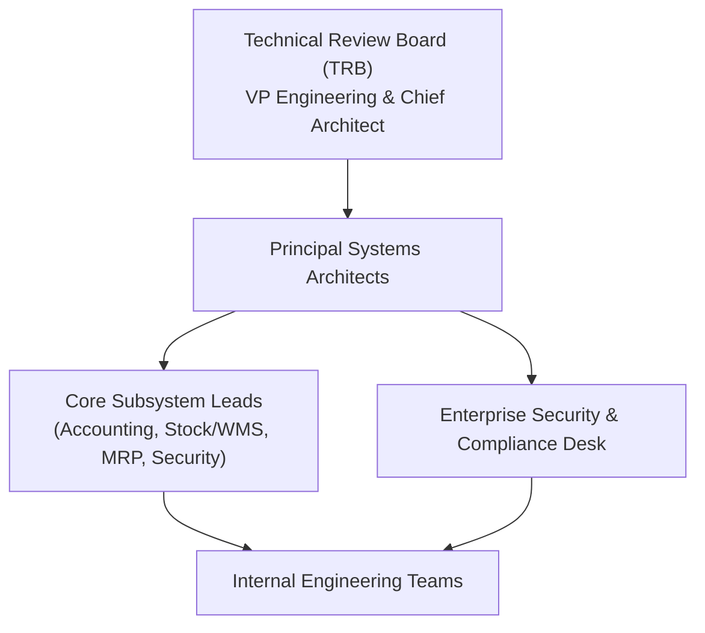
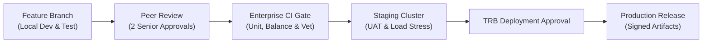

# Enterprise Governance Guide — GoERP Enterprise

This document defines the architectural governance, release engineering lifecycle, intellectual property protection, change management, and service level standards for the **GoERP Enterprise** platform.

---

## 1. Vision & Architecture Philosophy

GoERP Enterprise is engineered to address the operational shortcomings of legacy enterprise systems—specifically excessive resource consumption, fragile runtime dependencies, and unpredictable maintenance overhead:

1. **Single Static Binary**: The application core, 50 business modules, database migration manager, and single-page web client compile into a single static binary. No external runtime environments (Python, Node.js, or Java) are required on target servers.
2. **Minimal Resource Footprint**: The system cold-starts in under 50 milliseconds and maintains an idle memory footprint of approximately 25–30 MB, making it suitable for edge servers, branch locations, and high-density cloud environments.
3. **Double-Entry Equilibrium Invariants**: Both financial transactions ($\sum \text{Debit} = \sum \text{Credit}$) and physical inventory movements (double-entry stock locations) are mathematically verified before database commitment.
4. **Zero-CGO Dual Engine**: Supports pure-Go SQLite for air-gapped branch offices and edge appliances, alongside PostgreSQL for high-concurrency corporate clusters.

---

## 2. Technical Review Board & Governance

GoERP Enterprise engineering adheres to formal corporate governance directed by the **Technical Review Board (TRB)**:

### Roles and Responsibilities
- **Technical Review Board (TRB)**: Approves major architectural shifts, approves data model modifications, and evaluates enterprise scalability roadmaps.
- **Principal Systems Architects**: Maintain stability of `internal/core`, supervise API contract consistency across the OpenAPI 3.1 specification, and authorize cross-module migrations.
- **Core Subsystem Leads**: Maintain domain-specific modules (Accounting, Procurement, Manufacturing, Customs Bonded Zones, HRIS), conduct mandatory code reviews, and guarantee business logic correctness.
- **Enterprise Security & Compliance Desk**: Enforces static code analysis (SAST), software bill-of-materials (SBOM) tracking, vulnerability containment, and compliance auditing (SOC 2, ISO 27001).

### Enterprise Change Request (ECR) Process
Any modification altering public REST/RPC contracts, database schema layouts, or balance invariant rules requires an Enterprise Change Request (ECR):
1. **ECR Submission**: The author submits a technical design proposal outlining business justification, backward-compatibility assessment, risk analysis, and migration scripts.
2. **Architecture Review**: The TRB reviews the proposal against performance benchmarks, data retention rules, and enterprise multi-company isolation invariants.
3. **Staged Implementation**: Upon approval, implementation proceeds on an isolated feature branch with full end-to-end regression tests before staging promotion.

---

## 3. Proprietary Intellectual Property & Licensing Policy

### Proprietary Commercial Licensing
GoERP Enterprise is proprietary and confidential software owned exclusively by GoERP Systems.
- **Commercial Use Only**: Authorized solely for internal enterprise operations under an active commercial license key or Master Services Agreement.
- **No Unauthorized Distribution**: Source code, compiled binaries, database migration scripts, and documentation cannot be redistributed, published, or hosted publicly.
- **Zero Copyleft Contamination**: The introduction of external dependencies licensed under copyleft regimes (e.g., GPL, AGPL) is strictly prohibited across all modules and submodules.

### Internal IP Assignment
All source code, designs, and technical documentation developed by internal engineers and verified commercial contractors are works-for-hire and constitute the exclusive intellectual property of GoERP Systems.

---

## 4. Release Lifecycle & Change Management

GoERP Enterprise follows a rigorous, gated release engineering pipeline designed for zero-downtime corporate deployments:

### Versioning Model
GoERP Enterprise follows Semantic Versioning (`MAJOR.MINOR.PATCH`):
- **MAJOR (`v2.0.0`)**: Substantial architectural paradigm updates with coordinated data migration assistance.
- **MINOR (`v1.83.0`)**: New domain modules, performance enhancements, and non-breaking API expansions.
- **PATCH (`v1.82.1`)**: Security fixes, regression resolutions, and regulatory compliance updates.

### Long-Term Support (LTS) Lifecycle
- **Active LTS Releases**: Supported with monthly maintenance updates and immediate critical security hotfixes for 24 months from the initial minor release date.
- **Maintenance Releases**: Supported with critical security patches for an additional 12 months.

---

## 5. Enterprise SLA & Support Tiers

| Incident Severity | Definition | Initial Response SLA | Target Containment SLA |
| :--- | :--- | :--- | :--- |
| **Severity 1 (Critical)** | Core ERP system down; total financial transaction or warehouse order processing halted with no workaround. | **< 2 hours** | **< 12 hours** (Hotfix or failover) |
| **Severity 2 (High)** | Significant business impact; major domain module (e.g., Invoicing or Customs Filing) impaired with partial workaround. | **< 8 hours** | **< 48 hours** |
| **Severity 3 (Normal)** | Minor defects, non-critical calculation discrepancies, or operational inquiries. | **< 24 hours** | Next scheduled maintenance patch |

### Enterprise Support Escalation
Authorized enterprise administrators should submit incident reports directly through the **Enterprise Customer Portal** or contact the 24/7 dedicated enterprise response desk at `enterprise-support@goerp.internal`.
