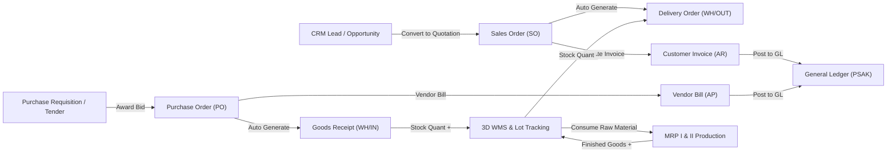

# Dokumentasi Fungsional (Functional Documentation) — GoERP v1.0

## 1. Gambaran Umum Fungsionalitas Bisnis

**GoERP** mengintegrasikan **50 modul fungsional kelas enterprise** ke dalam satu basis data terpadu. Setiap transaksi operasional di satu modul secara otomatis memicu pembaruan di modul terkait (Inventaris, Buku Besar Akuntansi, Pajak, Kepabeanan, dan Jejak Audit) tanpa duplikasi entri manual.

---

## 2. Alur Proses Bisnis End-to-End (Core End-to-End Workflows)

### 2.1 Siklus *Order-to-Cash* (Penjualan, Pengiriman, Penagihan & Kas)
1. **Akuisisi Prospek (CRM)**: Tim penjualan mencatat prospek di pipeline CRM (`new` → `qualified` → `proposition` → `won`) dan mengonversinya menjadi *Sales Quotation* dengan 1 klik.
2. **Konfirmasi Pesanan Penjualan (`sale.order`)**: Saat status diubah dari `draft` menjadi `sale`, sistem secara otomatis:
   - Memotong/mereservasi stok melalui pembuatan dokumen *Delivery Order* (`WH/OUT/xxxxx`) di modul Inventaris.
   - Menghitung PPN 11% secara otomatis pada setiap baris pesanan.
3. **Pengiriman Barang (`stock.picking`)**: Petugas gudang memvalidasi dokumen `WH/OUT`, yang mengurangi saldo `stock.quant` di lokasi `WH/Stock` dan memindahkannya ke `Partners/Customers`.
4. **Faktur & e-Faktur Pajak (`account.move` & `tax_efaktur`)**: Bagian keuangan menerbitkan *Customer Invoice*, mengambil nomor seri faktur pajak (NSFP) otomatis untuk e-Faktur PPN 11%, dan memposting jurnal berpasangan (*Debit Piutang Usaha / Credit Pendapatan & PPN Keluaran*).
5. **Penerimaan Pembayaran & Rekonsiliasi Bank**: Pembayaran pelanggan dicatat melalui `account.payment`, mengubah status faktur menjadi `paid`, dan dicocokkan otomatis dengan mutasi rekening koran di modul *Bank Reconciliation*.

### 2.2 Siklus *Procure-to-Pay* (Pengadaan, Penerimaan Gudang, Landed Cost & Utang)
1. **Permintaan Pembelian & Lelang (`purchase.requisition`)**: Departemen mengajukan kebutuhan barang; bagian pengadaan membuka tender multi-vendor (*Call for Bids*) atau menggunakan kontrak *Blanket Order*.
2. **Persetujuan Berjenjang (`workflow_engine` / `approval`)**: PO bernilai tinggi dievaluasi oleh *BPMN 2.0 Exclusive Gateway* (misal: nilai $\ge \text{Rp } 50\text{ Juta}$ diarahkan ke CFO, $\ge \text{Rp } 500\text{ Juta}$ diarahkan ke CEO).
3. **Penerimaan Barang & Kontrol Mutu (`WH/IN` & `quality`)**: Saat barang tiba dari pemasok, sistem memicu pemeriksaan *Quality Control Point* (QCP). Setelah lulus inspeksi, validasi `WH/IN` menambah saldo stok fisik.
4. **Kapitalisasi Biaya Impor (`landed_cost`)**: Bea masuk, biaya pengangkutan (*freight*), dan asuransi dialokasikan secara proporsional (berdasarkan nilai, berat, atau volume) ke Harga Pokok Persediaan.
5. **Tagihan Vendor & e-Bupot Unifikasi (`tax_ebupot`)**: Atas jasa atau sewa, sistem menerbitkan Bukti Potong PPh 23 / PPh 4(2) secara otomatis dan melunasi utang usaha.

### 2.3 Siklus *Plan-to-Produce* (Manufaktur MRP I & MRP II Shop Floor)
1. **Bill of Materials (`mrp.bom`)**: Mendefinisikan komposisi bahan baku dan komponen untuk setiap produk jadi.
2. **Work Center & Routing (`mrp_advanced`)**: Menentukan stasiun kerja pabrik (*Work Center*), kapasitas jam mesin, biaya operasional per jam, serta urutan tahapan pengerjaan (*Routing*).
3. **Eksekusi Produksi (`mrp.production` & `work.order`)**:
   - Mencatat waktu mulai/selesai aktual di lantai produksi (*Shop Floor*), menghitung metrik **OEE (*Overall Equipment Effectiveness*)** = $\text{Availability} \times \text{Performance} \times \text{Quality}$.
   - Saat selesai, sistem otomatis mengurangi stok bahan baku dari gudang dan menambah stok produk jadi beserta silsilah *Lot/Serial Number* (`traceability`).

### 2.4 Siklus *Hire-to-Retire* (SDM, Presensi, Cuti & Payroll PPh 21 TER)
1. **Rekrutmen Berbasis AI (`recruitment`)**: Pelamar kerja dievaluasi oleh *AI Talent Scorer* berdasarkan kecocokan kualifikasi, dan pelamar terpilih dapat langsung dikonversi menjadi karyawan aktif (*1-Click Hire*).
2. **Presensi Geofencing & Cuti (`attendance` & `leave`)**: Kehadiran dicatat dengan koordinat GPS, deteksi keterlambatan/lembur otomatis, serta integrasi saldo cuti tahunan dan cuti tidak berbayar (*unpaid leave*).
3. **Penggajian & Pajak PPh 21 TER (`payroll`)**:
   - Menghitung gaji pokok, tunjangan tetap/tidak tetap, potongan ketidakhadiran prorata, iuran **BPJS Kesehatan (4% Perusahaan, 1% Karyawan)**, **BPJS Ketenagakerjaan (JHT, JKK, JKM, JP)**, serta **PPh 21 Tarif Efektif Rata-rata (TER Kategori A/B/C sesuai PP 58/2023 & PMK 168/2023)**.
   - Memposting jurnal gaji secara agregat ke Buku Besar Akuntansi.

### 2.5 Kepatuhan Kepabeanan Kawasan Berikat (DJBC CEISA 4.0)
Modul `customs_bonded` memenuhi persyaratan **IT Inventory Kawasan Berikat (PER-09/BC/2014 & PMK 131/PMK.04/2018)**:
- **Pencatatan Dokumen Pabean**: Mendukung **BC 2.3** (Impor ke KB), **BC 4.0** (Pemasukan Lokal TLDDP), **BC 2.5** (Pengeluaran ke Lokal), **BC 2.7** (Antar KB), **BC 4.1** (Pengeluaran Lokal), **BC 2.6.1 / 2.6.2** (Subkontrak), dan **BC 3.0** (Ekspor).
- **4 Laporan Resmi DJBC Real-Time**:
  1. Laporan Pertanggungjawaban Mutasi Bahan Baku & Bahan Penolong.
  2. Laporan Pertanggungjawaban Mutasi Barang Jadi (Hasil Produksi).
  3. Laporan Pertanggungjawaban Mutasi Mesin & Peralatan Perkantoran.
  4. Laporan Pertanggungjawaban Mutasi Barang Reject & Scrap/Limbah.

---

## 3. Spesifikasi Fungsional 50 Modul Enterprise

| No | Nama Modul | Entitas Teknis Utama | Fungsi Bisnis Utama |
| :-: | :--- | :--- | :--- |
| 1 | **Base & Multi-Company** | `res.company`, `res.partner`, `res.users` | Master perusahaan, pelanggan, pemasok, pengguna, dan penomoran dokumen otomatis (`ir.sequence`). |
| 2 | **Product Catalog** | `product.product`, `product.category` | Katalog barang dagang (*storable*), jasa (*service*), dan barang habis pakai (*consumable*). |
| 3 | **Inventory & Stock** | `stock.picking`, `stock.move`, `stock.quant` | Mutasi gudang *double-entry*, transfer internal antar gudang, dan aturan pemesanan ulang otomatis (*Reordering Rules*). |
| 4 | **Sales Management** | `sale.order`, `sale.order.line` | Penawaran harga, konfirmasi pesanan penjualan, integrasi pengiriman dan penagihan. |
| 5 | **Purchase Management** | `purchase.order`, `purchase.order.line` | Permintaan penawaran (RFQ), pesanan pembelian pemasok, dan penerimaan barang. |
| 6 | **Accounting & PSAK** | `account.move`, `account.account`, `account.payment` | Buku besar berpasangan, faktur, pembayaran, Laba Rugi, Neraca, dan Neraca Saldo. |
| 7 | **Manufacturing (MRP I)** | `mrp.bom`, `mrp.production` | Struktur komponen produk (BoM) dan eksekusi perintah kerja produksi. |
| 8 | **Point of Sale (POS)** | `pos.session`, `pos.order` | Kasir ritel cepat, manajemen kas awal/akhir shift, dan struk thermal 80mm. |
| 9 | **Human Resources (HR)** | `hr.department`, `hr.employee` | Struktur organisasi departemen, direktori karyawan, dan kontrak kerja. |
| 10 | **CRM Pipeline** | `crm.lead` | Pelacakan peluang bisnis, probabilitas kemenangan, dan konversi ke Sales Order. |
| 11 | **Project & Timesheet** | `project.project`, `project.task` | Manajemen proyek pelanggan, tahapan tugas Kanban, dan pencatatan jam kerja. |
| 12 | **Chatter & Collaboration** | `mail.message` | Diskusi internal pada dokumen transaksi dan pencatatan riwayat perubahan status. |
| 13 | **Fixed Assets** | `account.asset` | Akuisisi aset tetap, perhitungan penyusutan garis lurus/saldo menurun, dan posting GL. |
| 14 | **Helpdesk Support** | `helpdesk.ticket` | Tiket layanan pelanggan, prioritas eskalasi, dan pemantauan waktu penyelesaian SLA. |
| 15 | **Maintenance Management** | `maintenance.equipment`, `maintenance.request` | Jadwal perawatan berkala (*preventive*) dan perbaikan kerusakan mesin (*corrective*). |
| 16 | **Fleet Management** | `fleet.vehicle`, `fleet.service` | Pemantauan kendaraan operasional, catatan odometer KM, dan biaya servis armada. |
| 17 | **Leave & Time Off** | `hr.leave`, `hr.leave.allocation` | Pengajuan cuti tahunan/sakit/tidak dibayar dan persetujuan manajer. |
| 18 | **Employee Expenses** | `hr.expense`, `hr.expense.sheet` | Klaim pengeluaran perjalanan dinas/operasional karyawan dan penggantian biaya. |
| 19 | **Quality Control (QMS)** | `quality.point`, `quality.check`, `quality.alert` | Pemeriksaan mutu penerimaan/produksi dan tindakan korektif-preventif (CAPA). |
| 20 | **Approval Matrix** | `approval.rule`, `approval.request` | Aturan otorisasi dokumen berdasarkan ambang nilai transaksi dan jabatan. |
| 21 | **Attachments & R2 OCR** | `ir.attachment` | Penyimpanan berkas cloud R2 dan ekstraksi data struk belanja otomatis dengan AI Vision. |
| 22 | **Edge Attendance** | `hr.attendance`, `hr.shift` | Presensi masuk/pulang dengan validasi lokasi GPS dan analisis keterlambatan. |
| 23 | **AI Recruitment** | `hr.job`, `hr.applicant` | Pembukaan lowongan, penilaian CV otomatis dengan AI, dan konversi pelamar ke karyawan. |
| 24 | **Stock Opname** | `stock.inventory` | Perhitungan fisik stok gudang, penyesuaian selisih, dan audit penyusutan (*shrinkage*). |
| 25 | **Enterprise Payroll** | `hr.payslip`, `hr.salary.rule` | Penggajian massal, perhitungan PPh 21 TER & BPJS otomatis, serta slip gaji elektronik. |
| 26 | **Budget & Analytic** | `account.budget`, `account.analytic.account` | Anggaran tahunan per pusat biaya (*cost center*) dan analisis varians realisasi vs anggaran. |
| 27 | **Barcode & Lot Engine** | `stock.production.lot` | Pembuatan label barcode SVG Code 128 dan pelacakan nomor seri/lot kedaluwarsa. |
| 28 | **Purchase Requisition** | `purchase.requisition`, `purchase.bid` | Lelang pengadaan multi-pemasok, matriks perbandingan harga, dan kontrak payung. |
| 29 | **Multi-Currency (Forex)** | `res.currency.rate`, `account.currency.revaluation` | Pembaruan kurs mata uang asing dan jurnal laba/rugi selisih kurs (PSAK 10). |
| 30 | **Tax e-Faktur DJP** | `account.tax.nsfp`, `account.tax.invoice` | Pengelolaan jatah NSFP, Faktur Pajak Keluaran/Masukan, dan ekspor CSV SPT Masa PPN 1111. |
| 31 | **Bank Reconciliation** | `account.bank.statement` | Impor mutasi rekening koran BCA/Mandiri/BRI dan pencocokan otomatis dengan buku besar. |
| 32 | **Landed Cost** | `stock.landed.cost` | Pembebanan biaya kepabeanan dan logistik impor ke nilai valuasi persediaan barang. |
| 33 | **Lot Traceability** | `stock.lot.trace`, `stock.lot.recall` | Pelacakan rantai pasok hulu ke hilir dan manajemen penarikan produk cacat (*product recall*). |
| 34 | **Subscription & SaaS** | `sale.subscription` | Kontrak berlangganan bulanan/tahunan, perhitungan MRR/ARR, dan faktur berulang otomatis. |
| 35 | **Immutable Audit Trail** | `audit.log.entry` | Rekaman forensik setiap penambahan/perubahan/penghapusan data beserta nilai sebelum & sesudah. |
| 36 | **Outbound Webhooks** | `webhook.subscription`, `webhook.delivery` | Pengiriman notifikasi event real-time ke sistem luar dengan tanda tangan HMAC-SHA256. |
| 37 | **Inbound Webhooks** | `inbound.webhook.endpoint`, `inbound.webhook.log` | Penerima callback otomatis dari payment gateway (Midtrans/Xendit) dan marketplace. |
| 38 | **Intercompany Holding** | `intercompany.group`, `consolidation.run` | Sinkronisasi transaksi antar anak perusahaan dan eliminasi jurnal konsolidasi holding. |
| 39 | **Corporate Treasury** | `treasury.bank.account`, `cash.flow.forecast` | Pemantauan posisi kas likuid multi-bank, proyeksi arus kas 13 minggu, dan *cash sweeping*. |
| 40 | **Advanced MRP II** | `mrp.workcenter`, `mrp.routing`, `mrp.workorder` | Penjadwalan mesin pabrik, pelacakan operasi lantai produksi, dan perhitungan skor OEE. |
| 41 | **Tax e-Bupot Unifikasi** | `tax.ebupot.slip`, `tax.ebupot.period` | Pembuatan bukti potong PPh 21/23/26/4(2) dan pelaporan SPT Masa PPh Unifikasi. |
| 42 | **Digital Signature** | `esignature.request` | Penandatanganan dokumen kontrak secara kriptografis (SHA-256) dan pembubuhan e-Meterai. |
| 43 | **3D WMS Gudang** | `wms.zone`, `wms.bin.location`, `wms.wave.picking` | Manajemen koordinat lorong-rak-ambalan-bin 3D, aturan *putaway* FEFO/FIFO, dan *wave picking*. |
| 44 | **Vendor Portal** | `vendor.portal.account`, `vendor.asn` | Portal mandiri bagi pemasok untuk memasukkan penawaran tender, surat jalan ASN, dan tagihan. |
| 45 | **Customer Portal B2B** | `customer.portal.account`, `customer.rma` | Portal mandiri bagi pelanggan grosir untuk memesan barang, mengajukan retur RMA, dan konfirmasi bayar. |
| 46 | **Customs Bonded Zone** | `customs.document`, `customs.it.inventory` | Kepatuhan kawasan berikat DJBC CEISA 4.0, SPPB, subkontrak, dan 4 laporan mutasi IT Inventory. |
| 47 | **Low-Code Studio** | `lowcode.custom.model`, `lowcode.custom.field` | Pembuatan model data kustom, kolom dinamis EAV, ekstensi entitas standar, dan AI Schema Copilot. |
| 48 | **Printable Reports** | `reports.engine` | Pencetakan dokumen resmi berformat A4 (SO, PO, Invoice, Surat Jalan, Slip Gaji, P&L) & struk kasir. |
| 49 | **BPMN Workflow Engine** | `workflow.definition`, `workflow.instance` | Mesin state machine BPMN 2.0 visual dengan *conditional gateway* dan pelacakan SLA persetujuan. |
| 50 | **Integration Hub** | `integration.api.key`, `integration.connector` | Gateway Open RPC universal, manajemen kunci API M2M, konektor marketplace, dan pekerjaan Batch ETL. |

---

## 6. Fitur Continuous Improvement & Produktivitas Eksekutif

Untuk mempercepat alur kerja harian pengguna pada sistem dengan 50 modul enterprise, tersedia fitur produktivitas terpadu:

1. **Universal Command Palette & Omni-Search (`Ctrl+K`)**:
   - Memungkinkan pengguna mencari dan melompat ke modul mana pun dari 50 modul ERP, mengeksekusi tindakan cepat (*Quick Actions*), serta mencari dokumen transaksi (`SO`, `PO`, `INV`), produk (`SKU`), maupun mitra bisnis secara instan dari satu jendela komando.
2. **Filter Cepat Sidebar 50 Modul (`/` Shortcut)**:
   - Kolom pencarian instan di bagian atas menu *sidebar* untuk menyaring daftar 50 modul secara *real-time* beserta indikator jumlah modul aktif.
3. **1-Click Business Cycle Simulator (O2C & P2P)**:
   - Tombol simulasi otomatis pada Executive Dashboard yang menjalankan alur *Procure-to-Pay* (PO $\rightarrow$ Penerimaan Gudang `WH/IN`) dan *Order-to-Cash* (SO $\rightarrow$ Pengiriman `WH/OUT` $\rightarrow$ Posting Faktur & Jurnal Buku Besar `INV`) dalam satu klik beserta laporan jejak audit 5 langkah.
4. **Actionable Notification & Approval Center (`🔔`)**:
   - Lonceng notifikasi pintar di *header* atas yang menampilkan jumlah antrean persetujuan (*Approvals*), *workflow* BPMN aktif, dokumen *draft*, dan peringatan audit keamanan dengan navigasi 1-klik ke modul tujuan.
5. **Executive Financial Pulse Strip & Peta Kesehatan 50 Modul**:
   - Menampilkan metrik likuiditas kas/bank, Piutang Usaha (*AR*), Hutang Usaha (*AP*), *CRM Pipeline Revenue*, *Subscription MRR*, tabel transaksi terkini (*Live Feed*), serta matriks kesehatan 8 departemen utama.
6. **Mode Tema Gelap / Terang (*Dark / Light Enterprise Theme*)**:
   - Sakelar tema tampilan (`☀️ Light` / `🌙 Dark`) di bagian *header* yang disimpan secara persisten di browser pengguna.
