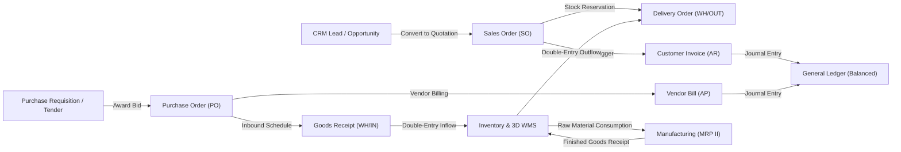

# Functional Specification — GoERP

This document details the functional architecture, business process models, state transitions, and transactional invariants governing the GoERP platform.

---

## 1. Integrated Business Architecture

GoERP unifies enterprise operational workflows across commerce, supply chain, manufacturing, finance, human resources, and compliance into a singular transactional data model. Every business event automatically triggers necessary accounting, inventory, and audit updates without manual re-entry.



---

## 2. End-to-End Business Cycles

### 2.1 Order-to-Cash (O2C)

The Order-to-Cash cycle manages the progression from sales lead to cash realization:

```
[Lead/Opportunity] -> [Sales Quotation] -> [Confirmed Sale] -> [Warehouse Delivery] -> [Customer Invoice] -> [Payment & Reconciliation]
```

1. **Lead Qualification & Quotation (`crm.lead` -> `sale.order`)**:
   - Sales opportunities transition across pipeline stages (`new` -> `qualified` -> `proposition` -> `won`).
   - A won opportunity converts to a `DRAFT` sales quotation, inheriting line items, customer currency, and delivery address.
2. **Order Confirmation (`sale.order`)**:
   - Confirming an order transitions its state to `SALE`.
   - The inventory engine evaluates product configuration and creates an associated Delivery Order (`WH/OUT/xxxxx`) with stock reservation.
   - Taxes (e.g., standard 11% VAT) are locked at order confirmation.
3. **Fulfillment & Stock Relief (`stock.picking`)**:
   - Warehouse personnel validate the picking document upon dispatch.
   - The system performs atomic double-entry stock moves from the internal warehouse location (`WH/Stock`) to the partner customer location (`Partners/Customers`).
   - If perpetual inventory valuation is enabled, an automated Cost of Goods Sold (COGS) journal entry posts:
     $$\text{Debit: Cost of Goods Sold} \quad / \quad \text{Credit: Inventory Asset}$$
4. **Invoicing & e-Faktur Issuance (`account.move` & `tax_efaktur`)**:
   - Customer invoices are generated based on ordered or delivered quantities.
   - The invoice transitions from `DRAFT` to `POSTED`, generating balanced general ledger lines:
     $$\text{Debit: Accounts Receivable} \quad / \quad \text{Credit: Revenue} \quad / \quad \text{Credit: Output VAT Payable}$$
   - An official Electronic Tax Invoice number (NSFP) is assigned sequentially from the authorized quota.
5. **Cash Receipt & Settlement (`account.payment`)**:
   - Customer payments are recorded against the posted invoice, reducing open receivables and updating liquid bank accounts.
   - Bank statement imports (CSV) utilize multi-attribute matching (amount, reference, dates) to reconcile statements against recorded payments.

---

### 2.2 Procure-to-Pay (P2P)

The Procure-to-Pay cycle manages material procurement, receiving, landed cost capitalization, and supplier payment:

```
[Purchase Requisition] -> [RFQ / Tender] -> [Purchase Order] -> [Inbound Goods Receipt] -> [3-Way Match & Bill] -> [Disbursement]
```

1. **Requisitions & Multi-Vendor Tenders (`purchase.requisition`)**:
   - Internal departments submit purchase requisitions for goods, services, or capital assets.
   - Procurement aggregates requisitions into competitive tender calls (*Call for Bids*) or executes against pre-negotiated blanket purchase agreements.
2. **Purchase Order Authorization (`purchase.order` & `approval.request`)**:
   - Vendor quotes are compared, and winning bids convert to a formal Purchase Order.
   - If the total order amount exceeds departmental approval thresholds, the document automatically enters a multi-tier approval workflow.
3. **Goods Receiving & Quality Inspection (`stock.picking` & `quality.check`)**:
   - On delivery, warehouse staff inspect incoming shipments against the PO.
   - Quality control points (QCP) enforce physical and quantitative tolerance checks. Passing lots increase warehouse stock (`WH/IN/xxxxx`) and update inventory valuation layers.
4. **Landed Cost Capitalization (`stock.landed.cost`)**:
   - External expenditures associated with inbound shipments (freight charges, customs import duties, terminal handling fees, cargo insurance) are captured.
   - Costs are proportionally distributed across received items by value, quantity, weight, or volume, retroactively adjusting inventory valuation:
     $$\text{Debit: Inventory Valuation Layer} \quad / \quad \text{Credit: Freight / Tariff Accrual}$$
5. **3-Way Matching & Bill Posting (`account.move`)**:
   - Vendor bills are matched against the original Purchase Order and the validated Goods Receipt.
   - Discrepancies exceeding allowable quantity or price tolerances halt posting until reviewed.
   - Withholding taxes (e.g., PPh 23 / PPh 4(2)) are calculated and withheld from the vendor payable.

---

### 2.3 Plan-to-Produce (MRP I & MRP II)

The Plan-to-Produce cycle governs production planning, component consumption, and finished goods assembly:

```
[Sales Forecast / Demand] -> [Production Planning] -> [Bill of Materials Explosion] -> [Work Order Execution] -> [Finished Goods Receipt]
```

1. **Bill of Materials (`mrp.bom`)**:
   - Supports multi-level hierarchical assemblies, phantom assemblies, and component scrap allowances.
   - Defines standard routing operations assigned to specific machine work centers.
2. **Work Center Management (`mrp.workcenter`)**:
   - Tracks operational capacities, machine hourly operating costs, labor costs, and efficiency factors.
   - Captures Overall Equipment Effectiveness (OEE) metrics:
     $$\text{OEE} = \text{Availability} \times \text{Performance} \times \text{Quality}$$
3. **Production Order Execution (`mrp.production` & `mrp.workorder`)**:
   - Issuing a production order reserves component inventory.
   - Shop floor operators log start, pause, and completion timestamps on active work orders.
   - Validation atomically consumes component materials from raw inventory and registers completed units into finished goods stock, maintaining complete forward and backward lot genealogy.

---

### 2.4 Hire-to-Retire (H2R)

The Hire-to-Retire cycle manages the complete employee lifecycle, time tracking, and statutory payroll:

```
[Job Requisition] -> [Candidate Pipeline] -> [Onboarding] -> [Attendance & Leave] -> [Monthly Payroll] -> [General Ledger Posting]
```

1. **Employee Master & Contracts (`hr.employee` & `hr.contract`)**:
   - Stores employee profiles, organizational hierarchies, job titles, and compensation terms.
2. **Time & Attendance Tracking (`hr.attendance` & `hr.leave`)**:
   - Captures clock-in and clock-out timestamps with optional GPS geofencing.
   - Enforces shift scheduling rules, computes overtime hours, and tracks annual, sick, and unpaid leave balances.
3. **Payroll Calculation & Statutory Deductions (`hr.payslip`)**:
   - Evaluates base salaries, variable allowances, attendance penalties, and overtime.
   - Calculates mandatory social security contributions (BPJS Ketenagakerjaan for pensions, retirement, and workplace injury; BPJS Kesehatan for healthcare).
   - Computes progressive personal income tax withholdings.
   - Posts balanced composite payroll expense and liability journals into the General Ledger:
     $$\text{Debit: Salary & Benefit Expense} \quad / \quad \text{Credit: Withholding Tax Payable} \quad / \quad \text{Credit: Social Security Payable} \quad / \quad \text{Credit: Net Wages Payable}$$

---

### 2.5 Customs & Bonded Zones (CEISA)

GoERP provides specialized regulatory IT inventory tracking compliant with bonded zone regulations:

- **Customs Declaration Lifecycle**: Supports inbound declarations (BC 2.3, BC 4.0), inter-bonded transfers (BC 2.7), domestic clearances (BC 2.5), subcontracting (BC 2.6.1/2), and export declarations (BC 3.0).
- **Mandatory Mutation Ledgers**:
  1. Raw Materials & Consumables Ledger
  2. Finished Goods (Production Output) Ledger
  3. Machinery, Capital Equipment & Asset Ledger
  4. Scrap, Waste & Defective Material Ledger
- **Clearance Permit (SPPB) Validation**: Goods cannot leave or enter bonded areas without recorded authorization permits, preventing customs non-compliance.

---

## 3. Financial Invariants & Data Integrity

GoERP strictly enforces foundational accounting and inventory invariants across all transactions:

### 3.1 Double-Entry Balance Invariant
Every journal entry (`account.move`) must satisfy the zero-sum balance rule prior to posting:
$$\sum_{i=1}^{n} \text{Debit}_i - \sum_{i=1}^{n} \text{Credit}_i = 0$$
Any transaction where debits do not match credits is rejected at the database transaction layer.

### 3.2 Inventory Mass Conservation
Every physical stock adjustment must be modeled as a transfer between two distinct locations:
- Standard transfers: $\text{Source Location} \rightarrow \text{Destination Location}$.
- Inventory write-downs or shrinkage: $\text{Internal Location} \rightarrow \text{Virtual Loss Location}$.
- Initial inventory intake: $\text{Virtual Inventory Location} \rightarrow \text{Internal Location}$.
This guarantees that inventory quantities across the global location tree are mathematically conserved.

### 3.3 Foreign Exchange Revaluation (IAS 21 / PSAK 10)
- Transactions recorded in foreign currencies record both the transactional foreign currency amount and the base company currency equivalent using active daily spot rates.
- At financial period close, open foreign currency monetary assets and liabilities are revalued using the period-end spot rate.
- Unrealized gains or losses are automatically recognized:
  $$\text{Unrealized Gain/Loss} = \text{Amount}_{\text{FC}} \times (\text{Rate}_{\text{Close}} - \text{Rate}_{\text{Original}})$$

---

## 4. Functional Entity Catalog

| Domain | Primary Entities | Business Responsibilities |
| :--- | :--- | :--- |
| **Organization** | `res.company`, `res.partner`, `res.users` | Multi-company hierarchy, customer/vendor partners, user accounts, and sequence numbering. |
| **Catalog** | `product.product`, `product.category`, `uom.uom` | Product templates, variants, standard costs, sale prices, and unit conversions. |
| **Inventory** | `stock.warehouse`, `stock.location`, `stock.move`, `stock.quant` | Double-entry stock transfers, physical bin management, lot tracking, and reorder points. |
| **Sales** | `sale.order`, `sale.order.line` | Commercial quotations, order confirmations, pricing agreements, and delivery triggers. |
| **Procurement** | `purchase.order`, `purchase.order.line`, `purchase.requisition` | RFQ generation, multi-tier purchase approvals, vendor contracts, and receipt tracking. |
| **Accounting** | `account.account`, `account.move`, `account.payment` | Chart of Accounts, general ledger journals, customer invoicing, vendor bills, and financial statements. |
| **Manufacturing** | `mrp.bom`, `mrp.production`, `mrp.workcenter`, `mrp.workorder` | Multi-level BoMs, work centers, routing steps, shop floor work order tracking, and OEE. |
| **Human Resources** | `hr.employee`, `hr.department`, `hr.attendance`, `hr.payslip` | Employee records, geofenced time attendance, leave allocations, and payroll processing. |
| **Customs** | `customs.document`, `customs.it.inventory` | Bonded zone declarations (BC 2.3 - 4.1), clearance permits (SPPB), and regulatory IT inventory ledgers. |
| **Workflows** | `workflow.definition`, `workflow.instance`, `workflow.task` | Visual BPMN 2.0 approval processes, conditional gateways, and task inboxes. |
| **Extensibility** | `lowcode.model`, `lowcode.field`, `integration.api.key` | Runtime dynamic entities, custom fields, and M2M API key management. |
