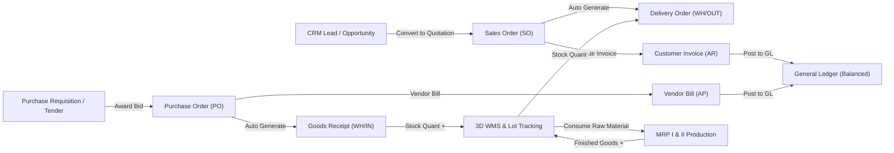

# Functional Documentation — GoERP v1.0

## 1. Business Functionality Overview

**GoERP** unifies **50 enterprise-grade functional modules** into a single cohesive data model and transaction engine. Every business transaction in one module automatically cascades updates across corresponding modules (Inventory, General Ledger, Tax Compliance, Customs Bonded Zones, and Audit Trails) eliminating duplicate manual data entry.

---

## 2. Core End-to-End Business Workflows

### 2.1 Order-to-Cash Cycle (Sales, Delivery, Invoicing & Cash Collections)
1. **Lead Acquisition & CRM Pipeline**: Sales representatives qualify prospects across CRM pipeline stages (`new` → `qualified` → `proposition` → `won`) and convert won opportunities into official Sales Quotations with 1 click.
2. **Sales Order Confirmation (`sale.order`)**: When confirmed (`state` transitions from `draft` to `sale`), the system automatically:
   - Reserves stock and generates an associated *Delivery Order* (`WH/OUT/xxxxx`) in the Warehouse module.
   - Computes standard 11% Value Added Tax (VAT) on line items.
3. **Goods Dispatch & Delivery (`stock.picking`)**: Warehouse personnel validate the `WH/OUT` document, which deducts on-hand quantities from `WH/Stock` and transfers them to `Partners/Customers` via double-entry stock moves.
4. **Invoicing & e-Faktur Integration (`account.move` & `tax_efaktur`)**: Finance issues a Customer Invoice, allocates official tax serial numbers (NSFP), generates electronic tax invoices (e-Faktur), and posts balanced GL entries (*Debit Accounts Receivable / Credit Sales Revenue & Output VAT*).
5. **Cash Collections & Bank Reconciliation**: Incoming customer payments are registered via `account.payment`, settling invoice balances and enabling automated algorithmic matching against uploaded bank statements in the *Bank Reconciliation* module.

### 2.2 Procure-to-Pay Cycle (Purchasing, Inbound Receiving, Landed Costs & Accounts Payable)
1. **Requisitions & Multi-Vendor Tenders (`purchase.requisition`)**: Internal departments raise material requests; procurement issues competitive RFQ tenders (*Call for Bids*) or draws against approved *Blanket Orders*.
2. **Multi-Level Approval Matrix (`workflow_engine` / `approval`)**: Purchase orders exceeding organizational thresholds trigger conditional BPMN 2.0 evaluation (e.g., $\ge \$5,000$ escalates to Finance Manager, $\ge \$50,000$ escalates to Executive Director).
3. **Inbound Receiving & Quality Inspection (`WH/IN` & `quality`)**: Upon vendor delivery, the system initiates Quality Control Point (QCP) inspections. Passing items are confirmed via `WH/IN` validation, increasing warehouse inventory.
4. **Landed Cost Capitalization (`landed_cost`)**: Inbound freight charges, customs import duties, terminal fees, and cargo insurance are proportionally allocated (by value, quantity, weight, or volume) into the inventory valuation layer.
5. **Vendor Bills & Tax Withholding (`tax_ebupot`)**: Vendor invoices for contracted services automatically generate withholding tax slips (PPh 23 / PPh 4(2)) before final cash disbursement.

### 2.3 Plan-to-Produce Cycle (Manufacturing MRP I & MRP II Shop Floor Control)
1. **Bill of Materials (`mrp.bom`)**: Defines multi-level raw material component structures, scrap percentages, and assembly formulas for finished goods.
2. **Work Centers & Routing Operations (`mrp_advanced`)**: Configures production work centers, machine hourly capacities, labor operating costs, and sequential operation routings.
3. **Shop Floor Production Execution (`mrp.production` & `work.order`)**:
   - Captures real-time work order tracking on the shop floor and tracks **OEE (Overall Equipment Effectiveness)** metrics = $\text{Availability} \times \text{Performance} \times \text{Quality}$.
   - Upon completion, raw materials are atomically consumed from inventory and finished goods are received into stock accompanied by full lot/serial genealogy (`traceability`).

### 2.4 Hire-to-Retire Cycle (HRIS, Attendance, Leave & Enterprise Payroll)
1. **AI-Assisted Recruitment (`recruitment`)**: Candidates are evaluated by an automated AI Talent Scorer against job descriptions; shortlisted applicants convert to active employees via 1-Click Hire.
2. **GPS Geofenced Attendance & Leave (`attendance` & `leave`)**: Employee time-tracking enforces GPS geofencing and shift schedules, computing tardiness and overtime while factoring in approved annual leave and unpaid absence.
3. **Enterprise Payroll Execution (`payroll`)**:
   - Computes base salaries, position allowances, meal and transport benefits, statutory social security (BPJS Ketenagakerjaan & BPJS Kesehatan), and progressive payroll tax withholding.
   - Automatically posts aggregated salary expense and withholding liability journals into the General Ledger.

### 2.5 Customs Bonded Zone Compliance (DJBC CEISA 4.0 / IT Inventory)
The `customs_bonded` module adheres to official bonded zone IT inventory reporting requirements:
- **Customs Declaration Documentation**: Supports Inbound Raw Materials, Domestic Inbound, Domestic Finished Goods Outbound, Inter-Bonded Transfers, Subcontracting Inbound/Outbound, and Export Declarations.
- **4 Real-Time Official IT Inventory Mutation Ledgers**:
  1. Accountability Ledger for Raw Materials & Consumables.
  2. Accountability Ledger for Finished Goods (Production Output).
  3. Accountability Ledger for Machinery, Capital Equipment & Office Assets.
  4. Accountability Ledger for Scrap, Waste & Rejected Materials.

---

## 3. Functional Specifications of 50 Enterprise Modules

| No | Module Name | Primary Technical Entities | Core Business Responsibilities |
| :-: | :--- | :--- | :--- |
| 1 | **Base & Multi-Company** | `res.company`, `res.partner`, `res.users` | Master company structures, customer/vendor partners, user authentication, and document sequence auto-numbering (`ir.sequence`). |
| 2 | **Product Catalog** | `product.product`, `product.category` | Product master data supporting storable goods, services, and consumable items with units of measure (UoM). |
| 3 | **Inventory & Stock** | `stock.picking`, `stock.move`, `stock.quant` | Double-entry warehouse stock moves, multi-warehouse routing, internal transfers, and automated reordering rules. |
| 4 | **Sales Management** | `sale.order`, `sale.order.line` | Sales quotations, order confirmation, automated delivery order generation, and customer invoicing hooks. |
| 5 | **Purchase Management** | `purchase.order`, `purchase.order.line` | Requests for Quotation (RFQ), vendor purchase orders, and automated inbound goods receipt (`WH/IN`). |
| 6 | **Accounting & General Ledger** | `account.move`, `account.account`, `account.payment` | Double-entry general ledger, customer/vendor invoices, payments, P&L, Balance Sheet, and Trial Balance. |
| 7 | **Manufacturing (MRP I)** | `mrp.bom`, `mrp.production` | Multi-level Bill of Materials (BoM), manufacturing orders, component consumption, and finished goods creation. |
| 8 | **Point of Sale (POS)** | `pos.session`, `pos.order` | Cashier shifts, cash in/out reconciliation, instant multi-payment retail checkout, and 80mm thermal receipt printing. |
| 9 | **Human Resources (HR)** | `hr.department`, `hr.employee` | Department organization hierarchy, employee directories, and job position definitions. |
| 10 | **CRM Pipeline** | `crm.lead` | Sales lead tracking, opportunity stage qualification, expected revenue calculation, and 1-click quotation conversion. |
| 11 | **Project & Timesheet** | `project.project`, `project.task` | Client projects, Kanban task stages, planned vs actual hours tracking, and analytical employee timesheets. |
| 12 | **Chatter & Collaboration** | `mail.message` | Document-level audit trail logging, internal team collaboration, and status history notes. |
| 13 | **Fixed Assets** | `account.asset` | Asset registry, straight-line and declining depreciation calculation boards, and automated GL posting. |
| 14 | **Helpdesk Support** | `helpdesk.ticket` | Customer support ticket intake, tiered priority queues, support team routing, and SLA resolution tracking. |
| 15 | **Maintenance Management** | `maintenance.equipment`, `maintenance.request` | Plant machinery registry, automated preventive maintenance scheduling, and corrective breakdown work orders. |
| 16 | **Fleet Management** | `fleet.vehicle`, `fleet.service` | Vehicle fleet registry, driver assignments, periodic odometer tracking, and scheduled maintenance history. |
| 17 | **Leave & Time Off** | `hr.leave`, `hr.leave.allocation` | Annual leave quota allocations, multi-tiered leave requests, and payroll deduction integration. |
| 18 | **Employee Expenses** | `hr.expense`, `hr.expense.sheet` | Expense receipt claims, multi-item expense report submissions, managerial approvals, and automated GL reimbursement journals. |
| 19 | **Quality Control (QMS)** | `quality.point`, `quality.check`, `quality.alert` | Quality control points (incoming, production, outgoing), quantitative tolerance checks, and CAPA non-conformance alerts. |
| 20 | **Approval Matrix** | `approval.rule`, `approval.request` | Multi-tier authorization matrix governed by transaction amount thresholds, departments, and roles. |
| 21 | **Attachments & R2 OCR** | `ir.attachment` | Universal file attachments backed by Cloudflare R2 / local disk with integrated AI Vision receipt OCR. |
| 22 | **Edge Attendance** | `hr.attendance`, `hr.shift` | GPS geofenced check-in/out, work shift policies, Cloudflare edge telemetry anti-fraud, and automated payroll sync. |
| 23 | **AI Recruitment** | `hr.job`, `hr.applicant` | Job openings, recruitment pipeline, AI CV screening and scoring, and 1-click hire to active employee directory. |
| 24 | **Stock Opname** | `stock.inventory` | Physical stocktaking, automated book quant snapshots, physical count entry, AI shrinkage audit, and GL variance posting. |
| 25 | **Enterprise Payroll** | `hr.payslip`, `hr.salary.rule` | Multi-tier salary structures, dynamic salary computation rules, statutory deductions, batch payroll runs, and GL posting. |
| 26 | **Budget & Analytic** | `account.budget`, `account.analytic.account` | Corporate operational budgets (RKAB), cost center tracking, real-time GL practical spend variance, and AI burn-rate alerts. |
| 27 | **Barcode & Lot Engine** | `stock.production.lot` | Pure-Go SVG Code 128 barcode generator, lot/serial batch tracking, expiration dates, and context-aware mobile scanner. |
| 28 | **Purchase Requisition** | `purchase.requisition`, `purchase.bid` | Internal purchase requests, competitive multi-vendor tender auctions (*Call for Bids*), and blanket supply contracts. |
| 29 | **Multi-Currency (Forex)** | `res.currency.rate`, `account.currency.revaluation` | Multi-currency transactions, daily spot rate tables, realized exchange gain/loss, and month-end unrealized FX revaluation. |
| 30 | **Tax e-Faktur Engine** | `account.tax.nsfp`, `account.tax.invoice` | Tax serial number (NSFP) management, 11% VAT e-Faktur issuance, QR verification codes, and periodic VAT return exports. |
| 31 | **Bank Reconciliation** | `account.bank.statement` | Multi-bank CSV statement parser, multi-tier algorithmic auto-matching engine, and 1-click ledger reconciliation. |
| 32 | **Landed Cost** | `stock.landed.cost` | Capitalization of freight, customs, and port handling charges into inventory valuation across 5 allocation methods. |
| 33 | **Lot Traceability** | `stock.lot.trace`, `stock.lot.recall` | End-to-end upstream and downstream supply chain lot genealogy, batch tracking, and product recall management. |
| 34 | **Subscription & SaaS** | `sale.subscription` | Recurring customer subscriptions, automated billing cycles, MRR/ARR analytics, and AI churn risk forecasting. |
| 35 | **Immutable Audit Trail** | `audit.log.entry` | Forensic audit log capturing deep before-and-after JSON diffs, user attribution, and suspicious activity detection. |
| 36 | **Outbound Webhooks** | `webhook.subscription`, `webhook.delivery` | Real-time event notifications delivered to external endpoints with HMAC-SHA256 signature security and retry policies. |
| 37 | **Inbound Webhooks** | `inbound.webhook.endpoint`, `inbound.webhook.log` | Omnichannel webhook ingestion for payments (Midtrans, Xendit, Stripe), e-commerce marketplaces, and logistics partners. |
| 38 | **Intercompany Holding** | `intercompany.group`, `consolidation.run` | Multi-company holding hierarchy, automated sales/purchase order mirroring, and intercompany elimination consolidation. |
| 39 | **Corporate Treasury** | `treasury.bank.account`, `cash.flow.forecast` | Multi-bank account liquidity monitoring, 13-week rolling cash flow projections, and automated cash sweep transfers. |
| 40 | **Advanced MRP II** | `mrp.workcenter`, `mrp.routing`, `mrp.workorder` | Industrial work center capacity, sequential routing operations, shop floor tracking, and Overall Equipment Effectiveness (OEE). |
| 41 | **Tax e-Bupot Unifikasi** | `tax.ebupot.slip`, `tax.ebupot.period` | Unified withholding tax calculation slips, periodic withholding ledgers, and consolidated tax return exports. |
| 42 | **Digital Signature** | `esignature.request` | Cryptographic document signing workflows (SHA-256), signer verification trails, and digital stamp duty integration. |
| 43 | **3D Warehouse WMS** | `wms.zone`, `wms.bin.location`, `wms.wave.picking` | 3D bin coordinates (Aisle/Rack/Shelf/Bin), FEFO/FIFO putaway strategies, pick paths, and consolidated wave picking. |
| 44 | **Vendor Portal** | `vendor.portal.account`, `vendor.asn` | Self-service portal for suppliers: tender bid submissions, advance shipping notices (ASN), and invoice tracking. |
| 45 | **Customer Portal B2B** | `customer.portal.account`, `customer.rma` | Self-service B2B portal: wholesale catalogs, online ordering, return merchandise authorization (RMA), and payment proofs. |
| 46 | **Customs Bonded Zone** | `customs.document`, `customs.it.inventory` | Bonded zone compliance (inbound, outbound, subcontracting), customs clearance permits, and 4 real-time IT inventory ledgers. |
| 47 | **Low-Code Studio** | `lowcode.custom.model`, `lowcode.custom.field` | Dynamic model and field creation (EAV), core entity extensions, and conversational AI Schema Copilot. |
| 48 | **Printable Reports** | `reports.engine` | Corporate A4 print layouts (SO, PO, Invoices, Delivery Slips, Payslips, Financial Statements) and 80mm POS receipts. |
| 49 | **BPMN Workflow Engine** | `workflow.definition`, `workflow.instance` | Visual BPMN 2.0 state machine engine, conditional decision gateways, user task approval inboxes, and SLA timers. |
| 50 | **Universal Integration Hub**| `integration.api.key`, `integration.connector` | M2M API key management, Open RPC gateway, pre-built marketplace/payment connectors, and scheduled batch ETL pipelines. |

---

## 4. Continuous Improvement & Executive Productivity Features

To maximize operational throughput across all 50 enterprise modules, GoERP incorporates a comprehensive suite of executive productivity tools:

1. **Universal Command Palette & Omni-Search (`Ctrl+K`)**:
   - Enables users to instantly search across all 50 ERP modules, execute quick actions, and look up live database records (`SO`, `PO`, `INV`, `SKU`, and business partners) from a unified dialog with a 120ms debounce.
2. **Instant 50-Module Sidebar Filter (`/` Shortcut)**:
   - Real-time search filter situated at the top of the navigation sidebar allowing instant keyword filtering across all 50 modules with a live active module counter.
3. **1-Click Business Cycle Simulator (O2C & P2P)**:
   - Automated workflow simulator on the Executive Dashboard that executes a complete *Procure-to-Pay* (`PO` $\rightarrow$ `WH/IN`) and *Order-to-Cash* (`SO` $\rightarrow$ `WH/OUT` $\rightarrow$ `INV` balanced GL posting) cycle in a single click with an interactive 5-step audit log.
4. **Actionable Notification & Approval Center (`🔔`)**:
   - Intelligent notification bell in the top navigation bar displaying real-time actionable approval queues, active BPMN workflow tasks, draft documents, and suspicious audit alerts with 1-click navigation to target modules.
5. **Executive Financial Pulse Strip & 50-Module Ecosystem Health Matrix**:
   - Live KPI overview displaying Treasury cash and bank balances, Accounts Receivable (AR), Accounts Payable (AP), CRM Pipeline revenue, Subscription MRR, a live transaction activity feed, and a multi-departmental health matrix.
6. **Dark / Light Enterprise Theme Modes**:
   - Persistent theme switcher (`☀️ Light` / `🌙 Dark`) in the top navigation bar, remembered across user browser sessions.
