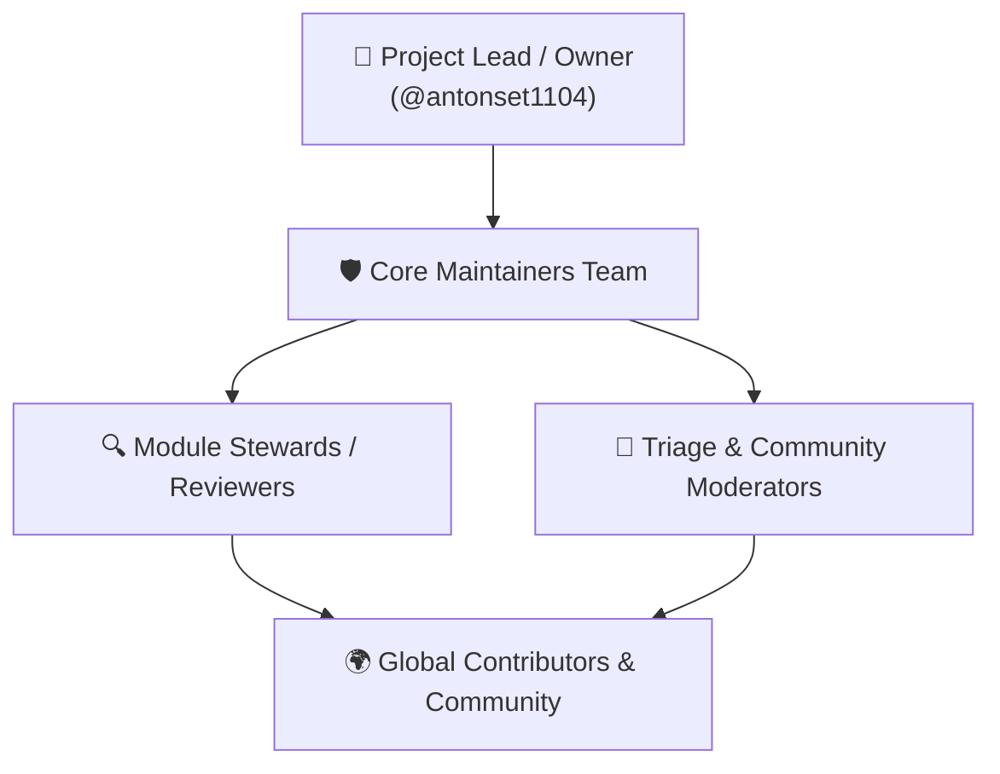

# Strategic & Operational Open-Source Project Guide

This document serves as the comprehensive blueprint for repository owners, core maintainers, and community contributors in governing **GoERP** as a world-class, enterprise-grade open-source software project.

---

## 1. Vision & Market Positioning

### Why GoERP?
Traditional enterprise ERP systems (primarily built on Python/PostgreSQL or legacy Java/C++ monoliths) are widespread but face chronic structural drawbacks:
- High memory consumption (hundreds of megabytes per worker process).
- Fragile runtime dependencies (Python virtualenvs, pip packages, NodeJS for asset pipelines, external C bindings).
- Execution bottlenecks and GIL contention under high-concurrency I/O spikes.

**GoERP** resolves these industry pain points by providing:
1. **Single Standalone Binary**: All 50 enterprise modules and web SPA assets are compiled into a single executable binary (no Python, pip, or npm needed on production servers).
2. **Native Go Concurrency & Speed**: Sub-50ms cold boot time, ~25–40 MB idle RAM consumption, and native goroutine scheduling capable of sustaining thousands of concurrent transactions per second.
3. **Flexible Storage Strategy**: Embedded SQLite for edge deployments, branches, and SMEs, or PostgreSQL for large-scale enterprise conglomerates.
4. **Complete & Battle-Tested**: Comes equipped with 50 integrated modules (O2C, P2P, MRP II, WMS, double-entry accounting, HRIS, taxation, bonded customs, low-code studio, BPMN 2.0 workflow engine, and integration hub).

---

## 2. Open-Source Governance Model

The project operates under a **Benevolent Maintainer / Core Team Governance** model:



### Roles & Responsibilities:
1. **Project Lead / Owner (`@antonset1104`)**:
   - Oversees strategic project direction, public release signing, domain ownership, and final merge authority on the `main` branch.
2. **Core Maintainers**:
   - Review and approve Pull Requests.
   - Coordinate release cycles and publish security advisories.
   - Preserve architectural hygiene within `internal/core`.
3. **Module Stewards**:
   - Domain experts who maintain specific sub-systems (e.g., General Ledger Accounting, WMS/Inventory, MRP II, or Frontend SPA).
4. **Triage Team**:
   - Triage incoming issues, verify bug reproduction steps, and apply appropriate taxonomy labels.
5. **Contributors**:
   - Community members who submit bug fixes, new modules, localization plugins, or documentation enhancements.

### Architectural Decision Process: RFC (Request for Comments)
For substantial architectural changes (such as core schema refactoring, new database engines, or protocol alterations), contributors must submit an RFC:
1. Open an issue titled **RFC: [Proposal Title]** or create a post in GitHub Discussions under the *Ideas* category.
2. Detail the motivation, alternatives considered, performance benchmarks, and proposed implementation.
3. Allow a minimum of 7 calendar days for open discussion before a decision by Core Maintainers.

---

## 3. Licensing & Copyright Strategy (Apache 2.0 & DCO)

### Primary License: Apache License 2.0
GoERP is distributed under the terms of the **Apache License 2.0**.
- **Commercial Permissiveness**: Grants individuals and companies the freedom to use, modify, distribute, and self-host the platform commercially without royalty fees.
- **Explicit Patent Grant**: Provides mutual patent protection from contributors to users and downstream distributors.
- **Limitation of Liability**: Shields maintainers and contributors from legal liability and operational damages.

### Contribution Policy: Developer Certificate of Origin (DCO)
To guarantee copyright provenance without imposing bureaucratic paperwork, GoERP adheres to the **Developer Certificate of Origin (DCO v1.1)** standard (used by Linux and Git).
Contributors sign off on their commits by including the `-s` flag:
```bash
git commit -s -m "feat(wms): implement wave picking algorithm"
```
Which appends: `Signed-off-by: Full Name <email@example.com>`.

---

## 4. GitHub Repository Configuration Standards

To maintain professional open-source engineering hygiene, the repository is configured with the following settings:

### A. General Repository Settings
- **Repository Name**: `erp`
- **Description**: `High-performance Enterprise Resource Planning (ERP) platform in Golang — 50 enterprise modules, single-binary, high concurrency, double-entry inventory & accounting, low-code & BPMN engine.`
- **Homepage**: `https://github.com/antonset1104/erp`
- **Topics**: `golang`, `go`, `erp`, `accounting`, `crm`, `wms`, `mrp`, `hris`, `bpm`, `workflow-engine`, `low-code`, `enterprise`, `double-entry`, `rest-api`, `open-source`
- **Enabled Features**:
  - ✅ **Issues** (Enabled with structured YAML issue forms)
  - ✅ **Discussions** (Enabled for community Q&A and RFCs)
  - ✅ **Projects & Wiki** (Enabled)

### B. Main Branch Protection Rules (`main`)
- **Require pull request before merging**: Enabled.
- **Require status checks to pass before merging**:
  - `Test (Go 1.22.x on ubuntu-latest)`
  - `Test (Go 1.22.x on windows-latest)`
- **Strict status checks**: Requires branches to be up-to-date with `main` before merging.
- **Require linear history**: Enabled (enforces clean, rebased git history).
- **Prevent force pushes & deletions**: Enforced.

### C. Security & Dependency Automation
- ✅ **Dependabot alerts**: Enabled.
- ✅ **Dependabot automated security fixes**: Enabled.
- ✅ **Secret scanning**: Enabled.
- ✅ **Private vulnerability reporting**: Enabled.

---

## 5. Release Engineering & Semantic Versioning (SemVer)

GoERP adheres to the **Semantic Versioning 2.0.0** (`vMAJOR.MINOR.PATCH`) standard:
- **MAJOR (`v2.0.0`)**: Breaking architectural changes, incompatible API modifications, or fundamental schema migrations.
- **MINOR (`v1.42.0`)**: Backwards-compatible features, new enterprise modules, or significant performance enhancements.
- **PATCH (`v1.41.1`)**: Backwards-compatible bug fixes and security patches.

### Release Cadence:
- **Patch Releases**: Published ad-hoc as soon as critical bugs or vulnerabilities are resolved.
- **Minor Releases**: Published every 4–6 weeks aggregating validated features from `main`.

### Automated Release Pipeline (GitHub Actions & GoReleaser):
When maintainers push a semver tag (e.g. `git tag -a v1.41.0 -m "Release v1.41.0" && git push origin v1.41.0`), `.github/workflows/release.yml` automatically:
1. Cross-compiles optimized binaries for supported platforms:
   - `go-erp_v1.41.0_linux_amd64.tar.gz`
   - `go-erp_v1.41.0_linux_arm64.tar.gz`
   - `go-erp_v1.41.0_windows_amd64.zip`
   - `go-erp_v1.41.0_darwin_amd64.tar.gz`
   - `go-erp_v1.41.0_darwin_arm64.tar.gz` (Apple Silicon M-Series)
2. Generates cryptographic checksums (`SHA256SUMS.txt`).
3. Publishes official Docker images to GitHub Container Registry (`ghcr.io/antonset1104/erp:latest`).
4. Generates automated release notes and changelogs on GitHub Releases.

---

## 6. Extensibility Architecture for Community Modules

Third-party developers can extend GoERP through three primary extension vectors:

1. **Native Go Modules**: Add a dedicated package under `internal/modules/<module_name>`, register model migrations in `internal/core/database/db.go`, and wire HTTP routes in `cmd/server/main.go`.
2. **Low-Code Studio & Dynamic Schemas**: Define dynamic database models, relational foreign keys, and UI views directly from the web interface without recompiling Go binaries.
3. **Integration Hub, Open RPC & Webhooks**: Connect external systems (marketplaces, payment gateways, WhatsApp bots, third-party CRMs) through standardized JSON-RPC and outbound webhook events.

---

## 7. Sustainability & Commercialization Model

As an enterprise-grade platform, long-term open-source sustainability is supported through an **Open Core & Value-Added Services** model:

| Tier | License | Description |
| :--- | :---: | :--- |
| **GoERP Core Engine (50 Modules)** | 🆓 Open Source (Apache 2.0) | Completely free for commercial self-hosting without user seats or database row limits. |
| **Enterprise Cloud Hosting (Managed SaaS)** | 💼 Commercial Service | Managed cloud hosting with automated daily backups, SSL, 99.9% uptime SLA, and 1-click upgrades. |
| **Custom Integration & Enterprise Consulting** | 💼 Professional Services | Tailored enterprise implementations, custom fiscal compliance adapters, and dedicated technical training. |
| **Enterprise Support & SLA** | 💼 Subscription | Priority technical support with 24/7 hotline and rapid incident response SLAs. |

---

## 8. Community Communication Channels

- **GitHub Discussions**: The primary venue for architecture discussions, Q&A, and community showcases.
- **GitHub Issues**: Reserved exclusively for verified bug reports and tracked work items.
- **Official Documentation**: Kept version-controlled in the repository's `docs/` folder (*documentation as code*).
