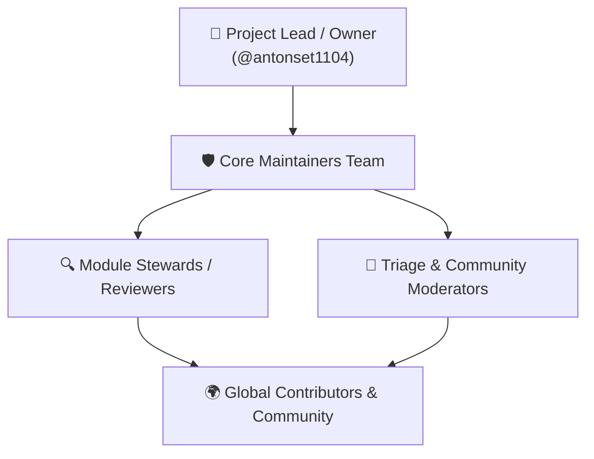

# Panduan Strategis & Operasional Proyek Open Source (Open Source Project Guide)

Dokumen ini merupakan cetak biru (*blueprint*) komprehensif bagi pemilik repositori, pengelola (*maintainers*), dan komunitas dalam mengelola **Odoo-Go ERP** sebagai proyek perangkat lunak sumber terbuka (*open source software*) berkelas dunia.

---

## 1. Visi & Posisi Pasar (Market Positioning)

### Mengapa Odoo-Go ERP?
Odoo tradisional (berbasis Python/PostgreSQL) sangat populer namun sering menghadapi tantangan dalam hal:
- Konsumsi memori yang tinggi (ratusan megabyte per *worker process*).
- Ketergantungan *runtime* yang rumit (*pip dependencies*, nodejs untuk asset bundling, pustaka C eksternal).
- Kecepatan eksekusi dan konkurensi I/O yang terbatas.

**Odoo-Go ERP** hadir untuk memecahkan tantangan tersebut dengan:
1. **Single Binary Executable**: Seluruh 50 modul enterprise dan aset antarmuka web dikemas dalam 1 file biner mandiri (tanpa perlu install Python, pip, atau npm di server produksi).
2. **Kecepatan & Konkurensi Native Go**: Waktu *cold start* di bawah 50 milidetik, konsumsi RAM idle hanya ~25-40 MB, dan mampu menangani ribuan transaksi *concurrent* per detik.
3. **Penyimpanan Fleksibel**: Dukungan SQLite *embedded* (ideal untuk UKM/edge/on-premise) dan PostgreSQL (untuk korporasi skala besar multi-cabang).
4. **Lengkap & Teruji**: Membawa 50 modul terintegrasi (O2C, P2P, MRP II, WMS, Akuntansi Double-Entry, HRIS, Pajak DJP, Kawasan Berikat, Low-Code, BPMN 2.0, dan Integration Hub).

---

## 2. Model Tata Kelola Proyek (Open Source Governance)

Proyek ini mengadopsi model tata kelola **Benevolent Maintainer / Core Team Governance**:



### Peran & Tanggung Jawab:
1. **Project Lead / Owner (`@antonset1104`)**:
   - Memegang kendali visi strategis, hak rilis publik, kepemilikan domain, dan hak merge final ke branch `main`.
2. **Core Maintainers**:
   - Meninjau (*review*) dan menyetujui Pull Requests.
   - Mengelola rilis berkala (*release management*) dan patch keamanan darurat.
   - Menjaga kebersihan arsitektur sistem (`internal/core`).
3. **Module Stewards**:
   - Pengembang spesialis yang fokus memelihara sub-sistem tertentu (misal: Perpajakan Indonesia, Akuntansi Buku Besar, MRP II, atau Frontend UI).
4. **Triage Team**:
   - Mengklasifikasikan issue baru yang masuk, mereproduksi bug, dan memberi label (*labels*).
5. **Contributors**:
   - Pengembang komunitas yang mengirimkan perbaikan bug, fitur baru, terjemahan bahasa (*i18n*), atau perbaikan dokumentasi.

### Proses Pengambilan Keputusan Arsitektur: RFC (Request for Comments)
Untuk perubahan arsitektur besar (seperti penambahan modul inti baru, perubahan skema database fundamental, atau pembaruan protokol API), kontributor diwajibkan membuat dokumen usulan:
1. Buat issue bertipe **RFC: [Judul Usulan]** atau posting di tab GitHub Discussions kategori *Ideas*.
2. Jelaskan motivasi, alternatif yang dipertimbangkan, dampak performa, dan contoh implementasi.
3. Diskusi terbuka minimal 7 hari kalender sebelum disetujui oleh Core Maintainers.

---

## 3. Strategi Lisensi & Hak Cipta (Licensing & CLA/DCO)

### Lisensi Utama: Apache License 2.0
Proyek Odoo-Go ERP didistribusikan di bawah naungan **Apache License 2.0**.
- **Kelebihan bagi Pengguna**: Bebas digunakan untuk keperluan komersial, privat, dan edukasi tanpa biaya lisensi.
- **Perlindungan Paten Eksplisit**: Memberikan jaminan paten timbal balik dari kontributor kepada pengguna dan proyek.
- **Klausul Pembatasan Tanggung Jawab (*Liability Disclaimer*)**: Melindungi pengelola dari tuntutan hukum kerusakan atau kehilangan data bisnis.

### Kebijakan Kontribusi: DCO (Developer Certificate of Origin)
Untuk menjaga kemurnian hak cipta tanpa membebani kontributor dengan birokrasi CLA yang rumit, proyek ini menggunakan standar **Developer Certificate of Origin (DCO v1.1)** (sama seperti kernel Linux dan Git).
Setiap kontributor cukup menyertakan tanda tangan baris pada setiap commit:
```bash
git commit -s -m "feat(wms): implement wave picking algorithm"
```
Yang menghasilkan teks: `Signed-off-by: Nama Lengkap <email@domain.com>`.

---

## 4. Konfigurasi Repositori GitHub yang Diwajibkan (GitHub Settings Checklist)

Agar repositori memenuhi standar baku proyek open source profesional di GitHub, pemilik repositori disarankan mengatur konfigurasi berikut pada panel **Settings** di [https://github.com/antonset1104/erp/settings](https://github.com/antonset1104/erp/settings):

### A. General Repository Settings
- **Repository Name**: `erp`
- **Description**: `Enterprise Resource Planning (ERP) platform in Golang — 50 enterprise modules, single-binary, high concurrency, double-entry inventory & accounting, low-code & BPMN engine.`
- **Website URL**: `https://github.com/antonset1104/erp`
- **Topics / Tags**:
  `golang`, `go`, `erp`, `odoo`, `accounting`, `crm`, `wms`, `mrp`, `hris`, `bpm`, `workflow-engine`, `low-code`, `enterprise`, `double-entry`, `rest-api`
- **Fitur Aktif**:
  - ✅ **Issues** (Diaktifkan)
  - ✅ **Discussions** (Diaktifkan untuk tanya-jawab, ide fitur, dan pengumuman)
  - ✅ **Wikis** (Opsional, dokumentasi utama tetap di folder `docs/`)
  - ✅ **Sponsorships** (GitHub Sponsors jika membuka donasi publik)

### B. Aturan Perlindungan Branch Utama (`main`)
Atur pada menu **Settings $\rightarrow$ Branches $\rightarrow$ Branch protection rules**:
1. **Branch name pattern**: `main`
2. ✅ **Require a pull request before merging**:
   - Require approvals: Minimal 1 persetujuan dari Maintainer.
   - Dismiss stale pull request approvals when new commits are pushed.
3. ✅ **Require status checks to pass before merging**:
   - Wajibkan workflow CI lulus (`test (ubuntu-latest)`, `test (windows-latest)`).
   - Require branches to be up to date before merging.
4. ✅ **Require linear history** (mencegah *messy merge commits*).
5. ❌ **Do not allow bypassing the above settings** (berlaku untuk semua orang termasuk admin).

### C. Keamanan & Pemindaian Kerentanan (Code Security & Analysis)
Atur pada menu **Settings $\rightarrow$ Code security and analysis**:
- ✅ **Dependabot alerts**: Aktif.
- ✅ **Dependabot security updates**: Aktif (otomatis membuat PR jika dependensi Go memiliki kerentanan CVE).
- ✅ **Secret scanning**: Aktif (mencegah commit API key atau secret token secara tidak sengaja).
- ✅ **Private vulnerability reporting**: Aktif (memungkinkan peneliti keamanan melaporkan celah secara privat ke maintainer).

---

## 5. Rekayasa Rilis & Semantic Versioning (SemVer)

Odoo-Go ERP mematuhi konvensi **Semantic Versioning 2.0.0** (`vMAJOR.MINOR.PATCH`):
- **MAJOR (`v2.0.0`)**: Perubahan arsitektur besar yang merusak kompatibilitas backward (*breaking changes* pada API atau skema database).
- **MINOR (`v1.42.0`)**: Penambahan modul baru, endpoint API baru, atau peningkatan fitur yang kompatibel ke belakang.
- **PATCH (`v1.41.1`)**: Perbaikan bug, patch keamanan, atau optimasi performa tanpa mengubah kontrak API.

### Siklus Rilis (Release Cadence):
- **Patch Releases**: Dirilis setiap ada perbaikan bug kritis atau celah keamanan (sesegera mungkin / ad-hoc).
- **Minor Releases**: Dirilis setiap 4-6 minggu sekali dengan menyertakan fitur-fitur baru yang telah teruji di branch `main`.

### Alur Rilis Biner Otomatis (GitHub Actions & GoReleaser):
Ketika maintainer membuat git tag (contoh: `git tag -a v1.41.0 -m "Release v1.41.0" && git push origin v1.41.0`), workflow `.github/workflows/release.yml` otomatis:
1. Mengompilasi biner untuk berbagai sistem operasi & arsitektur:
   - `odoo-go-erp_v1.41.0_linux_amd64.tar.gz`
   - `odoo-go-erp_v1.41.0_linux_arm64.tar.gz`
   - `odoo-go-erp_v1.41.0_windows_amd64.zip`
   - `odoo-go-erp_v1.41.0_darwin_amd64.tar.gz`
   - `odoo-go-erp_v1.41.0_darwin_arm64.tar.gz` (Apple Silicon M1/M2/M3)
2. Membuat hash verifikasi `SHA256SUMS.txt`.
3. Membangun dan mempublikasikan image Docker resmi ke GitHub Container Registry (`ghcr.io/antonset1104/erp:v1.41.0` dan `:latest`).
4. Menerbitkan rilis baru di halaman *Releases* GitHub beserta *Changelog* otomatis.

---

## 6. Arsitektur Ekstensibilitas untuk Modul Komunitas

Pengembang pihak ketiga dapat memperluas fungsionalitas Odoo-Go ERP melalui 3 mekanisme utama:

1. **Modul Native Go**: Menambahkan folder baru di `internal/modules/<nama_modul>`, mendaftarkan migrasi model di `internal/core/database/db.go`, dan mendaftarkan rute HTTP di `cmd/server/main.go`.
2. **Low-Code Studio & Dynamic Data Models**: Membuat entitas database baru dan formulir UI kustom langsung dari antarmuka web tanpa perlu kompilasi ulang kode biner.
3. **Integration Hub, Open RPC & Webhooks**: Menghubungkan sistem eksternal (CRM luar, marketplace Shopee/Tokopedia, payment gateway, WhatsApp API) via protokol JSON-RPC dan event webhook real-time.

---

## 7. Model Keberlanjutan & Komersialisasi (Sustainability Model)

Sebagai proyek open source berskala enterprise, keberlanjutan pemeliharaan dapat dicapai melalui model **Open Core & Value-Added Services**:

| Komponen | Status Lisensi | Deskripsi |
| :--- | :---: | :--- |
| **Odoo-Go ERP Core Engine (50 Modul)** | 🆓 Open Source (Apache 2.0) | Bebas digunakan, dimodifikasi, dan di-hosting mandiri (*self-hosted*) tanpa batasan jumlah pengguna. |
| **Enterprise Cloud Hosting (Managed SaaS)** | 💼 Layanan Komersial | Layanan hosting cloud terkelola (backup harian otomatis, SSL, uptime SLA 99.9%, update versi 1-klik). |
| **Custom Integration & Implementation Consulting** | 💼 Layanan Profesional | Jasa implementasi ERP untuk perusahaan besar, kustomisasi alur akuntansi/pajak khusus, dan pelatihan tim. |
| **Enterprise Support & SLA** | 💼 Layanan Berlangganan | Jalur dukungan teknis prioritas (tiket 24/7, hotline respon 1 jam untuk downtime produksi). |

---

## 8. Panduan Komunikasi Komunitas

- **GitHub Discussions**: Forum utama tanya-jawab teknis, showcase implementasi, dan ide fitur baru.
- **GitHub Issues**: Khusus untuk pelaporan bug yang terverifikasi dan tugas kerja resmi.
- **Discord / Telegram Developer Group**: Saluran komunikasi interaktif untuk pengembang inti dan kontributor aktif.
- **Dokumentasi Resmi**: Selalu simpan dokumentasi resmi dalam format Markdown di repositori agar versi dokumentasi selalu selaras dengan versi kode biner (*docs as code*).
