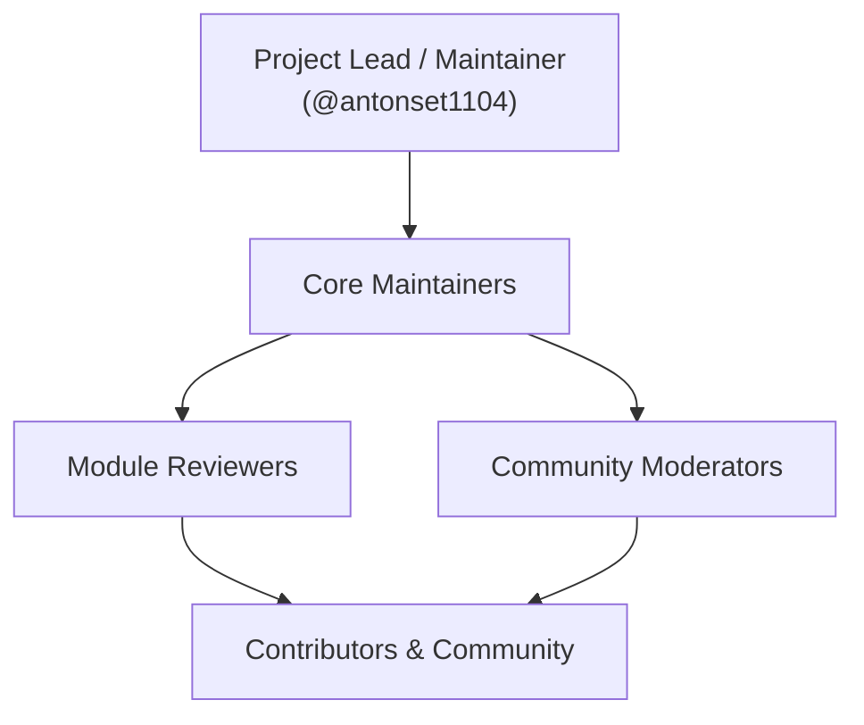

# Open Source Project Guide — GoERP

This document outlines the governance model, contribution policies, release engineering, and community standards for the GoERP open-source project.

---

## 1. Vision & Architecture Philosophy

Traditional enterprise resource planning platforms often suffer from structural operational challenges:
- High idle memory consumption (hundreds of megabytes per worker process).
- Fragile runtime dependencies across language runtimes, virtual environments, and asset pipelines.
- Slow cold start times and complex multi-container setup requirements.

GoERP addresses these limitations through deliberate architectural choices:
1. **Single Static Binary**: The backend application, database migrations, and web interface compile into a single executable binary. No external runtime dependencies (such as Python, Node.js, or Ruby) are required on production host servers.
2. **Native Go Concurrency**: Low idle memory footprint (~25–30 MB), sub-50ms cold starts, and goroutine-based concurrent request handling capable of serving thousands of transactions per second on modest hardware.
3. **Flexible Data Storage**: Embedded pure-Go SQLite for zero-configuration branch and edge deployments, and PostgreSQL for distributed, high-concurrency enterprise installations.
4. **Comprehensive Core**: Standard business functions (double-entry general ledger, inventory mass conservation, MRP II, WMS, HR/Payroll, and tax localization) are integrated natively without fragmented plugins.

---

## 2. Project Governance Model

GoERP operates under a **Core Team Governance** model:



### Roles and Responsibilities
- **Project Lead**: Oversees project vision, cryptographic release signing, domain governance, and final merge decisions on the `main` branch.
- **Core Maintainers**: Review and merge pull requests, coordinate release cycles, manage security advisories, and maintain architecture hygiene in `internal/core`.
- **Module Reviewers**: Domain specialists who maintain and review specific subsystems (Accounting, Inventory/WMS, Manufacturing, or Web UI).
- **Contributors**: Community developers who report bugs, submit documentation updates, contribute localization packs, and implement features via pull requests.

### Request for Comments (RFC) Process
Significant architectural changes (such as core database schema refactoring, protocol modifications, or breaking API changes) require an RFC:
1. Open an issue titled **RFC: [Proposal Title]** or start a thread in GitHub Discussions under the *Ideas* category.
2. Outline the motivation, technical alternatives evaluated, backward compatibility impact, and proposed implementation plan.
3. Allow a minimum discussion period of 7 calendar days before core maintainers decide on implementation.

---

## 3. Licensing & Copyright Policy

### Apache License 2.0
GoERP is licensed under the **Apache License 2.0**.
- **Permissive Commercial Use**: Allows organizations and individuals to use, customize, self-host, and distribute the software without royalty fees.
- **Explicit Patent Grant**: Provides mutual patent protection from contributors to users and downstream distributors.
- **Limitation of Liability**: Protects maintainers and contributors from operational liability.

### Developer Certificate of Origin (DCO)
To ensure copyright provenance without bureaucratic contributor license agreements, GoERP uses the **Developer Certificate of Origin (DCO v1.1)** standard (the same process used by the Linux kernel and Git projects).
Contributors sign off on their commits by including the `-s` flag:
```bash
git commit -s -m "feat(wms): implement wave picking algorithm"
```
This automatically appends: `Signed-off-by: Full Name <email@example.com>`.

---

## 4. Repository Standards & Branch Protection

To ensure code quality and stability, the following rules are enforced on the `main` branch:

### Branch Protection Rules
- **Pull Requests Required**: Direct pushes to `main` are restricted; changes must land via reviewed pull requests.
- **Required Automated Status Checks**:
  - `go test -v ./tests/...` must pass 100% on target platforms (Linux and Windows).
  - `go vet ./...` must complete with zero warnings.
- **Linear History**: Commits must be rebased or squashed to maintain a clean git history.
- **Automated Security Scanning**: Dependabot vulnerability alerts and secret scanning are enabled across the repository.

---

## 5. Release Engineering & Versioning

GoERP follows the **Semantic Versioning 2.0.0** (`vMAJOR.MINOR.PATCH`) specification:
- **MAJOR (`v2.0.0`)**: Breaking architectural changes, incompatible API modifications, or database schema restructuring requiring manual intervention.
- **MINOR (`v1.42.0`)**: Backwards-compatible features, new business modules, or performance improvements.
- **PATCH (`v1.41.1`)**: Backwards-compatible bug fixes and security patches.

### Automated Release Pipeline
When a release tag is pushed (e.g., `git tag -a v1.82.0 -m "Release v1.82.0" && git push origin v1.82.0`), GitHub Actions automatically:
1. Compiles optimized production binaries for target platforms:
   - `go-erp_linux_amd64.tar.gz`
   - `go-erp_linux_arm64.tar.gz`
   - `go-erp_windows_amd64.zip`
   - `go-erp_darwin_arm64.tar.gz` (Apple Silicon)
2. Generates cryptographic checksums (`SHA256SUMS.txt`).
3. Publishes multi-architecture Docker container images to GitHub Container Registry (`ghcr.io/antonset1104/erp`).
4. Compiles structured release notes on the GitHub Releases page.

---

## 6. Extending the Platform

Developers can extend GoERP through three primary extension vectors:

1. **Native Go Modules**: Create a package in `internal/modules/<module_name>`, register database models in `internal/core/database/db.go`, and mount HTTP routes in `cmd/server/main.go`.
2. **Low-Code Studio**: Define dynamic business models, custom fields, and views through the browser UI without recompiling Go source code.
3. **Integration Hub & Webhooks**: Connect external services (payment gateways, e-commerce storefronts, logistics tracking) via standardized REST/JSON-RPC APIs and outbound webhook events.

---

## 7. Community Communication

- **GitHub Discussions**: The primary channel for technical questions, architecture ideas, and showcases.
- **GitHub Issues**: Reserved exclusively for reproducible bug reports and tracked implementation items.
- **Documentation**: Maintained in the repository under `docs/` following the *documentation-as-code* approach.
