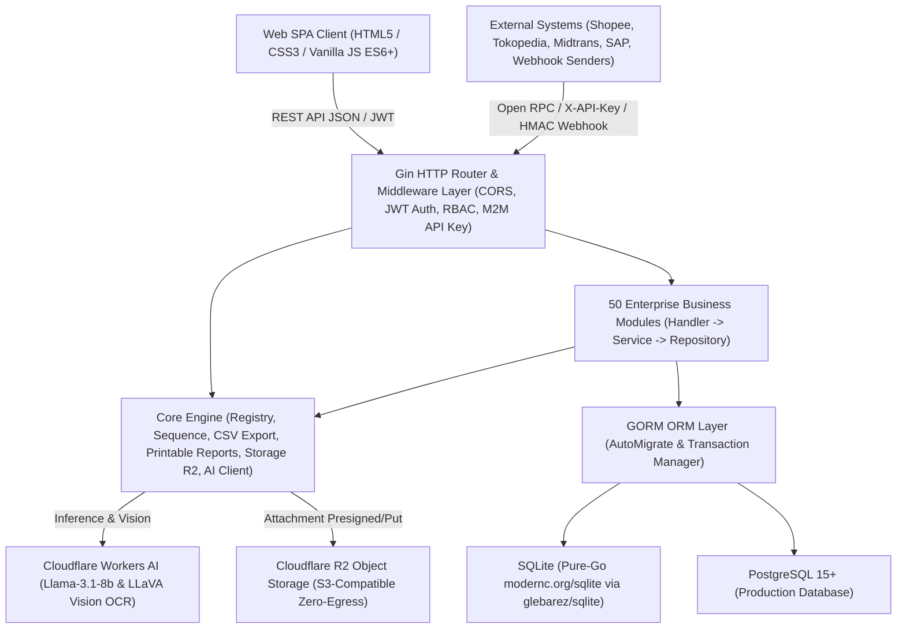

# Dokumentasi Teknis (Technical Documentation) — GoERP v1.0

## 1. Ikhtisar Arsitektur Sistem (System Architecture Overview)

**GoERP** adalah sistem *Enterprise Resource Planning* (ERP) modular berkinerja tinggi yang dibangun menggunakan bahasa pemrograman **Go (Golang)** dengan pola arsitektur **Modular Monolith** terinspirasi dari *standard enterprise ERP framework* (`ir.model`, `res.partner`, `stock.quant`, `account.move`) dan prinsip **Clean Architecture** (*Handler → Service → Repository → GORM Model*).



### 1.1 Komponen Inti Teknologi (Tech Stack)
| Lapisan | Teknologi / Library | Peran & Spesifikasi |
| :--- | :--- | :--- |
| **Bahasa Pemrograman** | Go `1.22+` (Kompatibel penuh hingga Go `1.27`) | Kompilasi statis *single-binary*, konkurensi tinggi (*goroutines*), penggunaan memori sangat rendah (~25 MB RAM idle). |
| **HTTP Web Framework** | `github.com/gin-gonic/gin` v1.9+ | Routing RESTful API cepat, *middleware chaining*, pengikatan dan validasi payload JSON. |
| **ORM & Database Layer** | `gorm.io/gorm` v1.25+ | Pemetaan objek-relasional, *Auto-Migration* 120+ tabel otomatis saat *startup*, transaksi ACID (`db.Transaction`). |
| **Driver SQLite (Zero-CGO)** | `github.com/glebarez/sqlite` (`modernc.org/sqlite`) | Driver SQLite *pure-Go* yang berjalan di Windows, Linux, dan macOS dengan `CGO_ENABLED=0` tanpa ketergantungan kompilator C (`gcc`). |
| **Driver PostgreSQL** | `gorm.io/driver/postgres` | Driver produksi untuk beban kerja transaksi konkurensi tinggi pada PostgreSQL 15+. |
| **Keamanan & Autentikasi** | `github.com/golang-jwt/jwt/v5` & `golang.org/x/crypto/bcrypt` | Autentikasi pengguna berbasis *JSON Web Token* (HS256), *hashing* kata sandi Bcrypt, serta autentikasi *Machine-to-Machine* (M2M) berbasis SHA-256 API Key. |
| **Kecerdasan Buatan (AI)** | Cloudflare Workers AI + Smart Local Heuristic Fallback | Mendukung model LLM `@cf/meta/llama-3.1-8b-instruct` dan Vision `@cf/llava-hf/llava-1.5-7b-hf` dengan *fallback* heuristik lokal deterministik jika kredensial cloud tidak dikonfigurasi. |
| **Penyimpanan Berkas** | Cloudflare R2 + Local Disk Fallback | Penyimpanan dokumen lampiran (`ir.attachment`) kompatibel S3 API dengan *fallback* otomatis ke direktori lokal `./uploads/attachments`. |
| **Frontend UI** | Vanilla JavaScript (ES6+), CSS3 Variables, HTML5 | *Single Page Application* (SPA) tanpa langkah *build* Node.js/Webpack, mendukung tema gelap (*Dark Glassmorphism*), pemindai Barcode/QR, dan kanvas visual BPMN 2.0. |

---

## 2. Struktur Direktori Proyek (Repository Structure)

```text
c:\erp\
├── cmd/
│   └── server/
│       └── main.go                 # Entrypoint utama server, AutoMigrate, Seeding, Routing & Dashboard Stats
├── internal/
│   ├── config/
│   │   └── config.go               # Konfigurasi environment variables (.env, DB, JWT, Cloudflare AI & R2)
│   ├── core/
│   │   ├── ai/                     # Klien Cloudflare Workers AI, ERP Copilot & Vision OCR
│   │   ├── database/               # Inisialisasi koneksi GORM (SQLite pure-Go & PostgreSQL)
│   │   ├── export/                 # Utilitas ekspor CSV universal untuk seluruh tabel ERP
│   │   ├── middleware/             # JWT AuthMiddleware & Role-Based Access Control (RBAC)
│   │   ├── models/                 # BaseModel standar (ID, CreatedAt, UpdatedAt, DeletedAt, CompanyID)
│   │   ├── registry/               # Registri modul dinamis (Enterprise-style module loader)
│   │   └── storage/                # Abstraksi penyimpanan objek Cloudflare R2 & Local File System
│   └── modules/                    # 50 Modul Bisnis Enterprise (Masing-masing: models, repository, service, handler)
│       ├── base/                   # 1. Perusahaan (res.company), Mitra (res.partner), Pengguna (res.users), Sequence
│       ├── product/                # 2. Kategori Produk & Master Produk (product.template / product.product)
│       ├── stock/                  # 3. Gudang, Lokasi, Double-Entry Stock Move, Picking, Quant & Reordering Rules
│       ├── sale/                   # 4. Penawaran & Pesanan Penjualan (sale.order & sale.order.line)
│       ├── purchase/               # 5. RFQ & Pesanan Pembelian (purchase.order & purchase.order.line)
│       ├── account/                # 6. Bagan Akun (CoA), Jurnal, Faktur, Pembayaran & Laporan Keuangan PSAK
│       ├── mrp/                    # 7. Bill of Materials (BoM) & Manufacturing Orders (mrp.production)
│       ├── pos/                    # 8. Sesi Kasir Point of Sale & Pesanan Ritel Instan (pos.session, pos.order)
│       ├── hr/                     # 9. Departemen, Karyawan & Slip Gaji Dasar
│       ├── crm/                    # 10. Pipeline Prospek & Konversi Peluang ke Sales Order (crm.lead)
│       ├── project/                # 11. Manajemen Proyek, Tahapan Tugas & Timesheet (project.project, project.task)
│       ├── chatter/                # 12. Kolaborasi Dokumen & Jejak Pesan Audit (mail.message)
│       ├── asset/                  # 13. Aset Tetap & Jadwal Penyusutan Otomatis ke GL (account.asset)
│       ├── helpdesk/               # 14. Tiket Dukungan Pelanggan & SLA (helpdesk.ticket)
│       ├── maintenance/            # 15. Peralatan Pabrik, Preventive & Corrective Maintenance
│       ├── fleet/                  # 16. Armada Kendaraan, Log Odometer & Servis (fleet.vehicle)
│       ├── leave/                  # 17. Cuti Karyawan, Kuota Tahunan & Integrasi Payroll (hr.leave)
│       ├── expense/                # 18. Klaim Reimbursement Karyawan & Posting Jurnal (hr.expense)
│       ├── quality/                # 19. Titik Kontrol Mutu (QCP), Inspeksi & Peringatan CAPA
│       ├── approval/               # 20. Matriks Persetujuan Multi-Level (approval.request)
│       ├── attachment/             # 21. Manajemen Dokumen Lampiran & AI Vision Receipt OCR (ir.attachment)
│       ├── attendance/             # 22. Presensi Geofencing GPS, Shift Kerja & Deteksi Anomali Edge
│       ├── recruitment/            # 23. Lowongan Kerja, Pipeline Pelamar, AI CV Scorer & 1-Click Hire
│       ├── stock_inventory/        # 24. Stock Opname Fisik, Penyesuaian Selisih & AI Shrinkage Auditor
│       ├── payroll/                # 25. Struktur Gaji, PPh 21 TER (PP 58/2023), BPJS & Batch Payslip Run
│       ├── budget/                 # 26. Anggaran RKAB, Akuntansi Analitik Cost Center & AI Burn-Rate Auditor
│       ├── barcode/                # 27. Generator SVG Code 128, Pelacakan Lot/Serial & Pemindai Universal
│       ├── purchase_requisition/   # 28. Permintaan Pembelian (PR), Tender Multi-Vendor & Blanket Order
│       ├── currency/               # 29. Multi-Valas, Kurs Tengah BI/JISDOR & Revaluasi Kurs PSAK 10
│       ├── tax_efaktur/            # 30. Pajak PPN 11%, Jatah NSFP, e-Faktur Keluaran/Masukan & SPT 1111
│       ├── bank_reconciliation/    # 31. Impor Rekening Koran, Auto-Match Engine & Rekonsiliasi Bank
│       ├── landed_cost/            # 32. Alokasi Biaya Impor, Bea Masuk & Freight ke HPP Persediaan
│       ├── traceability/           # 33. Silsilah Hulu-Hilir Lot (Genealogy) & Penarikan Produk (Recall)
│       ├── subscription/           # 34. Langganan Berulang (MRR/ARR), Penagihan Otomatis & Churn AI
│       ├── audit_trail/            # 35. Jejak Audit Kriptografis (Old vs New JSON) & Deteksi Anomali
│       ├── webhook/                # 36. Outbound Event Webhooks dengan Tanda Tangan HMAC-SHA256
│       ├── inbound_webhook/        # 37. Receiver Webhook Omnichannel (E-Commerce, Payment, Logistik)
│       ├── intercompany/           # 38. Holding Multi-Perusahaan, Mirroring SO/PO & Eliminasi Konsolidasi
│       ├── treasury/               # 39. Manajemen Likuiditas Multi-Bank, Proyeksi Kas 13-Minggu & Cash Sweep
│       ├── mrp_advanced/           # 40. MRP II: Work Center, Routing Operasi, Work Order & Analitik OEE
│       ├── tax_ebupot/             # 41. Pajak e-Bupot Unifikasi (PPh 21/23/26/4(2)) & SPT Masa Unifikasi
│       ├── esignature/             # 42. Tanda Tangan Elektronik SHA-256 & Pembubuhan e-Meterai Peruri
│       ├── wms/                    # 43. WMS 3D Bin Location (Aisle/Rack/Shelf/Bin), Putaway & Wave Picking
│       ├── vendor_portal/          # 44. Portal Mandiri Pemasok: Penawaran Tender, ASN & Pengajuan Invoice
│       ├── customer_portal/        # 45. Portal Mandiri Pelanggan B2B: Katalog Grosir, RMA & Bukti Bayar
│       ├── customs_bonded/         # 46. Kawasan Berikat DJBC CEISA 4.0 (BC 2.3/2.5/2.7/4.0/4.1 & Subkontrak)
│       ├── lowcode_studio/         # 47. Low-Code Studio: Model Dinamis (EAV), Field Builder & Core Extensions
│       ├── reports/                # 48. Generator Dokumen Cetak Korporat A4 & Struk Thermal POS 80mm
│       ├── workflow_engine/        # 49. Mesin BPMN 2.0 State Machine, Conditional Gateway & AI Designer
│       └── integration_hub/        # 50. Universal Integration Hub, Open RPC Gateway, Connectors & Batch ETL
├── tests/
│   └── erp_test.go                 # Suite Pengujian End-to-End 54 Bagian (Mencakup seluruh 50 Modul)
├── web/
│   ├── index.html                  # Antarmuka SPA Utama (50 Tab Modul & 110+ Modal Interaktif)
│   ├── app.js                      # Logika State, Klien REST API, Render Tabel, Kanban & Kanvas BPMN
│   └── style.css                   # Sistem Desain CSS Dark Enterprise Glassmorphism
├── Dockerfile                      # Multi-stage Docker build untuk deployment kontainer ringan
├── docker-compose.yml              # Orkestrasi layanan aplikasi ERP + PostgreSQL 15
└── .env.example                    # Template variabel lingkungan konfigurasi sistem
```

---

## 3. Desain Database & Prinsip Multi-Tenant / Multi-Company

### 3.1 Standar Model Dasar (`models.BaseModel`)
Setiap entitas transaksi dan master data mewarisi `models.BaseModel` (`internal/core/models/base.go`):
- `ID` (`uint`, Primary Key, Auto-Increment)
- `CreatedAt` (`time.Time`)
- `UpdatedAt` (`time.Time`)
- `DeletedAt` (`gorm.DeletedAt`, Indexed untuk *Soft Delete*)
- `CompanyID` (`uint`, Indexed, Default: `1` untuk isolasi data multi-entitas perusahaan)

### 3.2 Mesin Akuntansi Berpasangan (*Double-Entry Bookkeeping*)
Pada modul `account`, setiap jurnal (`AccountMove`) wajib memenuhi persamaan keseimbangan buku besar sebelum dapat diposting (`state = 'posted'`):
$$\sum \text{Debit} = \sum \text{Credit}$$
Jika terdapat selisih lebih dari toleransi pembulatan (`0.01`), transaksi dibatalkan secara atomik oleh GORM Transaction.

### 3.3 Mesin Inventaris Berpasangan (*Double-Entry Stock Movement*)
Serupa dengan prinsip akuntansi, modul `stock` tidak sekadar mengubah angka stok pada tabel produk, melainkan memindahkan kuantitas dari `SourceLocationID` (misal: *Supplier Location* atau *WH/Stock*) ke `DestLocationID` (misal: *WH/Stock* atau *Customer Location*) melalui tabel `stock_moves` dan memperbarui saldo per lokasi di `stock_quants`.

### 3.4 Arsitektur *Entity-Attribute-Value* (EAV) pada Low-Code Studio
Modul `lowcode_studio` memungkinkan pembuatan tabel/model baru saat *runtime* tanpa mengubah skema DDL SQL melalui 4 tabel meta:
1. `lowcode_custom_models`: Menyimpan definisi model (`technical_name` berawalan `x_`, kategori menu, ikon, pengaturan audit/chatter).
2. `lowcode_custom_fields`: Menyimpan definisi kolom (`field_name`, `field_type` seperti `char`, `integer`, `float`, `boolean`, `date`, `selection`, `json`).
3. `lowcode_custom_records`: Menyimpan baris data aktual dengan kolom `values_json` yang divalidasi terhadap skema `lowcode_custom_fields`.
4. `lowcode_core_extensions`: Menyimpan atribut tambahan (`extension_json`) yang ditempelkan pada model inti ERP (`res.partner`, `product.product`, `sale.order`, `purchase.order`).

---

## 4. Keamanan, Autentikasi & Otorisasi

1. **Autentikasi Pengguna (JWT HS256)**:
   - Endpoint: `POST /api/v1/auth/login` dan `POST /api/v1/auth/register`.
   - Token dikirimkan melalui header `Authorization: Bearer <token>`.
   - Klaim JWT memuat `user_id`, `email`, `name`, `role`, dan `company_id`.
2. **Role-Based Access Control (RBAC)**:
   - Peran standar meliputi `admin`, `manager`, `finance_manager`, `director`, `dept_head`, dan `staff`.
   - Middleware `RoleMiddleware` memvalidasi izin akses per rute sensitif.
3. **Autentikasi Machine-to-Machine (M2M API Key)**:
   - Digunakan pada modul `integration_hub` (`/api/v1/integration/rpc/...`).
   - Klien eksternal mengirimkan header `X-API-Key: ak_live_<prefix>_<secret>`.
   - Sistem hanya menyimpan nilai *hash* SHA-256 dari kunci tersebut di database, memeriksa kecocokan *scope* (`read:product`, `write:sale`, `*`), batas *rate limit* (RPM), serta daftar putih IP (`allowed_ips`).
4. **Verifikasi Signature Webhook (HMAC-SHA256)**:
   - Setiap pengiriman *outbound webhook* menyertakan header `X-ERP-Signature-256` yang dihitung menggunakan algoritma HMAC-SHA256 atas *payload* JSON.

---

## 5. Referensi Endpoint API Utama (API Reference)

Seluruh endpoint berada di bawah prefix `/api/v1`:

| Grup Modul | Prefix Endpoint Utama | Metode & Fungsi Utama |
| :--- | :--- | :--- |
| **Auth & Base** | `/auth/login`, `/partners`, `/companies` | Login JWT, CRUD Mitra (Pelanggan/Vendor), Multi-Perusahaan |
| **Dashboard & CSV** | `/dashboard/stats`, `/export/:entity` | Statistik KPI 50 modul real-time, Unduh CSV seluruh entitas |
| **AI Copilot** | `/ai/ask`, `/ai/status` | Asisten Eksekutif Natural Language & Status Cloudflare AI |
| **Product & Stock** | `/products`, `/stock/pickings`, `/stock/quants`, `/stock/reorder-rules` | Katalog Produk, Transfer Gudang (`WH/IN`, `WH/OUT`, `WH/INT`), Saldo Stok, Auto-Replenishment |
| **Sales & CRM** | `/sales/orders`, `/crm/leads` | Konfirmasi SO (otomatis buat `WH/OUT` & Faktur), Pipeline Kanban CRM |
| **Purchase & PR** | `/purchases/orders`, `/purchase-requisitions` | Konfirmasi PO (otomatis buat `WH/IN`), Tender Multi-Vendor & Blanket Order |
| **Accounting & Financial** | `/accounting/accounts`, `/accounting/moves`, `/accounting/payments`, `/accounting/reports/*` | Buku Besar, Faktur, Pembayaran, Laba Rugi (`profit-loss`), Neraca (`balance-sheet`), Neraca Saldo (`trial-balance`) |
| **Manufacturing (MRP I & II)** | `/mrp/boms`, `/mrp/orders`, `/mrp-advanced/work-centers`, `/mrp-advanced/work-orders` | Resep BoM, Perintah Produksi, Kapasitas Mesin, Routing & Kalkulasi OEE |
| **POS & Retail** | `/pos/sessions`, `/pos/orders` | Buka/Tutup Sesi Kasir, Checkout Instan & Pengurangan Stok Otomatis |
| **HR, Attendance, Leave, Payroll** | `/hr/employees`, `/attendances`, `/leaves`, `/payroll/payslips`, `/recruitment/applicants` | Data Karyawan, Presensi GPS, Cuti Berjenjang, Slip Gaji PPh 21 TER & AI Recruitment |
| **Tax Compliance (DJP)** | `/tax-efaktur/*`, `/tax-ebupot/*` | Jatah NSFP, Faktur Pajak PPN 11%, Bukti Potong Unifikasi PPh 21/23/26/4(2) & SPT |
| **Customs & Bonded Zone** | `/customs-bonded/documents`, `/customs-bonded/reports/*`, `/customs-bonded/subcontracts` | Dokumen BC 2.3/2.5/2.7/4.0/4.1, Persetujuan SPPB, 4 Buku Mutasi IT Inventory DJBC |
| **WMS, Landed Cost, Traceability** | `/wms/bins`, `/wms/waves`, `/landed-costs`, `/traceability/traces` | Rak 3D Gudang, Wave Picking, Kapitalisasi Bea Masuk Impor, Silsilah Lot & Recall |
| **Portals & e-Signature** | `/vendor-portal/*`, `/customer-portal/*`, `/esignature/requests` | Portal Mandiri Vendor & Pelanggan B2B, Tanda Tangan Digital SHA-256 & e-Meterai |
| **Low-Code Studio** | `/lowcode/models`, `/lowcode/records/:name`, `/lowcode/core-extensions`, `/lowcode/ai/schema-copilot` | Pembuatan Model & Kolom Kustom saat Runtime, Ekstensi Entitas Inti & AI Schema Designer |
| **BPMN 2.0 Workflow Engine** | `/workflows/definitions`, `/workflows/start`, `/workflows/instances`, `/workflows/instances/:id/action` | Definisi State Machine BPMN, Evaluasi Gateway Kondisional, Inbox Approval & Audit Log |
| **Universal Integration Hub** | `/integration/api-keys`, `/integration/connectors`, `/integration/rpc/:method`, `/integration/data-jobs` | Manajemen API Key M2M, Konektor Marketplace/Payment/WA, Open RPC CRUD & Batch ETL |
| **Universal Report Engine** | `/reports/catalog`, `/reports/sale-order/:id`, `/reports/invoice/:id`, `/reports/payslip/:id` | Render Dokumen Cetak HTML A4 Siap PDF & Struk Thermal POS 80mm dengan Hash Audit SHA-256 |

---

## 6. Konfigurasi Lingkungan & Panduan Deployment

### 6.1 Variabel Lingkungan (`.env`)
```ini
PORT=8080
ENVIRONMENT=development
DB_TYPE=sqlite                  # "sqlite" atau "postgres"
DB_PATH=erp.db             # Digunakan jika DB_TYPE=sqlite
# Konfigurasi PostgreSQL (Digunakan jika DB_TYPE=postgres)
DB_HOST=localhost
DB_PORT=5432
DB_USER=erp
DB_PASSWORD=erp_secret_password
DB_NAME=erp_db
DB_SSLMODE=disable

JWT_SECRET=go-erplang-erp-super-secret-key-2026
UPLOAD_DIR=./uploads/attachments

# Opsional: Cloudflare Workers AI & R2 Object Storage
CLOUDFLARE_ACCOUNT_ID=
CLOUDFLARE_API_TOKEN=
CLOUDFLARE_AI_MODEL=@cf/meta/llama-3.1-8b-instruct
CLOUDFLARE_R2_BUCKET=
CLOUDFLARE_R2_ACCESS_KEY_ID=
CLOUDFLARE_R2_SECRET_ACCESS_KEY=
CLOUDFLARE_R2_ENDPOINT=
```

### 6.2 Menjalankan secara Lokal (Tanpa CGO / Pure Go)
```powershell
# 1. Jalankan seluruh pengujian integrasi (54 bagian test)
go test -v ./tests/...

# 2. Kompilasi binary server
go build -o server.exe ./cmd/server

# 3. Jalankan server ERP (otomatis melakukan AutoMigrate & Seeding data awal)
./server.exe
```

### 6.3 Menjalankan dengan Docker Compose (PostgreSQL + ERP Server)
```bash
docker-compose up --build -d
```


---

## 7. Arsitektur Executive Command Center & Continuous Improvements (`internal/core/commandcenter`)

Sebagai bagian dari peningkatan berkelanjutan (*Continuous Improvement*), paket `internal/core/commandcenter` menyediakan 4 layanan lintas-modul berkecepatan tinggi yang di-mount pada `/api/v1`:

1. **Universal Omni-Search Engine (`GET /api/v1/search?q=<keyword>`)**:
   - Melakukan pencarian terpadu secara simultan terhadap katalog **50 Modul ERP** (berdasarkan judul, kategori, kode tab, serta kata kunci Bahasa Indonesia & Inggris) dan **5 tabel transaksi/master utama** (`products`, `partners`, `sale_orders`, `purchase_orders`, `account_moves`).
   - Terintegrasi langsung dengan modal **Command Palette (`Ctrl+K`)** di frontend dengan *debouncing* 120ms.
2. **Actionable Notification & Pending Approvals Center (`GET /api/v1/dashboard/notifications`)**:
   - Mengagregasi secara *real-time* seluruh antrean tugas yang membutuhkan tindakan pengguna lintas modul:
     - Permintaan persetujuan berjenjang (`approval_requests`)
     - Instance alur kerja BPMN 2.0 yang sedang berjalan (`workflow_instances`)
     - Penawaran penjualan & pembelian yang masih berstatus `draft` (`sale_orders`, `purchase_orders`)
     - Dokumen mutasi gudang yang menunggu validasi (`stock_pickings`)
     - Faktur akuntansi yang belum diposting (`account_moves`)
     - Peringatan keamanan & perubahan data sensitif (`audit_log_entries` dengan `is_suspicious = true`)
3. **1-Click End-to-End Business Cycle Simulator (`POST /api/v1/dashboard/simulate-cycle`)**:
   - Mengeksekusi siklus bisnis ERP terintegrasi (*Procure-to-Pay* + *Warehouse Management* + *Order-to-Cash* + *General Ledger*) secara otomatis dalam 1 klik:
     1. Memastikan ketersediaan data master Pelanggan, Pemasok, dan Produk *Storable*.
     2. Membuat dan mengonfirmasi **Purchase Order (`PO...`)** -> menghasilkan & memvalidasi **Stock Receipt (`WH/IN/...`)** sehingga stok gudang bertambah secara atomik.
     3. Membuat dan mengonfirmasi **Sales Order (`SO...`)** -> menghasilkan & memvalidasi **Delivery Order (`WH/OUT/...`)** sehingga stok gudang berkurang secara akurat.
     4. Membuat dan mem-posting **Customer Invoice (`INV/...`)** berimbang ($\sum \text{Debit} = \sum \text{Credit}$) beserta PPN Keluaran 11% ke **Buku Besar (General Ledger)**.
4. **Executive KPI Summary CSV Exporter (`GET /api/v1/dashboard/export-summary`)**:
   - Menghasilkan file CSV berformat UTF-8 yang merangkum indikator kinerja utama (KPI) finansial dan operasional lintas departemen untuk pelaporan direksi.
