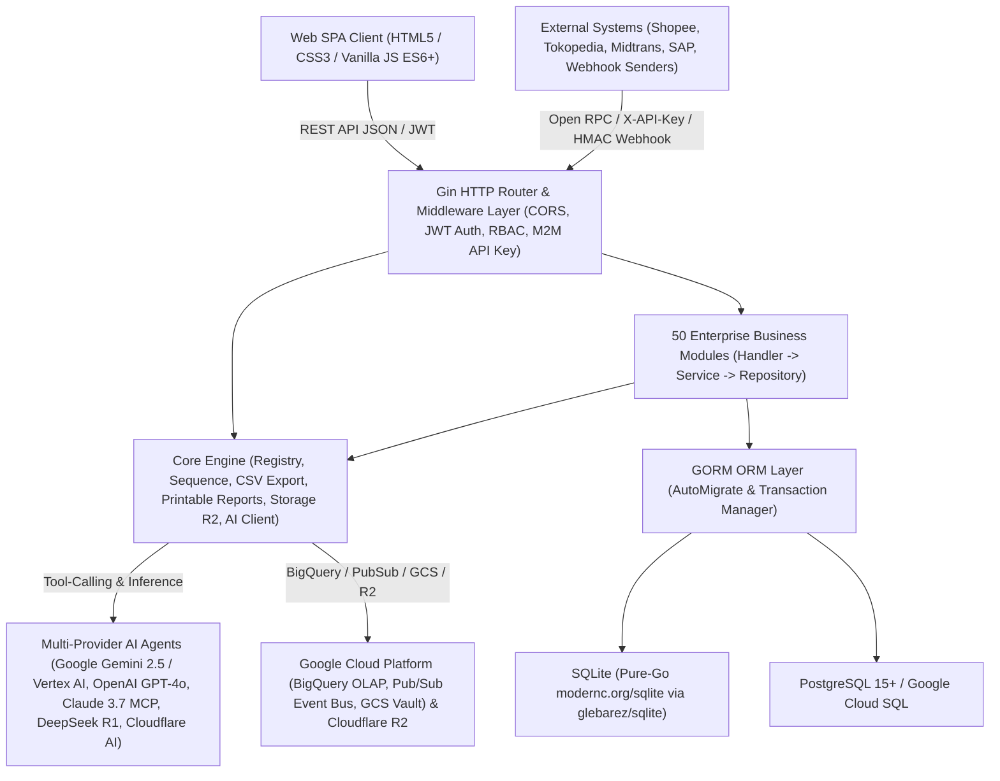

# Technical Documentation — GoERP v1.0

## 1. System Architecture Overview

**GoERP** is a high-performance modular Enterprise Resource Planning (ERP) system built using the **Go (Golang)** programming language. It leverages a **Modular Monolith** architectural pattern inspired by proven enterprise ERP standard models (`ir.model`, `res.partner`, `stock.quant`, `account.move`) combined with **Clean Architecture** principles (*Handler → Service → Repository → GORM Model*).



### 1.1 Core Technology Stack
| Layer | Technology / Library | Role & Specifications |
| :--- | :--- | :--- |
| **Programming Language** | Go `1.22+` (Fully compatible up to Go `1.27`) | Single-binary static compilation, native high concurrency (*goroutines*), minimal memory footprint (~25 MB idle RAM). |
| **HTTP Web Framework** | `github.com/gin-gonic/gin` v1.9+ | High-throughput RESTful routing, middleware chaining, strict JSON payload binding and validation. |
| **ORM & Database Layer** | `gorm.io/gorm` v1.25+ | Object-relational mapping, automatic *Auto-Migration* of 120+ tables at startup, strict ACID transactions (`db.Transaction`). |
| **SQLite Driver (Zero-CGO)** | `github.com/glebarez/sqlite` (`modernc.org/sqlite`) | Pure-Go SQLite engine running seamlessly across Windows, Linux, and macOS under `CGO_ENABLED=0` without GCC dependencies. |
| **PostgreSQL / Cloud SQL** | `gorm.io/driver/postgres` | Enterprise-grade production driver for high-concurrency transactional workloads on PostgreSQL 15+ and Google Cloud SQL. |
| **Security & Authentication** | `github.com/golang-jwt/jwt/v5` & `golang.org/x/crypto/bcrypt` | JSON Web Token (HS256) user authentication, Bcrypt password hashing, and SHA-256 scoped Machine-to-Machine (M2M) API keys. |
| **Multi-Provider AI & Agents** | Google Gemini 2.5 / Vertex AI, OpenAI GPT-4o, Anthropic Claude 3.7 (MCP), DeepSeek R1, Cloudflare Workers AI + Local Agent | Unified AI router with Autonomous ReAct Tool-Calling (`query_inventory_stock`, `get_financial_summary`, `sync_gcp_bigquery`), MCP tool manifests, and deterministic offline fallback. |
| **Cloud Storage & Analytics** | Google Cloud Storage (GCS), BigQuery, Pub/Sub, Cloudflare R2 + Local Disk Fallback | S3-interoperable object storage (`GCS` & `R2`) for `ir.attachment`, real-time BigQuery OLAP streaming, and Pub/Sub domain event bus. |
| **Frontend UI Client** | Vanilla JavaScript (ES6+), CSS3 Variables, HTML5 | Single Page Application (SPA) requiring zero Node.js/Webpack build steps, featuring Dark Glassmorphism, Barcode/QR scanner, and interactive BPMN 2.0 visual canvas. |

---

## 2. Project Directory Structure

```text
c:\erp\
├── cmd/
│   └── server/
│       └── main.go                 # Primary server entrypoint, AutoMigrate, Seeding, Routing & Dashboard Stats
├── internal/
│   ├── config/
│   │   └── config.go               # Environment variables configuration (.env, DB, JWT, Cloudflare AI & R2)
│   ├── core/
│   │   ├── ai/                     # Cloudflare Workers AI client, ERP Copilot & Vision OCR
│   │   ├── database/               # GORM database connection initialization (Pure-Go SQLite & PostgreSQL)
│   │   ├── export/                 # Universal CSV export utility across all ERP data tables
│   │   ├── middleware/             # JWT AuthMiddleware & Role-Based Access Control (RBAC)
│   │   ├── models/                 # Standard BaseModel (ID, CreatedAt, UpdatedAt, DeletedAt, CompanyID)
│   │   ├── registry/               # Dynamic module registry (Enterprise-style module loader)
│   │   └── storage/                # Cloudflare R2 & Local File System object storage abstraction
│   └── modules/                    # 50 Enterprise Business Modules (Each: models, repository, service, handler)
│       ├── base/                   # 1. Company (res.company), Partners (res.partner), Users (res.users), Sequences
│       ├── product/                # 2. Product Categories & Product Master (product.template / product.product)
│       ├── stock/                  # 3. Warehouses, Locations, Double-Entry Stock Move, Picking, Quant & Reordering Rules
│       ├── sale/                   # 4. Quotations & Sales Orders (sale.order & sale.order.line)
│       ├── purchase/               # 5. RFQs & Purchase Orders (purchase.order & purchase.order.line)
│       ├── account/                # 6. Chart of Accounts (CoA), Journals, Invoices, Payments & Financial Statements
│       ├── mrp/                    # 7. Bill of Materials (BoM) & Manufacturing Orders (mrp.production)
│       ├── pos/                    # 8. Point of Sale Cashier Sessions & Instant Retail Orders (pos.session, pos.order)
│       ├── hr/                     # 9. Departments, Employees & Basic Payslip Management
│       ├── crm/                    # 10. Lead Pipeline & Opportunity-to-Quotation Conversion (crm.lead)
│       ├── project/                # 11. Project Management, Task Stages & Timesheets (project.project, project.task)
│       ├── chatter/                # 12. Document Collaboration & Audit Trail Logging (mail.message)
│       ├── asset/                  # 13. Fixed Assets & Automated Linear GL Depreciation Scheduling (account.asset)
│       ├── helpdesk/               # 14. Customer Support Tickets, Escalations & SLA Management (helpdesk.ticket)
│       ├── maintenance/            # 15. Factory Machinery, Equipment, Preventive & Corrective Maintenance
│       ├── fleet/                  # 16. Vehicle Fleet, Odometer Logs & Scheduled Servicing (fleet.vehicle)
│       ├── leave/                  # 17. Employee Leave, Annual Quota Allocations & Payroll Deduction Sync (hr.leave)
│       ├── expense/                # 18. Employee Expense Reimbursement Claims & GL Journal Posting (hr.expense)
│       ├── quality/                # 19. Quality Control Points (QCP), Inspections & CAPA Non-Conformance Alerts
│       ├── approval/               # 20. Multi-Level Corporate Approval Matrix (approval.request)
│       ├── attachment/             # 21. Document Management & AI Vision Receipt OCR (ir.attachment)
│       ├── attendance/             # 22. GPS Geofencing Attendance, Work Shifts & Edge Anomaly Detection
│       ├── recruitment/            # 23. Job Openings, Applicant Pipeline, AI CV Scorer & 1-Click Hire
│       ├── stock_inventory/        # 24. Physical Stock Opname, Discrepancy Adjustments & AI Shrinkage Auditor
│       ├── payroll/                # 25. Multi-Tier Salary Structures, BPJS & Batch Payslip Generation
│       ├── budget/                 # 26. Corporate Budgeting (RKAB), Cost Center Analytic Accounting & AI Burn-Rate Auditor
│       ├── barcode/                # 27. Pure-Go SVG Code 128 Generator, Lot/Serial Tracking & Universal Scanner
│       ├── purchase_requisition/   # 28. Purchase Requisitions (PR), Multi-Vendor Tenders & Blanket Supply Agreements
│       ├── currency/               # 29. Multi-Currency, Historical Spot Exchange Rates & FX Revaluation (PSAK 10 / IAS 21)
│       ├── tax_efaktur/            # 30. VAT e-Faktur Engine, NSFP Quota Allocation & SPT Tax Filing Export
│       ├── bank_reconciliation/    # 31. Bank Statement Import (CSV), Algorithmic Auto-Match & One-Click Reconciliation
│       ├── landed_cost/            # 32. Import Duties, Customs Tariffs & Freight Capitalization to Inventory Valuation
│       ├── traceability/           # 33. Upstream-Downstream Lot Genealogy Tracking & Product Recall Management
│       ├── subscription/           # 34. Recurring SaaS Subscriptions (MRR/ARR), Automated Invoicing & AI Churn Prediction
│       ├── audit_trail/            # 35. Cryptographic Audit Trail (Old vs New JSON) & Suspicious Activity Detection
│       ├── webhook/                # 36. Outbound Event Webhook Dispatcher with HMAC-SHA256 Signatures
│       ├── inbound_webhook/        # 37. Omnichannel Inbound Webhook Receiver (E-Commerce, Payments, Logistics)
│       ├── intercompany/           # 38. Multi-Company Holding, SO/PO Auto-Mirroring & Elimination Consolidation
│       ├── treasury/               # 39. Multi-Bank Liquidity Management, 13-Week Cash Flow Forecast & Cash Sweep
│       ├── mrp_advanced/           # 40. Advanced MRP II: Work Centers, Routing Operations, Work Orders & OEE Analytics
│       ├── tax_ebupot/             # 41. Unified Tax Withholding (e-Bupot) & Periodic Tax Return Filing
│       ├── esignature/             # 42. Cryptographic Digital Signatures (SHA-256) & Stamp Duty Integration
│       ├── wms/                    # 43. 3D Warehouse Bin Locations (Aisle/Rack/Shelf/Bin), Putaway & Wave Picking
│       ├── vendor_portal/          # 44. Self-Service Vendor Portal: Tender Bids, ASN Delivery & Invoice Submissions
│       ├── customer_portal/        # 45. Self-Service B2B Customer Portal: Wholesale Catalog, RMA & Payment Confirmation
│       ├── customs_bonded/         # 46. Customs Bonded Zone IT Inventory Compliance (Inbound, Outbound & Subcontracting)
│       ├── lowcode_studio/         # 47. Low-Code Studio: Dynamic EAV Models, Custom Field Builder & Core Extensions
│       ├── reports/                # 48. Universal Report Engine: Corporate A4 Documents & 80mm POS Thermal Receipts
│       ├── workflow_engine/        # 49. Visual BPMN 2.0 State Machine Engine, Conditional Gateways & AI Designer
│       └── integration_hub/        # 50. Universal Integration Hub: Open RPC Gateway, Pre-built Connectors & Batch ETL
├── tests/
│   └── erp_test.go                 # 54-Section Comprehensive End-to-End Test Suite (Covering all 50 Modules)
├── web/
│   ├── index.html                  # Primary SPA Interface (50 Module Tabs & 110+ Interactive Modals)
│   ├── app.js                      # Application State, REST Client, Table Renderers, Kanban & BPMN Canvas
│   └── style.css                   # Enterprise Dark Glassmorphism CSS Design System
├── Dockerfile                      # Production multi-stage Docker build for lightweight containers
├── docker-compose.yml              # Service orchestration for ERP Application + PostgreSQL 15
└── .env.example                    # Environment variable configuration template
```

---

## 3. Database Design & Multi-Tenant / Multi-Company Architecture

### 3.1 Standard Base Model (`models.BaseModel`)
Every transactional and master entity inherits from `models.BaseModel` (`internal/core/models/base.go`):
- `ID` (`uint`, Primary Key, Auto-Increment)
- `CreatedAt` (`time.Time`)
- `UpdatedAt` (`time.Time`)
- `DeletedAt` (`gorm.DeletedAt`, Indexed for soft deletes)
- `CompanyID` (`uint`, Indexed, Default: `1` for multi-company data isolation)

### 3.2 Double-Entry Bookkeeping Engine
In the `account` module, every accounting entry (`AccountMove`) must strictly satisfy the General Ledger equilibrium formula before it can be posted (`state = 'posted'`):
$$\sum \text{Debit} = \sum \text{Credit}$$
If any discrepancy exceeds the allowed rounding tolerance (`0.01`), the transaction is automatically aborted by the GORM database transaction manager.

### 3.3 Double-Entry Stock Movement Engine
Similar to financial double-entry bookkeeping, the `stock` module does not merely increment or decrement a counter on the product table. Instead, stock moves relocate physical or virtual quantities from a `SourceLocationID` (e.g., *Supplier Location* or *WH/Stock*) to a `DestLocationID` (e.g., *WH/Stock* or *Customer Location*) via the `stock_moves` table, atomicity updating per-location quant balances in `stock_quants`.

### 3.4 Entity-Attribute-Value (EAV) Architecture in Low-Code Studio
The `lowcode_studio` module enables real-time creation of custom business models and fields at runtime without requiring SQL DDL schema modifications through 4 core metadata tables:
1. `lowcode_custom_models`: Stores model definitions (`technical_name` prefixed with `x_`, menu category, icon, audit/chatter toggles).
2. `lowcode_custom_fields`: Stores column definitions (`field_name`, `field_type` such as `char`, `integer`, `float`, `boolean`, `date`, `selection`, `json`).
3. `lowcode_custom_records`: Stores raw data rows with a validated `values_json` payload checked against the associated `lowcode_custom_fields` schema.
4. `lowcode_core_extensions`: Stores supplementary metadata attributes (`extension_json`) dynamically attached to standard core ERP models (`res.partner`, `product.product`, `sale.order`, `purchase.order`).

---

## 4. Security, Authentication & Authorization

1. **User Authentication (JWT HS256)**:
   - Endpoints: `POST /api/v1/auth/login` and `POST /api/v1/auth/register`.
   - Tokens are transmitted via the standard HTTP header: `Authorization: Bearer <token>`.
   - JWT claims encapsulate `user_id`, `email`, `name`, `role`, and `company_id`.
2. **Role-Based Access Control (RBAC)**:
   - Standard roles include `admin`, `manager`, `finance_manager`, `director`, `dept_head`, and `staff`.
   - The `RoleMiddleware` validates user permissions across protected API routes.
3. **Machine-to-Machine Authentication (M2M API Keys)**:
   - Utilized by external microservices and third parties via the `integration_hub` module (`/api/v1/integration/rpc/...`).
   - Callers supply the HTTP header `X-API-Key: ak_live_<prefix>_<secret>`.
   - The system stores only the cryptographic SHA-256 hash of the key, validating granted scopes (`read:product`, `write:sale`, `*`), rate limits (RPM), and IP address allowlists (`allowed_ips`).
4. **Webhook Signature Verification (HMAC-SHA256)**:
   - All outbound webhook event deliveries carry an `X-ERP-Signature-256` header containing an HMAC-SHA256 signature calculated over the JSON payload using a shared tenant secret.

---

## 5. Core API Endpoint Reference

All RESTful endpoints are exposed under the `/api/v1` namespace:

| Module Group | Primary Endpoint Prefix | HTTP Methods & Core Responsibilities |
| :--- | :--- | :--- |
| **Auth & Base** | `/auth/login`, `/partners`, `/companies` | JWT Authentication, Partner CRUD (Customers/Vendors), Multi-Company Management |
| **Dashboard & CSV** | `/dashboard/stats`, `/export/:entity` | Real-time KPI statistics across all 50 modules, universal UTF-8 CSV exporter |
| **AI Copilot** | `/ai/ask`, `/ai/status` | Executive Natural Language Assistant & Cloudflare Workers AI connectivity health |
| **Product & Stock** | `/products`, `/stock/pickings`, `/stock/quants`, `/stock/reorder-rules` | Product Catalog, Warehouse Stock Transfers (`WH/IN`, `WH/OUT`, `WH/INT`), On-hand Stock Quants, Auto-Replenishment |
| **Sales & CRM** | `/sales/orders`, `/crm/leads` | Sales Order Confirmation (auto-generates `WH/OUT` & Customer Invoice), CRM Kanban Pipeline |
| **Purchase & PR** | `/purchases/orders`, `/purchase-requisitions` | Purchase Order Confirmation (auto-generates `WH/IN`), Multi-Vendor Tenders & Blanket Orders |
| **Accounting & Financial** | `/accounting/accounts`, `/accounting/moves`, `/accounting/payments`, `/accounting/reports/*` | General Ledger, Invoices, Payments, Profit & Loss (`profit-loss`), Balance Sheet (`balance-sheet`), Trial Balance (`trial-balance`) |
| **Manufacturing (MRP I & II)** | `/mrp/boms`, `/mrp/orders`, `/mrp-advanced/work-centers`, `/mrp-advanced/work-orders` | Bill of Materials (BoM), Production Orders, Machine Work Centers, Routing Operations & OEE Analytics |
| **POS & Retail** | `/pos/sessions`, `/pos/orders` | Cashier Session Open/Close, Instant Retail Checkout & Automated Stock Depletion |
| **HR, Attendance, Leave, Payroll** | `/hr/employees`, `/attendances`, `/leaves`, `/payroll/payslips`, `/recruitment/applicants` | Employee Records, GPS Geofenced Attendance, Tiered Leave Approvals, Payslip Execution & AI Talent Acquisition |
| **Tax Compliance** | `/tax-efaktur/*`, `/tax-ebupot/*` | Tax Invoice Serial Quotas (NSFP), VAT e-Faktur 11%, Unified Withholding Tax Slips & Periodic Tax Return Exports |
| **Customs & Bonded Zone** | `/customs-bonded/documents`, `/customs-bonded/reports/*`, `/customs-bonded/subcontracts` | Customs Inbound/Outbound Declarations, Customs Clearance Approvals, 4 Official IT Inventory Mutation Reports |
| **WMS, Landed Cost, Traceability** | `/wms/bins`, `/wms/waves`, `/landed-costs`, `/traceability/traces` | 3D Warehouse Bin Locations, Wave Picking, Import Duty Capitalization to Inventory Valuation, Lot Genealogy & Recalls |
| **Portals & e-Signature** | `/vendor-portal/*`, `/customer-portal/*`, `/esignature/requests` | Self-service Vendor & B2B Customer Portals, SHA-256 Digital Signatures & Electronic Stamp Duty |
| **Low-Code Studio** | `/lowcode/models`, `/lowcode/records/:name`, `/lowcode/core-extensions`, `/lowcode/ai/schema-copilot` | Runtime Dynamic Models & Fields (EAV), Standard Entity Extensions & AI Schema Copilot |
| **BPMN 2.0 Workflow Engine** | `/workflows/definitions`, `/workflows/start`, `/workflows/instances`, `/workflows/instances/:id/action` | BPMN State Machine Definitions, Conditional Gateway Evaluations, Actionable Inbox & Audit Logging |
| **Universal Integration Hub** | `/integration/api-keys`, `/integration/connectors`, `/integration/rpc/:method`, `/integration/data-jobs` | M2M API Key Scopes, Marketplace/Payment/Messaging Connectors, Open RPC Gateway & Batch ETL Jobs |
| **Universal Report Engine** | `/reports/catalog`, `/reports/sale-order/:id`, `/reports/invoice/:id`, `/reports/payslip/:id` | Professional A4 PDF-Ready Corporate Documents & 80mm POS Thermal Receipts with Cryptographic SHA-256 Audit Hashes |

---

## 6. Environment Configuration & Deployment Guide

### 6.1 Environment Variables (`.env`)
```ini
PORT=8080
ENVIRONMENT=development
DB_TYPE=sqlite                  # Options: "sqlite" or "postgres"
DB_PATH=erp.db                  # Used when DB_TYPE=sqlite
# PostgreSQL Configuration (Used when DB_TYPE=postgres)
DB_HOST=localhost
DB_PORT=5432
DB_USER=erp
DB_PASSWORD=erp_secret_password
DB_NAME=erp_db
DB_SSLMODE=disable

JWT_SECRET=go-erp-production-super-secret-key-2026
UPLOAD_DIR=./uploads/attachments

# Optional: Cloudflare Workers AI & R2 Object Storage
CLOUDFLARE_ACCOUNT_ID=
CLOUDFLARE_API_TOKEN=
CLOUDFLARE_AI_MODEL=@cf/meta/llama-3.1-8b-instruct
CLOUDFLARE_R2_BUCKET=
CLOUDFLARE_R2_ACCESS_KEY_ID=
CLOUDFLARE_R2_SECRET_ACCESS_KEY=
CLOUDFLARE_R2_ENDPOINT=
```

### 6.2 Running Locally (Zero-CGO / Pure Go)
```powershell
# 1. Run the comprehensive integration test suite (54 test sections)
go test -v ./tests/...

# 2. Compile the server binary
go build -o server.exe ./cmd/server

# 3. Launch the ERP server (automatically performs AutoMigrate and default seed data)
./server.exe
```

### 6.3 Running with Docker Compose (PostgreSQL + ERP Server)
```bash
docker-compose up --build -d
```

---

## 7. Executive Command Center & Continuous Improvement Architecture (`internal/core/commandcenter`)

As part of the platform's continuous improvement initiative, the `internal/core/commandcenter` package provides 4 high-speed cross-module services mounted under `/api/v1`:

1. **Universal Omni-Search Engine (`GET /api/v1/search?q=<keyword>`)**:
   - Executes high-speed concurrent search across all **50 ERP Modules** (by title, category, tab code, and bilingual keywords) and **5 core transactional/master tables** (`products`, `partners`, `sale_orders`, `purchase_orders`, `account_moves`).
   - Directly integrated with the frontend **Command Palette (`Ctrl+K`)** featuring a 120ms debounce.
2. **Actionable Notification & Pending Approvals Center (`GET /api/v1/dashboard/notifications`)**:
   - Aggregates real-time pending action items requiring user intervention across business departments:
     - Tiered approval requests (`approval_requests`)
     - Active in-flight BPMN 2.0 workflow instances (`workflow_instances`)
     - Sales and purchase orders pending in `draft` state (`sale_orders`, `purchase_orders`)
     - Warehouse stock transfer documents awaiting physical validation (`stock_pickings`)
     - Draft accounting moves pending GL posting (`account_moves`)
     - Security alerts and high-risk transactional modifications (`audit_log_entries` with `is_suspicious = true`)
3. **1-Click End-to-End Business Cycle Simulator (`POST /api/v1/dashboard/simulate-cycle`)**:
   - Executes an automated, atomic end-to-end enterprise business cycle (*Procure-to-Pay* + *Warehouse Management* + *Order-to-Cash* + *General Ledger Posting*) in a single click:
     1. Validates or provisions Customer, Supplier, and Storable Product master data.
     2. Generates and confirms a **Purchase Order (`PO...`)** -> generates and validates a **Goods Receipt (`WH/IN/...`)**, atomically incrementing warehouse stock quants.
     3. Generates and confirms a **Sales Order (`SO...`)** -> generates and validates a **Delivery Order (`WH/OUT/...`)**, atomically decrementing warehouse stock quants.
     4. Generates and posts a balanced **Customer Invoice (`INV/...`)** ($\sum \text{Debit} = \sum \text{Credit}$) with 11% VAT directly into the **General Ledger**.
4. **Executive KPI Summary CSV Exporter (`GET /api/v1/dashboard/export-summary`)**:
   - Generates a UTF-8 BOM CSV summary aggregating critical financial, operational, and departmental KPIs across all 50 enterprise modules for C-level reporting.


---

## 6. Native Model Context Protocol (MCP) & Google Cloud A2A Architecture

GoERP provides first-class support for autonomous agent-to-agent interoperability and external AI tooling integration without custom coding:

### 6.1 Native Model Context Protocol (MCP) JSON-RPC 2.0 Server (`/mcp`)
Compliant with standard MCP specification (`2025-03-26`), GoERP functions as a native MCP server for **Claude Desktop, Cursor, Gemini CLI, and Antigravity**:
- **Protocol Endpoint**: `POST /mcp` and `GET /mcp`
- **Supported Methods**:
  - `initialize`: Reports server capabilities, protocol version (`2025-03-26`), and server name (`goerp-enterprise-mcp-server`).
  - `ping`: Returns server heartbeat and UTC timestamp.
  - `tools/list`: Exposes standardized tool definitions with JSON Schema parameter validation (`query_inventory_stock`, `get_financial_summary`, `search_erp_records`, `create_sales_quotation`, `create_purchase_rfq`, `sync_gcp_bigquery`, `extract_document_3way_match`, `scan_fraud_anomalies`, `forecast_cashflow`, `calculate_esg_carbon_footprint`).
  - `tools/call`: Invokes any ERP database tool atomically against live GORM tables and returns structured content.
  - `resources/list` & `resources/read`: Exposes virtual URIs (`erp://finance/gl-summary`, `erp://inventory/stock-levels`, `erp://esg/carbon-ledger`).
  - `prompts/list`: Exports standard executive prompt templates for forensic audit, supply-chain 3-way match, and ESG compliance.

### 6.2 Google Cloud Agent-to-Agent (A2A) Protocol (`/.well-known/agent.json`)
GoERP exposes an Agent Discovery Card following Google Cloud's open standard for autonomous B2B agent-to-agent communication:
- **Discovery Card**: `GET /.well-known/agent.json`
- **Task Submission Gateway**: `POST /api/v1/ai/a2a/tasks/send`
- **Supported B2B Skills**:
  1. `inventory-availability-check`: Real-time warehouse availability and pricing for supplier/buyer agents.
  2. `b2b-quote-negotiation`: Autonomous sales quotation and purchase RFQ creation.
  3. `invoice-3way-reconciliation`: Cross-company automated 3-Way Matching of vendor bills against POs and GRNs.
  4. `financial-audit-verification`: Continuous fraud radar and 90-day cashflow liquidity projection.
  5. `esg-scope3-exchange`: Scope 1-3 GHG carbon emissions data exchange across supply chain partners.

---

## 7. Enterprise AI Intelligence Engine

### 7.1 AI Document Intelligence & Automated 3-Way Matching (`POST /api/v1/ai/doc-intelligence`)
- **Multimodal OCR Extraction**: Extracts Vendor Name, NPWP Tax ID, e-Faktur Serial Number (`010.002-26.XXXXXXXX`), Invoice Number, DPP Subtotal, PPN 11%, PPh 23, and Grand Total with 97%+ confidence.
- **Automated 3-Way Matching**: Cross-matches invoice amounts against corresponding **Purchase Orders (`PO...`)** and warehouse **Goods Receipt Notes (`WH/IN...`)**. Flags price deviations exceeding tolerance (`PRICE_VARIANCE_ALERT`) and auto-generates balanced double-entry GL journal moves (Debit: Inventory Clearing 510100 & VAT Input 110600; Credit: Accounts Payable 210100).

### 7.2 Continuous AI Audit & Fraud Radar (`GET & POST /api/v1/ai/fraud-radar`)
- **Forensic Anomaly Detection**:
  - *Split PO Detection*: Identifies potential approval-limit evasion by detecting multiple POs to the same vendor within the same cycle.
  - *High-Value Postings*: Flags journal moves and invoices exceeding user-defined threshold limits (default: IDR 50M).
  - *Trial Balance Guard*: Verifies 100% mathematical integrity where `Debit == Credit` across all historical entries.
- **Compliance Alignment**: PSAK / IFRS, ISO 27001 Audit Immutability, and SOX Segregation of Duties.

### 7.3 Predictive 30/60/90-Day Cashflow Forecasting (`GET & POST /api/v1/ai/cashflow-forecast`)
- **Liquidity Horizon Modeling**: Projects cash inflows (Confirmed Sales AR, Pipeline Quotations, SaaS Subscription MRR) and outflows (Procurement AP, Operating Expenses, Payroll) across 30, 60, and 90-day horizons.
- **Scenario Analysis**: Generates Optimistic (+25%), Baseline (100%), and Conservative (-22%) projections.
- **CFO Health Metrics**: Computes estimated cash runway (months), Days Sales Outstanding (DSO), and Days Payable Outstanding (DPO).

### 7.4 ESG & Carbon Footprint Ledger (`GET & POST /api/v1/ai/esg-report`)
- **Greenhouse Gas (GHG) Protocol Accounting**:
  - **Scope 1 (Direct)**: Fleet vehicle fuel consumption (IPCC Mobile Combustion: 2.68 kg CO2e / Liter diesel).
  - **Scope 2 (Indirect)**: MRP Manufacturing electricity consumption (Grid Electricity Factor: 0.78 kg CO2e / kWh).
  - **Scope 3 (Value Chain)**: Upstream/downstream logistics shipments and procurement orders (GHG Scope 3 Cat 1 & 4).
- **Sustainability Metrics**: Total emissions (kg & metric tons CO2e), carbon intensity per million IDR revenue, and tree offset equivalents.
- **Regulatory Readiness**: OJK POJK No. 51/2017, Global Reporting Initiative (GRI 305), and EU CSRD.

### 7.5 Omnichannel ChatOps Gateway (`POST /api/v1/ai/chatops/webhook`)
- **Supported Channels**: WhatsApp Business API, Telegram Bot, Slack, and Microsoft Teams.
- **Executive Slash Commands**:
  - `/omzet`: Instant revenue, procurement spend, and GL posting summary.
  - `/stok`: Warehouse inventory stock and quant availability brief.
  - `/approve`: Executive 1-click Purchase Order approval.
  - `/fraud`: Immediate forensic audit and fraud risk radar briefing.
  - `/esg`: Live corporate ESG carbon footprint and sustainability summary.

---

## 8. OpenAPI 3.1 & Interactive API Explorer (`/api/docs`)

GoERP serves a built-in OpenAPI 3.1.0 specification and an interactive browser-based testing console:
- **Raw JSON Spec**: `GET /openapi.json` and `GET /api/v1/openapi.json`
- **Interactive Explorer UI**: `GET /api/docs`
- Features live token authentication, pre-populated sample payloads for MCP, A2A, and ChatOps, and real-time response inspection.


---

## 9. Next-Gen Enterprise Capabilities (v1.43.0)

### 9.1 AI Demand Sensing & Smart Inventory Replenishment (`internal/core/ai/demand_sensing.go`)
- **Daily Demand Velocity**: Calculates 30, 60, and 90-day moving sales velocity across historical order lines.
- **Dynamic Gaussian Safety Stock**: Computes dynamic buffer $SS = Z \times \sqrt{L} \times \sigma_D$ at a 95% cycle service level ($Z = 1.65$) to absorb supplier lead-time variance.
- **Reorder Point (ROP)**: $ROP = (L \times D) + SS$.
- **Economic Order Quantity (EOQ)**: $EOQ = \sqrt{\frac{2DS}{H}}$, optimizing total annual procurement and inventory holding costs.
- **1-Click Auto-Draft PO**: Endpoints `GET /api/v1/ai/demand-sensing` and `POST /api/v1/ai/replenish/auto-po` automatically draft Purchase Orders with EOQ batch sizes and 11% VAT.

### 9.2 Real-Time SSE Event Broker & Live Presence Engine (`internal/core/events`)
- **Persistent Server-Sent Events**: `GET /api/v1/events/stream` provides live push notifications for sales orders, payment reconciliations, and inventory alerts with periodic 15s keep-alive heartbeats.
- **Document Presence & Collision Avoidance**: `POST & GET /api/v1/events/presence` tracks active users viewing or editing specific documents (`sale_order`, `purchase_order`, `account_move`, `mrp_production`) to avoid concurrent edit collisions.

### 9.3 SaaS Multi-Tenancy & Database-per-Tenant Isolation (`internal/core/multitenancy`)
- **Tenant Context Middleware**: Resolves tenant identity from:
  1. Subdomain parsing from Host header (e.g. `tenant1.goerp.io`).
  2. Header `X-Tenant-ID` or `X-Tenant-Domain`.
  3. URL query parameter `?tenant=...`.
- **Database Isolation Modes**: Dedicated SQLite file path (`./data/tenants/<tenant_id>/erp.db`) or PostgreSQL schema search path (`SET search_path TO tenant_<tenant_id>`).
- **Self-Service Tenant Provisioning**: `POST /api/v1/saas/tenants/register` provisions new tenants with configurable plan limits (Starter, Professional, Enterprise) and storage quotas.

### 9.4 Offline-First PWA & Barcode POS Sync (`web/manifest.json` & `web/sw.js`)
- **Progressive Web App Shell**: Standalone mobile display mode, theme colors, and offline shell pre-caching via Service Worker.
- **Offline Batch Reconciliation**: `POST /api/v1/pos/sync-offline-batch` atomically processes orders queued locally during network outages, decrements warehouse stock quants, and posts balanced GL entries upon reconnection.

### 9.5 Hands-Free Voice Ops Assistant (`internal/core/ai/voice.go`)
- **Voice Intent Parser**: Endpoint `POST /api/v1/ai/voice/command` accepts voice transcripts and routes to autonomous tools (`warehouse_inventory_check`, `executive_finance_inquiry`, `executive_order_approval`, `continuous_fraud_scan`, `esg_carbon_lookup`, `cashflow_runway_forecast`).
- **Conversational Speech Synthesis**: Returns synthesized text in Indonesian (`id-ID`) or English (`en-US`) for browser SpeechSynthesis and mobile audio playback.

---

## 10. Advanced Intelligence & Enterprise Security (v1.44.0)

### 10.1 AI Autonomous Supplier Negotiation & RFQ Bidding Wars (`internal/core/ai/bidding_engine.go`)
- **Tokenized Vendor Bid Intake**: Endpoint `POST /api/v1/ai/rfq/tenders` initializes competitive tenders with secure vendor submission tokens (`POST /api/v1/ai/rfq/submit-bid`).
- **Multi-Attribute Utility Theory (MAUT) Scorecard**: AI scoring engine dynamically weights multi-criteria parameters:
  - Unit Price & Volume Discounts (40% weight)
  - Delivery Lead Time & Speed (25% weight)
  - Payment Terms Flexibility (Net 30/60/90) (20% weight)
  - Quality Warranty & Coverage (15% weight)
- **Automated Award & PO Generation**: `POST /api/v1/ai/rfq/award/:tender_id` locks the lowest effective price, calculates procurement budget savings, and automatically generates a draft Purchase Order (`PO/AWARD/...`) with line items.

### 10.2 Cryptographic Merkle-Tree Ledger Audit (`internal/core/audit/merkle_ledger.go`)
- **Sequential SHA-256 Hash Chaining**: Every financial record (`account_moves`, `account_payments`, and `purchase_orders`) is deterministically serialized and cryptographically linked to previous entries:
  $$\text{Block}_{i} = \text{SHA256}(\text{Block}_{i-1} \parallel \text{CanonicalTxData}_i)$$
- **Binary Merkle Tree Recomputation**: Leaves are computed as $\text{SHA256}(\text{Block}_i)$, recursively paired into branch nodes up to a singular, verifiable Merkle Root.
- **1-Click Tamper Verification**: Endpoint `GET /api/v1/audit/verify-tamper` recalculates the tree in real time, verifies mathematical sibling proof paths, and generates a zero-tamper cryptographic certificate confirming zero alterations or deletions.

### 10.3 Supply Chain Digital Twin & What-If Scenario Simulator (`internal/core/ai/digital_twin.go`)
- **Stress-Test Simulation Engine**: Endpoint `POST /api/v1/ai/digital-twin/simulate` accepts parameterized macroeconomic and supply-chain shocks:
  - Supplier Lead-Time Delay ($\Delta L$ days)
  - Fuel & Freight Rate Inflation ($\%$)
  - USD/IDR Spot Rate Depreciation ($\%$)
  - Raw Material Price Hikes ($\%$)
  - Demand Spikes ($\%$)
- **Impact Assessment**: Simulates compound cost increases across active Bills of Materials (`mrp_boms`), projects gross profit margin erosion, identifies at-risk SKUs and projected stockout dates, and computes customer revenue at risk.
- **Strategic Mitigation Playbooks**: Automatically generates actionable hedging recommendations across Dual-Sourcing, Freight Index Surcharges, Gaussian Safety Stock increases ($Z=2.33$), and FX Forward Contracts.

### 10.4 Enterprise Single Sign-On & Field-Level RBAC Matrix (`internal/core/security/rbac_matrix.go`)
- **Federated Corporate Identity**: Configured metadata for SAML 2.0 (Okta, Microsoft Entra ID) and OpenID Connect (Google Workspace, Keycloak) with RSA-SHA256 certificate validation (`GET /api/v1/security/sso/config`).
- **Granular Field-Level Data Masking**: Dynamic masking engine (`POST /api/v1/security/mask-record`) prevents information leakage across personas:
  - Warehouse operators see physical quantity and bin locations, while `standard_price` and `cost_price` are masked to `***CONFIDENTIAL***`.
  - Sales reps see customer orders and retail prices, while vendor costs are masked.
  - Role-permission profiles map modules, CRUD actions, and field masking policies.

### 10.5 Visual Drag-and-Drop BI Dashboard & Custom Report Builder (`internal/core/bi/dashboard_builder.go`)
- **Interactive BI Dashboard Cockpit**: Endpoints `GET & POST /api/v1/bi/dashboards` manage departmental layouts (C-Suite Executive, Supply Chain Operations, Treasury & Finance) with flexible GridX/Y/W/H coordinates.
- **Dynamic Real-Time Widgets**: Automatically aggregates live metrics from the ERP database for KPI Cards, Margin Gauges, Bar Charts (Monthly Revenue), Line Charts (Cashflow Runway), and Pie Charts (Product Category Breakdown).
- **Custom Executive Report Builder**: Endpoint `POST /api/v1/bi/reports/export` generates custom tabular reports with aggregations and formats for Excel and PDF downloads.

---

## 11. Strategic Enterprise Optimization & IoT Operations (v1.45.0)

### 11.1 AI Autonomous Dynamic Pricing & Elasticity Optimizer (`internal/core/ai/pricing_optimizer.go`)
- **Price Elasticity of Demand (PED)**: Evaluates volume elasticity $PED = \frac{\% \Delta Q}{\% \Delta P}$ per customer tier (Retail, Wholesale, Key Account, E-Commerce).
- **Profit-Maximizing Pricing**: Endpoint `POST /api/v1/ai/pricing/recommend` optimizes unit price with protected gross margin floors (e.g. 20%), inventory velocity factors, and Days-of-Inventory (DOI) markdown rules.
- **Automated Rule Application**: `POST /api/v1/ai/pricing/apply-rule` commits approved price updates to master product records and broadcasts audit notifications.

### 11.2 Cross-Border FX Exposure Matrix & Automated Treasury Hedging (`internal/core/treasury/fx_exposure.go`)
- **Net Open Currency Position (NOP)**: Endpoint `GET /api/v1/treasury/fx-exposure` aggregates multi-currency cash balances, export AR, import AP, and committed open POs:
  $$\text{NOP}_{\text{CCY}} = (\text{Cash} + \text{AR}) - (\text{AP} + \text{Committed PO})$$
- **Sensitivity Stress-Testing**: Models currency depreciation shocks ($\pm 5\%$, $\pm 10\%$) against operating cashflow and computes unhedged Value-at-Risk (VaR).
- **Automated Forward Contracts**: Endpoint `POST /api/v1/treasury/hedge-contracts` registers FX Forward contracts locking spot rates to insulate international procurement margins.

### 11.3 Predictive Equipment Maintenance & IoT Telemetry Gateway (`internal/core/iot/predictive_maintenance.go`)
- **Shop-Floor Telemetry Ingestion**: Endpoint `POST /api/v1/iot/telemetry/ingest` ingests mechanical vibration (RMS per ISO 10816 standards), operating temperature, motor current, and acoustic emissions.
- **Remaining Useful Life (RUL) Modeling**: Weibull-based estimation calculates remaining machine operating hours before bearing or spindle fatigue failure.
- **Automated Work Orders**: Transitions to `CRITICAL_ANOMALY` automatically trigger priority Maintenance Requests (`maintenance.MaintenanceRequest`) and reserve replacement spare parts before physical breakdown occurs.

### 11.4 Supplier Sustainability Passport & Scope 3 Vendor Scoring (`internal/core/esg/supplier_passport.go`)
- **Multi-Dimensional Green Auditing**: Endpoint `GET /api/v1/esg/vendor-scorecards` scores vendors across Carbon Intensity (kg CO2e/unit), ISO 14001/50001 certifications, circular recycled packaging percentage, and green logistics modes (Electric EV, Intermodal Rail, Maritime).
- **Composite Green Score (0-100)**: Classifies vendors into tiers (Platinum Leader, Gold Advanced, Silver Compliant, Bronze Basic).
- **Procurement Bonus Points**: Platinum and Gold suppliers receive competitive bonus scoring in corporate RFQ bidding wars, lowering the company's indirect Scope 3 emissions.

### 11.5 AI Knowledge Base Semantic Search & Customer Support Copilot (RAG) (`internal/core/ai/knowledge_rag.go`)
- **Hybrid Semantic Index**: Indexes corporate SOPs, product specifications, warranty policies, and tax guidelines via BM25 and cosine keyword similarity (`POST /api/v1/ai/knowledge/query`).
- **Support Copilot Agent**: Endpoint `POST /api/v1/ai/helpdesk/copilot-draft` ingests incoming Helpdesk tickets, extracts problem context, retrieves authoritative knowledge chunks, and automatically drafts polite, accurate, step-by-step customer resolutions with high confidence scores.

---

## 12. Advanced Legal Intelligence, Spatial Optimization & Global Supply Chain EDI (v1.46.0)

### 12.1 AI Automated Contract Lifecycle Management (CLM) & Clause Risk Redlining (`internal/core/ai/clm_analyzer.go`)
- **Automated Legal Risk Scoring**: Endpoint `POST /api/v1/ai/contracts/analyze` ingests Vendor MSAs, NDAs, and Customer Agreements, extracting high-liability clauses (Unlimited Liability, one-sided Indemnification, aggressive Liquidated Damages, lock-in Auto-Renewal, and unbalanced Termination for Convenience).
- **Composite Contract Exposure Score (0-100)**: Evaluates overall legal risk tiers (`LOW_RISK`, `MEDIUM_RISK`, `HIGH_RISK`, `CRITICAL_EXPOSURE`) with actionable executive summaries.
- **AI Counter-Clause Redliner**: Endpoint `POST /api/v1/ai/contracts/redline` automatically synthesizes balanced counter-proposals (e.g. capping liability to 100% of trailing 12-month contract value) with legal rationales and negotiation tactics.

### 12.2 Smart 3D Bin Packing & Pallet Load Optimizer (`internal/core/wms/bin_packing.go`)
- **Spatial 3D Knapsack Heuristic**: Endpoint `POST /api/v1/wms/pack-optimizer` computes optimal cuboid packing coordinates $(x, y, z)$, 90-degree rotations, and layer indices across Euro Pallets ($1200 \times 800 \times 1500$ mm), Standard Pallets ($1200 \times 1000 \times 1600$ mm), 20ft Containers, and Delivery Vans.
- **Fragile & Gravitational Stability**: Automatically sorts non-fragile heavy cartons to bottom support layers ($Z = 0$) and places fragile items on top layers to prevent cargo crush damage.
- **Volume & Weight Utilization**: Computes precise volumetric efficiency percentages, gross payload weight, center-of-gravity ratios, and generates step-by-step 3D forklift loading instructions.

### 12.3 Predictive Employee Attrition & AI Talent Retention Radar (`internal/core/hr/attrition_radar.go`)
- **Multi-Factor Flight Risk Scoring**: Endpoint `GET /api/v1/hr/attrition-radar` computes employee flight risk (0-100) using continuous evaluation of overtime burnout ratios, untaken annual leave accumulation, months since last promotion, and compensation market review latencies.
- **Departmental Risk Benchmarking**: Aggregates enterprise flight risk heatmaps across Supply Chain, Manufacturing, Sales, Engineering, and Finance.
- **Automated Retention Playbooks**: Endpoint `POST /api/v1/hr/retention-playbook` executes targeted HR interventions (stay interviews, salary adjustments, promotion fast-tracking, and shift workload rebalancing) with projected post-intervention risk reductions.

### 12.4 Multi-Horizon Bank Reconciler with ML Fuzzy Statement Matching (`internal/core/account/fuzzy_reconciliation.go`)
- **ML Fuzzy Statement Matching**: Endpoint `POST /api/v1/account/reconciliation/auto-match` compares raw bank statement lines against open invoices using normalized Levenshtein string distance, invoice reference extraction, and partner memo heuristics.
- **Banking Fee Tolerance Bands**: Automatically accommodates transfer fee discrepancies (e.g. Indonesian BI-FAST Rp 2,500 and RTGS Rp 6,500 fees), eliminating manual journal variance adjustments.
- **1-Click Batch Reconciliation**: Endpoint `POST /api/v1/account/reconciliation/batch-post` posts matched statement lines to General Ledger journal entries, registers customer payments (`account.payment`), and updates invoice status to `paid` in bulk.

### 12.5 Universal EDI (Electronic Data Interchange) Gateway (`internal/core/edi/gateway.go`)
- **Multi-Standard Ingestion Engine**: Endpoint `POST /api/v1/edi/ingest` automatically detects and parses North American ANSI X12 and international UN/EDIFACT streams.
- **Core Document Support**:
  - **EDI 850 / ORDERS**: Ingests retail and B2B Purchase Orders and stages draft Sales Orders (`sale.order`) in GoERP with parsed line items, quantities, and pricing.
  - **EDI 855 / ORDRSP**: Generates automated PO acknowledgments confirming order acceptance and delivery commitments.
  - **EDI 856 / DESADV**: Generates Advance Shipping Notices (ASN) with carrier codes, tracking numbers, and package hierarchies upon stock shipment.
  - **EDI 810 / INVOIC**: Generates and ingests Commercial Invoices directly synchronized with posted General Ledger customer invoices (`account.move`).
- **Standard Discovery**: Endpoint `GET /api/v1/edi/supported` exposes transaction set catalogs and validation specs for partner B2B integrations.
