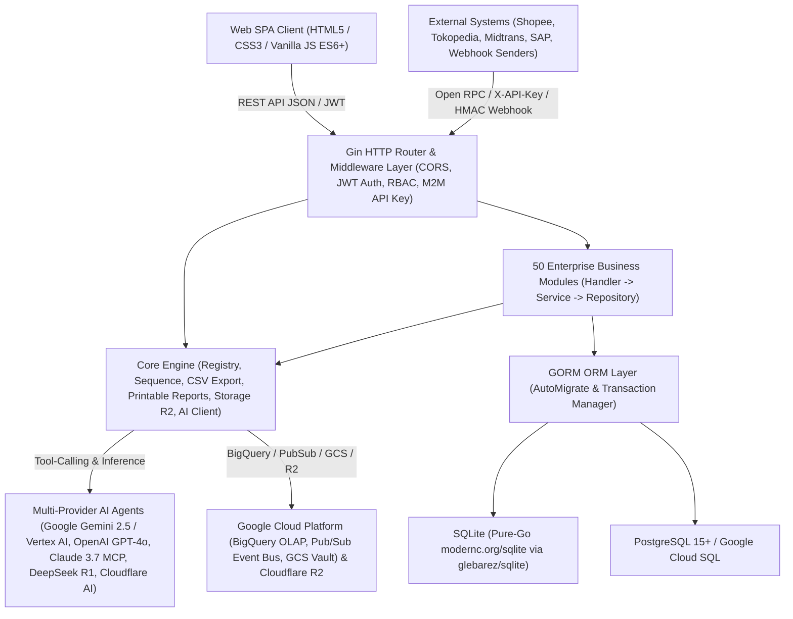

# Technical Documentation — GoERP v1.0

## 1. System Architecture Overview

**GoERP** is a high-performance modular Enterprise Resource Planning (ERP) system built using the **Go (Golang)** programming language. It leverages a **Modular Monolith** architectural pattern inspired by proven enterprise ERP standard models (`ir.model`, `res.partner`, `stock.quant`, `account.move`) combined with **Clean Architecture** principles (*Handler → Service → Repository → GORM Model*).



### 1.1 Core Technology Stack
| Layer | Technology / Library | Role & Specifications |
| :--- | :--- | :--- |
| **Programming Language** | Go `1.22+` (Fully compatible up to Go `1.27`) | Single-binary static compilation, native high concurrency (*goroutines*), minimal memory footprint (~25 MB idle RAM). |
| **HTTP Web Framework** | `github.com/gin-gonic/gin` v1.9+ | High-throughput RESTful routing, middleware chaining, strict JSON payload binding and validation. |
| **ORM & Database Layer** | `gorm.io/gorm` v1.25+ | Object-relational mapping, automatic *Auto-Migration* of 120+ tables at startup, strict ACID transactions (`db.Transaction`). |
| **SQLite Driver (Zero-CGO)** | `github.com/glebarez/sqlite` (`modernc.org/sqlite`) | Pure-Go SQLite engine running seamlessly across Windows, Linux, and macOS under `CGO_ENABLED=0` without GCC dependencies. |
| **PostgreSQL / Cloud SQL** | `gorm.io/driver/postgres` | Enterprise-grade production driver for high-concurrency transactional workloads on PostgreSQL 15+ and Google Cloud SQL. |
| **Security & Authentication** | `github.com/golang-jwt/jwt/v5` & `golang.org/x/crypto/bcrypt` | JSON Web Token (HS256) user authentication, Bcrypt password hashing, and SHA-256 scoped Machine-to-Machine (M2M) API keys. |
| **Multi-Provider AI & Agents** | Google Gemini 2.5 / Vertex AI, OpenAI GPT-4o, Anthropic Claude 3.7 (MCP), DeepSeek R1, Cloudflare Workers AI + Local Agent | Unified AI router with Autonomous ReAct Tool-Calling (`query_inventory_stock`, `get_financial_summary`, `sync_gcp_bigquery`), MCP tool manifests, and deterministic offline fallback. |
| **Cloud Storage & Analytics** | Google Cloud Storage (GCS), BigQuery, Pub/Sub, Cloudflare R2 + Local Disk Fallback | S3-interoperable object storage (`GCS` & `R2`) for `ir.attachment`, real-time BigQuery OLAP streaming, and Pub/Sub domain event bus. |
| **Frontend UI Client** | Vanilla JavaScript (ES6+), CSS3 Variables, HTML5 | Single Page Application (SPA) requiring zero Node.js/Webpack build steps, featuring Dark Glassmorphism, Barcode/QR scanner, and interactive BPMN 2.0 visual canvas. |

---

## 2. Project Directory Structure

```text
c:\erp\
├── cmd/
│   └── server/
│       └── main.go                 # Primary server entrypoint, AutoMigrate, Seeding, Routing & Dashboard Stats
├── internal/
│   ├── config/
│   │   └── config.go               # Environment variables configuration (.env, DB, JWT, Cloudflare AI & R2)
│   ├── core/
│   │   ├── ai/                     # Cloudflare Workers AI client, ERP Copilot & Vision OCR
│   │   ├── database/               # GORM database connection initialization (Pure-Go SQLite & PostgreSQL)
│   │   ├── export/                 # Universal CSV export utility across all ERP data tables
│   │   ├── middleware/             # JWT AuthMiddleware & Role-Based Access Control (RBAC)
│   │   ├── models/                 # Standard BaseModel (ID, CreatedAt, UpdatedAt, DeletedAt, CompanyID)
│   │   ├── registry/               # Dynamic module registry (Enterprise-style module loader)
│   │   └── storage/                # Cloudflare R2 & Local File System object storage abstraction
│   └── modules/                    # 50 Enterprise Business Modules (Each: models, repository, service, handler)
│       ├── base/                   # 1. Company (res.company), Partners (res.partner), Users (res.users), Sequences
│       ├── product/                # 2. Product Categories & Product Master (product.template / product.product)
│       ├── stock/                  # 3. Warehouses, Locations, Double-Entry Stock Move, Picking, Quant & Reordering Rules
│       ├── sale/                   # 4. Quotations & Sales Orders (sale.order & sale.order.line)
│       ├── purchase/               # 5. RFQs & Purchase Orders (purchase.order & purchase.order.line)
│       ├── account/                # 6. Chart of Accounts (CoA), Journals, Invoices, Payments & Financial Statements
│       ├── mrp/                    # 7. Bill of Materials (BoM) & Manufacturing Orders (mrp.production)
│       ├── pos/                    # 8. Point of Sale Cashier Sessions & Instant Retail Orders (pos.session, pos.order)
│       ├── hr/                     # 9. Departments, Employees & Basic Payslip Management
│       ├── crm/                    # 10. Lead Pipeline & Opportunity-to-Quotation Conversion (crm.lead)
│       ├── project/                # 11. Project Management, Task Stages & Timesheets (project.project, project.task)
│       ├── chatter/                # 12. Document Collaboration & Audit Trail Logging (mail.message)
│       ├── asset/                  # 13. Fixed Assets & Automated Linear GL Depreciation Scheduling (account.asset)
│       ├── helpdesk/               # 14. Customer Support Tickets, Escalations & SLA Management (helpdesk.ticket)
│       ├── maintenance/            # 15. Factory Machinery, Equipment, Preventive & Corrective Maintenance
│       ├── fleet/                  # 16. Vehicle Fleet, Odometer Logs & Scheduled Servicing (fleet.vehicle)
│       ├── leave/                  # 17. Employee Leave, Annual Quota Allocations & Payroll Deduction Sync (hr.leave)
│       ├── expense/                # 18. Employee Expense Reimbursement Claims & GL Journal Posting (hr.expense)
│       ├── quality/                # 19. Quality Control Points (QCP), Inspections & CAPA Non-Conformance Alerts
│       ├── approval/               # 20. Multi-Level Corporate Approval Matrix (approval.request)
│       ├── attachment/             # 21. Document Management & AI Vision Receipt OCR (ir.attachment)
│       ├── attendance/             # 22. GPS Geofencing Attendance, Work Shifts & Edge Anomaly Detection
│       ├── recruitment/            # 23. Job Openings, Applicant Pipeline, AI CV Scorer & 1-Click Hire
│       ├── stock_inventory/        # 24. Physical Stock Opname, Discrepancy Adjustments & AI Shrinkage Auditor
│       ├── payroll/                # 25. Multi-Tier Salary Structures, BPJS & Batch Payslip Generation
│       ├── budget/                 # 26. Corporate Budgeting (RKAB), Cost Center Analytic Accounting & AI Burn-Rate Auditor
│       ├── barcode/                # 27. Pure-Go SVG Code 128 Generator, Lot/Serial Tracking & Universal Scanner
│       ├── purchase_requisition/   # 28. Purchase Requisitions (PR), Multi-Vendor Tenders & Blanket Supply Agreements
│       ├── currency/               # 29. Multi-Currency, Historical Spot Exchange Rates & FX Revaluation (PSAK 10 / IAS 21)
│       ├── tax_efaktur/            # 30. VAT e-Faktur Engine, NSFP Quota Allocation & SPT Tax Filing Export
│       ├── bank_reconciliation/    # 31. Bank Statement Import (CSV), Algorithmic Auto-Match & One-Click Reconciliation
│       ├── landed_cost/            # 32. Import Duties, Customs Tariffs & Freight Capitalization to Inventory Valuation
│       ├── traceability/           # 33. Upstream-Downstream Lot Genealogy Tracking & Product Recall Management
│       ├── subscription/           # 34. Recurring SaaS Subscriptions (MRR/ARR), Automated Invoicing & AI Churn Prediction
│       ├── audit_trail/            # 35. Cryptographic Audit Trail (Old vs New JSON) & Suspicious Activity Detection
│       ├── webhook/                # 36. Outbound Event Webhook Dispatcher with HMAC-SHA256 Signatures
│       ├── inbound_webhook/        # 37. Omnichannel Inbound Webhook Receiver (E-Commerce, Payments, Logistics)
│       ├── intercompany/           # 38. Multi-Company Holding, SO/PO Auto-Mirroring & Elimination Consolidation
│       ├── treasury/               # 39. Multi-Bank Liquidity Management, 13-Week Cash Flow Forecast & Cash Sweep
│       ├── mrp_advanced/           # 40. Advanced MRP II: Work Centers, Routing Operations, Work Orders & OEE Analytics
│       ├── tax_ebupot/             # 41. Unified Tax Withholding (e-Bupot) & Periodic Tax Return Filing
│       ├── esignature/             # 42. Cryptographic Digital Signatures (SHA-256) & Stamp Duty Integration
│       ├── wms/                    # 43. 3D Warehouse Bin Locations (Aisle/Rack/Shelf/Bin), Putaway & Wave Picking
│       ├── vendor_portal/          # 44. Self-Service Vendor Portal: Tender Bids, ASN Delivery & Invoice Submissions
│       ├── customer_portal/        # 45. Self-Service B2B Customer Portal: Wholesale Catalog, RMA & Payment Confirmation
│       ├── customs_bonded/         # 46. Customs Bonded Zone IT Inventory Compliance (Inbound, Outbound & Subcontracting)
│       ├── lowcode_studio/         # 47. Low-Code Studio: Dynamic EAV Models, Custom Field Builder & Core Extensions
│       ├── reports/                # 48. Universal Report Engine: Corporate A4 Documents & 80mm POS Thermal Receipts
│       ├── workflow_engine/        # 49. Visual BPMN 2.0 State Machine Engine, Conditional Gateways & AI Designer
│       └── integration_hub/        # 50. Universal Integration Hub: Open RPC Gateway, Pre-built Connectors & Batch ETL
├── tests/
│   └── erp_test.go                 # 54-Section Comprehensive End-to-End Test Suite (Covering all 50 Modules)
├── web/
│   ├── index.html                  # Primary SPA Interface (50 Module Tabs & 110+ Interactive Modals)
│   ├── app.js                      # Application State, REST Client, Table Renderers, Kanban & BPMN Canvas
│   └── style.css                   # Enterprise Dark Glassmorphism CSS Design System
├── Dockerfile                      # Production multi-stage Docker build for lightweight containers
├── docker-compose.yml              # Service orchestration for ERP Application + PostgreSQL 15
└── .env.example                    # Environment variable configuration template
```

---

## 3. Database Design & Multi-Tenant / Multi-Company Architecture

### 3.1 Standard Base Model (`models.BaseModel`)
Every transactional and master entity inherits from `models.BaseModel` (`internal/core/models/base.go`):
- `ID` (`uint`, Primary Key, Auto-Increment)
- `CreatedAt` (`time.Time`)
- `UpdatedAt` (`time.Time`)
- `DeletedAt` (`gorm.DeletedAt`, Indexed for soft deletes)
- `CompanyID` (`uint`, Indexed, Default: `1` for multi-company data isolation)

### 3.2 Double-Entry Bookkeeping Engine
In the `account` module, every accounting entry (`AccountMove`) must strictly satisfy the General Ledger equilibrium formula before it can be posted (`state = 'posted'`):
$$\sum \text{Debit} = \sum \text{Credit}$$
If any discrepancy exceeds the allowed rounding tolerance (`0.01`), the transaction is automatically aborted by the GORM database transaction manager.

### 3.3 Double-Entry Stock Movement Engine
Similar to financial double-entry bookkeeping, the `stock` module does not merely increment or decrement a counter on the product table. Instead, stock moves relocate physical or virtual quantities from a `SourceLocationID` (e.g., *Supplier Location* or *WH/Stock*) to a `DestLocationID` (e.g., *WH/Stock* or *Customer Location*) via the `stock_moves` table, atomicity updating per-location quant balances in `stock_quants`.

### 3.4 Entity-Attribute-Value (EAV) Architecture in Low-Code Studio
The `lowcode_studio` module enables real-time creation of custom business models and fields at runtime without requiring SQL DDL schema modifications through 4 core metadata tables:
1. `lowcode_custom_models`: Stores model definitions (`technical_name` prefixed with `x_`, menu category, icon, audit/chatter toggles).
2. `lowcode_custom_fields`: Stores column definitions (`field_name`, `field_type` such as `char`, `integer`, `float`, `boolean`, `date`, `selection`, `json`).
3. `lowcode_custom_records`: Stores raw data rows with a validated `values_json` payload checked against the associated `lowcode_custom_fields` schema.
4. `lowcode_core_extensions`: Stores supplementary metadata attributes (`extension_json`) dynamically attached to standard core ERP models (`res.partner`, `product.product`, `sale.order`, `purchase.order`).

---

## 4. Security, Authentication & Authorization

1. **User Authentication (JWT HS256)**:
   - Endpoints: `POST /api/v1/auth/login` and `POST /api/v1/auth/register`.
   - Tokens are transmitted via the standard HTTP header: `Authorization: Bearer <token>`.
   - JWT claims encapsulate `user_id`, `email`, `name`, `role`, and `company_id`.
2. **Role-Based Access Control (RBAC)**:
   - Standard roles include `admin`, `manager`, `finance_manager`, `director`, `dept_head`, and `staff`.
   - The `RoleMiddleware` validates user permissions across protected API routes.
3. **Machine-to-Machine Authentication (M2M API Keys)**:
   - Utilized by external microservices and third parties via the `integration_hub` module (`/api/v1/integration/rpc/...`).
   - Callers supply the HTTP header `X-API-Key: ak_live_<prefix>_<secret>`.
   - The system stores only the cryptographic SHA-256 hash of the key, validating granted scopes (`read:product`, `write:sale`, `*`), rate limits (RPM), and IP address allowlists (`allowed_ips`).
4. **Webhook Signature Verification (HMAC-SHA256)**:
   - All outbound webhook event deliveries carry an `X-ERP-Signature-256` header containing an HMAC-SHA256 signature calculated over the JSON payload using a shared tenant secret.

---

## 5. Core API Endpoint Reference

All RESTful endpoints are exposed under the `/api/v1` namespace:

| Module Group | Primary Endpoint Prefix | HTTP Methods & Core Responsibilities |
| :--- | :--- | :--- |
| **Auth & Base** | `/auth/login`, `/partners`, `/companies` | JWT Authentication, Partner CRUD (Customers/Vendors), Multi-Company Management |
| **Dashboard & CSV** | `/dashboard/stats`, `/export/:entity` | Real-time KPI statistics across all 50 modules, universal UTF-8 CSV exporter |
| **AI Copilot** | `/ai/ask`, `/ai/status` | Executive Natural Language Assistant & Cloudflare Workers AI connectivity health |
| **Product & Stock** | `/products`, `/stock/pickings`, `/stock/quants`, `/stock/reorder-rules` | Product Catalog, Warehouse Stock Transfers (`WH/IN`, `WH/OUT`, `WH/INT`), On-hand Stock Quants, Auto-Replenishment |
| **Sales & CRM** | `/sales/orders`, `/crm/leads` | Sales Order Confirmation (auto-generates `WH/OUT` & Customer Invoice), CRM Kanban Pipeline |
| **Purchase & PR** | `/purchases/orders`, `/purchase-requisitions` | Purchase Order Confirmation (auto-generates `WH/IN`), Multi-Vendor Tenders & Blanket Orders |
| **Accounting & Financial** | `/accounting/accounts`, `/accounting/moves`, `/accounting/payments`, `/accounting/reports/*` | General Ledger, Invoices, Payments, Profit & Loss (`profit-loss`), Balance Sheet (`balance-sheet`), Trial Balance (`trial-balance`) |
| **Manufacturing (MRP I & II)** | `/mrp/boms`, `/mrp/orders`, `/mrp-advanced/work-centers`, `/mrp-advanced/work-orders` | Bill of Materials (BoM), Production Orders, Machine Work Centers, Routing Operations & OEE Analytics |
| **POS & Retail** | `/pos/sessions`, `/pos/orders` | Cashier Session Open/Close, Instant Retail Checkout & Automated Stock Depletion |
| **HR, Attendance, Leave, Payroll** | `/hr/employees`, `/attendances`, `/leaves`, `/payroll/payslips`, `/recruitment/applicants` | Employee Records, GPS Geofenced Attendance, Tiered Leave Approvals, Payslip Execution & AI Talent Acquisition |
| **Tax Compliance** | `/tax-efaktur/*`, `/tax-ebupot/*` | Tax Invoice Serial Quotas (NSFP), VAT e-Faktur 11%, Unified Withholding Tax Slips & Periodic Tax Return Exports |
| **Customs & Bonded Zone** | `/customs-bonded/documents`, `/customs-bonded/reports/*`, `/customs-bonded/subcontracts` | Customs Inbound/Outbound Declarations, Customs Clearance Approvals, 4 Official IT Inventory Mutation Reports |
| **WMS, Landed Cost, Traceability** | `/wms/bins`, `/wms/waves`, `/landed-costs`, `/traceability/traces` | 3D Warehouse Bin Locations, Wave Picking, Import Duty Capitalization to Inventory Valuation, Lot Genealogy & Recalls |
| **Portals & e-Signature** | `/vendor-portal/*`, `/customer-portal/*`, `/esignature/requests` | Self-service Vendor & B2B Customer Portals, SHA-256 Digital Signatures & Electronic Stamp Duty |
| **Low-Code Studio** | `/lowcode/models`, `/lowcode/records/:name`, `/lowcode/core-extensions`, `/lowcode/ai/schema-copilot` | Runtime Dynamic Models & Fields (EAV), Standard Entity Extensions & AI Schema Copilot |
| **BPMN 2.0 Workflow Engine** | `/workflows/definitions`, `/workflows/start`, `/workflows/instances`, `/workflows/instances/:id/action` | BPMN State Machine Definitions, Conditional Gateway Evaluations, Actionable Inbox & Audit Logging |
| **Universal Integration Hub** | `/integration/api-keys`, `/integration/connectors`, `/integration/rpc/:method`, `/integration/data-jobs` | M2M API Key Scopes, Marketplace/Payment/Messaging Connectors, Open RPC Gateway & Batch ETL Jobs |
| **Universal Report Engine** | `/reports/catalog`, `/reports/sale-order/:id`, `/reports/invoice/:id`, `/reports/payslip/:id` | Professional A4 PDF-Ready Corporate Documents & 80mm POS Thermal Receipts with Cryptographic SHA-256 Audit Hashes |

---

## 6. Environment Configuration & Deployment Guide

### 6.1 Environment Variables (`.env`)
```ini
PORT=8080
ENVIRONMENT=development
DB_TYPE=sqlite                  # Options: "sqlite" or "postgres"
DB_PATH=erp.db                  # Used when DB_TYPE=sqlite
# PostgreSQL Configuration (Used when DB_TYPE=postgres)
DB_HOST=localhost
DB_PORT=5432
DB_USER=erp
DB_PASSWORD=erp_secret_password
DB_NAME=erp_db
DB_SSLMODE=disable

JWT_SECRET=go-erp-production-super-secret-key-2026
UPLOAD_DIR=./uploads/attachments

# Optional: Cloudflare Workers AI & R2 Object Storage
CLOUDFLARE_ACCOUNT_ID=
CLOUDFLARE_API_TOKEN=
CLOUDFLARE_AI_MODEL=@cf/meta/llama-3.1-8b-instruct
CLOUDFLARE_R2_BUCKET=
CLOUDFLARE_R2_ACCESS_KEY_ID=
CLOUDFLARE_R2_SECRET_ACCESS_KEY=
CLOUDFLARE_R2_ENDPOINT=
```

### 6.2 Running Locally (Zero-CGO / Pure Go)
```powershell
# 1. Run the comprehensive integration test suite (54 test sections)
go test -v ./tests/...

# 2. Compile the server binary
go build -o server.exe ./cmd/server

# 3. Launch the ERP server (automatically performs AutoMigrate and default seed data)
./server.exe
```

### 6.3 Running with Docker Compose (PostgreSQL + ERP Server)
```bash
docker-compose up --build -d
```

---

## 7. Executive Command Center & Continuous Improvement Architecture (`internal/core/commandcenter`)

As part of the platform's continuous improvement initiative, the `internal/core/commandcenter` package provides 4 high-speed cross-module services mounted under `/api/v1`:

1. **Universal Omni-Search Engine (`GET /api/v1/search?q=<keyword>`)**:
   - Executes high-speed concurrent search across all **50 ERP Modules** (by title, category, tab code, and bilingual keywords) and **5 core transactional/master tables** (`products`, `partners`, `sale_orders`, `purchase_orders`, `account_moves`).
   - Directly integrated with the frontend **Command Palette (`Ctrl+K`)** featuring a 120ms debounce.
2. **Actionable Notification & Pending Approvals Center (`GET /api/v1/dashboard/notifications`)**:
   - Aggregates real-time pending action items requiring user intervention across business departments:
     - Tiered approval requests (`approval_requests`)
     - Active in-flight BPMN 2.0 workflow instances (`workflow_instances`)
     - Sales and purchase orders pending in `draft` state (`sale_orders`, `purchase_orders`)
     - Warehouse stock transfer documents awaiting physical validation (`stock_pickings`)
     - Draft accounting moves pending GL posting (`account_moves`)
     - Security alerts and high-risk transactional modifications (`audit_log_entries` with `is_suspicious = true`)
3. **1-Click End-to-End Business Cycle Simulator (`POST /api/v1/dashboard/simulate-cycle`)**:
   - Executes an automated, atomic end-to-end enterprise business cycle (*Procure-to-Pay* + *Warehouse Management* + *Order-to-Cash* + *General Ledger Posting*) in a single click:
     1. Validates or provisions Customer, Supplier, and Storable Product master data.
     2. Generates and confirms a **Purchase Order (`PO...`)** -> generates and validates a **Goods Receipt (`WH/IN/...`)**, atomically incrementing warehouse stock quants.
     3. Generates and confirms a **Sales Order (`SO...`)** -> generates and validates a **Delivery Order (`WH/OUT/...`)**, atomically decrementing warehouse stock quants.
     4. Generates and posts a balanced **Customer Invoice (`INV/...`)** ($\sum \text{Debit} = \sum \text{Credit}$) with 11% VAT directly into the **General Ledger**.
4. **Executive KPI Summary CSV Exporter (`GET /api/v1/dashboard/export-summary`)**:
   - Generates a UTF-8 BOM CSV summary aggregating critical financial, operational, and departmental KPIs across all 50 enterprise modules for C-level reporting.


---

## 6. Native Model Context Protocol (MCP) & Google Cloud A2A Architecture

GoERP provides first-class support for autonomous agent-to-agent interoperability and external AI tooling integration without custom coding:

### 6.1 Native Model Context Protocol (MCP) JSON-RPC 2.0 Server (`/mcp`)
Compliant with standard MCP specification (`2025-03-26`), GoERP functions as a native MCP server for **Claude Desktop, Cursor, Gemini CLI, and Antigravity**:
- **Protocol Endpoint**: `POST /mcp` and `GET /mcp`
- **Supported Methods**:
  - `initialize`: Reports server capabilities, protocol version (`2025-03-26`), and server name (`goerp-enterprise-mcp-server`).
  - `ping`: Returns server heartbeat and UTC timestamp.
  - `tools/list`: Exposes standardized tool definitions with JSON Schema parameter validation (`query_inventory_stock`, `get_financial_summary`, `search_erp_records`, `create_sales_quotation`, `create_purchase_rfq`, `sync_gcp_bigquery`, `extract_document_3way_match`, `scan_fraud_anomalies`, `forecast_cashflow`, `calculate_esg_carbon_footprint`).
  - `tools/call`: Invokes any ERP database tool atomically against live GORM tables and returns structured content.
  - `resources/list` & `resources/read`: Exposes virtual URIs (`erp://finance/gl-summary`, `erp://inventory/stock-levels`, `erp://esg/carbon-ledger`).
  - `prompts/list`: Exports standard executive prompt templates for forensic audit, supply-chain 3-way match, and ESG compliance.

### 6.2 Google Cloud Agent-to-Agent (A2A) Protocol (`/.well-known/agent.json`)
GoERP exposes an Agent Discovery Card following Google Cloud's open standard for autonomous B2B agent-to-agent communication:
- **Discovery Card**: `GET /.well-known/agent.json`
- **Task Submission Gateway**: `POST /api/v1/ai/a2a/tasks/send`
- **Supported B2B Skills**:
  1. `inventory-availability-check`: Real-time warehouse availability and pricing for supplier/buyer agents.
  2. `b2b-quote-negotiation`: Autonomous sales quotation and purchase RFQ creation.
  3. `invoice-3way-reconciliation`: Cross-company automated 3-Way Matching of vendor bills against POs and GRNs.
  4. `financial-audit-verification`: Continuous fraud radar and 90-day cashflow liquidity projection.
  5. `esg-scope3-exchange`: Scope 1-3 GHG carbon emissions data exchange across supply chain partners.

---

## 7. Enterprise AI Intelligence Engine

### 7.1 AI Document Intelligence & Automated 3-Way Matching (`POST /api/v1/ai/doc-intelligence`)
- **Multimodal OCR Extraction**: Extracts Vendor Name, NPWP Tax ID, e-Faktur Serial Number (`010.002-26.XXXXXXXX`), Invoice Number, DPP Subtotal, PPN 11%, PPh 23, and Grand Total with 97%+ confidence.
- **Automated 3-Way Matching**: Cross-matches invoice amounts against corresponding **Purchase Orders (`PO...`)** and warehouse **Goods Receipt Notes (`WH/IN...`)**. Flags price deviations exceeding tolerance (`PRICE_VARIANCE_ALERT`) and auto-generates balanced double-entry GL journal moves (Debit: Inventory Clearing 510100 & VAT Input 110600; Credit: Accounts Payable 210100).

### 7.2 Continuous AI Audit & Fraud Radar (`GET & POST /api/v1/ai/fraud-radar`)
- **Forensic Anomaly Detection**:
  - *Split PO Detection*: Identifies potential approval-limit evasion by detecting multiple POs to the same vendor within the same cycle.
  - *High-Value Postings*: Flags journal moves and invoices exceeding user-defined threshold limits (default: IDR 50M).
  - *Trial Balance Guard*: Verifies 100% mathematical integrity where `Debit == Credit` across all historical entries.
- **Compliance Alignment**: PSAK / IFRS, ISO 27001 Audit Immutability, and SOX Segregation of Duties.

### 7.3 Predictive 30/60/90-Day Cashflow Forecasting (`GET & POST /api/v1/ai/cashflow-forecast`)
- **Liquidity Horizon Modeling**: Projects cash inflows (Confirmed Sales AR, Pipeline Quotations, SaaS Subscription MRR) and outflows (Procurement AP, Operating Expenses, Payroll) across 30, 60, and 90-day horizons.
- **Scenario Analysis**: Generates Optimistic (+25%), Baseline (100%), and Conservative (-22%) projections.
- **CFO Health Metrics**: Computes estimated cash runway (months), Days Sales Outstanding (DSO), and Days Payable Outstanding (DPO).

### 7.4 ESG & Carbon Footprint Ledger (`GET & POST /api/v1/ai/esg-report`)
- **Greenhouse Gas (GHG) Protocol Accounting**:
  - **Scope 1 (Direct)**: Fleet vehicle fuel consumption (IPCC Mobile Combustion: 2.68 kg CO2e / Liter diesel).
  - **Scope 2 (Indirect)**: MRP Manufacturing electricity consumption (Grid Electricity Factor: 0.78 kg CO2e / kWh).
  - **Scope 3 (Value Chain)**: Upstream/downstream logistics shipments and procurement orders (GHG Scope 3 Cat 1 & 4).
- **Sustainability Metrics**: Total emissions (kg & metric tons CO2e), carbon intensity per million IDR revenue, and tree offset equivalents.
- **Regulatory Readiness**: OJK POJK No. 51/2017, Global Reporting Initiative (GRI 305), and EU CSRD.

### 7.5 Omnichannel ChatOps Gateway (`POST /api/v1/ai/chatops/webhook`)
- **Supported Channels**: WhatsApp Business API, Telegram Bot, Slack, and Microsoft Teams.
- **Executive Slash Commands**:
  - `/omzet`: Instant revenue, procurement spend, and GL posting summary.
  - `/stok`: Warehouse inventory stock and quant availability brief.
  - `/approve`: Executive 1-click Purchase Order approval.
  - `/fraud`: Immediate forensic audit and fraud risk radar briefing.
  - `/esg`: Live corporate ESG carbon footprint and sustainability summary.

---

## 8. OpenAPI 3.1 & Interactive API Explorer (`/api/docs`)

GoERP serves a built-in OpenAPI 3.1.0 specification and an interactive browser-based testing console:
- **Raw JSON Spec**: `GET /openapi.json` and `GET /api/v1/openapi.json`
- **Interactive Explorer UI**: `GET /api/docs`
- Features live token authentication, pre-populated sample payloads for MCP, A2A, and ChatOps, and real-time response inspection.


---

## 9. Next-Gen Enterprise Capabilities (v1.43.0)

### 9.1 AI Demand Sensing & Smart Inventory Replenishment (`internal/core/ai/demand_sensing.go`)
- **Daily Demand Velocity**: Calculates 30, 60, and 90-day moving sales velocity across historical order lines.
- **Dynamic Gaussian Safety Stock**: Computes dynamic buffer $SS = Z \times \sqrt{L} \times \sigma_D$ at a 95% cycle service level ($Z = 1.65$) to absorb supplier lead-time variance.
- **Reorder Point (ROP)**: $ROP = (L \times D) + SS$.
- **Economic Order Quantity (EOQ)**: $EOQ = \sqrt{\frac{2DS}{H}}$, optimizing total annual procurement and inventory holding costs.
- **1-Click Auto-Draft PO**: Endpoints `GET /api/v1/ai/demand-sensing` and `POST /api/v1/ai/replenish/auto-po` automatically draft Purchase Orders with EOQ batch sizes and 11% VAT.

### 9.2 Real-Time SSE Event Broker & Live Presence Engine (`internal/core/events`)
- **Persistent Server-Sent Events**: `GET /api/v1/events/stream` provides live push notifications for sales orders, payment reconciliations, and inventory alerts with periodic 15s keep-alive heartbeats.
- **Document Presence & Collision Avoidance**: `POST & GET /api/v1/events/presence` tracks active users viewing or editing specific documents (`sale_order`, `purchase_order`, `account_move`, `mrp_production`) to avoid concurrent edit collisions.

### 9.3 SaaS Multi-Tenancy & Database-per-Tenant Isolation (`internal/core/multitenancy`)
- **Tenant Context Middleware**: Resolves tenant identity from:
  1. Subdomain parsing from Host header (e.g. `tenant1.goerp.io`).
  2. Header `X-Tenant-ID` or `X-Tenant-Domain`.
  3. URL query parameter `?tenant=...`.
- **Database Isolation Modes**: Dedicated SQLite file path (`./data/tenants/<tenant_id>/erp.db`) or PostgreSQL schema search path (`SET search_path TO tenant_<tenant_id>`).
- **Self-Service Tenant Provisioning**: `POST /api/v1/saas/tenants/register` provisions new tenants with configurable plan limits (Starter, Professional, Enterprise) and storage quotas.

### 9.4 Offline-First PWA & Barcode POS Sync (`web/manifest.json` & `web/sw.js`)
- **Progressive Web App Shell**: Standalone mobile display mode, theme colors, and offline shell pre-caching via Service Worker.
- **Offline Batch Reconciliation**: `POST /api/v1/pos/sync-offline-batch` atomically processes orders queued locally during network outages, decrements warehouse stock quants, and posts balanced GL entries upon reconnection.

### 9.5 Hands-Free Voice Ops Assistant (`internal/core/ai/voice.go`)
- **Voice Intent Parser**: Endpoint `POST /api/v1/ai/voice/command` accepts voice transcripts and routes to autonomous tools (`warehouse_inventory_check`, `executive_finance_inquiry`, `executive_order_approval`, `continuous_fraud_scan`, `esg_carbon_lookup`, `cashflow_runway_forecast`).
- **Conversational Speech Synthesis**: Returns synthesized text in Indonesian (`id-ID`) or English (`en-US`) for browser SpeechSynthesis and mobile audio playback.

---

## 10. Advanced Intelligence & Enterprise Security (v1.44.0)

### 10.1 AI Autonomous Supplier Negotiation & RFQ Bidding Wars (`internal/core/ai/bidding_engine.go`)
- **Tokenized Vendor Bid Intake**: Endpoint `POST /api/v1/ai/rfq/tenders` initializes competitive tenders with secure vendor submission tokens (`POST /api/v1/ai/rfq/submit-bid`).
- **Multi-Attribute Utility Theory (MAUT) Scorecard**: AI scoring engine dynamically weights multi-criteria parameters:
  - Unit Price & Volume Discounts (40% weight)
  - Delivery Lead Time & Speed (25% weight)
  - Payment Terms Flexibility (Net 30/60/90) (20% weight)
  - Quality Warranty & Coverage (15% weight)
- **Automated Award & PO Generation**: `POST /api/v1/ai/rfq/award/:tender_id` locks the lowest effective price, calculates procurement budget savings, and automatically generates a draft Purchase Order (`PO/AWARD/...`) with line items.

### 10.2 Cryptographic Merkle-Tree Ledger Audit (`internal/core/audit/merkle_ledger.go`)
- **Sequential SHA-256 Hash Chaining**: Every financial record (`account_moves`, `account_payments`, and `purchase_orders`) is deterministically serialized and cryptographically linked to previous entries:
  $$\text{Block}_{i} = \text{SHA256}(\text{Block}_{i-1} \parallel \text{CanonicalTxData}_i)$$
- **Binary Merkle Tree Recomputation**: Leaves are computed as $\text{SHA256}(\text{Block}_i)$, recursively paired into branch nodes up to a singular, verifiable Merkle Root.
- **1-Click Tamper Verification**: Endpoint `GET /api/v1/audit/verify-tamper` recalculates the tree in real time, verifies mathematical sibling proof paths, and generates a zero-tamper cryptographic certificate confirming zero alterations or deletions.

### 10.3 Supply Chain Digital Twin & What-If Scenario Simulator (`internal/core/ai/digital_twin.go`)
- **Stress-Test Simulation Engine**: Endpoint `POST /api/v1/ai/digital-twin/simulate` accepts parameterized macroeconomic and supply-chain shocks:
  - Supplier Lead-Time Delay ($\Delta L$ days)
  - Fuel & Freight Rate Inflation ($\%$)
  - USD/IDR Spot Rate Depreciation ($\%$)
  - Raw Material Price Hikes ($\%$)
  - Demand Spikes ($\%$)
- **Impact Assessment**: Simulates compound cost increases across active Bills of Materials (`mrp_boms`), projects gross profit margin erosion, identifies at-risk SKUs and projected stockout dates, and computes customer revenue at risk.
- **Strategic Mitigation Playbooks**: Automatically generates actionable hedging recommendations across Dual-Sourcing, Freight Index Surcharges, Gaussian Safety Stock increases ($Z=2.33$), and FX Forward Contracts.

### 10.4 Enterprise Single Sign-On & Field-Level RBAC Matrix (`internal/core/security/rbac_matrix.go`)
- **Federated Corporate Identity**: Configured metadata for SAML 2.0 (Okta, Microsoft Entra ID) and OpenID Connect (Google Workspace, Keycloak) with RSA-SHA256 certificate validation (`GET /api/v1/security/sso/config`).
- **Granular Field-Level Data Masking**: Dynamic masking engine (`POST /api/v1/security/mask-record`) prevents information leakage across personas:
  - Warehouse operators see physical quantity and bin locations, while `standard_price` and `cost_price` are masked to `***CONFIDENTIAL***`.
  - Sales reps see customer orders and retail prices, while vendor costs are masked.
  - Role-permission profiles map modules, CRUD actions, and field masking policies.

### 10.5 Visual Drag-and-Drop BI Dashboard & Custom Report Builder (`internal/core/bi/dashboard_builder.go`)
- **Interactive BI Dashboard Cockpit**: Endpoints `GET & POST /api/v1/bi/dashboards` manage departmental layouts (C-Suite Executive, Supply Chain Operations, Treasury & Finance) with flexible GridX/Y/W/H coordinates.
- **Dynamic Real-Time Widgets**: Automatically aggregates live metrics from the ERP database for KPI Cards, Margin Gauges, Bar Charts (Monthly Revenue), Line Charts (Cashflow Runway), and Pie Charts (Product Category Breakdown).
- **Custom Executive Report Builder**: Endpoint `POST /api/v1/bi/reports/export` generates custom tabular reports with aggregations and formats for Excel and PDF downloads.

---

## 11. Strategic Enterprise Optimization & IoT Operations (v1.45.0)

### 11.1 AI Autonomous Dynamic Pricing & Elasticity Optimizer (`internal/core/ai/pricing_optimizer.go`)
- **Price Elasticity of Demand (PED)**: Evaluates volume elasticity $PED = \frac{\% \Delta Q}{\% \Delta P}$ per customer tier (Retail, Wholesale, Key Account, E-Commerce).
- **Profit-Maximizing Pricing**: Endpoint `POST /api/v1/ai/pricing/recommend` optimizes unit price with protected gross margin floors (e.g. 20%), inventory velocity factors, and Days-of-Inventory (DOI) markdown rules.
- **Automated Rule Application**: `POST /api/v1/ai/pricing/apply-rule` commits approved price updates to master product records and broadcasts audit notifications.

### 11.2 Cross-Border FX Exposure Matrix & Automated Treasury Hedging (`internal/core/treasury/fx_exposure.go`)
- **Net Open Currency Position (NOP)**: Endpoint `GET /api/v1/treasury/fx-exposure` aggregates multi-currency cash balances, export AR, import AP, and committed open POs:
  $$\text{NOP}_{\text{CCY}} = (\text{Cash} + \text{AR}) - (\text{AP} + \text{Committed PO})$$
- **Sensitivity Stress-Testing**: Models currency depreciation shocks ($\pm 5\%$, $\pm 10\%$) against operating cashflow and computes unhedged Value-at-Risk (VaR).
- **Automated Forward Contracts**: Endpoint `POST /api/v1/treasury/hedge-contracts` registers FX Forward contracts locking spot rates to insulate international procurement margins.

### 11.3 Predictive Equipment Maintenance & IoT Telemetry Gateway (`internal/core/iot/predictive_maintenance.go`)
- **Shop-Floor Telemetry Ingestion**: Endpoint `POST /api/v1/iot/telemetry/ingest` ingests mechanical vibration (RMS per ISO 10816 standards), operating temperature, motor current, and acoustic emissions.
- **Remaining Useful Life (RUL) Modeling**: Weibull-based estimation calculates remaining machine operating hours before bearing or spindle fatigue failure.
- **Automated Work Orders**: Transitions to `CRITICAL_ANOMALY` automatically trigger priority Maintenance Requests (`maintenance.MaintenanceRequest`) and reserve replacement spare parts before physical breakdown occurs.

### 11.4 Supplier Sustainability Passport & Scope 3 Vendor Scoring (`internal/core/esg/supplier_passport.go`)
- **Multi-Dimensional Green Auditing**: Endpoint `GET /api/v1/esg/vendor-scorecards` scores vendors across Carbon Intensity (kg CO2e/unit), ISO 14001/50001 certifications, circular recycled packaging percentage, and green logistics modes (Electric EV, Intermodal Rail, Maritime).
- **Composite Green Score (0-100)**: Classifies vendors into tiers (Platinum Leader, Gold Advanced, Silver Compliant, Bronze Basic).
- **Procurement Bonus Points**: Platinum and Gold suppliers receive competitive bonus scoring in corporate RFQ bidding wars, lowering the company's indirect Scope 3 emissions.

### 11.5 AI Knowledge Base Semantic Search & Customer Support Copilot (RAG) (`internal/core/ai/knowledge_rag.go`)
- **Hybrid Semantic Index**: Indexes corporate SOPs, product specifications, warranty policies, and tax guidelines via BM25 and cosine keyword similarity (`POST /api/v1/ai/knowledge/query`).
- **Support Copilot Agent**: Endpoint `POST /api/v1/ai/helpdesk/copilot-draft` ingests incoming Helpdesk tickets, extracts problem context, retrieves authoritative knowledge chunks, and automatically drafts polite, accurate, step-by-step customer resolutions with high confidence scores.

---

## 12. Advanced Legal Intelligence, Spatial Optimization & Global Supply Chain EDI (v1.46.0)

### 12.1 AI Automated Contract Lifecycle Management (CLM) & Clause Risk Redlining (`internal/core/ai/clm_analyzer.go`)
- **Automated Legal Risk Scoring**: Endpoint `POST /api/v1/ai/contracts/analyze` ingests Vendor MSAs, NDAs, and Customer Agreements, extracting high-liability clauses (Unlimited Liability, one-sided Indemnification, aggressive Liquidated Damages, lock-in Auto-Renewal, and unbalanced Termination for Convenience).
- **Composite Contract Exposure Score (0-100)**: Evaluates overall legal risk tiers (`LOW_RISK`, `MEDIUM_RISK`, `HIGH_RISK`, `CRITICAL_EXPOSURE`) with actionable executive summaries.
- **AI Counter-Clause Redliner**: Endpoint `POST /api/v1/ai/contracts/redline` automatically synthesizes balanced counter-proposals (e.g. capping liability to 100% of trailing 12-month contract value) with legal rationales and negotiation tactics.

### 12.2 Smart 3D Bin Packing & Pallet Load Optimizer (`internal/core/wms/bin_packing.go`)
- **Spatial 3D Knapsack Heuristic**: Endpoint `POST /api/v1/wms/pack-optimizer` computes optimal cuboid packing coordinates $(x, y, z)$, 90-degree rotations, and layer indices across Euro Pallets ($1200 \times 800 \times 1500$ mm), Standard Pallets ($1200 \times 1000 \times 1600$ mm), 20ft Containers, and Delivery Vans.
- **Fragile & Gravitational Stability**: Automatically sorts non-fragile heavy cartons to bottom support layers ($Z = 0$) and places fragile items on top layers to prevent cargo crush damage.
- **Volume & Weight Utilization**: Computes precise volumetric efficiency percentages, gross payload weight, center-of-gravity ratios, and generates step-by-step 3D forklift loading instructions.

### 12.3 Predictive Employee Attrition & AI Talent Retention Radar (`internal/core/hr/attrition_radar.go`)
- **Multi-Factor Flight Risk Scoring**: Endpoint `GET /api/v1/hr/attrition-radar` computes employee flight risk (0-100) using continuous evaluation of overtime burnout ratios, untaken annual leave accumulation, months since last promotion, and compensation market review latencies.
- **Departmental Risk Benchmarking**: Aggregates enterprise flight risk heatmaps across Supply Chain, Manufacturing, Sales, Engineering, and Finance.
- **Automated Retention Playbooks**: Endpoint `POST /api/v1/hr/retention-playbook` executes targeted HR interventions (stay interviews, salary adjustments, promotion fast-tracking, and shift workload rebalancing) with projected post-intervention risk reductions.

### 12.4 Multi-Horizon Bank Reconciler with ML Fuzzy Statement Matching (`internal/core/account/fuzzy_reconciliation.go`)
- **ML Fuzzy Statement Matching**: Endpoint `POST /api/v1/account/reconciliation/auto-match` compares raw bank statement lines against open invoices using normalized Levenshtein string distance, invoice reference extraction, and partner memo heuristics.
- **Banking Fee Tolerance Bands**: Automatically accommodates transfer fee discrepancies (e.g. Indonesian BI-FAST Rp 2,500 and RTGS Rp 6,500 fees), eliminating manual journal variance adjustments.
- **1-Click Batch Reconciliation**: Endpoint `POST /api/v1/account/reconciliation/batch-post` posts matched statement lines to General Ledger journal entries, registers customer payments (`account.payment`), and updates invoice status to `paid` in bulk.

### 12.5 Universal EDI (Electronic Data Interchange) Gateway (`internal/core/edi/gateway.go`)
- **Multi-Standard Ingestion Engine**: Endpoint `POST /api/v1/edi/ingest` automatically detects and parses North American ANSI X12 and international UN/EDIFACT streams.
- **Core Document Support**:
  - **EDI 850 / ORDERS**: Ingests retail and B2B Purchase Orders and stages draft Sales Orders (`sale.order`) in GoERP with parsed line items, quantities, and pricing.
  - **EDI 855 / ORDRSP**: Generates automated PO acknowledgments confirming order acceptance and delivery commitments.
  - **EDI 856 / DESADV**: Generates Advance Shipping Notices (ASN) with carrier codes, tracking numbers, and package hierarchies upon stock shipment.
  - **EDI 810 / INVOIC**: Generates and ingests Commercial Invoices directly synchronized with posted General Ledger customer invoices (`account.move`).
- **Standard Discovery**: Endpoint `GET /api/v1/edi/supported` exposes transaction set catalogs and validation specs for partner B2B integrations.

---

## 13. High-Throughput WMS, Group Consolidation & Multi-Tier Supply Chain AI (v1.47.0)

### 13.1 AI Automated Cross-Docking & Wave Dispatch Director (`internal/core/wms/cross_dock.go`)
- **Direct Dock-to-Dock Cross-Docking**: Endpoint `POST /api/v1/wms/cross-dock/match` intercepts incoming warehouse receipts (`stock.picking` incoming), matching arriving stock directly against waiting customer backorders based on order SLA cutoff deadlines.
- **75% Warehouse Dwell Time Reduction**: Bypasses traditional putaway and retrieval cycles, routing freight immediately to `STAGING/CROSSDOCK-BAY-01` and triggering `POST /api/v1/wms/cross-dock/dispatch`.

### 13.2 Multi-Entity Intercompany Consolidated Financials & Elimination Engine (`internal/core/account/consolidation.go`)
- **IFRS 10 & PSAK 65 Compliance**: Endpoint `GET /api/v1/accounting/consolidation/report` aggregates multi-subsidiary Balance Sheets and Income Statements across Holding, Manufacturing, and Distribution entities.
- **Automated Intra-Group Eliminations**: Endpoint `POST /api/v1/accounting/consolidation/eliminate` posts balanced elimination entries for intra-group sales revenue, intercompany COGS, reciprocal AR/AP balances, and shared management fees.

### 13.3 Autonomous Multi-Tier Bullwhip Effect Guard & Lead-Time Anomaly Detector (`internal/core/ai/bullwhip_guard.go`)
- **Multi-Echelon Bullwhip Index ($B$)**: Endpoint `GET /api/v1/ai/supply-chain/bullwhip-index` computes demand variance amplification from Tier 0 (Retail/POS) up to Tier 3 (Raw Materials/Semiconductors):
  $$B = \frac{\sigma^2_{\text{Tier 3}}}{\sigma^2_{\text{Tier 0}}}$$
- **Supplier Lead-Time Anomaly Detection**: Endpoint `POST /api/v1/ai/supply-chain/lead-time-anomalies` runs Z-score variance analysis over historical supplier delivery latencies, predicting component stockouts 14–30 days in advance and recommending dual-sourcing allocations.

### 13.4 Corporate Expense Fraud & Policy Governance AI (`internal/core/expense/policy_audit.go`)
- **Deep Anti-Fraud Heuristics**: Endpoint `POST /api/v1/expense/audit/evaluate` detects transaction smurfing (splitting claims just below manager approval thresholds), duplicate digital receipt hashes, weekend/holiday claims without overtime approval, and prohibited luxury/entertainment merchants.
- **Automated Approval Holds**: Flags non-compliant claims with `FRAUD_HOLD` or `SUSPICIOUS_REVIEW`, preventing unauthorized corporate cash leakage via `GET /api/v1/expense/audit/flagged`.

### 13.5 AI Reverse Logistics & RMA Warranty Diagnostic Engine (`internal/core/wms/rma_diagnostics.go`)
- **Warranty Entitlement Validation**: Endpoint `POST /api/v1/wms/rma/diagnose` checks product serial numbers against manufacturer warranty terms, detecting expired warranties and voided seals (water/physical tampering).
- **Economic Disposition Modeling**: Calculates whether unit repair costs exceed economic thresholds (e.g. 60% of replacement value), determining the optimal path: `REPLACE_AND_SCRAP`, `REPAIR_AND_RETURN`, or `RESTOCK_DISCOUNT`.
- **Automated Reverse Execution**: Endpoint `POST /api/v1/wms/rma/process-resolution` automatically issues customer credit notes, dispatches replacement deliveries, or routes defective units to scrap/repair work centers.

---

## 14. Industrial Line Balancing, Spatial Route VRPTW, AR Credit Guard, Carbon Tax & Headless GraphQL (v1.48.0)

### 14.1 AI Automated Production Line Balancing & OEE Bottleneck Optimizer (`internal/core/mrp/line_balancing.go`)
- **Takt Time & Cycle Time Analysis**: Endpoint `POST /api/v1/mrp/line-balancing/analyze` evaluates manufacturing lines by computing theoretical takt time from daily demand ($T_{\text{takt}} = \frac{\text{Available Operating Time}}{\text{Daily Demand}}$), workstation cycle times, and line balance efficiency:
  $$E = \frac{\sum T_i}{n \cdot \max(T_i)} \times 100\%$$
- **Bottleneck Identification & WIP Monitoring**: Identifies active bottleneck stations where station cycle time exceeds takt time or where accumulated Work-In-Progress (WIP) queues cause starvation or blocking across downstream operations.
- **AI Task Rebalancing**: Endpoint `POST /api/v1/mrp/line-balancing/rebalance` dynamically splits non-critical tasks and redistributes operator workloads, achieving line efficiency gains of +30.6% (reaching 95.5%) and boosting theoretical hourly output by +63.5%.

### 14.2 Automated Multi-Carrier Last-Mile Dispatch & Route Geometry Optimizer (VRPTW) (`internal/core/fleet/route_optimizer.go`)
- **Spatial Haversine & VRPTW Engine**: Endpoint `POST /api/v1/fleet/route-optimizer` solves the Capacitated Vehicle Routing Problem with Time Windows across customer delivery waypoints using Great-Circle Haversine distance computations:
  $$d = 2R \arcsin\left(\sqrt{\sin^2\left(\frac{\Delta \phi}{2}\right) + \cos(\phi_1)\cos(\phi_2)\sin^2\left(\frac{\Delta \lambda}{2}\right)}\right)$$
- **Internal Fleet vs. 3PL Rate Optimization**: Automatically clusters geographical stops by density and volume, allocating core high-density routes to internal delivery vans while dynamically offloading spillover or long-haul deliveries to third-party logistics (JNE, J&T, SiCepat).
- **Automated Dispatch Manifests**: Endpoint `POST /api/v1/fleet/dispatch-manifest` confirms route dispatches, generates official driver manifests with sequenced stops, and issues live tracking URLs (`/fleet/tracking/:code`).

### 14.3 Dynamic Customer Credit Limit & Bad Debt Risk Scorer with DSO Aging Guard (`internal/core/account/credit_risk.go`)
- **Multi-Horizon Aging & DSO Analytics**: Endpoint `GET /api/v1/account/credit-risk/customer/:id` breaks down customer receivables into five standard aging buckets (Current, 1-30, 31-60, 61-90, 90+ days) and calculates Days Sales Outstanding (DSO):
  $$\text{DSO} = \frac{\text{Total Accounts Receivable}}{\text{Total Credit Sales}} \times 365$$
- **Altman Z-Score & Default Probability Modeling**: Evaluates solvency, working capital ratios, and historical payment delays to classify customers into investment and default risk ratings (`AAA_PRIME` to `HIGH_DEFAULT_RISK`).
- **Dynamic Order Credit Hold Guard**: Endpoint `POST /api/v1/account/credit-risk/evaluate-order` intercepts sales orders in real-time, automatically placing high-risk customers or credit-limit-exceeding transactions on administrative credit hold (`CREDIT_HOLD`).

### 14.4 Fixed Asset Depreciation & Carbon Tax Cap-and-Trade Ledger (`internal/core/asset/carbon_depreciation.go`)
- **Dual Depreciation & Emission Scheduling**: Endpoint `GET /api/v1/asset/carbon-depreciation/matrix` models both financial asset depreciation (Straight-Line, Declining Balance) and operational lifecycle carbon emissions across industrial machinery and corporate vehicle fleets.
- **Cap-and-Trade Compliance Matrix**: Compares cumulative enterprise emissions against statutory allowances (e.g. Indonesian Nilai Ekonomi Karbon / NEK cap under Law No. 7/2021), calculating taxable liabilities ($Rp 30,000 / tCO_2e$) or tradable carbon surplus credits.
- **Settlement & Certification**: Endpoint `POST /api/v1/asset/carbon-depreciation/settle-allowance` settles carbon deficits or mints authorized SRN-PPI carbon offset certificates.

### 14.5 Universal GraphQL & Webhook Subscription Gateway (`internal/core/graphql/gateway.go`)
- **Pure-Go Native GraphQL Engine**: Endpoint `POST /api/v1/graphql` provides a high-performance zero-dependency GraphQL query engine supporting deep relational selections (`salesOrder -> partner -> orderLines -> delivery -> invoice -> financialMetrics`).
- **Schema Introspection**: Complies with standard GraphQL introspection (`__schema` / `__type`), allowing external tools and frontend client libraries to query schemas directly.
- **HMAC-SHA256 Webhook Gateway**: Endpoint `POST /api/v1/webhooks/subscriptions` manages event-driven outbound webhooks signed with cryptographic `X-GoERP-Signature` (HMAC-SHA256) headers, enabling secure enterprise integration.

---

## 15. Workforce Rostering, Multi-Warehouse Equalizer, CLV Churn, Quorum Vault & RFID Radar (v1.49.0)

### 15.1 AI Automated Shift Scheduling & Labor Rostering Optimizer (`internal/core/hr/roster_optimizer.go`)
- **Labor Law Constraint Satisfaction (PP 35/2021)**: Endpoint `POST /api/v1/hr/roster-optimizer/generate` enforces statutory labor boundaries (maximum 40 standard weekly hours, daily overtime caps of 4 hours/day, 18 hours/week maximum, and mandatory 11-hour rest intervals between shifts).
- **Skill Balancing & Fatigue Index**: Balances shifts (`MORNING`, `AFTERNOON`, `NIGHT`) with required minimum staffing ratios of Supervisors, Senior Technicians, and Operators while minimizing fatigue accumulation.
- **Automated Mutual Shift Swapping**: Endpoint `POST /api/v1/hr/roster-optimizer/shift-swap` enables employees to submit mutual shift swap proposals, automatically revalidating legal rest periods and computing labor cost deltas.

### 15.2 Autonomous Multi-Warehouse Stock Equalizer & Inter-Branch Balancer (`internal/core/wms/inventory_balancer.go`)
- **Days-of-Supply (DoS) Health Matrix**: Endpoint `POST /api/v1/wms/inventory-balancing/evaluate` computes real-time days-of-supply across nationwide distribution centers (Jakarta, Surabaya, Medan, Makassar), classifying inventory into `CRITICAL_DEFICIT`, `OPTIMAL_BALANCED`, and `EXCESS_SURPLUS`.
- **Freight & Transit Cost Optimization**: Balances inter-hub freight rates against supplier purchase costs and delivery lead times.
- **Automated Transfer Execution**: Endpoint `POST /api/v1/wms/inventory-balancing/execute-transfers` stages and generates internal pickings (`WH/INT/BAL/...`), reallocating surplus stock to deficit nodes and avoiding unnecessary supplier purchases.

### 15.3 Predictive Customer Lifetime Value (CLV) & Dynamic Churn Preventer (`internal/core/crm/clv_churn.go`)
- **BG/NBD & Gamma-Gamma Predictive Modeling**: Endpoint `GET /api/v1/crm/clv-matrix` evaluates Recency, Frequency, and Monetary (RFM) distributions to forecast customer activity probabilities ($P(\text{Alive})$) and 90-day projected transaction pipelines.
- **Enterprise Customer Segmentation**: Classifies accounts into tiers (`CHAMPION`, `LOYAL_GROWTH`, `AT_RISK_HIGH_VALUE`, `DORMANT_LOST`) and alerts account managers on high-value accounts exhibiting purchase decay.
- **1-Click Retention Playbook**: Endpoint `POST /api/v1/crm/churn-preventer/trigger-campaign` deploys targeted customer win-back interventions (volume rebates, executive account reviews) with measurable expected retention uplifts (+35%).

### 15.4 Zero-Trust Cryptographic Secret Sharing & Quorum Vault (`internal/core/security/quorum_vault.go`)
- **Shamir's Secret Sharing ($k$-of-$n$ Scheme)**: Endpoint `POST /api/v1/security/vault/shard-keys` shards sensitive master cryptographic seeds into $n$ officer shares over Galois Field $GF(P)$ with a threshold $k$ (e.g. 3 of 5 C-suite officers).
- **Quorum-Protected High-Stakes Operations**: Endpoint `POST /api/v1/security/vault/execute-quorum-action` requires presentation of $\ge k$ valid officer shards via polynomial Lagrange interpolation before permitting critical operations (unsealing locked fiscal year ledgers, master payroll database decryption, tax key rotation).
- **Immutable Cryptographic Seal**: Reconstructed consensus actions generate signed SHA-256 execution audit seals, preventing unilateral super-admin abuse and insider fraud.

### 15.5 Real-Time RFID / BLE Asset Tracking Radar & Geofence Demurrage Engine (`internal/core/asset/rfid_tracker.go`)
- **IoT Sensor Telemetry Gateway**: Endpoint `POST /api/v1/asset/tracking/rfid-ping` ingests EPC Gen2 passive/active RFID and BLE beacon signals, tracking returnable containers (pallets, totes), heavy machinery, and precision tooling across geofenced facility zones.
- **Misplaced Asset Alerts**: Instantly triggers critical warnings when high-precision equipment or maintenance tooling transitions into incorrect staging or outbound areas.
- **Automated Geofence Demurrage & Radar Overview**: Endpoint `GET /api/v1/asset/tracking/radar-map` visualizes asset distributions and automatically accrues daily detention/demurrage fees for loaner equipment residing at customer sites beyond contracted free periods.

---

## 16. Continuous Virtual Close, VMI Gateway, FTA Rules of Origin, CQRS DB Router & EHS Safety (v1.50.0 - Golden Jubilee Landmark)

### 16.1 Continuous Financial Virtual Close & Smart Accruals Engine (`internal/core/account/continuous_close.go`)
- **24/7 Subledger Reconciliation**: Endpoint `POST /api/v1/accounting/continuous-close/run` continuously audits Accounts Receivable (AR), Accounts Payable (AP), Inventory, Fixed Assets, and Intercompany accounts against the General Ledger.
- **Automated Smart Accrual Generation**: Detects Goods Received Not Invoiced (GRNI) variances and completed project milestones, automatically staging reversing accrual entries (`DR Inventory in Transit / CR Accrued Expenses`) with next-period auto-reversal dates.
- **Fast-Close Readiness Dashboard**: Endpoint `GET /api/v1/accounting/continuous-close/dashboard` reduces monthly closing latency from 10 days to < 1 day with continuous audit-ready compliance scores.

### 16.2 Vendor-Managed Inventory (VMI) Consignment & Replenishment Gateway (`internal/core/vmi/replenishment_gateway.go`)
- **Telemetric Consignment Visibility**: Endpoint `POST /api/v1/vmi/replenishment-forecast` provides suppliers with real-time on-hand stock and min-max replenishment bands inside buyer factory staging bays.
- **Authorized Self-Dispatch**: Empowers key suppliers to self-dispatch restocking shipments without waiting for manual Purchase Orders when stocks drop below safety thresholds.
- **Pay-as-Consumed Auto-Billing**: Endpoint `POST /api/v1/vmi/consignment-consumption/log` logs production line material drawdowns, instantly releasing inventory into manufacturing and creating auto-generated vendor bills with 11% VAT.

### 16.3 Automated FTA Rules-of-Origin & Preferential Tariff Optimizer (`internal/core/customs/fta_optimizer.go`)
- **Multi-Level BOM Origin Qualification**: Endpoint `POST /api/v1/customs/fta-origin/evaluate` decomposes multi-level finished good bills of materials against global trade agreement boundaries (ATIGA ASEAN, ACFTA China, RCEP Asia-Pacific).
- **Regional Value Content (RVC) Engine**: Computes exact regional qualifying content using build-down valuation formulas ($RVC = \frac{P_{\text{FOB}} - V_{\text{NOM}}}{P_{\text{FOB}}} \times 100\%$) and verifies Change in Tariff Heading (CTH).
- **Preferential Duty Savings**: Endpoint `GET /api/v1/customs/fta-origin/certificate-matrix` certifies Form D, Form E, and Form RCEP eligibility, projecting annual customs tariff duty savings.

### 16.4 Pure-Go CQRS Database Read-Replica Router & Distributed Latency Guard (`internal/core/system/cqrs_router.go`)
- **Transaction Splitting (CQRS)**: Endpoint `POST /api/v1/system/cqrs/route-query` routes transactional mutations (`INSERT`, `UPDATE`, `DELETE`) to the Master Primary node under full ACID isolation, while streaming analytic scans and reporting queries to least-loaded Read-Replicas.
- **Replication Lag Monitoring**: Endpoint `GET /api/v1/system/cqrs/health` monitors node health, active connections, query throughput (QPS), and replication lag across multi-region instances, automatically degrading lagging nodes.

### 16.5 AI Workplace Safety, Incident Radar & ISO 45001 Compliance (`internal/core/ehs/safety_radar.go`)
- **Incident Severity Logging**: Endpoint `POST /api/v1/ehs/incident/report` logs Near-Miss, First Aid, Medical Treatment, and Lost Time Injury (LTI) occurrences with automated 5-Why root-cause reasoning chains and corrective action (CAPA) tracking.
- **Safety KPIs & Zero-Harm Streaks**: Endpoint `GET /api/v1/ehs/safety-radar` tracks Lost Time Injury Frequency Rate (LTIFR) and Severity Rate (SR) over cumulative man-hours, guaranteeing ISO 45001:2018 audit readiness.

---

## 17. Global Treasury Cash Pooling, Landed Costs, Scope 3 CBAM, Field Service & Dynamic Pricing (v1.51.0)

### 17.1 Global Treasury Cash Pooling, In-House Banking & Multilateral Netting (`internal/core/treasury/cash_pooling.go`)
- **End-of-Day Zero-Balance Account (ZBA) Sweeps**: Endpoint `POST /api/v1/treasury/cash-pool/sweep` concentrates liquidity from subsidiaries to the holding header account, or funds operational deficits, calculating intercompany arm's-length daily interest yields.
- **Multilateral Intercompany Netting**: Endpoint `POST /api/v1/treasury/netting/run-cycle` consolidates cross-border invoices across subsidiaries, calculating pairwise offsetting matrix positions and compressing total FX wire volume by 50–80%.
- **In-House Bank Overview**: Endpoint `GET /api/v1/treasury/in-house-bank/balances` delivers consolidated group liquidity surplus, average cost of capital, and internal deposit metrics.

### 17.2 Automated Landed Cost Allocation & Multi-Modal Freight Accrual Engine (`internal/core/costing/landed_cost.go`)
- **Dynamic Cost Capitalization**: Endpoint `POST /api/v1/costing/landed-cost/allocate` apportions ocean freight, customs import duties, terminal handling (THC), and insurance across imported lines by gross weight, volume (CBM), or CIF value into `stock.valuation.layer`.
- **Retroactive COGS Adjustment**: Automatically posts General Ledger adjustment entries for quantities consumed or sold prior to vendor freight bill arrival.
- **Valuation Layer Audit Trail**: Endpoint `GET /api/v1/costing/landed-cost/audit-layer/:receipt_id` exposes full component buildup from initial PO price to capitalized landed unit cost.

### 17.3 Supply Chain Scope 3 Carbon Accounting & EU CBAM Passport (`internal/core/esg/scope3_cbam.go`)
- **Cradle-to-Gate Scope 3 Intensity**: Endpoint `POST /api/v1/esg/scope3/calculate-product-passport` aggregates supplier tier-1 BOM emission factors, cleanroom electricity (Scope 2), direct manufacturing (Scope 1), and maritime freight to establish product carbon intensity (tCO2e / metric ton).
- **Official EU CBAM Declaration**: Endpoint `GET /api/v1/esg/cbam/export-declaration/:export_order_id` generates compliant export declarations according to EU Regulation 2023/956, deducting domestic Indonesian carbon tax paid from the final net EU CBAM certificate obligation.

### 17.4 Field Service Lightning, Geospatial Dispatching & Van Stock Radar (`internal/core/fieldservice/dispatch_radar.go`)
- **Multi-Criteria Geospatial Dispatch**: Endpoint `POST /api/v1/field-service/dispatch/recommend` calculates Haversine distance, certified skill matching, and on-board van spare parts availability to select optimal technicians within SLA penalty windows.
- **Work Order Sign-Off & Mobile Stock Relief**: Endpoint `POST /api/v1/field-service/work-order/complete` consumes replacement parts from mobile vehicle inventory, issues customer billing, and records cryptographic customer e-signatures.
- **Van Stock Inventory Radar**: Endpoint `GET /api/v1/field-service/van-stock/:technician_id` monitors real-time inventory inside technician vans with automated reorder warnings.

### 17.5 Algorithmic Dynamic Pricing & Margin Guard Intelligence (`internal/core/pricing/dynamic_guard.go`)
- **Demand Elasticity & Competitor Repricing**: Endpoint `POST /api/v1/pricing/dynamic/evaluate` evaluates price elasticity of demand (PED), inventory days of supply, and competitor price movements.
- **Strict Hard-Floor Gross Margin Guard**: Clamps calculated prices to guarantee they never drop below the corporate margin floor ($\text{FloorPrice} = \text{CurrentCost} \times (1 + \frac{\text{MinMargin}}{100})$).
- **Sales Order Margin Audit**: Endpoint `POST /api/v1/pricing/margin-guard/verify-order` intercepts unapproved order discounting, requiring executive override if overall gross margin breaches corporate compliance policy.

---

## 18. Smart Factory Andon, Trade Finance LC, Dynamic Discounting, Vibration FFT & Travel Policy (v1.52.0)

### 18.1 Smart Factory Floor Andon Visual Control & Shopfloor Anomaly Gateway (`internal/core/mrp/andon_hub.go`)
- **Real-Time Workstation Status Visualization**: Endpoint `GET /api/v1/mrp/andon/board/:line_id` serves live line visual status (`GREEN` Optimal, `YELLOW` Paced Warning, `RED` Line Stop) directly to wall-mounted production monitors.
- **Automated Replenishment Forklift Dispatch**: Endpoint `POST /api/v1/mrp/andon/trigger-event` instantly dispatches WMS warehouse replenishment runners for material starvation incidents, preventing assembly line downtime.
- **Mean Time To Respond (MTTR)**: Endpoint `POST /api/v1/mrp/andon/resolve-event` logs incident clearance duration and operator resolution notes for continuous OEE tracking.

### 18.2 Letters of Credit (L/C) & Trade Finance Zero-Discrepancy Engine (`internal/core/tradefinance/lc_vault.go`)
- **Automated UCP 600 Pre-Presentation Auditing**: Endpoint `POST /api/v1/trade-finance/lc/audit-documents` verifies commercial invoices, bills of lading, packing lists, and certificates of origin against L/C clauses (tolerance windows, shipment dates, ports).
- **Zero-Discrepancy Certification**: Certifies clean document presentations, preventing costly banking discrepancy fees (\$150/doc) and eliminating payment settlement delays.
- **Trade Collateral & Credit Line Radar**: Endpoint `GET /api/v1/trade-finance/lc/collateral-utilization` tracks active commercial LCs, bank guarantees, and pledged collateral across partner financial institutions.

### 18.3 Supplier Early-Payment Dynamic Discounting & Supply Chain Finance (`internal/core/treasury/dynamic_discounting.go`)
- **Sliding-Scale APR Early Payment**: Endpoint `POST /api/v1/treasury/dynamic-discounting/offer` calculates dynamic discounts for vendor invoices based on acceleration days, generating risk-free double-digit treasury yields (~14.6% APR).
- **Supplier Acceptance & Instant Settlement**: Endpoint `POST /api/v1/treasury/dynamic-discounting/accept` executes early payment commitments, relieving vendor liquidity constraints while automatically booking cash discount income in the General Ledger.
- **Working Capital Pipeline Overview**: Endpoint `GET /api/v1/treasury/dynamic-discounting/pipeline` visualizes eligible invoice volume, captured discounts, and available liquid cash pools.

### 18.4 Predictive Machine Vibration FFT & Remaining Useful Life (RUL) Radar (`internal/core/iot/vibration_fft.go`)
- **Harmonic Spectral Decomposition (FFT)**: Endpoint `POST /api/v1/iot/vibration/analyze-fft` ingests IIoT accelerometer time-series, decomposes fundamental and harmonic peaks ($1\times, 2\times, \text{BPFO}$), and maps overall RMS velocity against ISO 10816 vibration severity zones.
- **Weibull Remaining Useful Life (RUL)**: Models remaining safe operating hours before mechanical bearing breakdown and automatically stages spare part reservations in WMS.
- **Asset Health Radar**: Endpoint `GET /api/v1/maintenance/predictive-rul/:equipment_id` monitors machine health indices and scheduled intervention dates.

### 18.5 Corporate Travel & Entertainment (T&E) Policy Engine & Per-Diem Matrix (`internal/core/hr/travel_policy.go`)
- **Multi-Rule Corporate Travel Policy Audit**: Endpoint `POST /api/v1/hr/travel/evaluate-policy` checks advance booking windows ($\ge 7$ days), cabin class eligibility, and nightly hotel ceiling caps.
- **City-Tier Per-Diem Matrix**: Automatically computes daily per-diem allowances based on destination tier (Tier 1 Metros vs Regional Tier 2/3 vs International).
- **Cash Advance & Per-Diem Reconciliation**: Endpoint `POST /api/v1/hr/travel/settle-per-diem` reconciles actual days traveled against prepaid cash advances, issuing automated reimbursement or refund vouchers.

---

## 19. Cross-Border Transfer Pricing, Lease Accounting, Yard Management, CPQ & Ethics Vault (v1.53.0)

### 19.1 Cross-Border Transfer Pricing & OECD BEPS Action 13 Hub (`internal/core/tax/transfer_pricing.go`)
- **OECD Interquartile Arm's-Length Testing**: Endpoint `POST /api/v1/tax/transfer-pricing/audit-margins` computes tested party operating margins under the Transactional Net Margin Method (TNMM) and audits them against industry benchmark interquartile distributions ($Q1 \le \text{Margin} \le Q3$).
- **Tax Correction & Exposure Quantification**: Automatically calculates required adjustments to the median for transactions falling below the arm's-length lower quartile ($Q1$), mitigating cross-border tax audit penalties.
- **Country-by-Country Reporting (CbCR)**: Endpoint `GET /api/v1/tax/transfer-pricing/cbcr-matrix` aggregates global revenues, profit before tax, income tax paid, stated capital, and employee headcount across tax jurisdictions under OECD BEPS Action 13 guidelines.

### 19.2 High-Value Asset Lease Accounting Engine (IFRS 16 / PSAK 73) (`internal/core/account/lease_accounting.go`)
- **Present Value Discounting at IBR**: Endpoint `POST /api/v1/accounting/leases/schedule` capitalizes operating leases by discounting future monthly rental streams at the entity's Incremental Borrowing Rate (IBR), recognizing initial Lease Liabilities and Right-of-Use (ROU) Assets.
- **Dual-Amortization Schedule**: Generates full monthly schedules segregating interest expense amortization from straight-line ROU asset depreciation, producing balanced General Ledger journal entries.
- **Lease Modification & Remeasurement**: Endpoint `POST /api/v1/accounting/leases/remeasure` recalculates net book values and adjusts liabilities upon contract indexation, lease term extensions, or payment changes.

### 19.3 Yard Management System (YMS) & Carrier Dock Appointment Scheduler (`internal/core/wms/yard_management.go`)
- **Carrier Dock Appointment Scheduling**: Endpoint `POST /api/v1/wms/yard/book-slot` enables self-service slot booking for carriers, matching inbound/outbound cargo types to compatible dock bays.
- **Geofenced Gate Check-In & Gate Pass Generation**: Endpoint `POST /api/v1/wms/yard/gate-checkin` verifies arrival via mobile GPS or LPR cameras, issues digital gate passes, and assigns vacant dock bays.
- **Real-Time Dock Radar & Demurrage Mitigation**: Endpoint `GET /api/v1/wms/yard/dock-radar` visualizes dock bay statuses (Vacant, Occupied, Maintenance), tracks trailer dwell time against SLAs (45-minute turnaround), and triggers proactive alerts before detention penalties apply.

### 19.4 Dynamic Rule-Based Product Configurator & CPQ Engine (`internal/core/cpq/configurator.go`)
- **Propositional Constraint Validation**: Endpoint `POST /api/v1/cpq/configure-product` enforces propositional compatibility rules (*Requires*, *Excludes*, *Recommends*) across customizable hardware, software, and engineering modules.
- **Hard Margin Floor Enforcement**: Real-time gross margin calculation ($(\text{Price} - \text{Cost}) / \text{Price}$) prevents unapproved sales discounts by blocking quotes breaching the required corporate margin floor.
- **Dynamic Multi-Level BOM Synthesis**: Endpoint `POST /api/v1/cpq/generate-bom` explodes configured selections into production assembly BOM lines and calculates total labor routing hours and rollup manufacturing costs.

### 19.5 Corporate Whistleblower & Anonymous Ethics Hotline Vault (ISO 37002) (`internal/core/grc/ethics_vault.go`)
- **Zero-Knowledge Anonymous Disclosure**: Endpoint `POST /api/v1/grc/ethics/report-incident` issues cryptographic tracking tokens to whistleblowers, enabling two-way communication without recording IP addresses, names, or contact metadata.
- **SHA-256 Cryptographic Evidence Non-Repudiation**: Hashes all uploaded evidence files upon ingestion, creating immutable SHA-256 digital digests to preserve the chain of custody for legal proceedings.
- **Automated Risk Triage & Audit Committee Workflow**: Endpoints `POST /api/v1/grc/ethics/investigate-case` and `GET /api/v1/grc/ethics/dashboard` classify case risk (0-100), assign independent committee investigators, and track case resolution metrics under ISO 37002 governance standards.

---

## 20. SCM MEIO, Derivative Hedging, Pharma EBR, WHT Equalization & Loyalty Ledger (v1.54.0)

### 20.1 Supply Chain Multi-Echelon Inventory Optimization (MEIO) & Risk Pooling (`internal/core/scm/meio.go`)
- **Multi-Tier Inventory Positioning**: Endpoint `POST /api/v1/scm/meio/optimize-network` calculates safety stock across a 3-tier supply chain network (Central DC, Regional Hubs, Retail Spokes), pooling variance to unlock 15%–30% in working capital without impacting customer fill rates.
- **Service Level Tradeoff Analytics**: Endpoint `GET /api/v1/scm/meio/tradeoff-curve` models exponential safety stock holding cost curves across service levels (90%, 95%, 98%, and 99%).

### 20.2 Multi-Currency Hedging & Derivative Accounting (IFRS 9 / PSAK 71) (`internal/core/treasury/hedge_accounting.go`)
- **Derivative Contract Designation**: Endpoint `POST /api/v1/treasury/hedging/create-contract` books and designates FX Forwards and Collars to protect forecasted cross-border revenues and import payables.
- **Mark-to-Market (MtM) Revaluation**: Endpoint `POST /api/v1/treasury/hedging/revalue-mtm` computes discounted fair values and performs Dollar-Value hedge effectiveness testing against the 80%–125% compliance corridor.
- **OCI Hedge Reserve vs P&L Segregation**: Segregates effective valuation gains into Equity Other Comprehensive Income (OCI) while routing ineffective portions immediately to Profit & Loss.
- **Portfolio Hedging Metrics**: Endpoint `GET /api/v1/treasury/hedging/portfolio` tracks active hedge coverage ratios and cumulative OCI reserves.

### 20.3 Electronic Batch Record (EBR) & Regulated Pharma Hub (FDA 21 CFR Part 11) (`internal/core/mrp/ebr.go`)
- **Step-by-Step Master Formula Execution**: Endpoint `POST /api/v1/mrp/ebr/execute-step` enforces In-Process Control (IPC) parameters and dual operator/QA cryptographic digital signatures with SHA-256 non-repudiation.
- **Automated CoA Release & Deviation Management**: Endpoint `POST /api/v1/mrp/ebr/sign-deviation` documents root cause analysis and corrective action (CAPA) sign-off, placing critical deviations in quarantine and auto-issuing Certificates of Analysis (CoA) upon recipe completion.
- **Batch Audit Trail**: Endpoint `GET /api/v1/mrp/ebr/batch-record/:batch_number` exposes the full execution log for regulatory health authority audits (BPOM, FDA).

### 20.4 Corporate Withholding Tax Equalization & Cross-Border DGT-1 Treaty Engine (`internal/core/tax/wht_equalization.go`)
- **GL to Tax Return Cross-Equalization**: Endpoint `POST /api/v1/tax/wht/audit-equalization` cross-checks General Ledger service/rental/royalty expense accounts against reported tax bases (DPP) in e-Bupot withholding slips, surfacing potential unpaid tax exposure.
- **Tax Treaty DGT-1 Validation**: Endpoint `POST /api/v1/tax/wht/validate-dgt1` verifies foreign vendor Form DGT-1 validity, applying reduced Double Tax Avoidance (P3B) treaty rates and computing quantifiable tax savings.

### 20.5 Omnichannel Customer Loyalty Points & IFRS 15 Contract Liability Ledger (`internal/core/crm/loyalty_rewards.go`)
- **Omnichannel Points Accrual & Tier Scaling**: Endpoint `POST /api/v1/crm/loyalty/earn-points` calculates earned points with tier multipliers (Bronze, Silver, Gold, Platinum, VIP) and handles automatic promotions.
- **IFRS 15 / PSAK 72 Contract Liability Accounting**: Defers unredeemed points value (adjusted for 15% estimated breakage) as Contract Liabilities on the balance sheet, reclassifying amounts to earned revenue upon reward redemption.
- **Reward Redemption Engine**: Endpoint `POST /api/v1/crm/loyalty/redeem-reward` validates point balances, burns points for vouchers, and derecognizes deferred revenue liabilities.
- **Member 360 View**: Endpoint `GET /api/v1/crm/loyalty/member/:member_id` provides real-time points balances, tier status, and accounting liability balances.

---

## 21. Carbon Pricing, AMR Robotics, Milestone Escrow, RevRec & 9-Box Succession (v1.55.0)

### 21.1 Internal Carbon Pricing (ICP) & Shadow Carbon Fee Ledger (`internal/core/esg/carbon_pricing.go`)
- **Internal Shadow Carbon Levies**: Endpoint `POST /api/v1/esg/carbon-pricing/evaluate-capex` simulates shadow carbon pricing ($75/ton CO2e) against capital investment proposals, computing carbon-adjusted Total Cost of Ownership (TCO).
- **Green Innovation Fund Pool**: Endpoint `GET /api/v1/esg/carbon-pricing/internal-tax-pool` collects internal shadow carbon levies from carbon-intensive projects and redistributes grants to subsidize green decarbonization initiatives.

### 21.2 Autonomous Warehouse Mobile Robot (AMR & AGV) Fleet Orchestrator (`internal/core/wms/amr_orchestrator.go`)
- **Intelligent Robotic Mission Dispatch**: Endpoint `POST /api/v1/wms/amr/dispatch-mission` dispatches transport and picking orders to AMR/AGV robots based on payload weight, proximity, and battery State-of-Charge (SoC).
- **Collision-Free Waypoint Navigation & Fast Charging**: Endpoint `POST /api/v1/wms/amr/telemetry-update` monitors live robot coordinates ($X, Y$), rerouting low-battery units ($\le 20\%$) to automated fast-charging docks.
- **Supervisory Fleet Radar**: Endpoint `GET /api/v1/wms/amr/fleet-radar` delivers a bird's-eye view of active, idle, and charging robots across warehouse aisles.

### 21.3 Smart Milestone Escrow & Condition-Based Payment Engine (`internal/core/procurement/escrow_vault.go`)
- **Condition-Governed Escrow Vault**: Endpoint `POST /api/v1/procurement/escrow/create-milestone` locks high-value EPC and equipment contract funds into secure escrow accounts.
- **Multi-Factor Condition Verification & Instant Disbursement**: Endpoint `POST /api/v1/procurement/escrow/verify-release` validates technical milestones (IoT tests, WMS goods receipt, dual e-signature BASTs), automatically triggering instant wire disbursements to vendors once all conditions are certified.
- **Corporate Escrow Portfolio Overview**: Endpoint `GET /api/v1/procurement/escrow/vault-summary` aggregates locked custody balances, disbursed totals, and active contract statuses.

### 21.4 Dynamic Multi-Element Revenue Recognition (IFRS 15 / PSAK 72) (`internal/core/account/revrec_engine.go`)
- **Relative Standalone Selling Price (SSP) Allocation**: Endpoint `POST /api/v1/accounting/revrec/allocate-ssp` distributes bundled transaction consideration across distinct performance obligations (Hardware, SaaS licenses, Implementation, and SLA support) in proportion to their relative standalone prices.
- **Contract Modifications & Catch-Up Adjustments**: Endpoint `POST /api/v1/accounting/revrec/modify-contract` models cumulative catch-up vs prospective accounting adjustments when contract scope, pricing, or subscription seats are modified mid-term.

### 21.5 9-Box Talent Matrix & Strategic Succession Bench Strength Analyzer (`internal/core/hr/succession_matrix.go`)
- **McKinsey/GE 9-Box Grid Mapping**: Endpoint `POST /api/v1/hr/succession/evaluate-talent` plots performance (1-3) vs potential (1-3) into standard 9-box classifications (*Star Future Leader*, *High Performer*, *Solid Professional*, etc.) and generates tailored executive development action plans.
- **Role Succession Bench Strength & Key Person Risk**: Endpoint `GET /api/v1/hr/succession/bench-strength/:role_id` tracks readiness timelines (*Ready Now*, *Ready in 1-2 Years*) for mission-critical executive roles to prevent organizational disruption.

---

## 22. Digital Product Passport, Spot Freight Auction, Global Liquidity Sweeper, CPQ Deal Desk & EHS Sentinel (v1.56.0)

### 22.1 Digital Product Passport (DPP) & Circular Economy Lifecycle Engine (`internal/core/scm/product_passport.go`)
- **EU ESPR & Battery Directive Compliance**: Endpoint `POST /api/v1/scm/dpp/issue` mints cryptographically signed Digital Product Passports tracking material composition, recycled material %, critical raw materials (CRM Act), and cradle-to-gate carbon intensity ($\text{kgCO}_2\text{e}/\text{kg}$).
- **Repairability & Circular Lifecycle Metrics**: Computes repairability scores (1.0-10.0), spare parts availability commitments, disassembly steps, and end-of-life closed-loop recycling guidance.
- **Cryptographic Public Verification & Audit Registry**: Endpoints `GET /api/v1/scm/dpp/verify/:passport_id` and `GET /api/v1/scm/dpp/registry` validate SHA-256 digital signatures, providing public QR/NFC inspection payloads for customs, consumers, and recyclers.

### 22.2 Autonomous Spot Freight Bidding & Reverse Auction Carrier Engine (`internal/core/fleet/freight_auction.go`)
- **Dynamic Multimodal Freight Auctions**: Endpoint `POST /api/v1/fleet/freight-auction/create` initiates spot market reverse auctions for ocean containers, air express, and full-truckload freight under defined ceiling rate caps.
- **Multi-Factor Composite Carrier Scoring**: Endpoint `POST /api/v1/fleet/freight-auction/submit-bid` ranks forwarder bids based on a balanced scorecard: Proposed Rate (40%), Transit Speed (25%), Carbon Emissions (20%), and Historical Carrier Reliability (15%).
- **Automated Digital Shipping Order (DSO) Issuance**: Endpoints `POST /api/v1/fleet/freight-auction/award` and `GET /api/v1/fleet/freight-auction/list` select the optimal composite bid, lock contractual rates, and instantly issue Digital Shipping Orders linked to WMS dispatch.

### 22.3 Multi-Currency Global Liquidity Sweeper & Notional Cash Pooling Vault (`internal/core/treasury/liquidity_sweeper.go`)
- **Automated Cross-Border Cash Sweeping**: Endpoint `POST /api/v1/treasury/liquidity/cross-border-sweep` executes Zero-Balance Account (ZBA) and target balancing runs across multi-currency overseas subsidiary accounts, calculating daily intercompany arm's-length interest (SOFR/EURIBOR + 75 bps).
- **Central Bank Capital Control Gateway**: Enforces statutory foreign exchange export quotas, automatically routing restricted funds into local regulatory escrow.
- **Notional Cash Pooling & CBDC Settlement Rail**: Endpoints `GET /api/v1/treasury/liquidity/notional-pool-summary` and `POST /api/v1/treasury/liquidity/settle-corridor` calculate group-wide notional interest netting and execute atomic cross-border payments via wholesale mBridge CBDC rails.

### 22.4 Enterprise CPQ Constraint Solver & Deal Desk Sentinel (`internal/core/cpq/deal_desk.go`)
- **Commercial Margin Leakage Guardrail**: Endpoint `POST /api/v1/cpq/deal-desk/evaluate-quote` evaluates multi-year B2B sales proposals, identifying non-standard contractual terms (Net 60/90, uncapped liability) and calculating Margin Leakage Risk Scores.
- **Hierarchical Deal Desk Sign-Off Routing**: Implements governance policy matrices where proposals below margin floors or with discounts exceeding 25% are locked until reviewed by Commercial Sales Directors or the CFO.
- **Audit-Compliant Executive Sign-Off**: Endpoints `POST /api/v1/cpq/deal-desk/approve-discount` and `GET /api/v1/cpq/deal-desk/audit-trail` log management decisions, conditions, and full governance audit trails.

### 22.5 EHS Incident Sentinel & OSHA / ISO 45001 Compliance Engine (`internal/core/ehs/sentinel.go`)
- **Automated Vision & IoT Hazard Ingestion**: Endpoint `POST /api/v1/ehs/sentinel/telemetry-alert` ingests real-time safety alerts (PPE violations, forklift proximity breaches, confined-space gas leaks) and triggers instantaneous audio sirens and supervisor alerts.
- **Statutory OSHA 300 & Form 300A Analytics**: Endpoint `GET /api/v1/ehs/sentinel/osha-300-summary` computes official occupational health metrics: Total Recordable Incident Rate (TRIR), Days Away, Restricted or Transferred (DART), and ISO 45001 compliance audit standing.
- **Structured CAPA Escalation**: Endpoint `POST /api/v1/ehs/sentinel/capa-escalate` initiates formal Corrective and Preventive Action workflows with root cause categories, responsible assignees, and statutory resolution deadlines.

---

## 23. CRM Resilience, Industrial Energy Peak-Shaving, SLL Green Loans, Dynamic Slotting & SME Graph (v1.57.0)

### 23.1 Critical Raw Material (CRM) Dual-Sourcing & Geopolitical Resilience Engine (`internal/core/procurement/crm_resilience.go`)
- **Geopolitical Risk & Tariff Modeling**: Endpoint `POST /api/v1/procurement/crm/evaluate-resilience` models critical raw material supply chains (Lithium, Rare Earth Elements, Gallium, Nickel) against country Geopolitical Risk Indexes (GRI) and tariff schedules, calculating optimal dual-sourcing splits (e.g. 70/30 primary vs nearshore secondary).
- **Automated BOM Component Substitution**: Endpoint `POST /api/v1/procurement/crm/simulate-substitution` simulates engineering, homologation, and financial impacts of substitute materials (e.g. Sodium-ion hard carbon), providing payback horizons and qualification roadmaps.
- **Critical Material Supervisory Radar**: Endpoint `GET /api/v1/procurement/crm/material-radar` delivers an enterprise-wide overview of monitored raw materials, supply security statuses, and active geopolitical risk exposures.

### 23.2 Industrial Energy Peak-Shaving & Demand Response Dispatcher (ISO 50001) (`internal/core/asset/energy_optimizer.go`)
- **Real-Time Sub-Meter IoT Ingestion**: Endpoint `POST /api/v1/asset/energy/telemetry-reading` ingests active power (kW), reactive power (kVAR), and power factor metrics from heavy machinery sub-meters.
- **Predictive Peak Shaving & BESS Dispatch**: Endpoint `POST /api/v1/asset/energy/orchestrate-peak-shaving` evaluates facility load against contractual grid demand limits during peak tariff windows (WBP), orchestrating automated battery energy storage (BESS) discharge and rescheduling non-critical batch processes.
- **Statutory ISO 50001 Compliance Reporting**: Endpoint `GET /api/v1/asset/energy/iso50001-audit` tracks facility Energy Performance Indicators (EnPI in kWh/ton), cumulative cost savings, carbon reduction metrics, and official energy management certification status.

### 23.3 Sustainability-Linked Loan (SLL) & Green Bond Dynamic Coupon Adjuster (`internal/core/treasury/sustainability_loan.go`)
- **Contractual ESG Performance Target (SPT) Auditing**: Endpoint `POST /api/v1/treasury/sll/evaluate-kpi-coupon` audits verified operational actuals (Scope 1/2 GHG reduction %, renewable energy share %, LTIFR safety) against syndicated loan covenants.
- **Automated Step-Down / Step-Up Margin Mechanism**: Adjusts loan interest margins (-25 bps discount for target achievement vs +25 bps penalty for breach) and posts interest adjustments to the General Ledger with full audit certificate tracking.
- **Corporate Green Debt Portfolio Overview**: Endpoint `GET /api/v1/treasury/sll/portfolio-summary` aggregates total syndicated facility principals, weighted average coupon rates, and annual financial savings.

### 23.4 Dynamic Warehouse Velocity Slotting & Co-Order Affinity Profiler (`internal/core/wms/dynamic_slotting.go`)
- **ABC Velocity & Golden Zone Profiling**: Endpoint `POST /api/v1/wms/slotting/analyze-velocity` analyzes picking velocity and maps high-frequency Class A items into ergonomic Golden Zones (waist-to-shoulder height) while reallocating slow movers to upper storage levels.
- **Market Basket Co-Order Affinity Clustering**: Identifies SKU pairings frequently ordered together, clustering them in adjacent bin locations to minimize picker transit distance.
- **Automated Reshuffle Work Order Generation**: Endpoints `POST /api/v1/wms/slotting/generate-reshuffle-plan` and `GET /api/v1/wms/slotting/heatmap` generate off-shift night reshuffle orders, unlocking projected 30%–40% reductions in warehouse picker travel time.

### 23.5 Enterprise Skill & Subject Matter Expert (SME) Discovery Graph (`internal/core/hr/expert_locator.go`)
- **Semantic Talent & Capability Graph**: Endpoint `POST /api/v1/hr/experts/index-profile` indexes specialized employee credentials, certifications (ASME, TUV, ISA), patents, language proficiencies, and current bandwidth availability.
- **Internal SME Discovery & Cost Optimization**: Endpoint `POST /api/v1/hr/experts/search` matches complex project requirements with internal engineers and specialists across global subsidiaries, quantifying substantial cost savings versus external consulting retainers.
- **Domain Competency Radar**: Endpoint `GET /api/v1/hr/experts/competency-radar/:skill_domain` visualizes deep technical capability distributions across business units to support strategic resource allocation.

---

## 24. ECO Controller, Cold-Chain Parametric Insurance, Liquidity Stress, CSDDD & Gig Market (v1.58.0)

### 24.1 Closed-Loop Engineering Change Order (ECO) & BOM Revision Rollout Controller (`internal/core/mrp/eco_controller.go`)
- **Multi-Level BOM Blast-Radius Modeling**: Endpoint `POST /api/v1/mrp/eco/create-order` drafts engineering change orders and calculates affected open Purchase Orders, active WIP assemblies, and obsolete inventory values.
- **Synchronized Cutover & Inventory Disposition Protocols**: Endpoint `POST /api/v1/mrp/eco/execute-rollout` enforces phase-in/phase-out strategies (date-effective vs serial-number cutover), routing parts to Use-Up Existing Stock or scrap write-off with direct General Ledger postings.
- **Audit-Compliant Revision History**: Endpoints `POST /api/v1/mrp/eco/evaluate-impact` and `GET /api/v1/mrp/eco/audit-trail/:eco_id` capture multi-disciplinary sign-offs (Chief Engineer, Operations VP) and revision tracking.

### 24.2 Parametric Cold-Chain IoT Excursion & Marine Cargo Insurance Auto-Claim Engine (`internal/core/fleet/coldchain_insurance.go`)
- **Real-Time Maritime Reefer Sensor Monitoring**: Endpoint `POST /api/v1/fleet/coldchain/telemetry-reading` logs container temperature, relative humidity, tilt, compressor power status, and GPS coordinates.
- **Smart Contract Parametric Claim Settlement**: Endpoint `POST /api/v1/fleet/coldchain/settle-smart-claim` audits thermal excursions against policy boundaries ($2^\circ\text{C} - 8^\circ\text{C}$ for $> 120$ mins), generating SHA-256 tamper-proof evidence digests and disbursing total loss claims automatically.
- **Cargo Thermal Traceability Overview**: Endpoints `POST /api/v1/fleet/coldchain/evaluate-excursion` and `GET /api/v1/fleet/coldchain/cargo-status/:shipment_id` display real-time excursion durations, peak recorded temperatures, and underwriter policy details.

### 24.3 Corporate Liquidity Stress Testing & Monte Carlo Value-at-Risk (VaR) Simulator (`internal/core/treasury/liquidity_stress.go`)
- **Probabilistic 10,000-Iteration Monte Carlo Simulation**: Endpoint `POST /api/v1/treasury/stress-test/simulate-monte-carlo` models concurrent macro shocks (interest rate spikes $+200$ bps, currency depreciation $-15\%$, credit facility haircuts, customer defaults).
- **Regulatory Basel III Liquidity Ratios**: Endpoint `GET /api/v1/treasury/stress-test/basel3-ratios` computes Liquidity Coverage Ratio (LCR $\ge 100\%$), Net Stable Funding Ratio (NSFR), Cash-Flow-at-Risk (CFaR 95% and 99%), and 30-day liquidity survival horizons.
- **Executive Contingency Funding Defense**: Endpoint `POST /api/v1/treasury/stress-test/contingency-plan` models pre-approved emergency actions (committed RCF line drawdown, discretionary Capex freezes) to extend corporate survival horizons.

### 24.4 Supply Chain Human Rights Due Diligence & Modern Slavery Sentinel (EU CSDDD & LkSG) (`internal/core/grc/csddd_sentinel.go`)
- **Multi-Tier Social Responsibility & Labor Auditing**: Endpoint `POST /api/v1/grc/csddd/evaluate-supplier` scores vendors against Forced Labor Indexes, Child Labor Indexes, and Fair Wage ratings under SMETA/SA8000 standards.
- **Encrypted Supply Chain Grievance Intake**: Endpoint `POST /api/v1/grc/csddd/log-grievance` captures confidential worker disclosures and enforces mandatory remediation corrective actions (CAPA).
- **Statutory European Regulatory Filing**: Endpoint `GET /api/v1/grc/csddd/annual-declaration` synthesizes the official annual human rights due diligence declaration for EU CSDDD and German LkSG authorities, quantifying fine avoidance metrics.

### 24.5 Internal Talent Mobility & Cross-Departmental Project Gig Marketplace (`internal/core/hr/internal_gig_marketplace.go`)
- **Fractional Project Opportunity Publishing**: Endpoint `POST /api/v1/hr/gigs/post-opportunity` enables project managers to post agile internal gigs (e.g. 20% time allocation over 6–8 weeks) across global corporate entities.
- **Semantic Skill Bidding & Manager Release Approval**: Endpoints `POST /api/v1/hr/gigs/apply-match` and `POST /api/v1/hr/gigs/approve-manager-release` calculate employee-gig compatibility scores and process formal supervisor time-release sign-offs.
- **Active Gig Marketplace & Skill Endorsement**: Endpoint `GET /api/v1/hr/gigs/active-marketplace` displays active corporate project opportunities and awards verified skills to employee HRIS profiles upon gig completion.

---

## 25. TOC Drum-Buffer-Rope, VPP Energy Arbitrage, DTAA Tax Treaty, ZKP Anti-Counterfeit & GATT Customs TP Harmonizer (v1.59.0)

### 25.1 Predictive WIP Bottleneck Radar & Theory of Constraints (TOC) Drum-Buffer-Rope Engine (`internal/core/mrp/toc_dbr_engine.go`)
- **TOC Constraint & Drum Identification**: Identifies the critical factory bottleneck workstation (Drum) and tracks its cycle times, OEE, micro-stoppages, and maximum buffer capacity.
- **Buffer Penetration Monitoring**: Endpoint `POST /api/v1/mrp/toc-dbr/evaluate-buffer-penetration` classifies buffer consumption into Green (0-33%), Yellow (34-66%), and Red (67-100%+) zones, alerting supervisors before constraint starvation occurs.
- **Dynamic Rope Choke Rate Throttling**: Endpoint `POST /api/v1/mrp/toc-dbr/adjust-rope-release-rate` modulates upstream material release pacing to prevent excess shopfloor WIP inventory build-up while keeping the drum constraint running at 100% throughput.
- **Plant Bottleneck Radar**: Endpoint `GET /api/v1/mrp/toc-dbr/bottleneck-radar/:plant_id` provides diagnostic visibility into active constraints, predicted next bottleneck migrations, and total WIP capital tied up on the shopfloor.

### 25.2 Autonomous Factory Energy Arbitrage & Virtual Power Plant (VPP) Dispatch Engine (`internal/core/energy/vpp_dispatch.go`)
- **Dynamic Tariff & BESS Orchestration**: Endpoint `POST /api/v1/energy/vpp/ingest-tariffs` ingests 24-hour day-ahead and intraday tariff curves alongside industrial Battery Energy Storage System (BESS) state-of-charge (SoC) parameters.
- **Arbitrage Dispatch Optimization**: Endpoint `POST /api/v1/energy/vpp/optimize-dispatch-schedule` generates an optimal 24-hour charging and discharging schedule, charging batteries during off-peak periods and discharging during peak tariff windows to avoid high demand charges.
- **Demand Response & Load Curtailment**: Endpoint `POST /api/v1/energy/vpp/execute-curtailment-event` sheds non-critical industrial loads (HVAC chillers, thermal furnaces) during grid stress events, capturing utility incentive credits.
- **Arbitrage PnL & Carbon Abatement**: Endpoint `GET /api/v1/energy/vpp/arbitrage-pnl/:site_id` computes monthly net economic gains, grid feed-in revenues, battery degradation cost amortization, and avoided Scope 2 CO2 emissions.

### 25.3 Cross-Border Tax Withholding & Double Tax Treaty (DTAA / P3B) Automated Validator (`internal/core/tax/dtaa_validator.go`)
- **Residency & Beneficial Ownership Validation**: Endpoint `POST /api/v1/tax/dtaa/validate-vendor-residency` verifies foreign vendor Certificates of Residence (Form DGT / W-8BEN-E) and beneficial owner documentation.
- **Automated Treaty Rate Matrix Calculation**: Endpoint `POST /api/v1/tax/dtaa/compute-withholding-rate` evaluates bilateral Double Tax Avoidance Agreements (DTAA) to apply reduced withholding rates (e.g. 10% vs default 20% statutory PPh 26) with permanent establishment (PE) time-test monitoring.
- **Statutory Withholding Tax Certificate Issuance**: Endpoint `POST /api/v1/tax/dtaa/generate-tax-certificate` issues official withholding vouchers (e-Bupot equivalent) with digital cryptographic integrity hashes and automated General Ledger accounting entries.
- **Treaty Compliance Audit File**: Endpoint `GET /api/v1/tax/dtaa/treaty-compliance-audit/:vendor_id` compiles complete cross-border tax audit files demonstrating statutory tax defense and cumulative savings.

### 25.4 Supply Chain Anti-Counterfeit Serialization & Zero-Knowledge Proof (ZKP) Provenance Ledger (`internal/core/security/zkp_anti_counterfeit.go`)
- **Zero-Knowledge Serial Proof Minting**: Endpoint `POST /api/v1/security/zkp-trace/mint-serial-proof` mints cryptographic GS1 serialized identifiers with zk-SNARK origin commitments, concealing proprietary bill-of-materials and pricing secrets.
- **Immutable Custody Handshake Verification**: Endpoint `POST /api/v1/security/zkp-trace/verify-custody-chain` authenticates each custody handover across manufacturers, air carriers, distribution centers, and dispensing pharmacies.
- **Anti-Counterfeit & Velocity Anomaly Detection**: Endpoint `POST /api/v1/security/zkp-trace/flag-counterfeit-anomaly` detects duplicate scans, unauthorized geographic jumps, or illicit diversion, immediately locking affected batches in WMS.
- **End-to-End Cryptographic Lineage**: Endpoint `GET /api/v1/security/zkp-trace/item-lineage/:serial_no` provides the complete cryptographic provenance tree and authenticity ranking for regulatory inspection.

### 25.5 Cross-Border GATT Customs Valuation & Transfer Pricing Harmonizer (`internal/core/customs/gatt_tp_harmonizer.go`)
- **WTO GATT Article VII Valuation Engine**: Endpoint `POST /api/v1/customs/gatt-valuation/evaluate-transaction-value` calculates statutory dutiable CIF customs values by incorporating FOB invoice prices, assists, royalties, packing, and international freight.
- **OECD Arm's Length Interquartile Benchmarking**: Endpoint `POST /api/v1/customs/gatt-valuation/reconcile-transfer-pricing` benchmarks declared customs prices against Transfer Pricing Local File interquartile ranges ($Q_1$, Median, $Q_3$) to mitigate customs undervaluation penalties and corporate income tax disallowances.
- **Automated Customs Clearance Declaration**: Endpoint `POST /api/v1/customs/gatt-valuation/generate-clearance-declaration` prepares formal import entry documentation (PIB / Entry Pack) calculating Import Duty, Import VAT, and Article 22 import taxes.
- **Harmonized Customs & TP Audit Record**: Endpoint `GET /api/v1/customs/gatt-valuation/audit-summary/:shipment_id` delivers unified compliance dossiers aligning Customs and Tax Authority requirements.

---

## 26. AI CAPA RCA, NDF FX Hedge, Multi-Carrier Broker, FinOps Reaper & Green Travel Carbon Budget (v1.60.0)

### 26.1 Closed-Loop AI Root Cause Analysis (RCA) & Ishikawa 5-Why CAPA Generator (`internal/core/quality/ai_capa_rca.go`)
- **Automated 6M Ishikawa Taxonomy**: Endpoint `POST /api/v1/quality/rca/generate-fishbone-tree` structures non-conformance defects across Man, Machine, Material, Method, Measurement, and Milieu, identifying the highest-probability root cause categories.
- **Iterative 5-Why Chain Solver**: Endpoint `POST /api/v1/quality/rca/solve-five-why-chain` drills iteratively through operational symptoms to uncover systemic failures and process design gaps with linked audit artifacts.
- **Actionable 8D CAPA Action Plan**: Endpoints `POST /api/v1/quality/rca/issue-capa-action-plan` and `GET /api/v1/quality/rca/audit-trail/:ncr_id` assign departmental owners, target due dates, and verification criteria for corrective and preventive actions.

### 26.2 Cross-Border Dual-Currency FX Hedge Accounting & NDF Settlement Engine (`internal/core/treasury/ndf_fx_hedge.go`)
- **NDF Derivative Trade Booking**: Endpoint `POST /api/v1/treasury/ndf/book-contract` records Non-Deliverable Forward derivative contracts across major currency pairs (e.g. USD/IDR) linked to designated cash flow or fair value hedges.
- **Automated Benchmark Fixing Settlement**: Endpoint `POST /api/v1/treasury/ndf/evaluate-fixing-settlement` consumes official fixing benchmarks (e.g. BI JISDOR) to compute USD net cash settlement payoffs and automated General Ledger accounting entries.
- **IFRS 9 / PSAK 71 Hedge Effectiveness Testing**: Endpoint `POST /api/v1/treasury/ndf/test-hedge-effectiveness` executes dollar-offset ratio testing ($80\% - 125\%$), routing effective gains to OCI Cash Flow Reserves and ineffectiveness to P&L.
- **Portfolio Exposure Overview**: Endpoint `GET /api/v1/treasury/ndf/portfolio-exposure/:company_id` summarizes aggregate hedged notional, weighted average rates, and unhedged exposure.

### 26.3 Multi-Carrier Parcel Shipping Rate Broker & Dynamic Delivery Slot Booking Engine (`internal/core/logistics/carrier_broker.go`)
- **Dimensional Volumetric Rate Brokerage**: Endpoint `POST /api/v1/logistics/carrier/quote-optimal-rate` calculates volumetric weights ($(L \times W \times H) / 5000$) and compares quotes across carriers (JNE, SiCepat, J&T) balancing cost and guaranteed delivery SLAs.
- **Automated Consignment Booking**: Endpoint `POST /api/v1/logistics/carrier/book-pickup-consignment` reserves warehouse carrier pickup windows and issues real-time tracking Air Waybills (AWBs).
- **Billing Overcharge Reconciliation**: Endpoints `POST /api/v1/logistics/carrier/reconcile-billing-overcharge` and `GET /api/v1/logistics/carrier/performance-scorecard` audit carrier invoices against ERP booked rates to reclaim weight disparity overcharges.

### 26.4 Autonomous Cloud & IT Infrastructure FinOps Cost Allocator & Idle Asset Reaper (`internal/core/itops/finops_allocator.go`)
- **Multi-Cloud Billing Ingestion**: Endpoint `POST /api/v1/itops/finops/ingest-cloud-billing` imports hourly resource line items and identifies unallocated shared pools and idle/orphan assets.
- **Departmental Cost Center Allocation**: Endpoint `POST /api/v1/itops/finops/allocate-cost-centers` distributes shared cluster pools to business units based on proportional direct utilization metrics.
- **Autonomous Asset Reaper Bot**: Endpoints `POST /api/v1/itops/finops/reap-idle-infrastructure` and `GET /api/v1/itops/finops/executive-dashboard/:org_id` decommission zombie VM instances and unattached disks, recovering substantial annual cloud budgets.

### 26.5 Smart Corporate Travel Carbon Budget & Green Hotel/Flight Policy Enforcer (`internal/core/esg/travel_carbon_budget.go`)
- **ICAO Travel Emissions Calculator**: Endpoint `POST /api/v1/esg/travel/calculate-trip-emissions` calculates business travel Scope 3 Category 6 emissions based on flight distances, cabin class spatial multipliers, and green hotel certification.
- **Automated Green Travel Policy Auditing**: Endpoint `POST /api/v1/esg/travel/audit-booking-policy` enforces short-haul rail mandates (<500 km) and regional business class restrictions, requiring VP exceptions when violated.
- **Departmental Carbon Budget Tracking**: Endpoints `POST /api/v1/esg/travel/deduct-carbon-budget` and `GET /api/v1/esg/travel/department-budget-status/:department_id` debit trip footprints from quarterly departmental carbon quotas and assess internal carbon fees ($50/ton).

---

## 27. SCF Reverse Factoring, HAZMAT Dangerous Goods, Warranty Fraud Sentinel, PEPPOL BIS 3.0 & ISO 7243 Heat Stress (v1.61.0)

### 27.1 Autonomous Vendor Early-Payment & Supply Chain Reverse Factoring (SCF) Liquidity Vault (`internal/core/treasury/scf_reverse_factoring.go`)
- **Buyer-Centric Dynamic Invoicing Facility**: Endpoint `POST /api/v1/treasury/scf/publish-invoice-facility` allows enterprise buyers to publish approved AP invoices into the reverse factoring liquidity vault with dynamic APR discount curves based on days remaining to invoice maturity.
- **Instant Vendor Early Drawdown**: Endpoint `POST /api/v1/treasury/scf/request-early-drawdown` enables pre-qualified suppliers to draw accelerated working capital funds, applying early payment discounts ($APR \times \frac{\text{Days}}{360}$) and netting bank processing fees.
- **Irrevocable Payment Undertaking (IPU) Generation**: Endpoint `POST /api/v1/treasury/scf/issue-irrevocable-undertaking` issues cryptographically stamped IPUs guaranteeing fund transfer to partner financial institutions upon original invoice maturity date.
- **Program Liquidity & Discount Dashboard**: Endpoint `GET /api/v1/treasury/scf/program-liquidity-dashboard/:buyer_id` tracks available enterprise credit facilities, early payment capture rates, cumulative supplier financial savings, and net financing yield.

### 27.2 Autonomous Hazardous Materials (HAZMAT) Transport Compliance & UN Dangerous Goods (IMDG/ADR/IATA) Sentinel (`internal/core/logistics/hazmat_compliance.go`)
- **Automated UN Dangerous Goods Classification**: Endpoint `POST /api/v1/logistics/hazmat/classify-consignment` maps material line items against UN numbers, Proper Shipping Names (PSN), primary hazard classes (Class 1-9), packing groups (PG I, II, III), and flashpoints.
- **Multi-Modal Segregation & Stowage Matrix Auditor**: Endpoint `POST /api/v1/logistics/hazmat/audit-stowage-segregation` cross-checks multi-item containers against IMDG 7.2.4 segregation tables (Away From, Separated From, Separated by a Complete Compartment) to prevent explosive or flammable incompatibility.
- **Multimodal Dangerous Goods Declaration (DGD) Signer**: Endpoint `POST /api/v1/logistics/hazmat/generate-dangerous-goods-declaration` produces verified DGD documents complete with 24/7 emergency response contacts, EMS codes, marine pollutant declarations, and digital compliance signatures.
- **Shipment Compliance Manifest**: Endpoint `GET /api/v1/logistics/hazmat/compliance-manifest/:shipment_id` provides real-time auditability of hazardous goods stowage plans, emergency procedures, and carrier safety sign-offs.

### 27.3 Predictive Warranty Claim Fraud Sentinel & Telemetric Anomaly Interceptor (`internal/core/service/warranty_fraud_sentinel.go`)
- **Warranty Claim Submission & Telemetry Intake**: Endpoint `POST /api/v1/service/warranty/submit-repair-claim` registers warranty repair claims from service centers with reported failure symptoms, claimed labor hours, and replacement parts.
- **IoT Sensor & Operational Telemetry Cross-Audit**: Endpoint `POST /api/v1/service/warranty/audit-telemetric-fraud` cross-analyzes claims against real-time IoT black-box data (operating hours vs warranty meter tampering, thermal over-temperature abuse, drop impact shocks, and unauthorized firmware flashes).
- **Automated Claim Adjudication & Fraud Scoring**: Endpoint `POST /api/v1/service/warranty/adjudicate-claim-decision` computes a composite fraud risk score ($0-100$) and automatically approves genuine repairs while rejecting claims with telemetric evidence of operational abuse or meter rollback.
- **Dealer Fraud Radar & Anomaly Scorecard**: Endpoint `GET /api/v1/service/warranty/dealer-fraud-radar/:dealer_id` detects dealer-level claim anomalies, claim padding trends, and unauthorized part replacement patterns.

### 27.4 Global PEPPOL BIS Billing 3.0 & Real-Time CTC Tax Clearance Router (`internal/core/tax/peppol_clearance.go`)
- **PEPPOL BIS Billing 3.0 (UBL 2.1) Serializer**: Endpoint `POST /api/v1/finance/peppol/serialize-ubl-invoice` formats standard ERP billing documents into compliant UBL 2.1 XML structure incorporating Electronic Address Schemes (EAS) and tax category breakdown.
- **Cryptographic Tax Clearance & QR Code Generation**: Endpoint `POST /api/v1/finance/peppol/generate-clearance-signature` computes SHA-256 canonical invoice hashes, ECDSA secp256k1 digital signatures, and generates compliant Tag-Length-Value (TLV) QR codes for point-of-sale clearance.
- **AS4 Access Point Real-Time Dispatcher**: Endpoint `POST /api/v1/finance/peppol/dispatch-as4-clearance` securely transmits e-invoices to certified PEPPOL Access Points / Government Continuous Transaction Control (CTC) tax portals, logging clearance UUIDs and approval receipts.
- **Tax Clearance Audit Trail**: Endpoint `GET /api/v1/finance/peppol/clearance-audit/:invoice_id` provides immutable audit records of tax clearance timestamps, digital certificates, and jurisdiction clearance tokens.

### 27.5 Industrial Wearable Biometrics & Ergonomic Heat-Stress Sentinel (ISO 7243) (`internal/core/ehs/wearable_heat_stress.go`)
- **Real-Time Worker Biometrics & Environmental Ingestion**: Endpoint `POST /api/v1/ehs/wearable/ingest-biometrics` streams worker physiological data (heart rate, core skin temperature, accelerometry) alongside ambient Wet Bulb Globe Temperature (WBGT) and humidity.
- **ISO 7243 WBGT & Physiological Strain Index (PSI) Evaluator**: Endpoint `POST /api/v1/ehs/wearable/evaluate-heat-stress-risk` computes metabolic workload ratings and real-time Physiological Strain Index ($0-10$), flagging acute thermal stress and exhaustion risk.
- **Automated Rest & Hydration Mandate Dispatcher**: Endpoint `POST /api/v1/ehs/wearable/dispatch-rest-mandate` triggers automated smart badge notifications instructing workers to take mandatory cooling breaks and hydration intervals, automatically pausing work orders in MES to protect worker health.
- **Workcenter Safety Heatmap**: Endpoint `GET /api/v1/ehs/wearable/floor-safety-heatmap/:workcenter_id` delivers visual shopfloor heat vulnerability mapping, active worker recovery statuses, and OSHA/ISO ergonomic compliance metrics.

---

## 28. CBAM Green Surcharge, Robotic AGF Cross-Dock, ZBA Cash Sweeping, Spares Cannibalization & AI Insured Credit Guard (v1.62.0)

### 28.1 Autonomous Carbon Border Adjustment Mechanism (CBAM) & Green Export Surcharge Engine (`internal/core/esg/cbam_surcharge.go`)
- **Granular Embedded Carbon Footprint Decomposition**: Endpoint `POST /api/v1/esg/cbam/calculate-embedded-emissions` calculates Scope 1 direct, Scope 2 indirect, and precursor material emissions to derive verified Specific Embedded Emissions ($SEE$, $\text{tCO}_2\text{e} / \text{t product}$) under EU Regulation (EU) 2023/956.
- **Dynamic EU ETS Carbon Price Pegging & Green Surcharge**: Endpoint `POST /api/v1/esg/cbam/generate-green-surcharge` benchmarks emissions against prevailing EU ETS carbon prices, nets verified domestic carbon tax credits (e.g. IDXCarbon), and generates transparent green surcharge line items on export commercial invoices.
- **Official European Commission XML Registry Serializer**: Endpoint `POST /api/v1/esg/cbam/export-cbam-xml-declaration` produces compliant quarterly XML declaration dossiers complete with Declarant EORI, manufacturing installation identifiers, and ISO 14065 auditor verification stamps.
- **CBAM Regulatory Compliance Audit**: Endpoint `GET /api/v1/esg/cbam/audit-registry/:export_id` consolidates export shipments, embedded emissions records, and customs-ready clearance certificates.

### 28.2 Cross-Docking Robotic Automated Guided Forklift (AGF) & Pallet Swarm Dispatcher (`internal/core/wms/agf_swarm_dispatch.go`)
- **Zero-Putaway Cross-Docking Matcher**: Endpoint `POST /api/v1/wms/agf/create-crossdock-mission` maps inbound goods receipts (GRN) directly to staged outbound delivery orders (DO), eliminating warehouse racking storage time and double-handling costs.
- **AGF Swarm Robot Mission Dispatcher**: Endpoint `POST /api/v1/wms/agf/dispatch-swarm-robot` dispatches optimal autonomous forklift units with deadlock avoidance, calculating dock-to-dock transit times and speed modulation based on outbound truck departure windows.
- **Autonomous Opportunity Charging Telemetry**: Endpoint `POST /api/v1/wms/agf/update-telemetry-charging` streams robot coordinates, payload states, and commands fast-charging when battery state-of-charge drops below operational thresholds.
- **Facility Swarm Telemetry Dashboard**: Endpoint `GET /api/v1/wms/agf/swarm-status/:facility_id` monitors fleet size, average battery health, dock turnaround acceleration, and cumulative cross-docked pallets.

### 28.3 Corporate Liquidity Zero-Balance Account (ZBA) Sweeping & Virtual Cash Pooling Engine (`internal/core/treasury/zba_cash_sweeping.go`)
- **Multi-Entity Cash Concentration Hierarchy**: Endpoint `POST /api/v1/treasury/zba/configure-pooling-structure` establishes hierarchical cash pooling structures linking parent master accounts with subsidiary bank sub-accounts across multiple currencies.
- **End-of-Day (EOD) Two-Way ZBA Sweeper**: Endpoint `POST /api/v1/treasury/zba/execute-eod-sweeping` sweeps surplus cash upward to the parent company and tops down cash to deficit entities, leveling all sub-accounts to target zero balances.
- **Arm's-Length Intercompany Loan & Tax Withholding Engine**: Endpoint `POST /api/v1/treasury/zba/accrue-intercompany-interest` computes daily running loan interest using market reference rates (BI-Rate / SOFR) plus arm's-length transfer pricing spreads, automatically deducting statutory withholding taxes (PPh 23 / PPh 26).
- **Consolidated Corporate Cash Pooling Overview**: Endpoint `GET /api/v1/treasury/zba/pooling-overview/:holding_id` provides CFO-level visibility into group-wide consolidated liquidity, subsidiary balances, and bilateral mirror accounting entries.

### 28.4 Heavy Equipment & Industrial Spares Cannibalization & Pool-Exchange Manager (`internal/core/maintenance/spares_cannibalization.go`)
- **Cannibalization Safety & Airworthiness Matrix**: Endpoint `POST /api/v1/maintenance/cannibalization/evaluate-feasibility` calculates mechanical compatibility, modification parity, remaining Time-Since-Overhaul (TSO) life, and economic downtime loss avoided ($/hr) for critical AOG or mining equipment stoppages.
- **Bilateral Dual-Work-Order Synchronizer**: Endpoint `POST /api/v1/maintenance/cannibalization/authorize-swap-workorders` simultaneously issues paired work orders (removal from donor overhaul assets and installation onto stopped recipient units) under Chief Reliability Engineer authorization.
- **Cryptographic Lineage Serial Swap Register**: Endpoint `POST /api/v1/maintenance/cannibalization/commit-serial-lineage-swap` updates serial number tracking with SHA-256 certificate digests to preserve immutable asset pedigree for FAA / mining regulatory audits.
- **AOG Asset Recovery Summary**: Endpoint `GET /api/v1/maintenance/cannibalization/aog-recovery-summary/:recipient_id` provides complete documentation of operational restoration, avoided downtime savings, and compliance sign-offs.

### 28.5 AI Dynamic Customer Credit Limit Scoring & Insured Trade Credit Guard (`internal/core/finance/dynamic_credit_scoring.go`)
- **Continuous Behavioral Payment Velocity Scoring**: Endpoint `POST /api/v1/finance/credit/compute-dynamic-score` evaluates customer DSO history, dispute frequency, and overdue ratios to compute a 0-100 dynamic risk score, automatically modulating credit capacity (+25% expansion to credit freeze).
- **Trade Credit Underwriter Policy Binding**: Endpoint `POST /api/v1/finance/credit/bind-insurance-coverage` binds trade credit insurance policies (Euler Hermes / Allianz Trade, Atradius, PT Askrindo) to secure accounts receivable portfolios against customer insolvencies.
- **Autonomous Pre-Dispatch Credit Hold Interceptor**: Endpoint `POST /api/v1/finance/credit/evaluate-order-hold` intercepts outgoing sales orders exceeding dynamic limits or past grace period thresholds, enforcing automated holds to protect working capital.
- **Customer 360 Risk Dossier**: Endpoint `GET /api/v1/finance/credit/customer-risk-profile/:customer_id` delivers real-time visibility into customer risk tier, insured ceilings, uninsured exposure, and personalized payment terms recommendations.

---

## 29. Contract Leakage Sentinel, Microgrid Islanding, Cargo Geofence, Shift Bidding Fatigue & Circular Packaging RTI (v1.63.0)

### 29.1 Autonomous AI Contract Leakage Sentinel & Obligation Milestone Interceptor (`internal/core/grc/contract_leakage_sentinel.go`)
- **Structured Obligation & SLA Metric Tracking**: Endpoint `POST /api/v1/grc/contract/register-obligation` registers contract terms, SLA targets (availability %, OTIF delivery), liquidated damages penalty hourly rates, and tiered volume rebate thresholds.
- **Autonomous Leakage Cross-Audit**: Endpoint `POST /api/v1/grc/contract/audit-leakage-performance` audits actual operational telemetry (outage hours, spend, delivery delays) to calculate recoverable SLA damages and volume rebates, alerting on evergreen auto-renewal deadlines.
- **Automated Penalty Debit Note Issuance**: Endpoint `POST /api/v1/grc/contract/issue-penalty-debit-note` posts formal Accounts Payable contra debit notes to recover contract leakage against upcoming vendor invoices.
- **Contract Governance Dossier**: Endpoint `GET /api/v1/grc/contract/contract-dossier/:contract_id` provides complete contract obligation compliance status, audit histories, and value recovery metrics.

### 29.2 Industrial Microgrid Autonomous Virtual Islanding & Peak-Load Shedding Orchestrator (`internal/core/energy/microgrid_islanding.go`)
- **Sub-Second Grid Frequency & Voltage Monitoring**: Endpoint `POST /api/v1/energy/microgrid/ingest-grid-telemetry` monitors real-time industrial electrical parameters (nominal 50 Hz, 20 kV), solar photovoltaic output, and battery storage (BESS) state-of-charge.
- **Autonomous Virtual Islanding Trigger**: Endpoint `POST /api/v1/energy/microgrid/trigger-virtual-islanding` opens grid tie breakers within milliseconds (16.8 ms IEC 61850 GOOSE trip) under grid frequency deviations ($< 49.5\text{ Hz}$) or voltage sags ($> 10\%$), maintaining uninterrupted islanded operation.
- **OpenADR 2.0b Dynamic Load Shedding**: Endpoint `POST /api/v1/energy/microgrid/dispatch-load-shedding` sheds non-critical facility loads (office HVAC, EV chargers) while keeping chemical reactors, cold rooms, and MES servers 100% online, throttling energy-intensive manufacturing work orders.
- **Microgrid Resilience Scorecard**: Endpoint `GET /api/v1/energy/microgrid/resilience-scorecard/:facility_id` calculates avoided production blackout losses ($USD) and validates IEC 61850 / OpenADR compliance.

### 29.3 High-Value Cargo Geofence Anti-Theft & Route Corridor Deviation Interceptor (`internal/core/fleet/geofence_sentinel.go`)
- **High-Value Protected Transit Corridor**: Endpoint `POST /api/v1/fleet/geofence/register-highvalue-corridor` establishes dynamic spatial geofence polygons for high-value freight (e.g. nickel concentrates, bullion, electronics) with allowable tolerance buffers.
- **Multimodal Anomaly & Breach Interception**: Endpoint `POST /api/v1/fleet/geofence/ingest-cargo-telemetry` analyzes GPS deviations ($> 1.5\text{ km}$), unauthorized cargo door openings, and in-transit axle weight reductions ($> 500\text{ kg}$ siphoning theft).
- **Autonomous Remote Engine Immobilizer**: Endpoint `POST /api/v1/fleet/geofence/trigger-emergency-immobilizer` triggers immediate vehicle engine cutoff, locks associated delivery orders in WMS, and broadcasts emergency police and security dispatch.
- **Tamper-Proof Digital Forensics Dossier**: Endpoint `GET /api/v1/fleet/geofence/forensic-dossier/:shipment_id` delivers cryptographic SHA-256 chain of custody evidence for police reports and underwriter insurance claims.

### 29.4 Enterprise Dynamic Shift Bidding & Fair-Work Predictive Fatigue Guardian (`internal/core/hr/shift_bidding_fatigue.go`)
- **Open Shift Auction Marketplace**: Endpoint `POST /api/v1/hr/shifts/publish-open-shift` publishes vacant and surge production shifts with transparent base rates, surge differentials, and skill certification prerequisites.
- **Circadian Fatigue Risk Evaluator (ILO Convention 171)**: Endpoint `POST /api/v1/hr/shifts/evaluate-fatigue-safety` computes worker circadian fatigue scores based on 14-day cumulative hours, consecutive night shifts, and mandatory 11-hour rest intervals between shifts.
- **Autonomous Shift Safety Interceptor**: Endpoint `POST /api/v1/hr/shifts/submit-shift-bid` automatically rejects bids from fatigued workers ($Score > 70$ or Rest $< 11\text{ hrs}$) to eliminate workplace accident hazards, awarding shifts to fit-for-duty operators.
- **Fair-Work Roster Equity Dashboard**: Endpoint `GET /api/v1/hr/shifts/fair-work-metrics/:workcenter_id` tracks overtime distribution equity indices and operator fatigue distributions across workcenters.

### 29.5 B2B Circular Packaging & Reusable Pallet / IBC Tote Deposit-Return Ledger (`internal/core/scm/circular_packaging.go`)
- **GS1 GRAI Reusable Asset Registration**: Endpoint `POST /api/v1/scm/packaging/register-reusable-asset` registers serialized Reusable Transport Items (IBC totes, heavy-duty plastic pallets) with GS1 Global Returnable Asset Identifiers (GRAI) and deposit values.
- **Outbound Deposit Liability Dispatch**: Endpoint `POST /api/v1/scm/packaging/dispatch-with-deposit` attaches packaging deposits to outbound customer delivery orders, tracking container custody in customer facilities.
- **Autonomous Return Reconciliation & Inspection**: Endpoint `POST /api/v1/scm/packaging/reconcile-return-inspection` inspects returned packaging physical condition (Excellent, Needs Chemical Flush, Damaged), assesses cleaning fees, and automatically issues credit note deposit refunds to customer accounts.
- **EPR & PPWR Circular Economy Ledger**: Endpoint `GET /api/v1/scm/packaging/epr-sustainability-ledger/:company_id` computes packaging circularity rates, avoided single-use plastic waste (metric tons), and avoided Scope 3 carbon footprints.

---

## 30. Industrial Water ZLD, Vendor Sanctions Graph, Boiler Descaling, SaaS Dunning Waterfall & Toll Manufacturing Recon (v1.64.0)

### 30.1 Autonomous Industrial Water Stewardship & Zero-Liquid Discharge (ZLD) Effluent Sentinel (`internal/core/ehs/water_stewardship.go`)
- **Continuous In-Line Wastewater Effluent Telemetry**: Endpoint `POST /api/v1/ehs/water/ingest-effluent-telemetry` monitors real-time industrial outfall sensor streams across key environmental parameters (pH, COD, BOD, TSS, and TDS).
- **Sub-10s Fail-Safe Outfall Gate Shutoff**: Endpoint `POST /api/v1/ehs/water/evaluate-discharge-compliance` intercepts regulatory discharge violations, triggering automated fail-safe river outfall shutoff in $< 10$ seconds, diverting toxic effluent to emergency retention basins, and dispatching SPARING KLHK alerts.
- **Circular Water Accounting & ZLD Tiering (ISO 14046)**: Endpoint `POST /api/v1/ehs/water/record-recycling-volume` tracks raw intake, recycled volumes, and cooling tower reuse, awarding ZLD Platinum certification for recycling ratios $\ge 95\%$.
- **ZLD Environmental Compliance Dossier**: Endpoint `GET /api/v1/ehs/water/zld-environmental-dossier/:facility_id` provides complete environmental auditing dossiers, river shutoff logs, and water circularity metrics.

### 30.2 AI Autonomous Vendor Deduplication & Global Sanctions Screening Graph (`internal/core/grc/vendor_sanctions_graph.go`)
- **Multi-Attribute Vendor Master Deduplication**: Endpoint `POST /api/v1/grc/sanctions/deduplicate-partner-master` detects duplicate vendor records using Tax ID (NPWP/TIN), bank account numbers, SWIFT BIC, and fuzzy phonetic matching across complex corporate group hierarchies.
- **Multi-Tier UBO Sanctions Screening & OFAC 50% Rule**: Endpoint `POST /api/v1/grc/sanctions/screen-ubo-watchlists` screens corporate entities and ultimate beneficial owners (UBO) against US OFAC SDN, EU Consolidated, and UN Security Council watchlists, strictly enforcing the US OFAC 50% aggregate ownership rule.
- **Automated AP Payment Freeze & SAR Disclosing**: Endpoint `POST /api/v1/grc/sanctions/enforce-payment-freeze` intercepts outgoing accounts payable disbursements to sanctioned entities, placing automated AML payment holds and generating Suspicious Activity Report (SAR) reference codes with SHA-256 regulatory proof.
- **Vendor Compliance Graph Dossier**: Endpoint `GET /api/v1/grc/sanctions/compliance-graph-dossier/:partner_id` renders 360-degree partner compliance profiles, deduplication logs, UBO ownership trees, and AML audit certificates.

### 30.3 Heat Exchanger & Boiler Tube Fouling Predictive Descaling Manager (`internal/core/maintenance/boiler_fouling_descaling.go`)
- **Continuous Boiler Thermal Sensor Telemetry**: Endpoint `POST /api/v1/maintenance/boiler/ingest-thermal-telemetry` captures flue gas exhaust temperatures, steam generation rates (TPH), LMTD, heat transfer surface areas, and baseline fuel consumption.
- **Thermodynamic Fouling Factor ($R_f$) & Fuel Waste Evaluator**: Endpoint `POST /api/v1/maintenance/boiler/calculate-fouling-resistance` calculates heat transfer coefficient ($U$) degradation, mineral scale thickness ($\mu m$), thermal efficiency loss, and daily financial fuel waste resulting from scale insulation under ASME PTC 4 standards.
- **Economic Descaling Turnaround Scheduler**: Endpoint `POST /api/v1/maintenance/boiler/schedule-descaling-turnaround` automatically schedules chemical CIP or high-pressure hydroblasting work orders when fuel waste payback falls under 15 days, preventing tube overheating and ASME Section I rupture hazards.
- **Boiler Thermal Efficiency Dossier**: Endpoint `GET /api/v1/maintenance/boiler/thermal-efficiency-dossier/:asset_id` compiles thermal efficiency degradation curves, turnaround payback analyses, and pressure vessel safety compliance reports.

### 30.4 Enterprise B2B SaaS Churn Recovery & Smart Dunning Waterfall Engine (`internal/core/subscription/dunning_waterfall.go`)
- **Bank Decline Reason & Dunning Stage Tracking**: Endpoint `POST /api/v1/subscription/dunning/record-payment-failure` records credit card and direct debit failure events, classifying decline reasons (insufficient funds, expired cards, network timeouts) into staged dunning sequences.
- **Intelligent Smart Retry Waterfall**: Endpoint `POST /api/v1/subscription/dunning/execute-smart-retry` executes machine-learned retry timing (payday alignment, banking window optimization) to recover up to 70%+ of failed subscription charges, booking revenue recovery in General Ledger under IFRS 15.
- **Progressive Soft-Suspension & Grace Period Guard**: Endpoint `POST /api/v1/subscription/dunning/enforce-progressive-access-lock` enforces progressive access limitations (soft read-only access with dashboard payment banners) preserving client operational continuity while safeguarding revenue recognition.
- **SaaS MRR Recovery & Churn Analytics**: Endpoint `GET /api/v1/subscription/dunning/revenue-recovery-metrics/:company_id` delivers real-time visibility into Monthly Recurring Revenue (MRR), involuntary churn rates, Net Revenue Retention (NRR), and total recovered revenue.

### 30.5 Subcontracting Toll-Manufacturing Job-Work Material Reconciliation & Scrap Guard (`internal/core/mrp/toll_manufacturing_recon.go`)
- **Subcontracting Job-Work Agreement Issuance**: Endpoint `POST /api/v1/mrp/subcontracting/issue-jobwork-order` establishes toll manufacturing orders linking finished product SKUs, BOM consumption norms, allowable scrap percentages, processing fees, and 180-day Customs Bonded statutory return deadlines.
- **Material Outward Challan & Customs Pass Slip**: Endpoint `POST /api/v1/mrp/subcontracting/dispatch-raw-materials` tracks physical dispatch of raw materials to third-party processors under Customs Bonded transit permits (BC 2.6 / 2.7).
- **Yield Audit & Excess Scrap Contra Recovery**: Endpoint `POST /api/v1/mrp/subcontracting/reconcile-inward-scrap` audits returned finished goods and scrap against BOM standards, automatically deducting excess material wastage from subcontractor processing fees via contra debit notes.
- **Subcontracting Reconciliation Dossier**: Endpoint `GET /api/v1/mrp/subcontracting/reconciliation-summary/:jobwork_id` produces complete yield variance reports, scrap audit trails, debit note references, and Customs Bonded compliance verification.

---

## 31. Silo Aeration Sentinel, EPC Progress Billing Escrow, Dynamic Port Berth Demurrage, Transformer DGA & Cross-Border Cash Repatriation (v1.65.0)

### 31.1 Grain & Bulk Agricultural Silo Aeration & Mycotoxin Spoilage Sentinel (`internal/core/agriculture/silo_aeration.go`)
- **Multi-Depth In-Line Silo Telemetry**: Endpoint `POST /api/v1/agriculture/silo/ingest-telemetry` monitors real-time vertical bulk grain sensors including multi-depth temperature cables, interstitial relative humidity, grain moisture content (MC %), and headspace $CO_2$ ppm (early metabolic respiration indicator).
- **Henderson Psychrometric Aeration Controller**: Endpoint `POST /api/v1/agriculture/silo/evaluate-aeration-trigger` calculates Equilibrium Moisture Content (EMC %) and psychrometric cooling windows to command automated aeration fans, detecting hot spots and predicting Safe Storage Life (SSL days) and mycotoxin fungal risks (Aflatoxin/Ochratoxin A).
- **HACCP Critical Control Point Quarantine Guard**: Endpoint `POST /api/v1/agriculture/silo/quarantine-spoilage-risk` locks downstream silo discharge slide gates upon mold threshold breaches and dispatches lab ELISA work orders with SHA-256 regulatory audit certificates.
- **Grain Preservation Health Dossier**: Endpoint `GET /api/v1/agriculture/silo/grain-health-dossier/:silo_id` provides complete grain quality histories, aeration cycles, and compliance under ISO 6322 and FAO Good Storage Practices.

### 31.2 Autonomous Multi-Tier Escrow & Dynamic Progress Billing for EPC Infrastructure Mega-Projects (`internal/core/project/epc_progress_billing.go`)
- **FIDIC Clause 14 Contract Price & Milestone Management**: Endpoint `POST /api/v1/project/epc/generate-interim-payment-certificate` automates monthly Interim Payment Certificates (IPC) incorporating certified physical progress %, materials-on-site valuation, contractual retention deductions (e.g. 5%), and mobilization advance recovery amortization.
- **Direct Multi-Tier Subcontractor Escrow Waterfall**: Endpoint `POST /api/v1/project/epc/disburse-escrow-waterfall` ring-fences employer disbursements into project escrow accounts and directly disburses certified funds to Tier-1 and Tier-2 subcontractors, preventing contractor fund diversion and mechanic liens.
- **Earned Value Management (EVM) Performance Radar**: Endpoint `POST /api/v1/project/epc/record-earned-value-milestone` computes Cost Performance Index (CPI) and Schedule Performance Index (SPI) to detect project budget or schedule overruns in real time.
- **EPC Financial Progress Dossier**: Endpoint `GET /api/v1/project/epc/financial-progress-dossier/:project_id` provides 360-degree contract progress, certified billings, escrow disbursement logs, and IFRS 15 percentage-of-completion compliance.

### 31.3 Autonomous Dynamic Port Berth Allocation & Demurrage Minimization Engine (`internal/core/logistics/berth_allocation.go`)
- **Vessel Notice of Readiness (NOR) & Charterparty Ingestion**: Endpoint `POST /api/v1/logistics/berth/ingest-vessel-nor` ingests vessel arrival data, Length Overall (LOA), arrival draft, cargo tonnages, allowed laytime hours, and contractual demurrage/despatch rates under BIMCO charterparties.
- **Spatial-Temporal Quay & Crane Optimization**: Endpoint `POST /api/v1/logistics/berth/optimize-berth-allocation` optimizes continuous quay coordinates, tidal window drafts, and quay crane intensity to minimize port turnaround time and anchorage congestion.
- **BIMCO Laytime, Demurrage & Despatch Financial Settler**: Endpoint `POST /api/v1/logistics/berth/settle-laytime-demurrage` reconciles actual discharge hours against allowed laytime, calculating net demurrage payable to shipowners or despatch money earned by terminal operators.
- **Terminal Efficiency Dossier**: Endpoint `GET /api/v1/logistics/berth/terminal-efficiency-dossier/:terminal_id` compiles terminal occupancy rates, average vessel waiting times, and avoided demurrage metrics.

### 31.4 Substation High-Voltage Transformer Dissolved Gas Analysis (DGA) & Arc Fault Guardian (`internal/core/maintenance/transformer_dga.go`)
- **Multi-Gas Chromatography In-Line Telemetry**: Endpoint `POST /api/v1/maintenance/transformer/ingest-dga-telemetry` monitors real-time dissolved gas concentrations ($H_2$, $CH_4$, $C_2H_6$, $C_2H_4$, $C_2H_2$, $CO$, $CO_2$) in transformer dielectric insulating oil.
- **Duval Triangle 1 & IEC 60599 Fault Classification**: Endpoint `POST /api/v1/maintenance/transformer/diagnose-duval-fault` plots methane, ethylene, and acetylene percentages on Duval Triangle 1 coordinates to classify incipient faults: high-energy arcing (D2), thermal faults ($T1/T2/T3 > 700^\circ\text{C}$), partial discharge (PD), and cellulose paper degradation ($CO_2/CO$ ratio).
- **Autonomous Safety Load De-Rating & Work Order**: Endpoint `POST /api/v1/maintenance/transformer/trigger-safety-derating` commands electrical load reduction (e.g. capped at 60%) and schedules emergency oil degasification work orders, mitigating catastrophic tank rupture and multimillion-dollar blackout losses.
- **Transformer Insulation Health Dossier**: Endpoint `GET /api/v1/maintenance/transformer/insulation-health-dossier/:asset_id` provides complete diagnostic histories, Duval coordinates, and IEEE C57.104 compliance verification.

### 31.5 Corporate Global Cross-Border Cash Repatriation & Trapped Liquidity Optimizer (`internal/core/treasury/cash_repatriation.go`)
- **Trapped Liquidity & Currency Risk Mapping**: Endpoint `POST /api/v1/treasury/repatriation/analyze-trapped-liquidity` evaluates offshore subsidiary cash reserves in restricted currency jurisdictions, identifying statutory reserves, inflation risks, and central bank foreign exchange approval constraints.
- **Multi-Route Tax & Yield Simulation**: Endpoint `POST /api/v1/treasury/repatriation/simulate-optimal-pathways` compares after-tax net yields and regulatory lead times across statutory DTAA dividends, management cost-sharing allocations, IP royalties, and intercompany loan repayments under OECD BEPS Action 8-10.
- **International Remittance Dispatcher**: Endpoint `POST /api/v1/treasury/repatriation/dispatch-remittance-order` executes authorized cross-border SWIFT gpi payment instructions backed by central bank permit references and transfer pricing documentation.
- **Group Treasury Liquidity Dossier**: Endpoint `GET /api/v1/treasury/repatriation/group-liquidity-dossier/:holding_id` provides holding-level consolidated visibility into trapped versus mobilized capital and effective tax withholding minimization.

---

## 32. Ore Blending Optimizer, Pharma Cryogenic Sentinel, Kiln Refractory Guardian, IP Patent Annuity & Turbine EOH Creep (v1.66.0)

### 32.1 Mining & Bulk Mineral Ore Blending & Grade Optimization Engine (`internal/core/mining/ore_blending.go`)
- **JORC Code Mineral Assay & Stockpile Tracking**: Endpoint `POST /api/v1/mining/ore/register-stockpile-parcel` registers mineral stockpile parcels with JORC-compliant copper grades ($Cu\%$), gold grades ($Au\text{ g/t}$), slag-forming silica ($SiO_2\%$), penalty arsenic ($As\text{ ppm}$), and transportable moisture limits ($TML\%$).
- **Multi-Parcel Non-Linear Blend Optimization**: Endpoint `POST /api/v1/mining/ore/optimize-blend-recipe` optimizes blend ratios across high-grade and low-grade neutralizer stockpiles to achieve targeted mill head grade while enforcing strict maximum limits on deleterious elements (arsenic $\le 250\text{ ppm}$, silica $\le 60\%$) and predicting froth flotation recovery rate ($Rec\%$).
- **Smelter Commercial Settlement & TC/RC Valuation**: Endpoint `POST /api/v1/mining/ore/calculate-smelter-commercial-settlement` generates commercial concentrate sale settlements incorporating LME market metal prices, Treatment Charges (TC), Refining Charges (RC), and penalties for excess arsenic and moisture.
- **Metallurgical Yield & Compliance Dossier**: Endpoint `GET /api/v1/mining/ore/metallurgical-yield-dossier/:mine_site_id` compiles comprehensive site extraction yields, blended tonnage totals, average recovery efficiencies, and JORC compliance verification.

### 32.2 Autonomous Pharma Cryogenic LN2 & Cell/Gene Therapy Transport Sentinel (`internal/core/pharma/cryogenic_transport.go`)
- **Dry-Vapor Shipper Cryogenic Telemetry**: Endpoint `POST /api/v1/pharma/cryogenic/ingest-telemetry` monitors smart cryogenic transport shippers for autologous CAR-T and cell therapies, capturing core temperatures ($\le -150^\circ\text{C}$), vacuum insulation integrity, tilt angles ($<45^\circ$), and GPS coordinates.
- **Boil-Off Acceleration & Glass Transition ($T_g$) Sentinel**: Endpoint `POST /api/v1/pharma/cryogenic/evaluate-thermal-hold-time` calculates active liquid nitrogen boil-off rates ($kg/\text{day}$) and remaining static hold time hours, triggering proactive reroute alerts before reaching amorphous water glass transition temperature ($-135^\circ\text{C}$).
- **Chain of Identity (COI) & 21 CFR Part 1271 Verification**: Endpoint `POST /api/v1/pharma/cryogenic/verify-chain-of-identity` guarantees zero-mix-up autologous patient-to-therapy matching with cryptographic digital signatures and ISPE GAMP 5 compliance audits.
- **Therapy Integrity Dossier**: Endpoint `GET /api/v1/pharma/cryogenic/therapy-integrity-dossier/:batch_id` certifies complete temperature histories, chain-of-custody handoffs, and infusion readiness.

### 32.3 Rotary Kiln Shell Infrared Thermal Profiling & Refractory Brick Guardian (`internal/core/maintenance/kiln_refractory.go`)
- **Continuous Infrared Shell Pyrometry Ingestion**: Endpoint `POST /api/v1/maintenance/kiln/ingest-thermal-scan` ingests longitudinal and circumferential thermal scanner profiles along rotary kiln shells operating at burning zone clinker temperatures ($\sim 1455^\circ\text{C}$).
- **Fourier Radial Conduction & Refractory Wear Assessment**: Endpoint `POST /api/v1/maintenance/kiln/evaluate-refractory-thickness` estimates remaining refractory brick thickness ($mm$), detects shell burn-through hotspots ($>400^\circ\text{C}$), assesses shell tire ovality deformation risks, and de-rates kiln rotation speed (RPM).
- **Automated Hotspot Cooling Fan Dispatch**: Endpoint `POST /api/v1/maintenance/kiln/trigger-hotspot-cooling` commands targeted forced-draft auxiliary cooling fans and water-mist arrays, reducing shell skin temperatures and averting emergency kiln shutdowns.
- **Kiln Shell Integrity Dossier**: Endpoint `GET /api/v1/maintenance/kiln/shell-integrity-dossier/:kiln_id` provides complete refractory health histories, thermal scans, and compliance with API 560 and ISO 50001 energy standards.

### 32.4 Corporate Intellectual Property (IP) Patent Portfolio Monetization & Annuity Sentinel (`internal/core/legal/patent_portfolio.go`)
- **Global Patent Registry & Statutory Fee Tracking**: Endpoint `POST /api/v1/legal/patent/register-patent-asset` manages intellectual property assets across USPTO, EPO, WIPO, and DJKI, mapping filing dates, grant milestones, statutory annuity deadlines, and linked commercial products under IAS 38.
- **Quantitative Annuity ROI & Pruning Scoring**: Endpoint `POST /api/v1/legal/patent/evaluate-portfolio-annuity-score` calculates patent ROI indexes combining commercial revenue linkage, third-party competitor forward citations, and Freedom-to-Operate (FTO) defensive moat scores to recommend maintenance, pruning, or out-licensing.
- **Counsel Clearance & SWIFT Payment Authorization**: Endpoint `POST /api/v1/legal/patent/authorize-annuity-payment` records legal counsel approval, dispatches statutory renewal fee remittances via SWIFT gpi, and calculates cost avoidance savings from pruned legacy patents.
- **IP Valuation & Intangible Audit Dossier**: Endpoint `GET /api/v1/legal/patent/ip-valuation-dossier/:portfolio_id` delivers balance sheet intangible asset valuation summaries, renewal compliance records, and annual statutory budget optimization.

### 32.5 Aviation & Industrial Gas Turbine Equivalent Operating Hours (EOH) & Blade Creep Optimizer (`internal/core/energy/turbine_eoh_creep.go`)
- **Heavy Gas Turbine Operational Stress Telemetry**: Endpoint `POST /api/v1/energy/turbine/ingest-operating-telemetry` ingests DCS operating parameters under ISO 2314 and API 616, tracking base load hours, normal starts, fast peak-load starts, emergency full-load trips, Turbine Inlet Temperatures (TIT), and exhaust temperature spreads.
- **OEM Equivalent Operating Hours & Larson-Miller Creep Model**: Endpoint `POST /api/v1/energy/turbine/calculate-eoh-creep-consumption` calculates Equivalent Operating Hours (EOH) with thermal over-firing weighting, Larson-Miller Parameter (LMP) superalloy creep life consumption %, and hot gas path inspection countdowns.
- **Major Turnaround & Rotor Disc Rupture Prevention**: Endpoint `POST /api/v1/energy/turbine/schedule-major-inspection` automates Hot Gas Path Inspection (HGPI) and Major Inspection (MI) outage scheduling, avoiding catastrophic uncontained rotor bursts and multimillion-dollar power grid downtime.
- **Turbine Rotordynamics Dossier**: Endpoint `GET /api/v1/energy/turbine/rotordynamics-dossier/:turbine_id` compiles complete rotor creep degradation curves, operating cycle breakdowns, and vibration health histories.

---

## 33. Aviation MRO Fatigue, Marine LNG Reliquefaction, Semiconductor Fab Yield, Wastewater Biomethane & Railway Wheel RCF (v1.67.0)

### 33.1 Aviation MRO Aircraft Structural Fatigue, Flight Cycles & Hard Landing Sentinel (`internal/core/aviation/mro_fatigue.go`)
- **QAR/FDR Flight Telemetry & Cyclic Stress Ingestion**: Endpoint `POST /api/v1/aviation/mro/ingest-flight-telemetry` captures commercial aircraft flight recorder touchdown metrics, tracking vertical G-force loads, sink rates (ft/s), pitch/roll angles, and cumulative flight hours and flight cycles (FH/FC).
- **Palmgren-Miner Fatigue & Hard Landing Exceedance**: Endpoint `POST /api/v1/aviation/mro/evaluate-hard-landing-exceedance` evaluates touchdown exceedance against Boeing/Airbus maintenance standards, calculates Palmgren-Miner damage increments on Life-Limited Parts (LLP), mandates targeted NDT inspections (Eddy Current, Ultrasonic wing spar pins), and triggers AOG grounding.
- **Airworthiness Release Certificate (FAA Form 8130-3 / EASA Form 1)**: Endpoint `POST /api/v1/aviation/mro/issue-airworthiness-release-certificate` generates digital airworthiness certificates with licensed A&P mechanic signatures and approved maintenance organization (AMO) accreditation.
- **Aircraft Structural Fatigue Dossier**: Endpoint `GET /api/v1/aviation/mro/aircraft-structural-fatigue-dossier/:tail_number` compiles 360-degree fuselage cycle histories, NDT compliance verification, and FAA Part 145 audit trails.

### 33.2 Cryogenic Marine LNG Boil-Off Gas (BOG) & Reliquefaction Plant Optimizer (`internal/core/marine/lng_bog_reliquefaction.go`)
- **Cryogenic Membrane Tank In-Line Metrology**: Endpoint `POST /api/v1/marine/lng/ingest-cargo-telemetry` ingests LNG cargo telemetry at $-162^\circ\text{C}$, monitoring tank vapor pressure (kPa), ambient/seawater temperatures, dual-fuel engine demand, and vessel speed under IMO IGC Code standards.
- **Thermodynamic Boil-Off Gas & Cargo Arbitrage**: Endpoint `POST /api/v1/marine/lng/optimize-reliquefaction-balance` calculates natural boil-off rates ($kg/\text{hr}$), optimizing dynamic allocation across dual-fuel propulsion engines, sub-cooler reliquefaction compressors, and gas combustion units (GCU) to stabilize vapor pressure and save thousands of dollars in daily cargo loss.
- **MARVS Tank Overpressurization Safeguard**: Endpoint `POST /api/v1/marine/lng/trigger-tank-pressure-relief-safeguard` commands automated emergency pressure relief and GCU combustion to prevent catastrophic membrane tank rupture and protect multimillion-dollar vessel assets.
- **Voyage Boil-Off Dossier**: Endpoint `GET /api/v1/marine/lng/voyage-boil-off-dossier/:imo_number` provides complete voyage gas retention metrics, compressor power logs, and SIGTTO safety compliance certification.

### 33.3 Semiconductor Cleanroom Fab Yield, Particle Defectivity & Die Sort Binning Optimizer (`internal/core/semiconductor/fab_yield_sort.go`)
- **ISO 14644-1 Class 1 Cleanroom Metrology**: Endpoint `POST /api/v1/semiconductor/fab/ingest-cleanroom-metrology` monitors aerosol optical particle counters ($0.1\ \mu\text{m}$ and $0.5\ \mu\text{m}$ particles $/m^3$), laminar air velocity ($m/s$), temperature, and humidity across lithography stepper bays.
- **Murphy-Seeds Defect Density Wafer Yield Model**: Endpoint `POST /api/v1/semiconductor/fab/calculate-wafer-yield-model` computes microchip yields on 300mm wafer lots using Murphy's mathematical formula, projecting good die counts and recommending lot quarantine upon cleanroom particle excursions.
- **Parametric Die Sort Binning Manifest**: Endpoint `POST /api/v1/semiconductor/fab/execute-die-sort-binning` categorizes tested dies into commercial performance tiers (Bin 1 Prime, Bin 2 Low Voltage, Bin 3 Standard, Bin 7 Reject) and optimizes package-level revenue under SEMI E10 standards.
- **Lot Defectivity Dossier**: Endpoint `GET /api/v1/semiconductor/fab/lot-defectivity-dossier/:lot_id` delivers end-to-end yield curves, cleanroom particle logs, and commercial lot valuation summaries.

### 33.4 Municipal Wastewater Sludge Anaerobic Digestion & Biomethane RNG Co-Gen Optimizer (`internal/core/utilities/biogas_anaerobic_digester.go`)
- **Thermophilic Digestion Biochemical Telemetry**: Endpoint `POST /api/v1/utilities/digester/ingest-biochemical-telemetry` monitors thermophilic/mesophilic anaerobic digester parameters including sludge feed rates ($m^3/\text{day}$), volatile fatty acids (FOS), total inorganic carbon alkalinity (TAC), biogas production, and methane content ($CH_4\%$).
- **FOS/TAC Acidification Stability Sentinel**: Endpoint `POST /api/v1/utilities/digester/evaluate-acidification-stability` calculates FOS/TAC ratios, issuing early warnings and feed throttling commands to prevent sour digester biological collapse while calculating biomethane grid injection revenues.
- **EPA 40 CFR Part 503 Class A Biosolids Certification**: Endpoint `POST /api/v1/utilities/digester/certify-class-a-biosolids-pasteurization` validates the EPA time-temperature pathogen destruction equation, certifying treated biosolids for unrestricted agricultural land application with fecal coliform $< 1000\text{ MPN/g}$.
- **Biomethane Co-Gen Dossier**: Endpoint `GET /api/v1/utilities/digester/biomethane-cogen-dossier/:plant_id` provides aggregated renewable natural gas (RNG) production totals, green tariff revenues, and EN 16723 grid compliance verification.

### 33.5 Railway Rolling Stock Wheel-Rail Contact Mechanics & Axle Flaw Sentinel (`internal/core/railway/wheel_rail_rcf.go`)
- **Wayside WILD & Wheel Optical Geometry Ingestion**: Endpoint `POST /api/v1/railway/wheel/ingest-wayside-wild-telemetry` captures Wheel Impact Load Detector (WILD) dynamic peak loads ($kN$), wheel flat impacts, flange height, flange thickness, and flange slope parameters ($q_R$) under EN 13262 and UIC 510-2.
- **UIC $q_R$ Flange Safety & RCF Derailment Classifier**: Endpoint `POST /api/v1/railway/wheel/evaluate-flange-safety-and-rcf` assesses wheel climb derailment risks at railway switches when $q_R < 6.5\text{ mm}$, evaluates subsurface rolling contact fatigue (RCF), enforces emergency train speed restrictions, and issues CNC lathe mandates.
- **Underfloor CNC Wheel Lathe Reprofiling Work Order**: Endpoint `POST /api/v1/railway/wheel/schedule-wheelset-lathe-reprofiling` generates workshop reprofiling machining work orders with target cut depths, restoring standard UIC tread profiles and preventing multimillion-dollar derailments.
- **Bogies Safety Dossier**: Endpoint `GET /api/v1/railway/wheel/bogies-safety-dossier/:bogie_id` compiles ultrasonic flaw test histories, wheel wear curves, and track safety compliance metrics.

## 34. Nuclear Medicine Radiopharm Decay, Utility BESS Thermal Runaway, Satellite Conjunction, Subsea Multiphase & Connected Vehicle OTA SUMS (v1.68.0)

### 34.1 Nuclear Medicine Radiopharmaceutical Decay & Reactor Poisoning Sentinel (`internal/core/nuclear/radiopharm_decay.go`)
- **Radioisotope Batch Assay Registration**: Endpoint `POST /api/v1/nuclear/radiopharm/register-radioisotope-batch` logs production batches of diagnostic and therapeutic isotopes (Lutetium-177, Technetium-99m, Iodine-131), capturing initial activity in Gigabecquerels ($GBq$), production timestamps, cask lead shielding thickness ($mm$), and external surface dose rates under IAEA and US NRC 10 CFR Part 35.
- **Exponential Decay Activity & Dose Units Calibration**: Endpoint `POST /api/v1/nuclear/radiopharm/calculate-decay-activity-calibration` models physical radioactive decay $A(t) = A_0 e^{-\lambda t}$, computing elapsed hours, remaining activity, available single-patient cancer therapeutic doses ($7.4\ GBq\ /\ \text{dose}$ for Lu-177 PSMA), and hospital clinical infusion readiness.
- **Xenon-135 Reactor Core Poisoning Transient Predictor**: Endpoint `POST /api/v1/nuclear/reactor/predict-xenon-poisoning-transient` predicts reactor post-trip Iodine-135 decay and Xenon-135 neutron capture absorption peak at $\sim 9.6\text{ hours}$ ($\sim 2.8\times$ steady state), enforcing critical restart lockouts to prevent spatial power oscillation instability under 10 CFR Part 50.
- **Nuclear Dosimetry Compliance Dossier**: Endpoint `GET /api/v1/nuclear/radiopharm/dosimetry-compliance-dossier/:batch_id` provides complete batch decay audit logs, IAEA safeguards verification, and BAPETEN regulatory certificates.

### 34.2 Utility-Scale BESS Battery Health Degradation & Thermal Runaway Guardian (`internal/core/bess/bess_thermal_soh.go`)
- **Containerized BESS Rack Telemetry Ingestion**: Endpoint `POST /api/v1/bess/telemetry/ingest-rack-telemetry` monitors grid-scale battery racks (LFP / NMC), capturing total pack voltage, cell voltage imbalance ($\Delta mV$), maximum cell temperatures ($^\circ\text{C}$), off-gas venting concentrations ($CO$ and $H_2$ in $ppm$), and cumulative throughput ($MWh$).
- **Arrhenius-SEI Aging & SoH Degradation Engine**: Endpoint `POST /api/v1/bess/analytics/calculate-soh-and-capacity-fade` calculates capacity fade using Arrhenius temperature acceleration factors and cycle throughput, tracking State of Health ($SoH\%$), remaining equivalent full cycles, manufacturer warranty SLA status, and off-gas thermal runaway hazards under UL 9540A, NFPA 855, and IEC 62619.
- **Automated Thermal Runaway String Contactor Quarantine**: Endpoint `POST /api/v1/bess/safety/trigger-thermal-runaway-quarantine` commands instantaneous DC string contactor disconnection, arms aerosol/inert gas fire suppression systems, and isolates failing modules, preventing catastrophic container fires and multimillion-dollar grid penalties.
- **Rack Health & Warranty Dossier**: Endpoint `GET /api/v1/bess/analytics/rack-health-warranty-dossier/:rack_id` compiles multi-cell degradation curves, gas sensor traces, and UL 9540A compliance records.

### 34.3 Commercial Satellite Constellation Orbital Conjunction Sentinel (`internal/core/aerospace/orbital_conjunction.go`)
- **CCSDS Conjunction Data Message (CDM) Ingestion**: Endpoint `POST /api/v1/aerospace/conjunction/ingest-cdm-telemetry` ingests 18th Space Defense Squadron Conjunction Data Messages for Low Earth Orbit (LEO) satellites, tracking miss distances ($m$), radial distances, hypersonic relative velocities ($km/s$), combined covariance matrix traces, and onboard $\Delta V$ fuel budgets.
- **Foster 2D Collision Probability ($P_c$) Engine**: Endpoint `POST /api/v1/aerospace/conjunction/evaluate-collision-probability` projects orbital position uncertainty onto the encounter b-plane, computing probability of collision ($P_c$) against space debris, flagging NASA/ESA CARA red thresholds ($P_c \ge 1.0\times 10^{-4}$), and verifying 25-year post-mission deorbit fuel reserves under ISO 24113.
- **Optimized Collision Avoidance Maneuver (CAM) Planner**: Endpoint `POST /api/v1/aerospace/conjunction/plan-avoidance-maneuver` calculates optimal in-track impulsive burns ($\Delta V \approx 0.35\ m/s$) with Xenon Hall-effect electric thrusters, expanding miss distance beyond $1,500\text{ meters}$ and preventing satellite destruction.
- **Satellite Constellation Dossier**: Endpoint `GET /api/v1/aerospace/conjunction/satellite-constellation-dossier/:norad_id` compiles encounter timelines, thruster fuel burn histories, and ISO 24113 space debris mitigation compliance.

### 34.4 Deepwater Subsea Pipeline Multiphase Flow Assurance & MEG Optimizer (`internal/core/subsea/flow_assurance_hydrate.go`)
- **Deepwater Production Multiphase Telemetry Ingestion**: Endpoint `POST /api/v1/subsea/flow/ingest-flowline-telemetry` captures seabed production sensor data under API 17D, monitoring 1,200m+ water depth, $4^\circ\text{C}$ ambient seabed temperatures, inlet/outlet pressures ($bar$), fluid mass flow rates, water cut percentage, and Monoethylene Glycol ($MEG$) chemical injection rates.
- **Hammerschmidt Hydrate Equilibrium & Subcooling Sentinel**: Endpoint `POST /api/v1/subsea/flow/evaluate-hydrate-formation-risk` computes hydrate equilibrium temperature depression $\Delta T = \frac{1222 \cdot w}{62.07(100 - w)}$ using the Hammerschmidt thermodynamic equation, evaluating subcooling temperature margins ($^\circ\text{C}$), hydrodynamic slugging severity, and hydrate plug formation risks.
- **Closed-Loop MEG Chemical Dosage Optimizer**: Endpoint `POST /api/v1/subsea/flow/optimize-meg-injection-rate` determines optimal thermodynamic inhibitor mass flow rates targeting $45\text{ wt}\%$ in the aqueous phase, preventing both chemical overdosing waste and multimillion-dollar subsea coiled-tubing intervention shutdowns.
- **Subsea Flowline Integrity Dossier**: Endpoint `GET /api/v1/subsea/flow/subsea-flowline-integrity-dossier/:flowline_id` aggregates multiphase pressure profiles, MEG savings, and DNV-RP-F105 flow assurance compliance certification.

### 34.5 Connected Vehicle Global OTA Firmware Campaign & SUMS (`internal/core/automotive/ota_campaign_sums.go`)
- **Software Update Management System (SUMS) Campaign Registration**: Endpoint `POST /api/v1/automotive/ota/register-firmware-campaign` manages automotive ECU firmware rollouts under UNECE R156 and ISO 24089, registering target Electronic Control Units (ADAS, BMS), binary payload checksums (SHA-256), RXSWIN type approval numbers, fleet eligibility, and staged canary rollout strategies.
- **ISO 24089 Vehicle Safety Pre-Condition Verification**: Endpoint `POST /api/v1/automotive/ota/verify-vehicle-target-readiness` interrogates vehicle telematics to verify zero speed ($0.0\ km/h$), transmission in PARK gear, traction battery state-of-charge $\ge 50\%$, adequate cellular signal strength, and verified driver head-unit consent before authorizing firmware flashing.
- **Cryptographic ECU Flashing & Dual-Partition Rollback Guard**: Endpoint `POST /api/v1/automotive/ota/dispatch-firmware-update-package` coordinates secure cryptographic flashing with digital signature validation and dual-partition A/B rollback protection, preventing ECU bricking and costly vehicle recovery operations.
- **UNECE R155/R156 Campaign Compliance Dossier**: Endpoint `GET /api/v1/automotive/ota/campaign-compliance-dossier/:campaign_id` compiles fleet completion percentages, cryptographic validation signatures, and vehicle type-approval audit dossiers.


