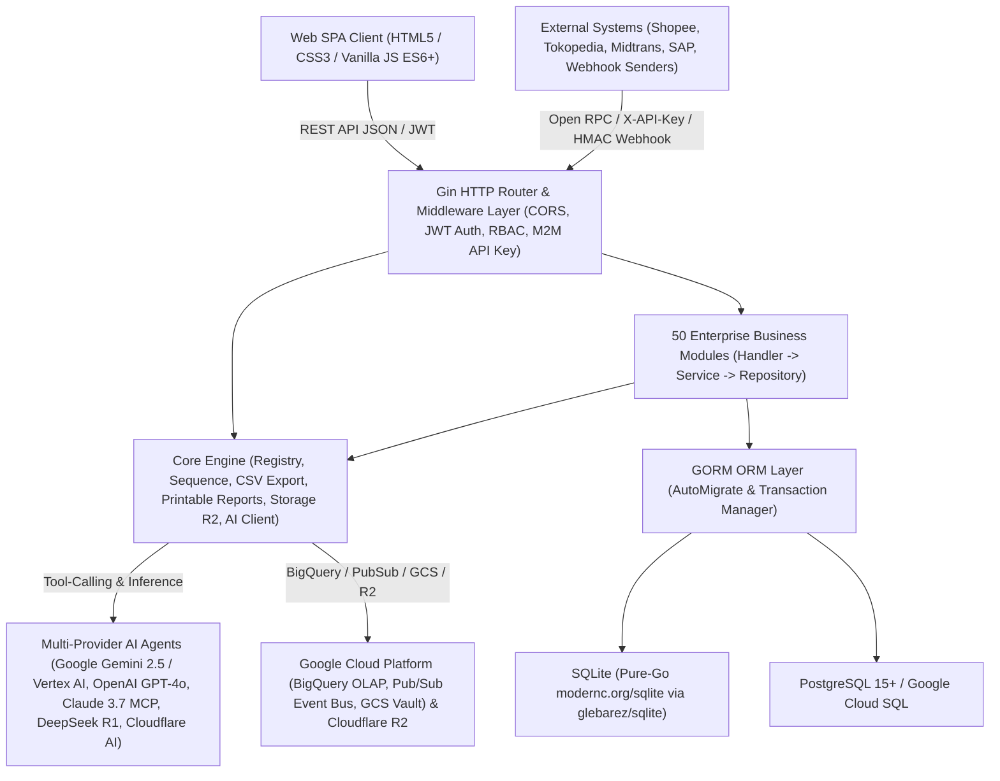

# Technical Documentation — GoERP v1.0

## 1. System Architecture Overview

**GoERP** is a high-performance modular Enterprise Resource Planning (ERP) system built using the **Go (Golang)** programming language. It leverages a **Modular Monolith** architectural pattern inspired by proven enterprise ERP standard models (`ir.model`, `res.partner`, `stock.quant`, `account.move`) combined with **Clean Architecture** principles (*Handler → Service → Repository → GORM Model*).



### 1.1 Core Technology Stack
| Layer | Technology / Library | Role & Specifications |
| :--- | :--- | :--- |
| **Programming Language** | Go `1.22+` (Fully compatible up to Go `1.27`) | Single-binary static compilation, native high concurrency (*goroutines*), minimal memory footprint (~25 MB idle RAM). |
| **HTTP Web Framework** | `github.com/gin-gonic/gin` v1.9+ | High-throughput RESTful routing, middleware chaining, strict JSON payload binding and validation. |
| **ORM & Database Layer** | `gorm.io/gorm` v1.25+ | Object-relational mapping, automatic *Auto-Migration* of 120+ tables at startup, strict ACID transactions (`db.Transaction`). |
| **SQLite Driver (Zero-CGO)** | `github.com/glebarez/sqlite` (`modernc.org/sqlite`) | Pure-Go SQLite engine running seamlessly across Windows, Linux, and macOS under `CGO_ENABLED=0` without GCC dependencies. |
| **PostgreSQL / Cloud SQL** | `gorm.io/driver/postgres` | Enterprise-grade production driver for high-concurrency transactional workloads on PostgreSQL 15+ and Google Cloud SQL. |
| **Security & Authentication** | `github.com/golang-jwt/jwt/v5` & `golang.org/x/crypto/bcrypt` | JSON Web Token (HS256) user authentication, Bcrypt password hashing, and SHA-256 scoped Machine-to-Machine (M2M) API keys. |
| **Multi-Provider AI & Agents** | Google Gemini 2.5 / Vertex AI, OpenAI GPT-4o, Anthropic Claude 3.7 (MCP), DeepSeek R1, Cloudflare Workers AI + Local Agent | Unified AI router with Autonomous ReAct Tool-Calling (`query_inventory_stock`, `get_financial_summary`, `sync_gcp_bigquery`), MCP tool manifests, and deterministic offline fallback. |
| **Cloud Storage & Analytics** | Google Cloud Storage (GCS), BigQuery, Pub/Sub, Cloudflare R2 + Local Disk Fallback | S3-interoperable object storage (`GCS` & `R2`) for `ir.attachment`, real-time BigQuery OLAP streaming, and Pub/Sub domain event bus. |
| **Frontend UI Client** | Vanilla JavaScript (ES6+), CSS3 Variables, HTML5 | Single Page Application (SPA) requiring zero Node.js/Webpack build steps, featuring Dark Glassmorphism, Barcode/QR scanner, and interactive BPMN 2.0 visual canvas. |

---

## 2. Project Directory Structure

```text
c:\erp\
├── cmd/
│   └── server/
│       └── main.go                 # Primary server entrypoint, AutoMigrate, Seeding, Routing & Dashboard Stats
├── internal/
│   ├── config/
│   │   └── config.go               # Environment variables configuration (.env, DB, JWT, Cloudflare AI & R2)
│   ├── core/
│   │   ├── ai/                     # Cloudflare Workers AI client, ERP Copilot & Vision OCR
│   │   ├── database/               # GORM database connection initialization (Pure-Go SQLite & PostgreSQL)
│   │   ├── export/                 # Universal CSV export utility across all ERP data tables
│   │   ├── middleware/             # JWT AuthMiddleware & Role-Based Access Control (RBAC)
│   │   ├── models/                 # Standard BaseModel (ID, CreatedAt, UpdatedAt, DeletedAt, CompanyID)
│   │   ├── registry/               # Dynamic module registry (Enterprise-style module loader)
│   │   └── storage/                # Cloudflare R2 & Local File System object storage abstraction
│   └── modules/                    # 50 Enterprise Business Modules (Each: models, repository, service, handler)
│       ├── base/                   # 1. Company (res.company), Partners (res.partner), Users (res.users), Sequences
│       ├── product/                # 2. Product Categories & Product Master (product.template / product.product)
│       ├── stock/                  # 3. Warehouses, Locations, Double-Entry Stock Move, Picking, Quant & Reordering Rules
│       ├── sale/                   # 4. Quotations & Sales Orders (sale.order & sale.order.line)
│       ├── purchase/               # 5. RFQs & Purchase Orders (purchase.order & purchase.order.line)
│       ├── account/                # 6. Chart of Accounts (CoA), Journals, Invoices, Payments & Financial Statements
│       ├── mrp/                    # 7. Bill of Materials (BoM) & Manufacturing Orders (mrp.production)
│       ├── pos/                    # 8. Point of Sale Cashier Sessions & Instant Retail Orders (pos.session, pos.order)
│       ├── hr/                     # 9. Departments, Employees & Basic Payslip Management
│       ├── crm/                    # 10. Lead Pipeline & Opportunity-to-Quotation Conversion (crm.lead)
│       ├── project/                # 11. Project Management, Task Stages & Timesheets (project.project, project.task)
│       ├── chatter/                # 12. Document Collaboration & Audit Trail Logging (mail.message)
│       ├── asset/                  # 13. Fixed Assets & Automated Linear GL Depreciation Scheduling (account.asset)
│       ├── helpdesk/               # 14. Customer Support Tickets, Escalations & SLA Management (helpdesk.ticket)
│       ├── maintenance/            # 15. Factory Machinery, Equipment, Preventive & Corrective Maintenance
│       ├── fleet/                  # 16. Vehicle Fleet, Odometer Logs & Scheduled Servicing (fleet.vehicle)
│       ├── leave/                  # 17. Employee Leave, Annual Quota Allocations & Payroll Deduction Sync (hr.leave)
│       ├── expense/                # 18. Employee Expense Reimbursement Claims & GL Journal Posting (hr.expense)
│       ├── quality/                # 19. Quality Control Points (QCP), Inspections & CAPA Non-Conformance Alerts
│       ├── approval/               # 20. Multi-Level Corporate Approval Matrix (approval.request)
│       ├── attachment/             # 21. Document Management & AI Vision Receipt OCR (ir.attachment)
│       ├── attendance/             # 22. GPS Geofencing Attendance, Work Shifts & Edge Anomaly Detection
│       ├── recruitment/            # 23. Job Openings, Applicant Pipeline, AI CV Scorer & 1-Click Hire
│       ├── stock_inventory/        # 24. Physical Stock Opname, Discrepancy Adjustments & AI Shrinkage Auditor
│       ├── payroll/                # 25. Multi-Tier Salary Structures, BPJS & Batch Payslip Generation
│       ├── budget/                 # 26. Corporate Budgeting (RKAB), Cost Center Analytic Accounting & AI Burn-Rate Auditor
│       ├── barcode/                # 27. Pure-Go SVG Code 128 Generator, Lot/Serial Tracking & Universal Scanner
│       ├── purchase_requisition/   # 28. Purchase Requisitions (PR), Multi-Vendor Tenders & Blanket Supply Agreements
│       ├── currency/               # 29. Multi-Currency, Historical Spot Exchange Rates & FX Revaluation (PSAK 10 / IAS 21)
│       ├── tax_efaktur/            # 30. VAT e-Faktur Engine, NSFP Quota Allocation & SPT Tax Filing Export
│       ├── bank_reconciliation/    # 31. Bank Statement Import (CSV), Algorithmic Auto-Match & One-Click Reconciliation
│       ├── landed_cost/            # 32. Import Duties, Customs Tariffs & Freight Capitalization to Inventory Valuation
│       ├── traceability/           # 33. Upstream-Downstream Lot Genealogy Tracking & Product Recall Management
│       ├── subscription/           # 34. Recurring SaaS Subscriptions (MRR/ARR), Automated Invoicing & AI Churn Prediction
│       ├── audit_trail/            # 35. Cryptographic Audit Trail (Old vs New JSON) & Suspicious Activity Detection
│       ├── webhook/                # 36. Outbound Event Webhook Dispatcher with HMAC-SHA256 Signatures
│       ├── inbound_webhook/        # 37. Omnichannel Inbound Webhook Receiver (E-Commerce, Payments, Logistics)
│       ├── intercompany/           # 38. Multi-Company Holding, SO/PO Auto-Mirroring & Elimination Consolidation
│       ├── treasury/               # 39. Multi-Bank Liquidity Management, 13-Week Cash Flow Forecast & Cash Sweep
│       ├── mrp_advanced/           # 40. Advanced MRP II: Work Centers, Routing Operations, Work Orders & OEE Analytics
│       ├── tax_ebupot/             # 41. Unified Tax Withholding (e-Bupot) & Periodic Tax Return Filing
│       ├── esignature/             # 42. Cryptographic Digital Signatures (SHA-256) & Stamp Duty Integration
│       ├── wms/                    # 43. 3D Warehouse Bin Locations (Aisle/Rack/Shelf/Bin), Putaway & Wave Picking
│       ├── vendor_portal/          # 44. Self-Service Vendor Portal: Tender Bids, ASN Delivery & Invoice Submissions
│       ├── customer_portal/        # 45. Self-Service B2B Customer Portal: Wholesale Catalog, RMA & Payment Confirmation
│       ├── customs_bonded/         # 46. Customs Bonded Zone IT Inventory Compliance (Inbound, Outbound & Subcontracting)
│       ├── lowcode_studio/         # 47. Low-Code Studio: Dynamic EAV Models, Custom Field Builder & Core Extensions
│       ├── reports/                # 48. Universal Report Engine: Corporate A4 Documents & 80mm POS Thermal Receipts
│       ├── workflow_engine/        # 49. Visual BPMN 2.0 State Machine Engine, Conditional Gateways & AI Designer
│       └── integration_hub/        # 50. Universal Integration Hub: Open RPC Gateway, Pre-built Connectors & Batch ETL
├── tests/
│   └── erp_test.go                 # 54-Section Comprehensive End-to-End Test Suite (Covering all 50 Modules)
├── web/
│   ├── index.html                  # Primary SPA Interface (50 Module Tabs & 110+ Interactive Modals)
│   ├── app.js                      # Application State, REST Client, Table Renderers, Kanban & BPMN Canvas
│   └── style.css                   # Enterprise Dark Glassmorphism CSS Design System
├── Dockerfile                      # Production multi-stage Docker build for lightweight containers
├── docker-compose.yml              # Service orchestration for ERP Application + PostgreSQL 15
└── .env.example                    # Environment variable configuration template
```

---

## 3. Database Design & Multi-Tenant / Multi-Company Architecture

### 3.1 Standard Base Model (`models.BaseModel`)
Every transactional and master entity inherits from `models.BaseModel` (`internal/core/models/base.go`):
- `ID` (`uint`, Primary Key, Auto-Increment)
- `CreatedAt` (`time.Time`)
- `UpdatedAt` (`time.Time`)
- `DeletedAt` (`gorm.DeletedAt`, Indexed for soft deletes)
- `CompanyID` (`uint`, Indexed, Default: `1` for multi-company data isolation)

### 3.2 Double-Entry Bookkeeping Engine
In the `account` module, every accounting entry (`AccountMove`) must strictly satisfy the General Ledger equilibrium formula before it can be posted (`state = 'posted'`):
$$\sum \text{Debit} = \sum \text{Credit}$$
If any discrepancy exceeds the allowed rounding tolerance (`0.01`), the transaction is automatically aborted by the GORM database transaction manager.

### 3.3 Double-Entry Stock Movement Engine
Similar to financial double-entry bookkeeping, the `stock` module does not merely increment or decrement a counter on the product table. Instead, stock moves relocate physical or virtual quantities from a `SourceLocationID` (e.g., *Supplier Location* or *WH/Stock*) to a `DestLocationID` (e.g., *WH/Stock* or *Customer Location*) via the `stock_moves` table, atomicity updating per-location quant balances in `stock_quants`.

### 3.4 Entity-Attribute-Value (EAV) Architecture in Low-Code Studio
The `lowcode_studio` module enables real-time creation of custom business models and fields at runtime without requiring SQL DDL schema modifications through 4 core metadata tables:
1. `lowcode_custom_models`: Stores model definitions (`technical_name` prefixed with `x_`, menu category, icon, audit/chatter toggles).
2. `lowcode_custom_fields`: Stores column definitions (`field_name`, `field_type` such as `char`, `integer`, `float`, `boolean`, `date`, `selection`, `json`).
3. `lowcode_custom_records`: Stores raw data rows with a validated `values_json` payload checked against the associated `lowcode_custom_fields` schema.
4. `lowcode_core_extensions`: Stores supplementary metadata attributes (`extension_json`) dynamically attached to standard core ERP models (`res.partner`, `product.product`, `sale.order`, `purchase.order`).

---

## 4. Security, Authentication & Authorization

1. **User Authentication (JWT HS256)**:
   - Endpoints: `POST /api/v1/auth/login` and `POST /api/v1/auth/register`.
   - Tokens are transmitted via the standard HTTP header: `Authorization: Bearer <token>`.
   - JWT claims encapsulate `user_id`, `email`, `name`, `role`, and `company_id`.
2. **Role-Based Access Control (RBAC)**:
   - Standard roles include `admin`, `manager`, `finance_manager`, `director`, `dept_head`, and `staff`.
   - The `RoleMiddleware` validates user permissions across protected API routes.
3. **Machine-to-Machine Authentication (M2M API Keys)**:
   - Utilized by external microservices and third parties via the `integration_hub` module (`/api/v1/integration/rpc/...`).
   - Callers supply the HTTP header `X-API-Key: ak_live_<prefix>_<secret>`.
   - The system stores only the cryptographic SHA-256 hash of the key, validating granted scopes (`read:product`, `write:sale`, `*`), rate limits (RPM), and IP address allowlists (`allowed_ips`).
4. **Webhook Signature Verification (HMAC-SHA256)**:
   - All outbound webhook event deliveries carry an `X-ERP-Signature-256` header containing an HMAC-SHA256 signature calculated over the JSON payload using a shared tenant secret.

---

## 5. Core API Endpoint Reference

All RESTful endpoints are exposed under the `/api/v1` namespace:

| Module Group | Primary Endpoint Prefix | HTTP Methods & Core Responsibilities |
| :--- | :--- | :--- |
| **Auth & Base** | `/auth/login`, `/partners`, `/companies` | JWT Authentication, Partner CRUD (Customers/Vendors), Multi-Company Management |
| **Dashboard & CSV** | `/dashboard/stats`, `/export/:entity` | Real-time KPI statistics across all 50 modules, universal UTF-8 CSV exporter |
| **AI Copilot** | `/ai/ask`, `/ai/status` | Executive Natural Language Assistant & Cloudflare Workers AI connectivity health |
| **Product & Stock** | `/products`, `/stock/pickings`, `/stock/quants`, `/stock/reorder-rules` | Product Catalog, Warehouse Stock Transfers (`WH/IN`, `WH/OUT`, `WH/INT`), On-hand Stock Quants, Auto-Replenishment |
| **Sales & CRM** | `/sales/orders`, `/crm/leads` | Sales Order Confirmation (auto-generates `WH/OUT` & Customer Invoice), CRM Kanban Pipeline |
| **Purchase & PR** | `/purchases/orders`, `/purchase-requisitions` | Purchase Order Confirmation (auto-generates `WH/IN`), Multi-Vendor Tenders & Blanket Orders |
| **Accounting & Financial** | `/accounting/accounts`, `/accounting/moves`, `/accounting/payments`, `/accounting/reports/*` | General Ledger, Invoices, Payments, Profit & Loss (`profit-loss`), Balance Sheet (`balance-sheet`), Trial Balance (`trial-balance`) |
| **Manufacturing (MRP I & II)** | `/mrp/boms`, `/mrp/orders`, `/mrp-advanced/work-centers`, `/mrp-advanced/work-orders` | Bill of Materials (BoM), Production Orders, Machine Work Centers, Routing Operations & OEE Analytics |
| **POS & Retail** | `/pos/sessions`, `/pos/orders` | Cashier Session Open/Close, Instant Retail Checkout & Automated Stock Depletion |
| **HR, Attendance, Leave, Payroll** | `/hr/employees`, `/attendances`, `/leaves`, `/payroll/payslips`, `/recruitment/applicants` | Employee Records, GPS Geofenced Attendance, Tiered Leave Approvals, Payslip Execution & AI Talent Acquisition |
| **Tax Compliance** | `/tax-efaktur/*`, `/tax-ebupot/*` | Tax Invoice Serial Quotas (NSFP), VAT e-Faktur 11%, Unified Withholding Tax Slips & Periodic Tax Return Exports |
| **Customs & Bonded Zone** | `/customs-bonded/documents`, `/customs-bonded/reports/*`, `/customs-bonded/subcontracts` | Customs Inbound/Outbound Declarations, Customs Clearance Approvals, 4 Official IT Inventory Mutation Reports |
| **WMS, Landed Cost, Traceability** | `/wms/bins`, `/wms/waves`, `/landed-costs`, `/traceability/traces` | 3D Warehouse Bin Locations, Wave Picking, Import Duty Capitalization to Inventory Valuation, Lot Genealogy & Recalls |
| **Portals & e-Signature** | `/vendor-portal/*`, `/customer-portal/*`, `/esignature/requests` | Self-service Vendor & B2B Customer Portals, SHA-256 Digital Signatures & Electronic Stamp Duty |
| **Low-Code Studio** | `/lowcode/models`, `/lowcode/records/:name`, `/lowcode/core-extensions`, `/lowcode/ai/schema-copilot` | Runtime Dynamic Models & Fields (EAV), Standard Entity Extensions & AI Schema Copilot |
| **BPMN 2.0 Workflow Engine** | `/workflows/definitions`, `/workflows/start`, `/workflows/instances`, `/workflows/instances/:id/action` | BPMN State Machine Definitions, Conditional Gateway Evaluations, Actionable Inbox & Audit Logging |
| **Universal Integration Hub** | `/integration/api-keys`, `/integration/connectors`, `/integration/rpc/:method`, `/integration/data-jobs` | M2M API Key Scopes, Marketplace/Payment/Messaging Connectors, Open RPC Gateway & Batch ETL Jobs |
| **Universal Report Engine** | `/reports/catalog`, `/reports/sale-order/:id`, `/reports/invoice/:id`, `/reports/payslip/:id` | Professional A4 PDF-Ready Corporate Documents & 80mm POS Thermal Receipts with Cryptographic SHA-256 Audit Hashes |

---

## 6. Environment Configuration & Deployment Guide

### 6.1 Environment Variables (`.env`)
```ini
PORT=8080
ENVIRONMENT=development
DB_TYPE=sqlite                  # Options: "sqlite" or "postgres"
DB_PATH=erp.db                  # Used when DB_TYPE=sqlite
# PostgreSQL Configuration (Used when DB_TYPE=postgres)
DB_HOST=localhost
DB_PORT=5432
DB_USER=erp
DB_PASSWORD=erp_secret_password
DB_NAME=erp_db
DB_SSLMODE=disable

JWT_SECRET=go-erp-production-super-secret-key-2026
UPLOAD_DIR=./uploads/attachments

# Optional: Cloudflare Workers AI & R2 Object Storage
CLOUDFLARE_ACCOUNT_ID=
CLOUDFLARE_API_TOKEN=
CLOUDFLARE_AI_MODEL=@cf/meta/llama-3.1-8b-instruct
CLOUDFLARE_R2_BUCKET=
CLOUDFLARE_R2_ACCESS_KEY_ID=
CLOUDFLARE_R2_SECRET_ACCESS_KEY=
CLOUDFLARE_R2_ENDPOINT=
```

### 6.2 Running Locally (Zero-CGO / Pure Go)
```powershell
# 1. Run the comprehensive integration test suite (54 test sections)
go test -v ./tests/...

# 2. Compile the server binary
go build -o server.exe ./cmd/server

# 3. Launch the ERP server (automatically performs AutoMigrate and default seed data)
./server.exe
```

### 6.3 Running with Docker Compose (PostgreSQL + ERP Server)
```bash
docker-compose up --build -d
```

---

## 7. Executive Command Center & Continuous Improvement Architecture (`internal/core/commandcenter`)

As part of the platform's continuous improvement initiative, the `internal/core/commandcenter` package provides 4 high-speed cross-module services mounted under `/api/v1`:

1. **Universal Omni-Search Engine (`GET /api/v1/search?q=<keyword>`)**:
   - Executes high-speed concurrent search across all **50 ERP Modules** (by title, category, tab code, and bilingual keywords) and **5 core transactional/master tables** (`products`, `partners`, `sale_orders`, `purchase_orders`, `account_moves`).
   - Directly integrated with the frontend **Command Palette (`Ctrl+K`)** featuring a 120ms debounce.
2. **Actionable Notification & Pending Approvals Center (`GET /api/v1/dashboard/notifications`)**:
   - Aggregates real-time pending action items requiring user intervention across business departments:
     - Tiered approval requests (`approval_requests`)
     - Active in-flight BPMN 2.0 workflow instances (`workflow_instances`)
     - Sales and purchase orders pending in `draft` state (`sale_orders`, `purchase_orders`)
     - Warehouse stock transfer documents awaiting physical validation (`stock_pickings`)
     - Draft accounting moves pending GL posting (`account_moves`)
     - Security alerts and high-risk transactional modifications (`audit_log_entries` with `is_suspicious = true`)
3. **1-Click End-to-End Business Cycle Simulator (`POST /api/v1/dashboard/simulate-cycle`)**:
   - Executes an automated, atomic end-to-end enterprise business cycle (*Procure-to-Pay* + *Warehouse Management* + *Order-to-Cash* + *General Ledger Posting*) in a single click:
     1. Validates or provisions Customer, Supplier, and Storable Product master data.
     2. Generates and confirms a **Purchase Order (`PO...`)** -> generates and validates a **Goods Receipt (`WH/IN/...`)**, atomically incrementing warehouse stock quants.
     3. Generates and confirms a **Sales Order (`SO...`)** -> generates and validates a **Delivery Order (`WH/OUT/...`)**, atomically decrementing warehouse stock quants.
     4. Generates and posts a balanced **Customer Invoice (`INV/...`)** ($\sum \text{Debit} = \sum \text{Credit}$) with 11% VAT directly into the **General Ledger**.
4. **Executive KPI Summary CSV Exporter (`GET /api/v1/dashboard/export-summary`)**:
   - Generates a UTF-8 BOM CSV summary aggregating critical financial, operational, and departmental KPIs across all 50 enterprise modules for C-level reporting.
