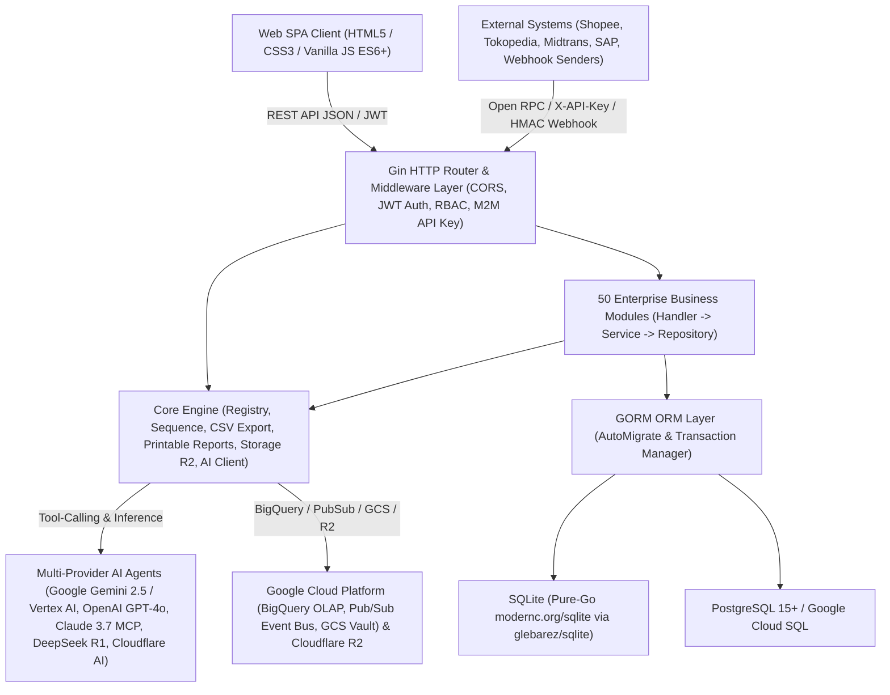

# Technical Documentation — GoERP v1.0

## 1. System Architecture Overview

**GoERP** is a high-performance modular Enterprise Resource Planning (ERP) system built using the **Go (Golang)** programming language. It leverages a **Modular Monolith** architectural pattern inspired by proven enterprise ERP standard models (`ir.model`, `res.partner`, `stock.quant`, `account.move`) combined with **Clean Architecture** principles (*Handler → Service → Repository → GORM Model*).



### 1.1 Core Technology Stack
| Layer | Technology / Library | Role & Specifications |
| :--- | :--- | :--- |
| **Programming Language** | Go `1.22+` (Fully compatible up to Go `1.27`) | Single-binary static compilation, native high concurrency (*goroutines*), minimal memory footprint (~25 MB idle RAM). |
| **HTTP Web Framework** | `github.com/gin-gonic/gin` v1.9+ | High-throughput RESTful routing, middleware chaining, strict JSON payload binding and validation. |
| **ORM & Database Layer** | `gorm.io/gorm` v1.25+ | Object-relational mapping, automatic *Auto-Migration* of 120+ tables at startup, strict ACID transactions (`db.Transaction`). |
| **SQLite Driver (Zero-CGO)** | `github.com/glebarez/sqlite` (`modernc.org/sqlite`) | Pure-Go SQLite engine running seamlessly across Windows, Linux, and macOS under `CGO_ENABLED=0` without GCC dependencies. |
| **PostgreSQL / Cloud SQL** | `gorm.io/driver/postgres` | Enterprise-grade production driver for high-concurrency transactional workloads on PostgreSQL 15+ and Google Cloud SQL. |
| **Security & Authentication** | `github.com/golang-jwt/jwt/v5` & `golang.org/x/crypto/bcrypt` | JSON Web Token (HS256) user authentication, Bcrypt password hashing, and SHA-256 scoped Machine-to-Machine (M2M) API keys. |
| **Multi-Provider AI & Agents** | Google Gemini 2.5 / Vertex AI, OpenAI GPT-4o, Anthropic Claude 3.7 (MCP), DeepSeek R1, Cloudflare Workers AI + Local Agent | Unified AI router with Autonomous ReAct Tool-Calling (`query_inventory_stock`, `get_financial_summary`, `sync_gcp_bigquery`), MCP tool manifests, and deterministic offline fallback. |
| **Cloud Storage & Analytics** | Google Cloud Storage (GCS), BigQuery, Pub/Sub, Cloudflare R2 + Local Disk Fallback | S3-interoperable object storage (`GCS` & `R2`) for `ir.attachment`, real-time BigQuery OLAP streaming, and Pub/Sub domain event bus. |
| **Frontend UI Client** | Vanilla JavaScript (ES6+), CSS3 Variables, HTML5 | Single Page Application (SPA) requiring zero Node.js/Webpack build steps, featuring Dark Glassmorphism, Barcode/QR scanner, and interactive BPMN 2.0 visual canvas. |

---

## 2. Project Directory Structure

```text
c:\erp\
├── cmd/
│   └── server/
│       └── main.go                 # Primary server entrypoint, AutoMigrate, Seeding, Routing & Dashboard Stats
├── internal/
│   ├── config/
│   │   └── config.go               # Environment variables configuration (.env, DB, JWT, Cloudflare AI & R2)
│   ├── core/
│   │   ├── ai/                     # Cloudflare Workers AI client, ERP Copilot & Vision OCR
│   │   ├── database/               # GORM database connection initialization (Pure-Go SQLite & PostgreSQL)
│   │   ├── export/                 # Universal CSV export utility across all ERP data tables
│   │   ├── middleware/             # JWT AuthMiddleware & Role-Based Access Control (RBAC)
│   │   ├── models/                 # Standard BaseModel (ID, CreatedAt, UpdatedAt, DeletedAt, CompanyID)
│   │   ├── registry/               # Dynamic module registry (Enterprise-style module loader)
│   │   └── storage/                # Cloudflare R2 & Local File System object storage abstraction
│   └── modules/                    # 50 Enterprise Business Modules (Each: models, repository, service, handler)
│       ├── base/                   # 1. Company (res.company), Partners (res.partner), Users (res.users), Sequences
│       ├── product/                # 2. Product Categories & Product Master (product.template / product.product)
│       ├── stock/                  # 3. Warehouses, Locations, Double-Entry Stock Move, Picking, Quant & Reordering Rules
│       ├── sale/                   # 4. Quotations & Sales Orders (sale.order & sale.order.line)
│       ├── purchase/               # 5. RFQs & Purchase Orders (purchase.order & purchase.order.line)
│       ├── account/                # 6. Chart of Accounts (CoA), Journals, Invoices, Payments & Financial Statements
│       ├── mrp/                    # 7. Bill of Materials (BoM) & Manufacturing Orders (mrp.production)
│       ├── pos/                    # 8. Point of Sale Cashier Sessions & Instant Retail Orders (pos.session, pos.order)
│       ├── hr/                     # 9. Departments, Employees & Basic Payslip Management
│       ├── crm/                    # 10. Lead Pipeline & Opportunity-to-Quotation Conversion (crm.lead)
│       ├── project/                # 11. Project Management, Task Stages & Timesheets (project.project, project.task)
│       ├── chatter/                # 12. Document Collaboration & Audit Trail Logging (mail.message)
│       ├── asset/                  # 13. Fixed Assets & Automated Linear GL Depreciation Scheduling (account.asset)
│       ├── helpdesk/               # 14. Customer Support Tickets, Escalations & SLA Management (helpdesk.ticket)
│       ├── maintenance/            # 15. Factory Machinery, Equipment, Preventive & Corrective Maintenance
│       ├── fleet/                  # 16. Vehicle Fleet, Odometer Logs & Scheduled Servicing (fleet.vehicle)
│       ├── leave/                  # 17. Employee Leave, Annual Quota Allocations & Payroll Deduction Sync (hr.leave)
│       ├── expense/                # 18. Employee Expense Reimbursement Claims & GL Journal Posting (hr.expense)
│       ├── quality/                # 19. Quality Control Points (QCP), Inspections & CAPA Non-Conformance Alerts
│       ├── approval/               # 20. Multi-Level Corporate Approval Matrix (approval.request)
│       ├── attachment/             # 21. Document Management & AI Vision Receipt OCR (ir.attachment)
│       ├── attendance/             # 22. GPS Geofencing Attendance, Work Shifts & Edge Anomaly Detection
│       ├── recruitment/            # 23. Job Openings, Applicant Pipeline, AI CV Scorer & 1-Click Hire
│       ├── stock_inventory/        # 24. Physical Stock Opname, Discrepancy Adjustments & AI Shrinkage Auditor
│       ├── payroll/                # 25. Multi-Tier Salary Structures, BPJS & Batch Payslip Generation
│       ├── budget/                 # 26. Corporate Budgeting (RKAB), Cost Center Analytic Accounting & AI Burn-Rate Auditor
│       ├── barcode/                # 27. Pure-Go SVG Code 128 Generator, Lot/Serial Tracking & Universal Scanner
│       ├── purchase_requisition/   # 28. Purchase Requisitions (PR), Multi-Vendor Tenders & Blanket Supply Agreements
│       ├── currency/               # 29. Multi-Currency, Historical Spot Exchange Rates & FX Revaluation (PSAK 10 / IAS 21)
│       ├── tax_efaktur/            # 30. VAT e-Faktur Engine, NSFP Quota Allocation & SPT Tax Filing Export
│       ├── bank_reconciliation/    # 31. Bank Statement Import (CSV), Algorithmic Auto-Match & One-Click Reconciliation
│       ├── landed_cost/            # 32. Import Duties, Customs Tariffs & Freight Capitalization to Inventory Valuation
│       ├── traceability/           # 33. Upstream-Downstream Lot Genealogy Tracking & Product Recall Management
│       ├── subscription/           # 34. Recurring SaaS Subscriptions (MRR/ARR), Automated Invoicing & AI Churn Prediction
│       ├── audit_trail/            # 35. Cryptographic Audit Trail (Old vs New JSON) & Suspicious Activity Detection
│       ├── webhook/                # 36. Outbound Event Webhook Dispatcher with HMAC-SHA256 Signatures
│       ├── inbound_webhook/        # 37. Omnichannel Inbound Webhook Receiver (E-Commerce, Payments, Logistics)
│       ├── intercompany/           # 38. Multi-Company Holding, SO/PO Auto-Mirroring & Elimination Consolidation
│       ├── treasury/               # 39. Multi-Bank Liquidity Management, 13-Week Cash Flow Forecast & Cash Sweep
│       ├── mrp_advanced/           # 40. Advanced MRP II: Work Centers, Routing Operations, Work Orders & OEE Analytics
│       ├── tax_ebupot/             # 41. Unified Tax Withholding (e-Bupot) & Periodic Tax Return Filing
│       ├── esignature/             # 42. Cryptographic Digital Signatures (SHA-256) & Stamp Duty Integration
│       ├── wms/                    # 43. 3D Warehouse Bin Locations (Aisle/Rack/Shelf/Bin), Putaway & Wave Picking
│       ├── vendor_portal/          # 44. Self-Service Vendor Portal: Tender Bids, ASN Delivery & Invoice Submissions
│       ├── customer_portal/        # 45. Self-Service B2B Customer Portal: Wholesale Catalog, RMA & Payment Confirmation
│       ├── customs_bonded/         # 46. Customs Bonded Zone IT Inventory Compliance (Inbound, Outbound & Subcontracting)
│       ├── lowcode_studio/         # 47. Low-Code Studio: Dynamic EAV Models, Custom Field Builder & Core Extensions
│       ├── reports/                # 48. Universal Report Engine: Corporate A4 Documents & 80mm POS Thermal Receipts
│       ├── workflow_engine/        # 49. Visual BPMN 2.0 State Machine Engine, Conditional Gateways & AI Designer
│       └── integration_hub/        # 50. Universal Integration Hub: Open RPC Gateway, Pre-built Connectors & Batch ETL
├── tests/
│   └── erp_test.go                 # 54-Section Comprehensive End-to-End Test Suite (Covering all 50 Modules)
├── web/
│   ├── index.html                  # Primary SPA Interface (50 Module Tabs & 110+ Interactive Modals)
│   ├── app.js                      # Application State, REST Client, Table Renderers, Kanban & BPMN Canvas
│   └── style.css                   # Enterprise Dark Glassmorphism CSS Design System
├── Dockerfile                      # Production multi-stage Docker build for lightweight containers
├── docker-compose.yml              # Service orchestration for ERP Application + PostgreSQL 15
└── .env.example                    # Environment variable configuration template
```

---

## 3. Database Design & Multi-Tenant / Multi-Company Architecture

### 3.1 Standard Base Model (`models.BaseModel`)
Every transactional and master entity inherits from `models.BaseModel` (`internal/core/models/base.go`):
- `ID` (`uint`, Primary Key, Auto-Increment)
- `CreatedAt` (`time.Time`)
- `UpdatedAt` (`time.Time`)
- `DeletedAt` (`gorm.DeletedAt`, Indexed for soft deletes)
- `CompanyID` (`uint`, Indexed, Default: `1` for multi-company data isolation)

### 3.2 Double-Entry Bookkeeping Engine
In the `account` module, every accounting entry (`AccountMove`) must strictly satisfy the General Ledger equilibrium formula before it can be posted (`state = 'posted'`):
$$\sum \text{Debit} = \sum \text{Credit}$$
If any discrepancy exceeds the allowed rounding tolerance (`0.01`), the transaction is automatically aborted by the GORM database transaction manager.

### 3.3 Double-Entry Stock Movement Engine
Similar to financial double-entry bookkeeping, the `stock` module does not merely increment or decrement a counter on the product table. Instead, stock moves relocate physical or virtual quantities from a `SourceLocationID` (e.g., *Supplier Location* or *WH/Stock*) to a `DestLocationID` (e.g., *WH/Stock* or *Customer Location*) via the `stock_moves` table, atomicity updating per-location quant balances in `stock_quants`.

### 3.4 Entity-Attribute-Value (EAV) Architecture in Low-Code Studio
The `lowcode_studio` module enables real-time creation of custom business models and fields at runtime without requiring SQL DDL schema modifications through 4 core metadata tables:
1. `lowcode_custom_models`: Stores model definitions (`technical_name` prefixed with `x_`, menu category, icon, audit/chatter toggles).
2. `lowcode_custom_fields`: Stores column definitions (`field_name`, `field_type` such as `char`, `integer`, `float`, `boolean`, `date`, `selection`, `json`).
3. `lowcode_custom_records`: Stores raw data rows with a validated `values_json` payload checked against the associated `lowcode_custom_fields` schema.
4. `lowcode_core_extensions`: Stores supplementary metadata attributes (`extension_json`) dynamically attached to standard core ERP models (`res.partner`, `product.product`, `sale.order`, `purchase.order`).

---

## 4. Security, Authentication & Authorization

1. **User Authentication (JWT HS256)**:
   - Endpoints: `POST /api/v1/auth/login` and `POST /api/v1/auth/register`.
   - Tokens are transmitted via the standard HTTP header: `Authorization: Bearer <token>`.
   - JWT claims encapsulate `user_id`, `email`, `name`, `role`, and `company_id`.
2. **Role-Based Access Control (RBAC)**:
   - Standard roles include `admin`, `manager`, `finance_manager`, `director`, `dept_head`, and `staff`.
   - The `RoleMiddleware` validates user permissions across protected API routes.
3. **Machine-to-Machine Authentication (M2M API Keys)**:
   - Utilized by external microservices and third parties via the `integration_hub` module (`/api/v1/integration/rpc/...`).
   - Callers supply the HTTP header `X-API-Key: ak_live_<prefix>_<secret>`.
   - The system stores only the cryptographic SHA-256 hash of the key, validating granted scopes (`read:product`, `write:sale`, `*`), rate limits (RPM), and IP address allowlists (`allowed_ips`).
4. **Webhook Signature Verification (HMAC-SHA256)**:
   - All outbound webhook event deliveries carry an `X-ERP-Signature-256` header containing an HMAC-SHA256 signature calculated over the JSON payload using a shared tenant secret.

---

## 5. Core API Endpoint Reference

All RESTful endpoints are exposed under the `/api/v1` namespace:

| Module Group | Primary Endpoint Prefix | HTTP Methods & Core Responsibilities |
| :--- | :--- | :--- |
| **Auth & Base** | `/auth/login`, `/partners`, `/companies` | JWT Authentication, Partner CRUD (Customers/Vendors), Multi-Company Management |
| **Dashboard & CSV** | `/dashboard/stats`, `/export/:entity` | Real-time KPI statistics across all 50 modules, universal UTF-8 CSV exporter |
| **AI Copilot** | `/ai/ask`, `/ai/status` | Executive Natural Language Assistant & Cloudflare Workers AI connectivity health |
| **Product & Stock** | `/products`, `/stock/pickings`, `/stock/quants`, `/stock/reorder-rules` | Product Catalog, Warehouse Stock Transfers (`WH/IN`, `WH/OUT`, `WH/INT`), On-hand Stock Quants, Auto-Replenishment |
| **Sales & CRM** | `/sales/orders`, `/crm/leads` | Sales Order Confirmation (auto-generates `WH/OUT` & Customer Invoice), CRM Kanban Pipeline |
| **Purchase & PR** | `/purchases/orders`, `/purchase-requisitions` | Purchase Order Confirmation (auto-generates `WH/IN`), Multi-Vendor Tenders & Blanket Orders |
| **Accounting & Financial** | `/accounting/accounts`, `/accounting/moves`, `/accounting/payments`, `/accounting/reports/*` | General Ledger, Invoices, Payments, Profit & Loss (`profit-loss`), Balance Sheet (`balance-sheet`), Trial Balance (`trial-balance`) |
| **Manufacturing (MRP I & II)** | `/mrp/boms`, `/mrp/orders`, `/mrp-advanced/work-centers`, `/mrp-advanced/work-orders` | Bill of Materials (BoM), Production Orders, Machine Work Centers, Routing Operations & OEE Analytics |
| **POS & Retail** | `/pos/sessions`, `/pos/orders` | Cashier Session Open/Close, Instant Retail Checkout & Automated Stock Depletion |
| **HR, Attendance, Leave, Payroll** | `/hr/employees`, `/attendances`, `/leaves`, `/payroll/payslips`, `/recruitment/applicants` | Employee Records, GPS Geofenced Attendance, Tiered Leave Approvals, Payslip Execution & AI Talent Acquisition |
| **Tax Compliance** | `/tax-efaktur/*`, `/tax-ebupot/*` | Tax Invoice Serial Quotas (NSFP), VAT e-Faktur 11%, Unified Withholding Tax Slips & Periodic Tax Return Exports |
| **Customs & Bonded Zone** | `/customs-bonded/documents`, `/customs-bonded/reports/*`, `/customs-bonded/subcontracts` | Customs Inbound/Outbound Declarations, Customs Clearance Approvals, 4 Official IT Inventory Mutation Reports |
| **WMS, Landed Cost, Traceability** | `/wms/bins`, `/wms/waves`, `/landed-costs`, `/traceability/traces` | 3D Warehouse Bin Locations, Wave Picking, Import Duty Capitalization to Inventory Valuation, Lot Genealogy & Recalls |
| **Portals & e-Signature** | `/vendor-portal/*`, `/customer-portal/*`, `/esignature/requests` | Self-service Vendor & B2B Customer Portals, SHA-256 Digital Signatures & Electronic Stamp Duty |
| **Low-Code Studio** | `/lowcode/models`, `/lowcode/records/:name`, `/lowcode/core-extensions`, `/lowcode/ai/schema-copilot` | Runtime Dynamic Models & Fields (EAV), Standard Entity Extensions & AI Schema Copilot |
| **BPMN 2.0 Workflow Engine** | `/workflows/definitions`, `/workflows/start`, `/workflows/instances`, `/workflows/instances/:id/action` | BPMN State Machine Definitions, Conditional Gateway Evaluations, Actionable Inbox & Audit Logging |
| **Universal Integration Hub** | `/integration/api-keys`, `/integration/connectors`, `/integration/rpc/:method`, `/integration/data-jobs` | M2M API Key Scopes, Marketplace/Payment/Messaging Connectors, Open RPC Gateway & Batch ETL Jobs |
| **Universal Report Engine** | `/reports/catalog`, `/reports/sale-order/:id`, `/reports/invoice/:id`, `/reports/payslip/:id` | Professional A4 PDF-Ready Corporate Documents & 80mm POS Thermal Receipts with Cryptographic SHA-256 Audit Hashes |

---

## 6. Environment Configuration & Deployment Guide

### 6.1 Environment Variables (`.env`)
```ini
PORT=8080
ENVIRONMENT=development
DB_TYPE=sqlite                  # Options: "sqlite" or "postgres"
DB_PATH=erp.db                  # Used when DB_TYPE=sqlite
# PostgreSQL Configuration (Used when DB_TYPE=postgres)
DB_HOST=localhost
DB_PORT=5432
DB_USER=erp
DB_PASSWORD=erp_secret_password
DB_NAME=erp_db
DB_SSLMODE=disable

JWT_SECRET=go-erp-production-super-secret-key-2026
UPLOAD_DIR=./uploads/attachments

# Optional: Cloudflare Workers AI & R2 Object Storage
CLOUDFLARE_ACCOUNT_ID=
CLOUDFLARE_API_TOKEN=
CLOUDFLARE_AI_MODEL=@cf/meta/llama-3.1-8b-instruct
CLOUDFLARE_R2_BUCKET=
CLOUDFLARE_R2_ACCESS_KEY_ID=
CLOUDFLARE_R2_SECRET_ACCESS_KEY=
CLOUDFLARE_R2_ENDPOINT=
```

### 6.2 Running Locally (Zero-CGO / Pure Go)
```powershell
# 1. Run the comprehensive integration test suite (54 test sections)
go test -v ./tests/...

# 2. Compile the server binary
go build -o server.exe ./cmd/server

# 3. Launch the ERP server (automatically performs AutoMigrate and default seed data)
./server.exe
```

### 6.3 Running with Docker Compose (PostgreSQL + ERP Server)
```bash
docker-compose up --build -d
```

---

## 7. Executive Command Center & Continuous Improvement Architecture (`internal/core/commandcenter`)

As part of the platform's continuous improvement initiative, the `internal/core/commandcenter` package provides 4 high-speed cross-module services mounted under `/api/v1`:

1. **Universal Omni-Search Engine (`GET /api/v1/search?q=<keyword>`)**:
   - Executes high-speed concurrent search across all **50 ERP Modules** (by title, category, tab code, and bilingual keywords) and **5 core transactional/master tables** (`products`, `partners`, `sale_orders`, `purchase_orders`, `account_moves`).
   - Directly integrated with the frontend **Command Palette (`Ctrl+K`)** featuring a 120ms debounce.
2. **Actionable Notification & Pending Approvals Center (`GET /api/v1/dashboard/notifications`)**:
   - Aggregates real-time pending action items requiring user intervention across business departments:
     - Tiered approval requests (`approval_requests`)
     - Active in-flight BPMN 2.0 workflow instances (`workflow_instances`)
     - Sales and purchase orders pending in `draft` state (`sale_orders`, `purchase_orders`)
     - Warehouse stock transfer documents awaiting physical validation (`stock_pickings`)
     - Draft accounting moves pending GL posting (`account_moves`)
     - Security alerts and high-risk transactional modifications (`audit_log_entries` with `is_suspicious = true`)
3. **1-Click End-to-End Business Cycle Simulator (`POST /api/v1/dashboard/simulate-cycle`)**:
   - Executes an automated, atomic end-to-end enterprise business cycle (*Procure-to-Pay* + *Warehouse Management* + *Order-to-Cash* + *General Ledger Posting*) in a single click:
     1. Validates or provisions Customer, Supplier, and Storable Product master data.
     2. Generates and confirms a **Purchase Order (`PO...`)** -> generates and validates a **Goods Receipt (`WH/IN/...`)**, atomically incrementing warehouse stock quants.
     3. Generates and confirms a **Sales Order (`SO...`)** -> generates and validates a **Delivery Order (`WH/OUT/...`)**, atomically decrementing warehouse stock quants.
     4. Generates and posts a balanced **Customer Invoice (`INV/...`)** ($\sum \text{Debit} = \sum \text{Credit}$) with 11% VAT directly into the **General Ledger**.
4. **Executive KPI Summary CSV Exporter (`GET /api/v1/dashboard/export-summary`)**:
   - Generates a UTF-8 BOM CSV summary aggregating critical financial, operational, and departmental KPIs across all 50 enterprise modules for C-level reporting.


---

## 6. Native Model Context Protocol (MCP) & Google Cloud A2A Architecture

GoERP provides first-class support for autonomous agent-to-agent interoperability and external AI tooling integration without custom coding:

### 6.1 Native Model Context Protocol (MCP) JSON-RPC 2.0 Server (`/mcp`)
Compliant with standard MCP specification (`2025-03-26`), GoERP functions as a native MCP server for **Claude Desktop, Cursor, Gemini CLI, and Antigravity**:
- **Protocol Endpoint**: `POST /mcp` and `GET /mcp`
- **Supported Methods**:
  - `initialize`: Reports server capabilities, protocol version (`2025-03-26`), and server name (`goerp-enterprise-mcp-server`).
  - `ping`: Returns server heartbeat and UTC timestamp.
  - `tools/list`: Exposes standardized tool definitions with JSON Schema parameter validation (`query_inventory_stock`, `get_financial_summary`, `search_erp_records`, `create_sales_quotation`, `create_purchase_rfq`, `sync_gcp_bigquery`, `extract_document_3way_match`, `scan_fraud_anomalies`, `forecast_cashflow`, `calculate_esg_carbon_footprint`).
  - `tools/call`: Invokes any ERP database tool atomically against live GORM tables and returns structured content.
  - `resources/list` & `resources/read`: Exposes virtual URIs (`erp://finance/gl-summary`, `erp://inventory/stock-levels`, `erp://esg/carbon-ledger`).
  - `prompts/list`: Exports standard executive prompt templates for forensic audit, supply-chain 3-way match, and ESG compliance.

### 6.2 Google Cloud Agent-to-Agent (A2A) Protocol (`/.well-known/agent.json`)
GoERP exposes an Agent Discovery Card following Google Cloud's open standard for autonomous B2B agent-to-agent communication:
- **Discovery Card**: `GET /.well-known/agent.json`
- **Task Submission Gateway**: `POST /api/v1/ai/a2a/tasks/send`
- **Supported B2B Skills**:
  1. `inventory-availability-check`: Real-time warehouse availability and pricing for supplier/buyer agents.
  2. `b2b-quote-negotiation`: Autonomous sales quotation and purchase RFQ creation.
  3. `invoice-3way-reconciliation`: Cross-company automated 3-Way Matching of vendor bills against POs and GRNs.
  4. `financial-audit-verification`: Continuous fraud radar and 90-day cashflow liquidity projection.
  5. `esg-scope3-exchange`: Scope 1-3 GHG carbon emissions data exchange across supply chain partners.

---

## 7. Enterprise AI Intelligence Engine

### 7.1 AI Document Intelligence & Automated 3-Way Matching (`POST /api/v1/ai/doc-intelligence`)
- **Multimodal OCR Extraction**: Extracts Vendor Name, NPWP Tax ID, e-Faktur Serial Number (`010.002-26.XXXXXXXX`), Invoice Number, DPP Subtotal, PPN 11%, PPh 23, and Grand Total with 97%+ confidence.
- **Automated 3-Way Matching**: Cross-matches invoice amounts against corresponding **Purchase Orders (`PO...`)** and warehouse **Goods Receipt Notes (`WH/IN...`)**. Flags price deviations exceeding tolerance (`PRICE_VARIANCE_ALERT`) and auto-generates balanced double-entry GL journal moves (Debit: Inventory Clearing 510100 & VAT Input 110600; Credit: Accounts Payable 210100).

### 7.2 Continuous AI Audit & Fraud Radar (`GET & POST /api/v1/ai/fraud-radar`)
- **Forensic Anomaly Detection**:
  - *Split PO Detection*: Identifies potential approval-limit evasion by detecting multiple POs to the same vendor within the same cycle.
  - *High-Value Postings*: Flags journal moves and invoices exceeding user-defined threshold limits (default: IDR 50M).
  - *Trial Balance Guard*: Verifies 100% mathematical integrity where `Debit == Credit` across all historical entries.
- **Compliance Alignment**: PSAK / IFRS, ISO 27001 Audit Immutability, and SOX Segregation of Duties.

### 7.3 Predictive 30/60/90-Day Cashflow Forecasting (`GET & POST /api/v1/ai/cashflow-forecast`)
- **Liquidity Horizon Modeling**: Projects cash inflows (Confirmed Sales AR, Pipeline Quotations, SaaS Subscription MRR) and outflows (Procurement AP, Operating Expenses, Payroll) across 30, 60, and 90-day horizons.
- **Scenario Analysis**: Generates Optimistic (+25%), Baseline (100%), and Conservative (-22%) projections.
- **CFO Health Metrics**: Computes estimated cash runway (months), Days Sales Outstanding (DSO), and Days Payable Outstanding (DPO).

### 7.4 ESG & Carbon Footprint Ledger (`GET & POST /api/v1/ai/esg-report`)
- **Greenhouse Gas (GHG) Protocol Accounting**:
  - **Scope 1 (Direct)**: Fleet vehicle fuel consumption (IPCC Mobile Combustion: 2.68 kg CO2e / Liter diesel).
  - **Scope 2 (Indirect)**: MRP Manufacturing electricity consumption (Grid Electricity Factor: 0.78 kg CO2e / kWh).
  - **Scope 3 (Value Chain)**: Upstream/downstream logistics shipments and procurement orders (GHG Scope 3 Cat 1 & 4).
- **Sustainability Metrics**: Total emissions (kg & metric tons CO2e), carbon intensity per million IDR revenue, and tree offset equivalents.
- **Regulatory Readiness**: OJK POJK No. 51/2017, Global Reporting Initiative (GRI 305), and EU CSRD.

### 7.5 Omnichannel ChatOps Gateway (`POST /api/v1/ai/chatops/webhook`)
- **Supported Channels**: WhatsApp Business API, Telegram Bot, Slack, and Microsoft Teams.
- **Executive Slash Commands**:
  - `/omzet`: Instant revenue, procurement spend, and GL posting summary.
  - `/stok`: Warehouse inventory stock and quant availability brief.
  - `/approve`: Executive 1-click Purchase Order approval.
  - `/fraud`: Immediate forensic audit and fraud risk radar briefing.
  - `/esg`: Live corporate ESG carbon footprint and sustainability summary.

---

## 8. OpenAPI 3.1 & Interactive API Explorer (`/api/docs`)

GoERP serves a built-in OpenAPI 3.1.0 specification and an interactive browser-based testing console:
- **Raw JSON Spec**: `GET /openapi.json` and `GET /api/v1/openapi.json`
- **Interactive Explorer UI**: `GET /api/docs`
- Features live token authentication, pre-populated sample payloads for MCP, A2A, and ChatOps, and real-time response inspection.


---

## 9. Next-Gen Enterprise Capabilities (v1.43.0)

### 9.1 AI Demand Sensing & Smart Inventory Replenishment (`internal/core/ai/demand_sensing.go`)
- **Daily Demand Velocity**: Calculates 30, 60, and 90-day moving sales velocity across historical order lines.
- **Dynamic Gaussian Safety Stock**: Computes dynamic buffer $SS = Z \times \sqrt{L} \times \sigma_D$ at a 95% cycle service level ($Z = 1.65$) to absorb supplier lead-time variance.
- **Reorder Point (ROP)**: $ROP = (L \times D) + SS$.
- **Economic Order Quantity (EOQ)**: $EOQ = \sqrt{\frac{2DS}{H}}$, optimizing total annual procurement and inventory holding costs.
- **1-Click Auto-Draft PO**: Endpoints `GET /api/v1/ai/demand-sensing` and `POST /api/v1/ai/replenish/auto-po` automatically draft Purchase Orders with EOQ batch sizes and 11% VAT.

### 9.2 Real-Time SSE Event Broker & Live Presence Engine (`internal/core/events`)
- **Persistent Server-Sent Events**: `GET /api/v1/events/stream` provides live push notifications for sales orders, payment reconciliations, and inventory alerts with periodic 15s keep-alive heartbeats.
- **Document Presence & Collision Avoidance**: `POST & GET /api/v1/events/presence` tracks active users viewing or editing specific documents (`sale_order`, `purchase_order`, `account_move`, `mrp_production`) to avoid concurrent edit collisions.

### 9.3 SaaS Multi-Tenancy & Database-per-Tenant Isolation (`internal/core/multitenancy`)
- **Tenant Context Middleware**: Resolves tenant identity from:
  1. Subdomain parsing from Host header (e.g. `tenant1.goerp.io`).
  2. Header `X-Tenant-ID` or `X-Tenant-Domain`.
  3. URL query parameter `?tenant=...`.
- **Database Isolation Modes**: Dedicated SQLite file path (`./data/tenants/<tenant_id>/erp.db`) or PostgreSQL schema search path (`SET search_path TO tenant_<tenant_id>`).
- **Self-Service Tenant Provisioning**: `POST /api/v1/saas/tenants/register` provisions new tenants with configurable plan limits (Starter, Professional, Enterprise) and storage quotas.

### 9.4 Offline-First PWA & Barcode POS Sync (`web/manifest.json` & `web/sw.js`)
- **Progressive Web App Shell**: Standalone mobile display mode, theme colors, and offline shell pre-caching via Service Worker.
- **Offline Batch Reconciliation**: `POST /api/v1/pos/sync-offline-batch` atomically processes orders queued locally during network outages, decrements warehouse stock quants, and posts balanced GL entries upon reconnection.

### 9.5 Hands-Free Voice Ops Assistant (`internal/core/ai/voice.go`)
- **Voice Intent Parser**: Endpoint `POST /api/v1/ai/voice/command` accepts voice transcripts and routes to autonomous tools (`warehouse_inventory_check`, `executive_finance_inquiry`, `executive_order_approval`, `continuous_fraud_scan`, `esg_carbon_lookup`, `cashflow_runway_forecast`).
- **Conversational Speech Synthesis**: Returns synthesized text in Indonesian (`id-ID`) or English (`en-US`) for browser SpeechSynthesis and mobile audio playback.

---

## 10. Advanced Intelligence & Enterprise Security (v1.44.0)

### 10.1 AI Autonomous Supplier Negotiation & RFQ Bidding Wars (`internal/core/ai/bidding_engine.go`)
- **Tokenized Vendor Bid Intake**: Endpoint `POST /api/v1/ai/rfq/tenders` initializes competitive tenders with secure vendor submission tokens (`POST /api/v1/ai/rfq/submit-bid`).
- **Multi-Attribute Utility Theory (MAUT) Scorecard**: AI scoring engine dynamically weights multi-criteria parameters:
  - Unit Price & Volume Discounts (40% weight)
  - Delivery Lead Time & Speed (25% weight)
  - Payment Terms Flexibility (Net 30/60/90) (20% weight)
  - Quality Warranty & Coverage (15% weight)
- **Automated Award & PO Generation**: `POST /api/v1/ai/rfq/award/:tender_id` locks the lowest effective price, calculates procurement budget savings, and automatically generates a draft Purchase Order (`PO/AWARD/...`) with line items.

### 10.2 Cryptographic Merkle-Tree Ledger Audit (`internal/core/audit/merkle_ledger.go`)
- **Sequential SHA-256 Hash Chaining**: Every financial record (`account_moves`, `account_payments`, and `purchase_orders`) is deterministically serialized and cryptographically linked to previous entries:
  $$\text{Block}_{i} = \text{SHA256}(\text{Block}_{i-1} \parallel \text{CanonicalTxData}_i)$$
- **Binary Merkle Tree Recomputation**: Leaves are computed as $\text{SHA256}(\text{Block}_i)$, recursively paired into branch nodes up to a singular, verifiable Merkle Root.
- **1-Click Tamper Verification**: Endpoint `GET /api/v1/audit/verify-tamper` recalculates the tree in real time, verifies mathematical sibling proof paths, and generates a zero-tamper cryptographic certificate confirming zero alterations or deletions.

### 10.3 Supply Chain Digital Twin & What-If Scenario Simulator (`internal/core/ai/digital_twin.go`)
- **Stress-Test Simulation Engine**: Endpoint `POST /api/v1/ai/digital-twin/simulate` accepts parameterized macroeconomic and supply-chain shocks:
  - Supplier Lead-Time Delay ($\Delta L$ days)
  - Fuel & Freight Rate Inflation ($\%$)
  - USD/IDR Spot Rate Depreciation ($\%$)
  - Raw Material Price Hikes ($\%$)
  - Demand Spikes ($\%$)
- **Impact Assessment**: Simulates compound cost increases across active Bills of Materials (`mrp_boms`), projects gross profit margin erosion, identifies at-risk SKUs and projected stockout dates, and computes customer revenue at risk.
- **Strategic Mitigation Playbooks**: Automatically generates actionable hedging recommendations across Dual-Sourcing, Freight Index Surcharges, Gaussian Safety Stock increases ($Z=2.33$), and FX Forward Contracts.

### 10.4 Enterprise Single Sign-On & Field-Level RBAC Matrix (`internal/core/security/rbac_matrix.go`)
- **Federated Corporate Identity**: Configured metadata for SAML 2.0 (Okta, Microsoft Entra ID) and OpenID Connect (Google Workspace, Keycloak) with RSA-SHA256 certificate validation (`GET /api/v1/security/sso/config`).
- **Granular Field-Level Data Masking**: Dynamic masking engine (`POST /api/v1/security/mask-record`) prevents information leakage across personas:
  - Warehouse operators see physical quantity and bin locations, while `standard_price` and `cost_price` are masked to `***CONFIDENTIAL***`.
  - Sales reps see customer orders and retail prices, while vendor costs are masked.
  - Role-permission profiles map modules, CRUD actions, and field masking policies.

### 10.5 Visual Drag-and-Drop BI Dashboard & Custom Report Builder (`internal/core/bi/dashboard_builder.go`)
- **Interactive BI Dashboard Cockpit**: Endpoints `GET & POST /api/v1/bi/dashboards` manage departmental layouts (C-Suite Executive, Supply Chain Operations, Treasury & Finance) with flexible GridX/Y/W/H coordinates.
- **Dynamic Real-Time Widgets**: Automatically aggregates live metrics from the ERP database for KPI Cards, Margin Gauges, Bar Charts (Monthly Revenue), Line Charts (Cashflow Runway), and Pie Charts (Product Category Breakdown).
- **Custom Executive Report Builder**: Endpoint `POST /api/v1/bi/reports/export` generates custom tabular reports with aggregations and formats for Excel and PDF downloads.

---

## 11. Strategic Enterprise Optimization & IoT Operations (v1.45.0)

### 11.1 AI Autonomous Dynamic Pricing & Elasticity Optimizer (`internal/core/ai/pricing_optimizer.go`)
- **Price Elasticity of Demand (PED)**: Evaluates volume elasticity $PED = \frac{\% \Delta Q}{\% \Delta P}$ per customer tier (Retail, Wholesale, Key Account, E-Commerce).
- **Profit-Maximizing Pricing**: Endpoint `POST /api/v1/ai/pricing/recommend` optimizes unit price with protected gross margin floors (e.g. 20%), inventory velocity factors, and Days-of-Inventory (DOI) markdown rules.
- **Automated Rule Application**: `POST /api/v1/ai/pricing/apply-rule` commits approved price updates to master product records and broadcasts audit notifications.

### 11.2 Cross-Border FX Exposure Matrix & Automated Treasury Hedging (`internal/core/treasury/fx_exposure.go`)
- **Net Open Currency Position (NOP)**: Endpoint `GET /api/v1/treasury/fx-exposure` aggregates multi-currency cash balances, export AR, import AP, and committed open POs:
  $$\text{NOP}_{\text{CCY}} = (\text{Cash} + \text{AR}) - (\text{AP} + \text{Committed PO})$$
- **Sensitivity Stress-Testing**: Models currency depreciation shocks ($\pm 5\%$, $\pm 10\%$) against operating cashflow and computes unhedged Value-at-Risk (VaR).
- **Automated Forward Contracts**: Endpoint `POST /api/v1/treasury/hedge-contracts` registers FX Forward contracts locking spot rates to insulate international procurement margins.

### 11.3 Predictive Equipment Maintenance & IoT Telemetry Gateway (`internal/core/iot/predictive_maintenance.go`)
- **Shop-Floor Telemetry Ingestion**: Endpoint `POST /api/v1/iot/telemetry/ingest` ingests mechanical vibration (RMS per ISO 10816 standards), operating temperature, motor current, and acoustic emissions.
- **Remaining Useful Life (RUL) Modeling**: Weibull-based estimation calculates remaining machine operating hours before bearing or spindle fatigue failure.
- **Automated Work Orders**: Transitions to `CRITICAL_ANOMALY` automatically trigger priority Maintenance Requests (`maintenance.MaintenanceRequest`) and reserve replacement spare parts before physical breakdown occurs.

### 11.4 Supplier Sustainability Passport & Scope 3 Vendor Scoring (`internal/core/esg/supplier_passport.go`)
- **Multi-Dimensional Green Auditing**: Endpoint `GET /api/v1/esg/vendor-scorecards` scores vendors across Carbon Intensity (kg CO2e/unit), ISO 14001/50001 certifications, circular recycled packaging percentage, and green logistics modes (Electric EV, Intermodal Rail, Maritime).
- **Composite Green Score (0-100)**: Classifies vendors into tiers (Platinum Leader, Gold Advanced, Silver Compliant, Bronze Basic).
- **Procurement Bonus Points**: Platinum and Gold suppliers receive competitive bonus scoring in corporate RFQ bidding wars, lowering the company's indirect Scope 3 emissions.

### 11.5 AI Knowledge Base Semantic Search & Customer Support Copilot (RAG) (`internal/core/ai/knowledge_rag.go`)
- **Hybrid Semantic Index**: Indexes corporate SOPs, product specifications, warranty policies, and tax guidelines via BM25 and cosine keyword similarity (`POST /api/v1/ai/knowledge/query`).
- **Support Copilot Agent**: Endpoint `POST /api/v1/ai/helpdesk/copilot-draft` ingests incoming Helpdesk tickets, extracts problem context, retrieves authoritative knowledge chunks, and automatically drafts polite, accurate, step-by-step customer resolutions with high confidence scores.

---

## 12. Advanced Legal Intelligence, Spatial Optimization & Global Supply Chain EDI (v1.46.0)

### 12.1 AI Automated Contract Lifecycle Management (CLM) & Clause Risk Redlining (`internal/core/ai/clm_analyzer.go`)
- **Automated Legal Risk Scoring**: Endpoint `POST /api/v1/ai/contracts/analyze` ingests Vendor MSAs, NDAs, and Customer Agreements, extracting high-liability clauses (Unlimited Liability, one-sided Indemnification, aggressive Liquidated Damages, lock-in Auto-Renewal, and unbalanced Termination for Convenience).
- **Composite Contract Exposure Score (0-100)**: Evaluates overall legal risk tiers (`LOW_RISK`, `MEDIUM_RISK`, `HIGH_RISK`, `CRITICAL_EXPOSURE`) with actionable executive summaries.
- **AI Counter-Clause Redliner**: Endpoint `POST /api/v1/ai/contracts/redline` automatically synthesizes balanced counter-proposals (e.g. capping liability to 100% of trailing 12-month contract value) with legal rationales and negotiation tactics.

### 12.2 Smart 3D Bin Packing & Pallet Load Optimizer (`internal/core/wms/bin_packing.go`)
- **Spatial 3D Knapsack Heuristic**: Endpoint `POST /api/v1/wms/pack-optimizer` computes optimal cuboid packing coordinates $(x, y, z)$, 90-degree rotations, and layer indices across Euro Pallets ($1200 \times 800 \times 1500$ mm), Standard Pallets ($1200 \times 1000 \times 1600$ mm), 20ft Containers, and Delivery Vans.
- **Fragile & Gravitational Stability**: Automatically sorts non-fragile heavy cartons to bottom support layers ($Z = 0$) and places fragile items on top layers to prevent cargo crush damage.
- **Volume & Weight Utilization**: Computes precise volumetric efficiency percentages, gross payload weight, center-of-gravity ratios, and generates step-by-step 3D forklift loading instructions.

### 12.3 Predictive Employee Attrition & AI Talent Retention Radar (`internal/core/hr/attrition_radar.go`)
- **Multi-Factor Flight Risk Scoring**: Endpoint `GET /api/v1/hr/attrition-radar` computes employee flight risk (0-100) using continuous evaluation of overtime burnout ratios, untaken annual leave accumulation, months since last promotion, and compensation market review latencies.
- **Departmental Risk Benchmarking**: Aggregates enterprise flight risk heatmaps across Supply Chain, Manufacturing, Sales, Engineering, and Finance.
- **Automated Retention Playbooks**: Endpoint `POST /api/v1/hr/retention-playbook` executes targeted HR interventions (stay interviews, salary adjustments, promotion fast-tracking, and shift workload rebalancing) with projected post-intervention risk reductions.

### 12.4 Multi-Horizon Bank Reconciler with ML Fuzzy Statement Matching (`internal/core/account/fuzzy_reconciliation.go`)
- **ML Fuzzy Statement Matching**: Endpoint `POST /api/v1/account/reconciliation/auto-match` compares raw bank statement lines against open invoices using normalized Levenshtein string distance, invoice reference extraction, and partner memo heuristics.
- **Banking Fee Tolerance Bands**: Automatically accommodates transfer fee discrepancies (e.g. Indonesian BI-FAST Rp 2,500 and RTGS Rp 6,500 fees), eliminating manual journal variance adjustments.
- **1-Click Batch Reconciliation**: Endpoint `POST /api/v1/account/reconciliation/batch-post` posts matched statement lines to General Ledger journal entries, registers customer payments (`account.payment`), and updates invoice status to `paid` in bulk.

### 12.5 Universal EDI (Electronic Data Interchange) Gateway (`internal/core/edi/gateway.go`)
- **Multi-Standard Ingestion Engine**: Endpoint `POST /api/v1/edi/ingest` automatically detects and parses North American ANSI X12 and international UN/EDIFACT streams.
- **Core Document Support**:
  - **EDI 850 / ORDERS**: Ingests retail and B2B Purchase Orders and stages draft Sales Orders (`sale.order`) in GoERP with parsed line items, quantities, and pricing.
  - **EDI 855 / ORDRSP**: Generates automated PO acknowledgments confirming order acceptance and delivery commitments.
  - **EDI 856 / DESADV**: Generates Advance Shipping Notices (ASN) with carrier codes, tracking numbers, and package hierarchies upon stock shipment.
  - **EDI 810 / INVOIC**: Generates and ingests Commercial Invoices directly synchronized with posted General Ledger customer invoices (`account.move`).
- **Standard Discovery**: Endpoint `GET /api/v1/edi/supported` exposes transaction set catalogs and validation specs for partner B2B integrations.

---

## 13. High-Throughput WMS, Group Consolidation & Multi-Tier Supply Chain AI (v1.47.0)

### 13.1 AI Automated Cross-Docking & Wave Dispatch Director (`internal/core/wms/cross_dock.go`)
- **Direct Dock-to-Dock Cross-Docking**: Endpoint `POST /api/v1/wms/cross-dock/match` intercepts incoming warehouse receipts (`stock.picking` incoming), matching arriving stock directly against waiting customer backorders based on order SLA cutoff deadlines.
- **75% Warehouse Dwell Time Reduction**: Bypasses traditional putaway and retrieval cycles, routing freight immediately to `STAGING/CROSSDOCK-BAY-01` and triggering `POST /api/v1/wms/cross-dock/dispatch`.

### 13.2 Multi-Entity Intercompany Consolidated Financials & Elimination Engine (`internal/core/account/consolidation.go`)
- **IFRS 10 & PSAK 65 Compliance**: Endpoint `GET /api/v1/accounting/consolidation/report` aggregates multi-subsidiary Balance Sheets and Income Statements across Holding, Manufacturing, and Distribution entities.
- **Automated Intra-Group Eliminations**: Endpoint `POST /api/v1/accounting/consolidation/eliminate` posts balanced elimination entries for intra-group sales revenue, intercompany COGS, reciprocal AR/AP balances, and shared management fees.

### 13.3 Autonomous Multi-Tier Bullwhip Effect Guard & Lead-Time Anomaly Detector (`internal/core/ai/bullwhip_guard.go`)
- **Multi-Echelon Bullwhip Index ($B$)**: Endpoint `GET /api/v1/ai/supply-chain/bullwhip-index` computes demand variance amplification from Tier 0 (Retail/POS) up to Tier 3 (Raw Materials/Semiconductors):
  $$B = \frac{\sigma^2_{\text{Tier 3}}}{\sigma^2_{\text{Tier 0}}}$$
- **Supplier Lead-Time Anomaly Detection**: Endpoint `POST /api/v1/ai/supply-chain/lead-time-anomalies` runs Z-score variance analysis over historical supplier delivery latencies, predicting component stockouts 14–30 days in advance and recommending dual-sourcing allocations.

### 13.4 Corporate Expense Fraud & Policy Governance AI (`internal/core/expense/policy_audit.go`)
- **Deep Anti-Fraud Heuristics**: Endpoint `POST /api/v1/expense/audit/evaluate` detects transaction smurfing (splitting claims just below manager approval thresholds), duplicate digital receipt hashes, weekend/holiday claims without overtime approval, and prohibited luxury/entertainment merchants.
- **Automated Approval Holds**: Flags non-compliant claims with `FRAUD_HOLD` or `SUSPICIOUS_REVIEW`, preventing unauthorized corporate cash leakage via `GET /api/v1/expense/audit/flagged`.

### 13.5 AI Reverse Logistics & RMA Warranty Diagnostic Engine (`internal/core/wms/rma_diagnostics.go`)
- **Warranty Entitlement Validation**: Endpoint `POST /api/v1/wms/rma/diagnose` checks product serial numbers against manufacturer warranty terms, detecting expired warranties and voided seals (water/physical tampering).
- **Economic Disposition Modeling**: Calculates whether unit repair costs exceed economic thresholds (e.g. 60% of replacement value), determining the optimal path: `REPLACE_AND_SCRAP`, `REPAIR_AND_RETURN`, or `RESTOCK_DISCOUNT`.
- **Automated Reverse Execution**: Endpoint `POST /api/v1/wms/rma/process-resolution` automatically issues customer credit notes, dispatches replacement deliveries, or routes defective units to scrap/repair work centers.

---

## 14. Industrial Line Balancing, Spatial Route VRPTW, AR Credit Guard, Carbon Tax & Headless GraphQL (v1.48.0)

### 14.1 AI Automated Production Line Balancing & OEE Bottleneck Optimizer (`internal/core/mrp/line_balancing.go`)
- **Takt Time & Cycle Time Analysis**: Endpoint `POST /api/v1/mrp/line-balancing/analyze` evaluates manufacturing lines by computing theoretical takt time from daily demand ($T_{\text{takt}} = \frac{\text{Available Operating Time}}{\text{Daily Demand}}$), workstation cycle times, and line balance efficiency:
  $$E = \frac{\sum T_i}{n \cdot \max(T_i)} \times 100\%$$
- **Bottleneck Identification & WIP Monitoring**: Identifies active bottleneck stations where station cycle time exceeds takt time or where accumulated Work-In-Progress (WIP) queues cause starvation or blocking across downstream operations.
- **AI Task Rebalancing**: Endpoint `POST /api/v1/mrp/line-balancing/rebalance` dynamically splits non-critical tasks and redistributes operator workloads, achieving line efficiency gains of +30.6% (reaching 95.5%) and boosting theoretical hourly output by +63.5%.

### 14.2 Automated Multi-Carrier Last-Mile Dispatch & Route Geometry Optimizer (VRPTW) (`internal/core/fleet/route_optimizer.go`)
- **Spatial Haversine & VRPTW Engine**: Endpoint `POST /api/v1/fleet/route-optimizer` solves the Capacitated Vehicle Routing Problem with Time Windows across customer delivery waypoints using Great-Circle Haversine distance computations:
  $$d = 2R \arcsin\left(\sqrt{\sin^2\left(\frac{\Delta \phi}{2}\right) + \cos(\phi_1)\cos(\phi_2)\sin^2\left(\frac{\Delta \lambda}{2}\right)}\right)$$
- **Internal Fleet vs. 3PL Rate Optimization**: Automatically clusters geographical stops by density and volume, allocating core high-density routes to internal delivery vans while dynamically offloading spillover or long-haul deliveries to third-party logistics (JNE, J&T, SiCepat).
- **Automated Dispatch Manifests**: Endpoint `POST /api/v1/fleet/dispatch-manifest` confirms route dispatches, generates official driver manifests with sequenced stops, and issues live tracking URLs (`/fleet/tracking/:code`).

### 14.3 Dynamic Customer Credit Limit & Bad Debt Risk Scorer with DSO Aging Guard (`internal/core/account/credit_risk.go`)
- **Multi-Horizon Aging & DSO Analytics**: Endpoint `GET /api/v1/account/credit-risk/customer/:id` breaks down customer receivables into five standard aging buckets (Current, 1-30, 31-60, 61-90, 90+ days) and calculates Days Sales Outstanding (DSO):
  $$\text{DSO} = \frac{\text{Total Accounts Receivable}}{\text{Total Credit Sales}} \times 365$$
- **Altman Z-Score & Default Probability Modeling**: Evaluates solvency, working capital ratios, and historical payment delays to classify customers into investment and default risk ratings (`AAA_PRIME` to `HIGH_DEFAULT_RISK`).
- **Dynamic Order Credit Hold Guard**: Endpoint `POST /api/v1/account/credit-risk/evaluate-order` intercepts sales orders in real-time, automatically placing high-risk customers or credit-limit-exceeding transactions on administrative credit hold (`CREDIT_HOLD`).

### 14.4 Fixed Asset Depreciation & Carbon Tax Cap-and-Trade Ledger (`internal/core/asset/carbon_depreciation.go`)
- **Dual Depreciation & Emission Scheduling**: Endpoint `GET /api/v1/asset/carbon-depreciation/matrix` models both financial asset depreciation (Straight-Line, Declining Balance) and operational lifecycle carbon emissions across industrial machinery and corporate vehicle fleets.
- **Cap-and-Trade Compliance Matrix**: Compares cumulative enterprise emissions against statutory allowances (e.g. Indonesian Nilai Ekonomi Karbon / NEK cap under Law No. 7/2021), calculating taxable liabilities ($Rp 30,000 / tCO_2e$) or tradable carbon surplus credits.
- **Settlement & Certification**: Endpoint `POST /api/v1/asset/carbon-depreciation/settle-allowance` settles carbon deficits or mints authorized SRN-PPI carbon offset certificates.

### 14.5 Universal GraphQL & Webhook Subscription Gateway (`internal/core/graphql/gateway.go`)
- **Pure-Go Native GraphQL Engine**: Endpoint `POST /api/v1/graphql` provides a high-performance zero-dependency GraphQL query engine supporting deep relational selections (`salesOrder -> partner -> orderLines -> delivery -> invoice -> financialMetrics`).
- **Schema Introspection**: Complies with standard GraphQL introspection (`__schema` / `__type`), allowing external tools and frontend client libraries to query schemas directly.
- **HMAC-SHA256 Webhook Gateway**: Endpoint `POST /api/v1/webhooks/subscriptions` manages event-driven outbound webhooks signed with cryptographic `X-GoERP-Signature` (HMAC-SHA256) headers, enabling secure enterprise integration.

---

## 15. Workforce Rostering, Multi-Warehouse Equalizer, CLV Churn, Quorum Vault & RFID Radar (v1.49.0)

### 15.1 AI Automated Shift Scheduling & Labor Rostering Optimizer (`internal/core/hr/roster_optimizer.go`)
- **Labor Law Constraint Satisfaction (PP 35/2021)**: Endpoint `POST /api/v1/hr/roster-optimizer/generate` enforces statutory labor boundaries (maximum 40 standard weekly hours, daily overtime caps of 4 hours/day, 18 hours/week maximum, and mandatory 11-hour rest intervals between shifts).
- **Skill Balancing & Fatigue Index**: Balances shifts (`MORNING`, `AFTERNOON`, `NIGHT`) with required minimum staffing ratios of Supervisors, Senior Technicians, and Operators while minimizing fatigue accumulation.
- **Automated Mutual Shift Swapping**: Endpoint `POST /api/v1/hr/roster-optimizer/shift-swap` enables employees to submit mutual shift swap proposals, automatically revalidating legal rest periods and computing labor cost deltas.

### 15.2 Autonomous Multi-Warehouse Stock Equalizer & Inter-Branch Balancer (`internal/core/wms/inventory_balancer.go`)
- **Days-of-Supply (DoS) Health Matrix**: Endpoint `POST /api/v1/wms/inventory-balancing/evaluate` computes real-time days-of-supply across nationwide distribution centers (Jakarta, Surabaya, Medan, Makassar), classifying inventory into `CRITICAL_DEFICIT`, `OPTIMAL_BALANCED`, and `EXCESS_SURPLUS`.
- **Freight & Transit Cost Optimization**: Balances inter-hub freight rates against supplier purchase costs and delivery lead times.
- **Automated Transfer Execution**: Endpoint `POST /api/v1/wms/inventory-balancing/execute-transfers` stages and generates internal pickings (`WH/INT/BAL/...`), reallocating surplus stock to deficit nodes and avoiding unnecessary supplier purchases.

### 15.3 Predictive Customer Lifetime Value (CLV) & Dynamic Churn Preventer (`internal/core/crm/clv_churn.go`)
- **BG/NBD & Gamma-Gamma Predictive Modeling**: Endpoint `GET /api/v1/crm/clv-matrix` evaluates Recency, Frequency, and Monetary (RFM) distributions to forecast customer activity probabilities ($P(\text{Alive})$) and 90-day projected transaction pipelines.
- **Enterprise Customer Segmentation**: Classifies accounts into tiers (`CHAMPION`, `LOYAL_GROWTH`, `AT_RISK_HIGH_VALUE`, `DORMANT_LOST`) and alerts account managers on high-value accounts exhibiting purchase decay.
- **1-Click Retention Playbook**: Endpoint `POST /api/v1/crm/churn-preventer/trigger-campaign` deploys targeted customer win-back interventions (volume rebates, executive account reviews) with measurable expected retention uplifts (+35%).

### 15.4 Zero-Trust Cryptographic Secret Sharing & Quorum Vault (`internal/core/security/quorum_vault.go`)
- **Shamir's Secret Sharing ($k$-of-$n$ Scheme)**: Endpoint `POST /api/v1/security/vault/shard-keys` shards sensitive master cryptographic seeds into $n$ officer shares over Galois Field $GF(P)$ with a threshold $k$ (e.g. 3 of 5 C-suite officers).
- **Quorum-Protected High-Stakes Operations**: Endpoint `POST /api/v1/security/vault/execute-quorum-action` requires presentation of $\ge k$ valid officer shards via polynomial Lagrange interpolation before permitting critical operations (unsealing locked fiscal year ledgers, master payroll database decryption, tax key rotation).
- **Immutable Cryptographic Seal**: Reconstructed consensus actions generate signed SHA-256 execution audit seals, preventing unilateral super-admin abuse and insider fraud.

### 15.5 Real-Time RFID / BLE Asset Tracking Radar & Geofence Demurrage Engine (`internal/core/asset/rfid_tracker.go`)
- **IoT Sensor Telemetry Gateway**: Endpoint `POST /api/v1/asset/tracking/rfid-ping` ingests EPC Gen2 passive/active RFID and BLE beacon signals, tracking returnable containers (pallets, totes), heavy machinery, and precision tooling across geofenced facility zones.
- **Misplaced Asset Alerts**: Instantly triggers critical warnings when high-precision equipment or maintenance tooling transitions into incorrect staging or outbound areas.
- **Automated Geofence Demurrage & Radar Overview**: Endpoint `GET /api/v1/asset/tracking/radar-map` visualizes asset distributions and automatically accrues daily detention/demurrage fees for loaner equipment residing at customer sites beyond contracted free periods.

---

## 16. Continuous Virtual Close, VMI Gateway, FTA Rules of Origin, CQRS DB Router & EHS Safety (v1.50.0 - Golden Jubilee Landmark)

### 16.1 Continuous Financial Virtual Close & Smart Accruals Engine (`internal/core/account/continuous_close.go`)
- **24/7 Subledger Reconciliation**: Endpoint `POST /api/v1/accounting/continuous-close/run` continuously audits Accounts Receivable (AR), Accounts Payable (AP), Inventory, Fixed Assets, and Intercompany accounts against the General Ledger.
- **Automated Smart Accrual Generation**: Detects Goods Received Not Invoiced (GRNI) variances and completed project milestones, automatically staging reversing accrual entries (`DR Inventory in Transit / CR Accrued Expenses`) with next-period auto-reversal dates.
- **Fast-Close Readiness Dashboard**: Endpoint `GET /api/v1/accounting/continuous-close/dashboard` reduces monthly closing latency from 10 days to < 1 day with continuous audit-ready compliance scores.

### 16.2 Vendor-Managed Inventory (VMI) Consignment & Replenishment Gateway (`internal/core/vmi/replenishment_gateway.go`)
- **Telemetric Consignment Visibility**: Endpoint `POST /api/v1/vmi/replenishment-forecast` provides suppliers with real-time on-hand stock and min-max replenishment bands inside buyer factory staging bays.
- **Authorized Self-Dispatch**: Empowers key suppliers to self-dispatch restocking shipments without waiting for manual Purchase Orders when stocks drop below safety thresholds.
- **Pay-as-Consumed Auto-Billing**: Endpoint `POST /api/v1/vmi/consignment-consumption/log` logs production line material drawdowns, instantly releasing inventory into manufacturing and creating auto-generated vendor bills with 11% VAT.

### 16.3 Automated FTA Rules-of-Origin & Preferential Tariff Optimizer (`internal/core/customs/fta_optimizer.go`)
- **Multi-Level BOM Origin Qualification**: Endpoint `POST /api/v1/customs/fta-origin/evaluate` decomposes multi-level finished good bills of materials against global trade agreement boundaries (ATIGA ASEAN, ACFTA China, RCEP Asia-Pacific).
- **Regional Value Content (RVC) Engine**: Computes exact regional qualifying content using build-down valuation formulas ($RVC = \frac{P_{\text{FOB}} - V_{\text{NOM}}}{P_{\text{FOB}}} \times 100\%$) and verifies Change in Tariff Heading (CTH).
- **Preferential Duty Savings**: Endpoint `GET /api/v1/customs/fta-origin/certificate-matrix` certifies Form D, Form E, and Form RCEP eligibility, projecting annual customs tariff duty savings.

### 16.4 Pure-Go CQRS Database Read-Replica Router & Distributed Latency Guard (`internal/core/system/cqrs_router.go`)
- **Transaction Splitting (CQRS)**: Endpoint `POST /api/v1/system/cqrs/route-query` routes transactional mutations (`INSERT`, `UPDATE`, `DELETE`) to the Master Primary node under full ACID isolation, while streaming analytic scans and reporting queries to least-loaded Read-Replicas.
- **Replication Lag Monitoring**: Endpoint `GET /api/v1/system/cqrs/health` monitors node health, active connections, query throughput (QPS), and replication lag across multi-region instances, automatically degrading lagging nodes.

### 16.5 AI Workplace Safety, Incident Radar & ISO 45001 Compliance (`internal/core/ehs/safety_radar.go`)
- **Incident Severity Logging**: Endpoint `POST /api/v1/ehs/incident/report` logs Near-Miss, First Aid, Medical Treatment, and Lost Time Injury (LTI) occurrences with automated 5-Why root-cause reasoning chains and corrective action (CAPA) tracking.
- **Safety KPIs & Zero-Harm Streaks**: Endpoint `GET /api/v1/ehs/safety-radar` tracks Lost Time Injury Frequency Rate (LTIFR) and Severity Rate (SR) over cumulative man-hours, guaranteeing ISO 45001:2018 audit readiness.

---

## 17. Global Treasury Cash Pooling, Landed Costs, Scope 3 CBAM, Field Service & Dynamic Pricing (v1.51.0)

### 17.1 Global Treasury Cash Pooling, In-House Banking & Multilateral Netting (`internal/core/treasury/cash_pooling.go`)
- **End-of-Day Zero-Balance Account (ZBA) Sweeps**: Endpoint `POST /api/v1/treasury/cash-pool/sweep` concentrates liquidity from subsidiaries to the holding header account, or funds operational deficits, calculating intercompany arm's-length daily interest yields.
- **Multilateral Intercompany Netting**: Endpoint `POST /api/v1/treasury/netting/run-cycle` consolidates cross-border invoices across subsidiaries, calculating pairwise offsetting matrix positions and compressing total FX wire volume by 50–80%.
- **In-House Bank Overview**: Endpoint `GET /api/v1/treasury/in-house-bank/balances` delivers consolidated group liquidity surplus, average cost of capital, and internal deposit metrics.

### 17.2 Automated Landed Cost Allocation & Multi-Modal Freight Accrual Engine (`internal/core/costing/landed_cost.go`)
- **Dynamic Cost Capitalization**: Endpoint `POST /api/v1/costing/landed-cost/allocate` apportions ocean freight, customs import duties, terminal handling (THC), and insurance across imported lines by gross weight, volume (CBM), or CIF value into `stock.valuation.layer`.
- **Retroactive COGS Adjustment**: Automatically posts General Ledger adjustment entries for quantities consumed or sold prior to vendor freight bill arrival.
- **Valuation Layer Audit Trail**: Endpoint `GET /api/v1/costing/landed-cost/audit-layer/:receipt_id` exposes full component buildup from initial PO price to capitalized landed unit cost.

### 17.3 Supply Chain Scope 3 Carbon Accounting & EU CBAM Passport (`internal/core/esg/scope3_cbam.go`)
- **Cradle-to-Gate Scope 3 Intensity**: Endpoint `POST /api/v1/esg/scope3/calculate-product-passport` aggregates supplier tier-1 BOM emission factors, cleanroom electricity (Scope 2), direct manufacturing (Scope 1), and maritime freight to establish product carbon intensity (tCO2e / metric ton).
- **Official EU CBAM Declaration**: Endpoint `GET /api/v1/esg/cbam/export-declaration/:export_order_id` generates compliant export declarations according to EU Regulation 2023/956, deducting domestic Indonesian carbon tax paid from the final net EU CBAM certificate obligation.

### 17.4 Field Service Lightning, Geospatial Dispatching & Van Stock Radar (`internal/core/fieldservice/dispatch_radar.go`)
- **Multi-Criteria Geospatial Dispatch**: Endpoint `POST /api/v1/field-service/dispatch/recommend` calculates Haversine distance, certified skill matching, and on-board van spare parts availability to select optimal technicians within SLA penalty windows.
- **Work Order Sign-Off & Mobile Stock Relief**: Endpoint `POST /api/v1/field-service/work-order/complete` consumes replacement parts from mobile vehicle inventory, issues customer billing, and records cryptographic customer e-signatures.
- **Van Stock Inventory Radar**: Endpoint `GET /api/v1/field-service/van-stock/:technician_id` monitors real-time inventory inside technician vans with automated reorder warnings.

### 17.5 Algorithmic Dynamic Pricing & Margin Guard Intelligence (`internal/core/pricing/dynamic_guard.go`)
- **Demand Elasticity & Competitor Repricing**: Endpoint `POST /api/v1/pricing/dynamic/evaluate` evaluates price elasticity of demand (PED), inventory days of supply, and competitor price movements.
- **Strict Hard-Floor Gross Margin Guard**: Clamps calculated prices to guarantee they never drop below the corporate margin floor ($\text{FloorPrice} = \text{CurrentCost} \times (1 + \frac{\text{MinMargin}}{100})$).
- **Sales Order Margin Audit**: Endpoint `POST /api/v1/pricing/margin-guard/verify-order` intercepts unapproved order discounting, requiring executive override if overall gross margin breaches corporate compliance policy.

---

## 18. Smart Factory Andon, Trade Finance LC, Dynamic Discounting, Vibration FFT & Travel Policy (v1.52.0)

### 18.1 Smart Factory Floor Andon Visual Control & Shopfloor Anomaly Gateway (`internal/core/mrp/andon_hub.go`)
- **Real-Time Workstation Status Visualization**: Endpoint `GET /api/v1/mrp/andon/board/:line_id` serves live line visual status (`GREEN` Optimal, `YELLOW` Paced Warning, `RED` Line Stop) directly to wall-mounted production monitors.
- **Automated Replenishment Forklift Dispatch**: Endpoint `POST /api/v1/mrp/andon/trigger-event` instantly dispatches WMS warehouse replenishment runners for material starvation incidents, preventing assembly line downtime.
- **Mean Time To Respond (MTTR)**: Endpoint `POST /api/v1/mrp/andon/resolve-event` logs incident clearance duration and operator resolution notes for continuous OEE tracking.

### 18.2 Letters of Credit (L/C) & Trade Finance Zero-Discrepancy Engine (`internal/core/tradefinance/lc_vault.go`)
- **Automated UCP 600 Pre-Presentation Auditing**: Endpoint `POST /api/v1/trade-finance/lc/audit-documents` verifies commercial invoices, bills of lading, packing lists, and certificates of origin against L/C clauses (tolerance windows, shipment dates, ports).
- **Zero-Discrepancy Certification**: Certifies clean document presentations, preventing costly banking discrepancy fees (\$150/doc) and eliminating payment settlement delays.
- **Trade Collateral & Credit Line Radar**: Endpoint `GET /api/v1/trade-finance/lc/collateral-utilization` tracks active commercial LCs, bank guarantees, and pledged collateral across partner financial institutions.

### 18.3 Supplier Early-Payment Dynamic Discounting & Supply Chain Finance (`internal/core/treasury/dynamic_discounting.go`)
- **Sliding-Scale APR Early Payment**: Endpoint `POST /api/v1/treasury/dynamic-discounting/offer` calculates dynamic discounts for vendor invoices based on acceleration days, generating risk-free double-digit treasury yields (~14.6% APR).
- **Supplier Acceptance & Instant Settlement**: Endpoint `POST /api/v1/treasury/dynamic-discounting/accept` executes early payment commitments, relieving vendor liquidity constraints while automatically booking cash discount income in the General Ledger.
- **Working Capital Pipeline Overview**: Endpoint `GET /api/v1/treasury/dynamic-discounting/pipeline` visualizes eligible invoice volume, captured discounts, and available liquid cash pools.

### 18.4 Predictive Machine Vibration FFT & Remaining Useful Life (RUL) Radar (`internal/core/iot/vibration_fft.go`)
- **Harmonic Spectral Decomposition (FFT)**: Endpoint `POST /api/v1/iot/vibration/analyze-fft` ingests IIoT accelerometer time-series, decomposes fundamental and harmonic peaks ($1\times, 2\times, \text{BPFO}$), and maps overall RMS velocity against ISO 10816 vibration severity zones.
- **Weibull Remaining Useful Life (RUL)**: Models remaining safe operating hours before mechanical bearing breakdown and automatically stages spare part reservations in WMS.
- **Asset Health Radar**: Endpoint `GET /api/v1/maintenance/predictive-rul/:equipment_id` monitors machine health indices and scheduled intervention dates.

### 18.5 Corporate Travel & Entertainment (T&E) Policy Engine & Per-Diem Matrix (`internal/core/hr/travel_policy.go`)
- **Multi-Rule Corporate Travel Policy Audit**: Endpoint `POST /api/v1/hr/travel/evaluate-policy` checks advance booking windows ($\ge 7$ days), cabin class eligibility, and nightly hotel ceiling caps.
- **City-Tier Per-Diem Matrix**: Automatically computes daily per-diem allowances based on destination tier (Tier 1 Metros vs Regional Tier 2/3 vs International).
- **Cash Advance & Per-Diem Reconciliation**: Endpoint `POST /api/v1/hr/travel/settle-per-diem` reconciles actual days traveled against prepaid cash advances, issuing automated reimbursement or refund vouchers.

---

## 19. Cross-Border Transfer Pricing, Lease Accounting, Yard Management, CPQ & Ethics Vault (v1.53.0)

### 19.1 Cross-Border Transfer Pricing & OECD BEPS Action 13 Hub (`internal/core/tax/transfer_pricing.go`)
- **OECD Interquartile Arm's-Length Testing**: Endpoint `POST /api/v1/tax/transfer-pricing/audit-margins` computes tested party operating margins under the Transactional Net Margin Method (TNMM) and audits them against industry benchmark interquartile distributions ($Q1 \le \text{Margin} \le Q3$).
- **Tax Correction & Exposure Quantification**: Automatically calculates required adjustments to the median for transactions falling below the arm's-length lower quartile ($Q1$), mitigating cross-border tax audit penalties.
- **Country-by-Country Reporting (CbCR)**: Endpoint `GET /api/v1/tax/transfer-pricing/cbcr-matrix` aggregates global revenues, profit before tax, income tax paid, stated capital, and employee headcount across tax jurisdictions under OECD BEPS Action 13 guidelines.

### 19.2 High-Value Asset Lease Accounting Engine (IFRS 16 / PSAK 73) (`internal/core/account/lease_accounting.go`)
- **Present Value Discounting at IBR**: Endpoint `POST /api/v1/accounting/leases/schedule` capitalizes operating leases by discounting future monthly rental streams at the entity's Incremental Borrowing Rate (IBR), recognizing initial Lease Liabilities and Right-of-Use (ROU) Assets.
- **Dual-Amortization Schedule**: Generates full monthly schedules segregating interest expense amortization from straight-line ROU asset depreciation, producing balanced General Ledger journal entries.
- **Lease Modification & Remeasurement**: Endpoint `POST /api/v1/accounting/leases/remeasure` recalculates net book values and adjusts liabilities upon contract indexation, lease term extensions, or payment changes.

### 19.3 Yard Management System (YMS) & Carrier Dock Appointment Scheduler (`internal/core/wms/yard_management.go`)
- **Carrier Dock Appointment Scheduling**: Endpoint `POST /api/v1/wms/yard/book-slot` enables self-service slot booking for carriers, matching inbound/outbound cargo types to compatible dock bays.
- **Geofenced Gate Check-In & Gate Pass Generation**: Endpoint `POST /api/v1/wms/yard/gate-checkin` verifies arrival via mobile GPS or LPR cameras, issues digital gate passes, and assigns vacant dock bays.
- **Real-Time Dock Radar & Demurrage Mitigation**: Endpoint `GET /api/v1/wms/yard/dock-radar` visualizes dock bay statuses (Vacant, Occupied, Maintenance), tracks trailer dwell time against SLAs (45-minute turnaround), and triggers proactive alerts before detention penalties apply.

### 19.4 Dynamic Rule-Based Product Configurator & CPQ Engine (`internal/core/cpq/configurator.go`)
- **Propositional Constraint Validation**: Endpoint `POST /api/v1/cpq/configure-product` enforces propositional compatibility rules (*Requires*, *Excludes*, *Recommends*) across customizable hardware, software, and engineering modules.
- **Hard Margin Floor Enforcement**: Real-time gross margin calculation ($(\text{Price} - \text{Cost}) / \text{Price}$) prevents unapproved sales discounts by blocking quotes breaching the required corporate margin floor.
- **Dynamic Multi-Level BOM Synthesis**: Endpoint `POST /api/v1/cpq/generate-bom` explodes configured selections into production assembly BOM lines and calculates total labor routing hours and rollup manufacturing costs.

### 19.5 Corporate Whistleblower & Anonymous Ethics Hotline Vault (ISO 37002) (`internal/core/grc/ethics_vault.go`)
- **Zero-Knowledge Anonymous Disclosure**: Endpoint `POST /api/v1/grc/ethics/report-incident` issues cryptographic tracking tokens to whistleblowers, enabling two-way communication without recording IP addresses, names, or contact metadata.
- **SHA-256 Cryptographic Evidence Non-Repudiation**: Hashes all uploaded evidence files upon ingestion, creating immutable SHA-256 digital digests to preserve the chain of custody for legal proceedings.
- **Automated Risk Triage & Audit Committee Workflow**: Endpoints `POST /api/v1/grc/ethics/investigate-case` and `GET /api/v1/grc/ethics/dashboard` classify case risk (0-100), assign independent committee investigators, and track case resolution metrics under ISO 37002 governance standards.

---

## 20. SCM MEIO, Derivative Hedging, Pharma EBR, WHT Equalization & Loyalty Ledger (v1.54.0)

### 20.1 Supply Chain Multi-Echelon Inventory Optimization (MEIO) & Risk Pooling (`internal/core/scm/meio.go`)
- **Multi-Tier Inventory Positioning**: Endpoint `POST /api/v1/scm/meio/optimize-network` calculates safety stock across a 3-tier supply chain network (Central DC, Regional Hubs, Retail Spokes), pooling variance to unlock 15%–30% in working capital without impacting customer fill rates.
- **Service Level Tradeoff Analytics**: Endpoint `GET /api/v1/scm/meio/tradeoff-curve` models exponential safety stock holding cost curves across service levels (90%, 95%, 98%, and 99%).

### 20.2 Multi-Currency Hedging & Derivative Accounting (IFRS 9 / PSAK 71) (`internal/core/treasury/hedge_accounting.go`)
- **Derivative Contract Designation**: Endpoint `POST /api/v1/treasury/hedging/create-contract` books and designates FX Forwards and Collars to protect forecasted cross-border revenues and import payables.
- **Mark-to-Market (MtM) Revaluation**: Endpoint `POST /api/v1/treasury/hedging/revalue-mtm` computes discounted fair values and performs Dollar-Value hedge effectiveness testing against the 80%–125% compliance corridor.
- **OCI Hedge Reserve vs P&L Segregation**: Segregates effective valuation gains into Equity Other Comprehensive Income (OCI) while routing ineffective portions immediately to Profit & Loss.
- **Portfolio Hedging Metrics**: Endpoint `GET /api/v1/treasury/hedging/portfolio` tracks active hedge coverage ratios and cumulative OCI reserves.

### 20.3 Electronic Batch Record (EBR) & Regulated Pharma Hub (FDA 21 CFR Part 11) (`internal/core/mrp/ebr.go`)
- **Step-by-Step Master Formula Execution**: Endpoint `POST /api/v1/mrp/ebr/execute-step` enforces In-Process Control (IPC) parameters and dual operator/QA cryptographic digital signatures with SHA-256 non-repudiation.
- **Automated CoA Release & Deviation Management**: Endpoint `POST /api/v1/mrp/ebr/sign-deviation` documents root cause analysis and corrective action (CAPA) sign-off, placing critical deviations in quarantine and auto-issuing Certificates of Analysis (CoA) upon recipe completion.
- **Batch Audit Trail**: Endpoint `GET /api/v1/mrp/ebr/batch-record/:batch_number` exposes the full execution log for regulatory health authority audits (BPOM, FDA).

### 20.4 Corporate Withholding Tax Equalization & Cross-Border DGT-1 Treaty Engine (`internal/core/tax/wht_equalization.go`)
- **GL to Tax Return Cross-Equalization**: Endpoint `POST /api/v1/tax/wht/audit-equalization` cross-checks General Ledger service/rental/royalty expense accounts against reported tax bases (DPP) in e-Bupot withholding slips, surfacing potential unpaid tax exposure.
- **Tax Treaty DGT-1 Validation**: Endpoint `POST /api/v1/tax/wht/validate-dgt1` verifies foreign vendor Form DGT-1 validity, applying reduced Double Tax Avoidance (P3B) treaty rates and computing quantifiable tax savings.

### 20.5 Omnichannel Customer Loyalty Points & IFRS 15 Contract Liability Ledger (`internal/core/crm/loyalty_rewards.go`)
- **Omnichannel Points Accrual & Tier Scaling**: Endpoint `POST /api/v1/crm/loyalty/earn-points` calculates earned points with tier multipliers (Bronze, Silver, Gold, Platinum, VIP) and handles automatic promotions.
- **IFRS 15 / PSAK 72 Contract Liability Accounting**: Defers unredeemed points value (adjusted for 15% estimated breakage) as Contract Liabilities on the balance sheet, reclassifying amounts to earned revenue upon reward redemption.
- **Reward Redemption Engine**: Endpoint `POST /api/v1/crm/loyalty/redeem-reward` validates point balances, burns points for vouchers, and derecognizes deferred revenue liabilities.
- **Member 360 View**: Endpoint `GET /api/v1/crm/loyalty/member/:member_id` provides real-time points balances, tier status, and accounting liability balances.

---

## 21. Carbon Pricing, AMR Robotics, Milestone Escrow, RevRec & 9-Box Succession (v1.55.0)

### 21.1 Internal Carbon Pricing (ICP) & Shadow Carbon Fee Ledger (`internal/core/esg/carbon_pricing.go`)
- **Internal Shadow Carbon Levies**: Endpoint `POST /api/v1/esg/carbon-pricing/evaluate-capex` simulates shadow carbon pricing ($75/ton CO2e) against capital investment proposals, computing carbon-adjusted Total Cost of Ownership (TCO).
- **Green Innovation Fund Pool**: Endpoint `GET /api/v1/esg/carbon-pricing/internal-tax-pool` collects internal shadow carbon levies from carbon-intensive projects and redistributes grants to subsidize green decarbonization initiatives.

### 21.2 Autonomous Warehouse Mobile Robot (AMR & AGV) Fleet Orchestrator (`internal/core/wms/amr_orchestrator.go`)
- **Intelligent Robotic Mission Dispatch**: Endpoint `POST /api/v1/wms/amr/dispatch-mission` dispatches transport and picking orders to AMR/AGV robots based on payload weight, proximity, and battery State-of-Charge (SoC).
- **Collision-Free Waypoint Navigation & Fast Charging**: Endpoint `POST /api/v1/wms/amr/telemetry-update` monitors live robot coordinates ($X, Y$), rerouting low-battery units ($\le 20\%$) to automated fast-charging docks.
- **Supervisory Fleet Radar**: Endpoint `GET /api/v1/wms/amr/fleet-radar` delivers a bird's-eye view of active, idle, and charging robots across warehouse aisles.

### 21.3 Smart Milestone Escrow & Condition-Based Payment Engine (`internal/core/procurement/escrow_vault.go`)
- **Condition-Governed Escrow Vault**: Endpoint `POST /api/v1/procurement/escrow/create-milestone` locks high-value EPC and equipment contract funds into secure escrow accounts.
- **Multi-Factor Condition Verification & Instant Disbursement**: Endpoint `POST /api/v1/procurement/escrow/verify-release` validates technical milestones (IoT tests, WMS goods receipt, dual e-signature BASTs), automatically triggering instant wire disbursements to vendors once all conditions are certified.
- **Corporate Escrow Portfolio Overview**: Endpoint `GET /api/v1/procurement/escrow/vault-summary` aggregates locked custody balances, disbursed totals, and active contract statuses.

### 21.4 Dynamic Multi-Element Revenue Recognition (IFRS 15 / PSAK 72) (`internal/core/account/revrec_engine.go`)
- **Relative Standalone Selling Price (SSP) Allocation**: Endpoint `POST /api/v1/accounting/revrec/allocate-ssp` distributes bundled transaction consideration across distinct performance obligations (Hardware, SaaS licenses, Implementation, and SLA support) in proportion to their relative standalone prices.
- **Contract Modifications & Catch-Up Adjustments**: Endpoint `POST /api/v1/accounting/revrec/modify-contract` models cumulative catch-up vs prospective accounting adjustments when contract scope, pricing, or subscription seats are modified mid-term.

### 21.5 9-Box Talent Matrix & Strategic Succession Bench Strength Analyzer (`internal/core/hr/succession_matrix.go`)
- **McKinsey/GE 9-Box Grid Mapping**: Endpoint `POST /api/v1/hr/succession/evaluate-talent` plots performance (1-3) vs potential (1-3) into standard 9-box classifications (*Star Future Leader*, *High Performer*, *Solid Professional*, etc.) and generates tailored executive development action plans.
- **Role Succession Bench Strength & Key Person Risk**: Endpoint `GET /api/v1/hr/succession/bench-strength/:role_id` tracks readiness timelines (*Ready Now*, *Ready in 1-2 Years*) for mission-critical executive roles to prevent organizational disruption.

---

## 22. Digital Product Passport, Spot Freight Auction, Global Liquidity Sweeper, CPQ Deal Desk & EHS Sentinel (v1.56.0)

### 22.1 Digital Product Passport (DPP) & Circular Economy Lifecycle Engine (`internal/core/scm/product_passport.go`)
- **EU ESPR & Battery Directive Compliance**: Endpoint `POST /api/v1/scm/dpp/issue` mints cryptographically signed Digital Product Passports tracking material composition, recycled material %, critical raw materials (CRM Act), and cradle-to-gate carbon intensity ($\text{kgCO}_2\text{e}/\text{kg}$).
- **Repairability & Circular Lifecycle Metrics**: Computes repairability scores (1.0-10.0), spare parts availability commitments, disassembly steps, and end-of-life closed-loop recycling guidance.
- **Cryptographic Public Verification & Audit Registry**: Endpoints `GET /api/v1/scm/dpp/verify/:passport_id` and `GET /api/v1/scm/dpp/registry` validate SHA-256 digital signatures, providing public QR/NFC inspection payloads for customs, consumers, and recyclers.

### 22.2 Autonomous Spot Freight Bidding & Reverse Auction Carrier Engine (`internal/core/fleet/freight_auction.go`)
- **Dynamic Multimodal Freight Auctions**: Endpoint `POST /api/v1/fleet/freight-auction/create` initiates spot market reverse auctions for ocean containers, air express, and full-truckload freight under defined ceiling rate caps.
- **Multi-Factor Composite Carrier Scoring**: Endpoint `POST /api/v1/fleet/freight-auction/submit-bid` ranks forwarder bids based on a balanced scorecard: Proposed Rate (40%), Transit Speed (25%), Carbon Emissions (20%), and Historical Carrier Reliability (15%).
- **Automated Digital Shipping Order (DSO) Issuance**: Endpoints `POST /api/v1/fleet/freight-auction/award` and `GET /api/v1/fleet/freight-auction/list` select the optimal composite bid, lock contractual rates, and instantly issue Digital Shipping Orders linked to WMS dispatch.

### 22.3 Multi-Currency Global Liquidity Sweeper & Notional Cash Pooling Vault (`internal/core/treasury/liquidity_sweeper.go`)
- **Automated Cross-Border Cash Sweeping**: Endpoint `POST /api/v1/treasury/liquidity/cross-border-sweep` executes Zero-Balance Account (ZBA) and target balancing runs across multi-currency overseas subsidiary accounts, calculating daily intercompany arm's-length interest (SOFR/EURIBOR + 75 bps).
- **Central Bank Capital Control Gateway**: Enforces statutory foreign exchange export quotas, automatically routing restricted funds into local regulatory escrow.
- **Notional Cash Pooling & CBDC Settlement Rail**: Endpoints `GET /api/v1/treasury/liquidity/notional-pool-summary` and `POST /api/v1/treasury/liquidity/settle-corridor` calculate group-wide notional interest netting and execute atomic cross-border payments via wholesale mBridge CBDC rails.

### 22.4 Enterprise CPQ Constraint Solver & Deal Desk Sentinel (`internal/core/cpq/deal_desk.go`)
- **Commercial Margin Leakage Guardrail**: Endpoint `POST /api/v1/cpq/deal-desk/evaluate-quote` evaluates multi-year B2B sales proposals, identifying non-standard contractual terms (Net 60/90, uncapped liability) and calculating Margin Leakage Risk Scores.
- **Hierarchical Deal Desk Sign-Off Routing**: Implements governance policy matrices where proposals below margin floors or with discounts exceeding 25% are locked until reviewed by Commercial Sales Directors or the CFO.
- **Audit-Compliant Executive Sign-Off**: Endpoints `POST /api/v1/cpq/deal-desk/approve-discount` and `GET /api/v1/cpq/deal-desk/audit-trail` log management decisions, conditions, and full governance audit trails.

### 22.5 EHS Incident Sentinel & OSHA / ISO 45001 Compliance Engine (`internal/core/ehs/sentinel.go`)
- **Automated Vision & IoT Hazard Ingestion**: Endpoint `POST /api/v1/ehs/sentinel/telemetry-alert` ingests real-time safety alerts (PPE violations, forklift proximity breaches, confined-space gas leaks) and triggers instantaneous audio sirens and supervisor alerts.
- **Statutory OSHA 300 & Form 300A Analytics**: Endpoint `GET /api/v1/ehs/sentinel/osha-300-summary` computes official occupational health metrics: Total Recordable Incident Rate (TRIR), Days Away, Restricted or Transferred (DART), and ISO 45001 compliance audit standing.
- **Structured CAPA Escalation**: Endpoint `POST /api/v1/ehs/sentinel/capa-escalate` initiates formal Corrective and Preventive Action workflows with root cause categories, responsible assignees, and statutory resolution deadlines.

---

## 23. CRM Resilience, Industrial Energy Peak-Shaving, SLL Green Loans, Dynamic Slotting & SME Graph (v1.57.0)

### 23.1 Critical Raw Material (CRM) Dual-Sourcing & Geopolitical Resilience Engine (`internal/core/procurement/crm_resilience.go`)
- **Geopolitical Risk & Tariff Modeling**: Endpoint `POST /api/v1/procurement/crm/evaluate-resilience` models critical raw material supply chains (Lithium, Rare Earth Elements, Gallium, Nickel) against country Geopolitical Risk Indexes (GRI) and tariff schedules, calculating optimal dual-sourcing splits (e.g. 70/30 primary vs nearshore secondary).
- **Automated BOM Component Substitution**: Endpoint `POST /api/v1/procurement/crm/simulate-substitution` simulates engineering, homologation, and financial impacts of substitute materials (e.g. Sodium-ion hard carbon), providing payback horizons and qualification roadmaps.
- **Critical Material Supervisory Radar**: Endpoint `GET /api/v1/procurement/crm/material-radar` delivers an enterprise-wide overview of monitored raw materials, supply security statuses, and active geopolitical risk exposures.

### 23.2 Industrial Energy Peak-Shaving & Demand Response Dispatcher (ISO 50001) (`internal/core/asset/energy_optimizer.go`)
- **Real-Time Sub-Meter IoT Ingestion**: Endpoint `POST /api/v1/asset/energy/telemetry-reading` ingests active power (kW), reactive power (kVAR), and power factor metrics from heavy machinery sub-meters.
- **Predictive Peak Shaving & BESS Dispatch**: Endpoint `POST /api/v1/asset/energy/orchestrate-peak-shaving` evaluates facility load against contractual grid demand limits during peak tariff windows (WBP), orchestrating automated battery energy storage (BESS) discharge and rescheduling non-critical batch processes.
- **Statutory ISO 50001 Compliance Reporting**: Endpoint `GET /api/v1/asset/energy/iso50001-audit` tracks facility Energy Performance Indicators (EnPI in kWh/ton), cumulative cost savings, carbon reduction metrics, and official energy management certification status.

### 23.3 Sustainability-Linked Loan (SLL) & Green Bond Dynamic Coupon Adjuster (`internal/core/treasury/sustainability_loan.go`)
- **Contractual ESG Performance Target (SPT) Auditing**: Endpoint `POST /api/v1/treasury/sll/evaluate-kpi-coupon` audits verified operational actuals (Scope 1/2 GHG reduction %, renewable energy share %, LTIFR safety) against syndicated loan covenants.
- **Automated Step-Down / Step-Up Margin Mechanism**: Adjusts loan interest margins (-25 bps discount for target achievement vs +25 bps penalty for breach) and posts interest adjustments to the General Ledger with full audit certificate tracking.
- **Corporate Green Debt Portfolio Overview**: Endpoint `GET /api/v1/treasury/sll/portfolio-summary` aggregates total syndicated facility principals, weighted average coupon rates, and annual financial savings.

### 23.4 Dynamic Warehouse Velocity Slotting & Co-Order Affinity Profiler (`internal/core/wms/dynamic_slotting.go`)
- **ABC Velocity & Golden Zone Profiling**: Endpoint `POST /api/v1/wms/slotting/analyze-velocity` analyzes picking velocity and maps high-frequency Class A items into ergonomic Golden Zones (waist-to-shoulder height) while reallocating slow movers to upper storage levels.
- **Market Basket Co-Order Affinity Clustering**: Identifies SKU pairings frequently ordered together, clustering them in adjacent bin locations to minimize picker transit distance.
- **Automated Reshuffle Work Order Generation**: Endpoints `POST /api/v1/wms/slotting/generate-reshuffle-plan` and `GET /api/v1/wms/slotting/heatmap` generate off-shift night reshuffle orders, unlocking projected 30%–40% reductions in warehouse picker travel time.

### 23.5 Enterprise Skill & Subject Matter Expert (SME) Discovery Graph (`internal/core/hr/expert_locator.go`)
- **Semantic Talent & Capability Graph**: Endpoint `POST /api/v1/hr/experts/index-profile` indexes specialized employee credentials, certifications (ASME, TUV, ISA), patents, language proficiencies, and current bandwidth availability.
- **Internal SME Discovery & Cost Optimization**: Endpoint `POST /api/v1/hr/experts/search` matches complex project requirements with internal engineers and specialists across global subsidiaries, quantifying substantial cost savings versus external consulting retainers.
- **Domain Competency Radar**: Endpoint `GET /api/v1/hr/experts/competency-radar/:skill_domain` visualizes deep technical capability distributions across business units to support strategic resource allocation.

---

## 24. ECO Controller, Cold-Chain Parametric Insurance, Liquidity Stress, CSDDD & Gig Market (v1.58.0)

### 24.1 Closed-Loop Engineering Change Order (ECO) & BOM Revision Rollout Controller (`internal/core/mrp/eco_controller.go`)
- **Multi-Level BOM Blast-Radius Modeling**: Endpoint `POST /api/v1/mrp/eco/create-order` drafts engineering change orders and calculates affected open Purchase Orders, active WIP assemblies, and obsolete inventory values.
- **Synchronized Cutover & Inventory Disposition Protocols**: Endpoint `POST /api/v1/mrp/eco/execute-rollout` enforces phase-in/phase-out strategies (date-effective vs serial-number cutover), routing parts to Use-Up Existing Stock or scrap write-off with direct General Ledger postings.
- **Audit-Compliant Revision History**: Endpoints `POST /api/v1/mrp/eco/evaluate-impact` and `GET /api/v1/mrp/eco/audit-trail/:eco_id` capture multi-disciplinary sign-offs (Chief Engineer, Operations VP) and revision tracking.

### 24.2 Parametric Cold-Chain IoT Excursion & Marine Cargo Insurance Auto-Claim Engine (`internal/core/fleet/coldchain_insurance.go`)
- **Real-Time Maritime Reefer Sensor Monitoring**: Endpoint `POST /api/v1/fleet/coldchain/telemetry-reading` logs container temperature, relative humidity, tilt, compressor power status, and GPS coordinates.
- **Smart Contract Parametric Claim Settlement**: Endpoint `POST /api/v1/fleet/coldchain/settle-smart-claim` audits thermal excursions against policy boundaries ($2^\circ\text{C} - 8^\circ\text{C}$ for $> 120$ mins), generating SHA-256 tamper-proof evidence digests and disbursing total loss claims automatically.
- **Cargo Thermal Traceability Overview**: Endpoints `POST /api/v1/fleet/coldchain/evaluate-excursion` and `GET /api/v1/fleet/coldchain/cargo-status/:shipment_id` display real-time excursion durations, peak recorded temperatures, and underwriter policy details.

### 24.3 Corporate Liquidity Stress Testing & Monte Carlo Value-at-Risk (VaR) Simulator (`internal/core/treasury/liquidity_stress.go`)
- **Probabilistic 10,000-Iteration Monte Carlo Simulation**: Endpoint `POST /api/v1/treasury/stress-test/simulate-monte-carlo` models concurrent macro shocks (interest rate spikes $+200$ bps, currency depreciation $-15\%$, credit facility haircuts, customer defaults).
- **Regulatory Basel III Liquidity Ratios**: Endpoint `GET /api/v1/treasury/stress-test/basel3-ratios` computes Liquidity Coverage Ratio (LCR $\ge 100\%$), Net Stable Funding Ratio (NSFR), Cash-Flow-at-Risk (CFaR 95% and 99%), and 30-day liquidity survival horizons.
- **Executive Contingency Funding Defense**: Endpoint `POST /api/v1/treasury/stress-test/contingency-plan` models pre-approved emergency actions (committed RCF line drawdown, discretionary Capex freezes) to extend corporate survival horizons.

### 24.4 Supply Chain Human Rights Due Diligence & Modern Slavery Sentinel (EU CSDDD & LkSG) (`internal/core/grc/csddd_sentinel.go`)
- **Multi-Tier Social Responsibility & Labor Auditing**: Endpoint `POST /api/v1/grc/csddd/evaluate-supplier` scores vendors against Forced Labor Indexes, Child Labor Indexes, and Fair Wage ratings under SMETA/SA8000 standards.
- **Encrypted Supply Chain Grievance Intake**: Endpoint `POST /api/v1/grc/csddd/log-grievance` captures confidential worker disclosures and enforces mandatory remediation corrective actions (CAPA).
- **Statutory European Regulatory Filing**: Endpoint `GET /api/v1/grc/csddd/annual-declaration` synthesizes the official annual human rights due diligence declaration for EU CSDDD and German LkSG authorities, quantifying fine avoidance metrics.

### 24.5 Internal Talent Mobility & Cross-Departmental Project Gig Marketplace (`internal/core/hr/internal_gig_marketplace.go`)
- **Fractional Project Opportunity Publishing**: Endpoint `POST /api/v1/hr/gigs/post-opportunity` enables project managers to post agile internal gigs (e.g. 20% time allocation over 6–8 weeks) across global corporate entities.
- **Semantic Skill Bidding & Manager Release Approval**: Endpoints `POST /api/v1/hr/gigs/apply-match` and `POST /api/v1/hr/gigs/approve-manager-release` calculate employee-gig compatibility scores and process formal supervisor time-release sign-offs.
- **Active Gig Marketplace & Skill Endorsement**: Endpoint `GET /api/v1/hr/gigs/active-marketplace` displays active corporate project opportunities and awards verified skills to employee HRIS profiles upon gig completion.

---

## 25. TOC Drum-Buffer-Rope, VPP Energy Arbitrage, DTAA Tax Treaty, ZKP Anti-Counterfeit & GATT Customs TP Harmonizer (v1.59.0)

### 25.1 Predictive WIP Bottleneck Radar & Theory of Constraints (TOC) Drum-Buffer-Rope Engine (`internal/core/mrp/toc_dbr_engine.go`)
- **TOC Constraint & Drum Identification**: Identifies the critical factory bottleneck workstation (Drum) and tracks its cycle times, OEE, micro-stoppages, and maximum buffer capacity.
- **Buffer Penetration Monitoring**: Endpoint `POST /api/v1/mrp/toc-dbr/evaluate-buffer-penetration` classifies buffer consumption into Green (0-33%), Yellow (34-66%), and Red (67-100%+) zones, alerting supervisors before constraint starvation occurs.
- **Dynamic Rope Choke Rate Throttling**: Endpoint `POST /api/v1/mrp/toc-dbr/adjust-rope-release-rate` modulates upstream material release pacing to prevent excess shopfloor WIP inventory build-up while keeping the drum constraint running at 100% throughput.
- **Plant Bottleneck Radar**: Endpoint `GET /api/v1/mrp/toc-dbr/bottleneck-radar/:plant_id` provides diagnostic visibility into active constraints, predicted next bottleneck migrations, and total WIP capital tied up on the shopfloor.

### 25.2 Autonomous Factory Energy Arbitrage & Virtual Power Plant (VPP) Dispatch Engine (`internal/core/energy/vpp_dispatch.go`)
- **Dynamic Tariff & BESS Orchestration**: Endpoint `POST /api/v1/energy/vpp/ingest-tariffs` ingests 24-hour day-ahead and intraday tariff curves alongside industrial Battery Energy Storage System (BESS) state-of-charge (SoC) parameters.
- **Arbitrage Dispatch Optimization**: Endpoint `POST /api/v1/energy/vpp/optimize-dispatch-schedule` generates an optimal 24-hour charging and discharging schedule, charging batteries during off-peak periods and discharging during peak tariff windows to avoid high demand charges.
- **Demand Response & Load Curtailment**: Endpoint `POST /api/v1/energy/vpp/execute-curtailment-event` sheds non-critical industrial loads (HVAC chillers, thermal furnaces) during grid stress events, capturing utility incentive credits.
- **Arbitrage PnL & Carbon Abatement**: Endpoint `GET /api/v1/energy/vpp/arbitrage-pnl/:site_id` computes monthly net economic gains, grid feed-in revenues, battery degradation cost amortization, and avoided Scope 2 CO2 emissions.

### 25.3 Cross-Border Tax Withholding & Double Tax Treaty (DTAA / P3B) Automated Validator (`internal/core/tax/dtaa_validator.go`)
- **Residency & Beneficial Ownership Validation**: Endpoint `POST /api/v1/tax/dtaa/validate-vendor-residency` verifies foreign vendor Certificates of Residence (Form DGT / W-8BEN-E) and beneficial owner documentation.
- **Automated Treaty Rate Matrix Calculation**: Endpoint `POST /api/v1/tax/dtaa/compute-withholding-rate` evaluates bilateral Double Tax Avoidance Agreements (DTAA) to apply reduced withholding rates (e.g. 10% vs default 20% statutory PPh 26) with permanent establishment (PE) time-test monitoring.
- **Statutory Withholding Tax Certificate Issuance**: Endpoint `POST /api/v1/tax/dtaa/generate-tax-certificate` issues official withholding vouchers (e-Bupot equivalent) with digital cryptographic integrity hashes and automated General Ledger accounting entries.
- **Treaty Compliance Audit File**: Endpoint `GET /api/v1/tax/dtaa/treaty-compliance-audit/:vendor_id` compiles complete cross-border tax audit files demonstrating statutory tax defense and cumulative savings.

### 25.4 Supply Chain Anti-Counterfeit Serialization & Zero-Knowledge Proof (ZKP) Provenance Ledger (`internal/core/security/zkp_anti_counterfeit.go`)
- **Zero-Knowledge Serial Proof Minting**: Endpoint `POST /api/v1/security/zkp-trace/mint-serial-proof` mints cryptographic GS1 serialized identifiers with zk-SNARK origin commitments, concealing proprietary bill-of-materials and pricing secrets.
- **Immutable Custody Handshake Verification**: Endpoint `POST /api/v1/security/zkp-trace/verify-custody-chain` authenticates each custody handover across manufacturers, air carriers, distribution centers, and dispensing pharmacies.
- **Anti-Counterfeit & Velocity Anomaly Detection**: Endpoint `POST /api/v1/security/zkp-trace/flag-counterfeit-anomaly` detects duplicate scans, unauthorized geographic jumps, or illicit diversion, immediately locking affected batches in WMS.
- **End-to-End Cryptographic Lineage**: Endpoint `GET /api/v1/security/zkp-trace/item-lineage/:serial_no` provides the complete cryptographic provenance tree and authenticity ranking for regulatory inspection.

### 25.5 Cross-Border GATT Customs Valuation & Transfer Pricing Harmonizer (`internal/core/customs/gatt_tp_harmonizer.go`)
- **WTO GATT Article VII Valuation Engine**: Endpoint `POST /api/v1/customs/gatt-valuation/evaluate-transaction-value` calculates statutory dutiable CIF customs values by incorporating FOB invoice prices, assists, royalties, packing, and international freight.
- **OECD Arm's Length Interquartile Benchmarking**: Endpoint `POST /api/v1/customs/gatt-valuation/reconcile-transfer-pricing` benchmarks declared customs prices against Transfer Pricing Local File interquartile ranges ($Q_1$, Median, $Q_3$) to mitigate customs undervaluation penalties and corporate income tax disallowances.
- **Automated Customs Clearance Declaration**: Endpoint `POST /api/v1/customs/gatt-valuation/generate-clearance-declaration` prepares formal import entry documentation (PIB / Entry Pack) calculating Import Duty, Import VAT, and Article 22 import taxes.
- **Harmonized Customs & TP Audit Record**: Endpoint `GET /api/v1/customs/gatt-valuation/audit-summary/:shipment_id` delivers unified compliance dossiers aligning Customs and Tax Authority requirements.

---

## 26. AI CAPA RCA, NDF FX Hedge, Multi-Carrier Broker, FinOps Reaper & Green Travel Carbon Budget (v1.60.0)

### 26.1 Closed-Loop AI Root Cause Analysis (RCA) & Ishikawa 5-Why CAPA Generator (`internal/core/quality/ai_capa_rca.go`)
- **Automated 6M Ishikawa Taxonomy**: Endpoint `POST /api/v1/quality/rca/generate-fishbone-tree` structures non-conformance defects across Man, Machine, Material, Method, Measurement, and Milieu, identifying the highest-probability root cause categories.
- **Iterative 5-Why Chain Solver**: Endpoint `POST /api/v1/quality/rca/solve-five-why-chain` drills iteratively through operational symptoms to uncover systemic failures and process design gaps with linked audit artifacts.
- **Actionable 8D CAPA Action Plan**: Endpoints `POST /api/v1/quality/rca/issue-capa-action-plan` and `GET /api/v1/quality/rca/audit-trail/:ncr_id` assign departmental owners, target due dates, and verification criteria for corrective and preventive actions.

### 26.2 Cross-Border Dual-Currency FX Hedge Accounting & NDF Settlement Engine (`internal/core/treasury/ndf_fx_hedge.go`)
- **NDF Derivative Trade Booking**: Endpoint `POST /api/v1/treasury/ndf/book-contract` records Non-Deliverable Forward derivative contracts across major currency pairs (e.g. USD/IDR) linked to designated cash flow or fair value hedges.
- **Automated Benchmark Fixing Settlement**: Endpoint `POST /api/v1/treasury/ndf/evaluate-fixing-settlement` consumes official fixing benchmarks (e.g. BI JISDOR) to compute USD net cash settlement payoffs and automated General Ledger accounting entries.
- **IFRS 9 / PSAK 71 Hedge Effectiveness Testing**: Endpoint `POST /api/v1/treasury/ndf/test-hedge-effectiveness` executes dollar-offset ratio testing ($80\% - 125\%$), routing effective gains to OCI Cash Flow Reserves and ineffectiveness to P&L.
- **Portfolio Exposure Overview**: Endpoint `GET /api/v1/treasury/ndf/portfolio-exposure/:company_id` summarizes aggregate hedged notional, weighted average rates, and unhedged exposure.

### 26.3 Multi-Carrier Parcel Shipping Rate Broker & Dynamic Delivery Slot Booking Engine (`internal/core/logistics/carrier_broker.go`)
- **Dimensional Volumetric Rate Brokerage**: Endpoint `POST /api/v1/logistics/carrier/quote-optimal-rate` calculates volumetric weights ($(L \times W \times H) / 5000$) and compares quotes across carriers (JNE, SiCepat, J&T) balancing cost and guaranteed delivery SLAs.
- **Automated Consignment Booking**: Endpoint `POST /api/v1/logistics/carrier/book-pickup-consignment` reserves warehouse carrier pickup windows and issues real-time tracking Air Waybills (AWBs).
- **Billing Overcharge Reconciliation**: Endpoints `POST /api/v1/logistics/carrier/reconcile-billing-overcharge` and `GET /api/v1/logistics/carrier/performance-scorecard` audit carrier invoices against ERP booked rates to reclaim weight disparity overcharges.

### 26.4 Autonomous Cloud & IT Infrastructure FinOps Cost Allocator & Idle Asset Reaper (`internal/core/itops/finops_allocator.go`)
- **Multi-Cloud Billing Ingestion**: Endpoint `POST /api/v1/itops/finops/ingest-cloud-billing` imports hourly resource line items and identifies unallocated shared pools and idle/orphan assets.
- **Departmental Cost Center Allocation**: Endpoint `POST /api/v1/itops/finops/allocate-cost-centers` distributes shared cluster pools to business units based on proportional direct utilization metrics.
- **Autonomous Asset Reaper Bot**: Endpoints `POST /api/v1/itops/finops/reap-idle-infrastructure` and `GET /api/v1/itops/finops/executive-dashboard/:org_id` decommission zombie VM instances and unattached disks, recovering substantial annual cloud budgets.

### 26.5 Smart Corporate Travel Carbon Budget & Green Hotel/Flight Policy Enforcer (`internal/core/esg/travel_carbon_budget.go`)
- **ICAO Travel Emissions Calculator**: Endpoint `POST /api/v1/esg/travel/calculate-trip-emissions` calculates business travel Scope 3 Category 6 emissions based on flight distances, cabin class spatial multipliers, and green hotel certification.
- **Automated Green Travel Policy Auditing**: Endpoint `POST /api/v1/esg/travel/audit-booking-policy` enforces short-haul rail mandates (<500 km) and regional business class restrictions, requiring VP exceptions when violated.
- **Departmental Carbon Budget Tracking**: Endpoints `POST /api/v1/esg/travel/deduct-carbon-budget` and `GET /api/v1/esg/travel/department-budget-status/:department_id` debit trip footprints from quarterly departmental carbon quotas and assess internal carbon fees ($50/ton).

---

## 27. SCF Reverse Factoring, HAZMAT Dangerous Goods, Warranty Fraud Sentinel, PEPPOL BIS 3.0 & ISO 7243 Heat Stress (v1.61.0)

### 27.1 Autonomous Vendor Early-Payment & Supply Chain Reverse Factoring (SCF) Liquidity Vault (`internal/core/treasury/scf_reverse_factoring.go`)
- **Buyer-Centric Dynamic Invoicing Facility**: Endpoint `POST /api/v1/treasury/scf/publish-invoice-facility` allows enterprise buyers to publish approved AP invoices into the reverse factoring liquidity vault with dynamic APR discount curves based on days remaining to invoice maturity.
- **Instant Vendor Early Drawdown**: Endpoint `POST /api/v1/treasury/scf/request-early-drawdown` enables pre-qualified suppliers to draw accelerated working capital funds, applying early payment discounts ($APR \times \frac{\text{Days}}{360}$) and netting bank processing fees.
- **Irrevocable Payment Undertaking (IPU) Generation**: Endpoint `POST /api/v1/treasury/scf/issue-irrevocable-undertaking` issues cryptographically stamped IPUs guaranteeing fund transfer to partner financial institutions upon original invoice maturity date.
- **Program Liquidity & Discount Dashboard**: Endpoint `GET /api/v1/treasury/scf/program-liquidity-dashboard/:buyer_id` tracks available enterprise credit facilities, early payment capture rates, cumulative supplier financial savings, and net financing yield.

### 27.2 Autonomous Hazardous Materials (HAZMAT) Transport Compliance & UN Dangerous Goods (IMDG/ADR/IATA) Sentinel (`internal/core/logistics/hazmat_compliance.go`)
- **Automated UN Dangerous Goods Classification**: Endpoint `POST /api/v1/logistics/hazmat/classify-consignment` maps material line items against UN numbers, Proper Shipping Names (PSN), primary hazard classes (Class 1-9), packing groups (PG I, II, III), and flashpoints.
- **Multi-Modal Segregation & Stowage Matrix Auditor**: Endpoint `POST /api/v1/logistics/hazmat/audit-stowage-segregation` cross-checks multi-item containers against IMDG 7.2.4 segregation tables (Away From, Separated From, Separated by a Complete Compartment) to prevent explosive or flammable incompatibility.
- **Multimodal Dangerous Goods Declaration (DGD) Signer**: Endpoint `POST /api/v1/logistics/hazmat/generate-dangerous-goods-declaration` produces verified DGD documents complete with 24/7 emergency response contacts, EMS codes, marine pollutant declarations, and digital compliance signatures.
- **Shipment Compliance Manifest**: Endpoint `GET /api/v1/logistics/hazmat/compliance-manifest/:shipment_id` provides real-time auditability of hazardous goods stowage plans, emergency procedures, and carrier safety sign-offs.

### 27.3 Predictive Warranty Claim Fraud Sentinel & Telemetric Anomaly Interceptor (`internal/core/service/warranty_fraud_sentinel.go`)
- **Warranty Claim Submission & Telemetry Intake**: Endpoint `POST /api/v1/service/warranty/submit-repair-claim` registers warranty repair claims from service centers with reported failure symptoms, claimed labor hours, and replacement parts.
- **IoT Sensor & Operational Telemetry Cross-Audit**: Endpoint `POST /api/v1/service/warranty/audit-telemetric-fraud` cross-analyzes claims against real-time IoT black-box data (operating hours vs warranty meter tampering, thermal over-temperature abuse, drop impact shocks, and unauthorized firmware flashes).
- **Automated Claim Adjudication & Fraud Scoring**: Endpoint `POST /api/v1/service/warranty/adjudicate-claim-decision` computes a composite fraud risk score ($0-100$) and automatically approves genuine repairs while rejecting claims with telemetric evidence of operational abuse or meter rollback.
- **Dealer Fraud Radar & Anomaly Scorecard**: Endpoint `GET /api/v1/service/warranty/dealer-fraud-radar/:dealer_id` detects dealer-level claim anomalies, claim padding trends, and unauthorized part replacement patterns.

### 27.4 Global PEPPOL BIS Billing 3.0 & Real-Time CTC Tax Clearance Router (`internal/core/tax/peppol_clearance.go`)
- **PEPPOL BIS Billing 3.0 (UBL 2.1) Serializer**: Endpoint `POST /api/v1/finance/peppol/serialize-ubl-invoice` formats standard ERP billing documents into compliant UBL 2.1 XML structure incorporating Electronic Address Schemes (EAS) and tax category breakdown.
- **Cryptographic Tax Clearance & QR Code Generation**: Endpoint `POST /api/v1/finance/peppol/generate-clearance-signature` computes SHA-256 canonical invoice hashes, ECDSA secp256k1 digital signatures, and generates compliant Tag-Length-Value (TLV) QR codes for point-of-sale clearance.
- **AS4 Access Point Real-Time Dispatcher**: Endpoint `POST /api/v1/finance/peppol/dispatch-as4-clearance` securely transmits e-invoices to certified PEPPOL Access Points / Government Continuous Transaction Control (CTC) tax portals, logging clearance UUIDs and approval receipts.
- **Tax Clearance Audit Trail**: Endpoint `GET /api/v1/finance/peppol/clearance-audit/:invoice_id` provides immutable audit records of tax clearance timestamps, digital certificates, and jurisdiction clearance tokens.

### 27.5 Industrial Wearable Biometrics & Ergonomic Heat-Stress Sentinel (ISO 7243) (`internal/core/ehs/wearable_heat_stress.go`)
- **Real-Time Worker Biometrics & Environmental Ingestion**: Endpoint `POST /api/v1/ehs/wearable/ingest-biometrics` streams worker physiological data (heart rate, core skin temperature, accelerometry) alongside ambient Wet Bulb Globe Temperature (WBGT) and humidity.
- **ISO 7243 WBGT & Physiological Strain Index (PSI) Evaluator**: Endpoint `POST /api/v1/ehs/wearable/evaluate-heat-stress-risk` computes metabolic workload ratings and real-time Physiological Strain Index ($0-10$), flagging acute thermal stress and exhaustion risk.
- **Automated Rest & Hydration Mandate Dispatcher**: Endpoint `POST /api/v1/ehs/wearable/dispatch-rest-mandate` triggers automated smart badge notifications instructing workers to take mandatory cooling breaks and hydration intervals, automatically pausing work orders in MES to protect worker health.
- **Workcenter Safety Heatmap**: Endpoint `GET /api/v1/ehs/wearable/floor-safety-heatmap/:workcenter_id` delivers visual shopfloor heat vulnerability mapping, active worker recovery statuses, and OSHA/ISO ergonomic compliance metrics.

---

## 28. CBAM Green Surcharge, Robotic AGF Cross-Dock, ZBA Cash Sweeping, Spares Cannibalization & AI Insured Credit Guard (v1.62.0)

### 28.1 Autonomous Carbon Border Adjustment Mechanism (CBAM) & Green Export Surcharge Engine (`internal/core/esg/cbam_surcharge.go`)
- **Granular Embedded Carbon Footprint Decomposition**: Endpoint `POST /api/v1/esg/cbam/calculate-embedded-emissions` calculates Scope 1 direct, Scope 2 indirect, and precursor material emissions to derive verified Specific Embedded Emissions ($SEE$, $\text{tCO}_2\text{e} / \text{t product}$) under EU Regulation (EU) 2023/956.
- **Dynamic EU ETS Carbon Price Pegging & Green Surcharge**: Endpoint `POST /api/v1/esg/cbam/generate-green-surcharge` benchmarks emissions against prevailing EU ETS carbon prices, nets verified domestic carbon tax credits (e.g. IDXCarbon), and generates transparent green surcharge line items on export commercial invoices.
- **Official European Commission XML Registry Serializer**: Endpoint `POST /api/v1/esg/cbam/export-cbam-xml-declaration` produces compliant quarterly XML declaration dossiers complete with Declarant EORI, manufacturing installation identifiers, and ISO 14065 auditor verification stamps.
- **CBAM Regulatory Compliance Audit**: Endpoint `GET /api/v1/esg/cbam/audit-registry/:export_id` consolidates export shipments, embedded emissions records, and customs-ready clearance certificates.

### 28.2 Cross-Docking Robotic Automated Guided Forklift (AGF) & Pallet Swarm Dispatcher (`internal/core/wms/agf_swarm_dispatch.go`)
- **Zero-Putaway Cross-Docking Matcher**: Endpoint `POST /api/v1/wms/agf/create-crossdock-mission` maps inbound goods receipts (GRN) directly to staged outbound delivery orders (DO), eliminating warehouse racking storage time and double-handling costs.
- **AGF Swarm Robot Mission Dispatcher**: Endpoint `POST /api/v1/wms/agf/dispatch-swarm-robot` dispatches optimal autonomous forklift units with deadlock avoidance, calculating dock-to-dock transit times and speed modulation based on outbound truck departure windows.
- **Autonomous Opportunity Charging Telemetry**: Endpoint `POST /api/v1/wms/agf/update-telemetry-charging` streams robot coordinates, payload states, and commands fast-charging when battery state-of-charge drops below operational thresholds.
- **Facility Swarm Telemetry Dashboard**: Endpoint `GET /api/v1/wms/agf/swarm-status/:facility_id` monitors fleet size, average battery health, dock turnaround acceleration, and cumulative cross-docked pallets.

### 28.3 Corporate Liquidity Zero-Balance Account (ZBA) Sweeping & Virtual Cash Pooling Engine (`internal/core/treasury/zba_cash_sweeping.go`)
- **Multi-Entity Cash Concentration Hierarchy**: Endpoint `POST /api/v1/treasury/zba/configure-pooling-structure` establishes hierarchical cash pooling structures linking parent master accounts with subsidiary bank sub-accounts across multiple currencies.
- **End-of-Day (EOD) Two-Way ZBA Sweeper**: Endpoint `POST /api/v1/treasury/zba/execute-eod-sweeping` sweeps surplus cash upward to the parent company and tops down cash to deficit entities, leveling all sub-accounts to target zero balances.
- **Arm's-Length Intercompany Loan & Tax Withholding Engine**: Endpoint `POST /api/v1/treasury/zba/accrue-intercompany-interest` computes daily running loan interest using market reference rates (BI-Rate / SOFR) plus arm's-length transfer pricing spreads, automatically deducting statutory withholding taxes (PPh 23 / PPh 26).
- **Consolidated Corporate Cash Pooling Overview**: Endpoint `GET /api/v1/treasury/zba/pooling-overview/:holding_id` provides CFO-level visibility into group-wide consolidated liquidity, subsidiary balances, and bilateral mirror accounting entries.

### 28.4 Heavy Equipment & Industrial Spares Cannibalization & Pool-Exchange Manager (`internal/core/maintenance/spares_cannibalization.go`)
- **Cannibalization Safety & Airworthiness Matrix**: Endpoint `POST /api/v1/maintenance/cannibalization/evaluate-feasibility` calculates mechanical compatibility, modification parity, remaining Time-Since-Overhaul (TSO) life, and economic downtime loss avoided ($/hr) for critical AOG or mining equipment stoppages.
- **Bilateral Dual-Work-Order Synchronizer**: Endpoint `POST /api/v1/maintenance/cannibalization/authorize-swap-workorders` simultaneously issues paired work orders (removal from donor overhaul assets and installation onto stopped recipient units) under Chief Reliability Engineer authorization.
- **Cryptographic Lineage Serial Swap Register**: Endpoint `POST /api/v1/maintenance/cannibalization/commit-serial-lineage-swap` updates serial number tracking with SHA-256 certificate digests to preserve immutable asset pedigree for FAA / mining regulatory audits.
- **AOG Asset Recovery Summary**: Endpoint `GET /api/v1/maintenance/cannibalization/aog-recovery-summary/:recipient_id` provides complete documentation of operational restoration, avoided downtime savings, and compliance sign-offs.

### 28.5 AI Dynamic Customer Credit Limit Scoring & Insured Trade Credit Guard (`internal/core/finance/dynamic_credit_scoring.go`)
- **Continuous Behavioral Payment Velocity Scoring**: Endpoint `POST /api/v1/finance/credit/compute-dynamic-score` evaluates customer DSO history, dispute frequency, and overdue ratios to compute a 0-100 dynamic risk score, automatically modulating credit capacity (+25% expansion to credit freeze).
- **Trade Credit Underwriter Policy Binding**: Endpoint `POST /api/v1/finance/credit/bind-insurance-coverage` binds trade credit insurance policies (Euler Hermes / Allianz Trade, Atradius, PT Askrindo) to secure accounts receivable portfolios against customer insolvencies.
- **Autonomous Pre-Dispatch Credit Hold Interceptor**: Endpoint `POST /api/v1/finance/credit/evaluate-order-hold` intercepts outgoing sales orders exceeding dynamic limits or past grace period thresholds, enforcing automated holds to protect working capital.
- **Customer 360 Risk Dossier**: Endpoint `GET /api/v1/finance/credit/customer-risk-profile/:customer_id` delivers real-time visibility into customer risk tier, insured ceilings, uninsured exposure, and personalized payment terms recommendations.

---

## 29. Contract Leakage Sentinel, Microgrid Islanding, Cargo Geofence, Shift Bidding Fatigue & Circular Packaging RTI (v1.63.0)

### 29.1 Autonomous AI Contract Leakage Sentinel & Obligation Milestone Interceptor (`internal/core/grc/contract_leakage_sentinel.go`)
- **Structured Obligation & SLA Metric Tracking**: Endpoint `POST /api/v1/grc/contract/register-obligation` registers contract terms, SLA targets (availability %, OTIF delivery), liquidated damages penalty hourly rates, and tiered volume rebate thresholds.
- **Autonomous Leakage Cross-Audit**: Endpoint `POST /api/v1/grc/contract/audit-leakage-performance` audits actual operational telemetry (outage hours, spend, delivery delays) to calculate recoverable SLA damages and volume rebates, alerting on evergreen auto-renewal deadlines.
- **Automated Penalty Debit Note Issuance**: Endpoint `POST /api/v1/grc/contract/issue-penalty-debit-note` posts formal Accounts Payable contra debit notes to recover contract leakage against upcoming vendor invoices.
- **Contract Governance Dossier**: Endpoint `GET /api/v1/grc/contract/contract-dossier/:contract_id` provides complete contract obligation compliance status, audit histories, and value recovery metrics.

### 29.2 Industrial Microgrid Autonomous Virtual Islanding & Peak-Load Shedding Orchestrator (`internal/core/energy/microgrid_islanding.go`)
- **Sub-Second Grid Frequency & Voltage Monitoring**: Endpoint `POST /api/v1/energy/microgrid/ingest-grid-telemetry` monitors real-time industrial electrical parameters (nominal 50 Hz, 20 kV), solar photovoltaic output, and battery storage (BESS) state-of-charge.
- **Autonomous Virtual Islanding Trigger**: Endpoint `POST /api/v1/energy/microgrid/trigger-virtual-islanding` opens grid tie breakers within milliseconds (16.8 ms IEC 61850 GOOSE trip) under grid frequency deviations ($< 49.5\text{ Hz}$) or voltage sags ($> 10\%$), maintaining uninterrupted islanded operation.
- **OpenADR 2.0b Dynamic Load Shedding**: Endpoint `POST /api/v1/energy/microgrid/dispatch-load-shedding` sheds non-critical facility loads (office HVAC, EV chargers) while keeping chemical reactors, cold rooms, and MES servers 100% online, throttling energy-intensive manufacturing work orders.
- **Microgrid Resilience Scorecard**: Endpoint `GET /api/v1/energy/microgrid/resilience-scorecard/:facility_id` calculates avoided production blackout losses ($USD) and validates IEC 61850 / OpenADR compliance.

### 29.3 High-Value Cargo Geofence Anti-Theft & Route Corridor Deviation Interceptor (`internal/core/fleet/geofence_sentinel.go`)
- **High-Value Protected Transit Corridor**: Endpoint `POST /api/v1/fleet/geofence/register-highvalue-corridor` establishes dynamic spatial geofence polygons for high-value freight (e.g. nickel concentrates, bullion, electronics) with allowable tolerance buffers.
- **Multimodal Anomaly & Breach Interception**: Endpoint `POST /api/v1/fleet/geofence/ingest-cargo-telemetry` analyzes GPS deviations ($> 1.5\text{ km}$), unauthorized cargo door openings, and in-transit axle weight reductions ($> 500\text{ kg}$ siphoning theft).
- **Autonomous Remote Engine Immobilizer**: Endpoint `POST /api/v1/fleet/geofence/trigger-emergency-immobilizer` triggers immediate vehicle engine cutoff, locks associated delivery orders in WMS, and broadcasts emergency police and security dispatch.
- **Tamper-Proof Digital Forensics Dossier**: Endpoint `GET /api/v1/fleet/geofence/forensic-dossier/:shipment_id` delivers cryptographic SHA-256 chain of custody evidence for police reports and underwriter insurance claims.

### 29.4 Enterprise Dynamic Shift Bidding & Fair-Work Predictive Fatigue Guardian (`internal/core/hr/shift_bidding_fatigue.go`)
- **Open Shift Auction Marketplace**: Endpoint `POST /api/v1/hr/shifts/publish-open-shift` publishes vacant and surge production shifts with transparent base rates, surge differentials, and skill certification prerequisites.
- **Circadian Fatigue Risk Evaluator (ILO Convention 171)**: Endpoint `POST /api/v1/hr/shifts/evaluate-fatigue-safety` computes worker circadian fatigue scores based on 14-day cumulative hours, consecutive night shifts, and mandatory 11-hour rest intervals between shifts.
- **Autonomous Shift Safety Interceptor**: Endpoint `POST /api/v1/hr/shifts/submit-shift-bid` automatically rejects bids from fatigued workers ($Score > 70$ or Rest $< 11\text{ hrs}$) to eliminate workplace accident hazards, awarding shifts to fit-for-duty operators.
- **Fair-Work Roster Equity Dashboard**: Endpoint `GET /api/v1/hr/shifts/fair-work-metrics/:workcenter_id` tracks overtime distribution equity indices and operator fatigue distributions across workcenters.

### 29.5 B2B Circular Packaging & Reusable Pallet / IBC Tote Deposit-Return Ledger (`internal/core/scm/circular_packaging.go`)
- **GS1 GRAI Reusable Asset Registration**: Endpoint `POST /api/v1/scm/packaging/register-reusable-asset` registers serialized Reusable Transport Items (IBC totes, heavy-duty plastic pallets) with GS1 Global Returnable Asset Identifiers (GRAI) and deposit values.
- **Outbound Deposit Liability Dispatch**: Endpoint `POST /api/v1/scm/packaging/dispatch-with-deposit` attaches packaging deposits to outbound customer delivery orders, tracking container custody in customer facilities.
- **Autonomous Return Reconciliation & Inspection**: Endpoint `POST /api/v1/scm/packaging/reconcile-return-inspection` inspects returned packaging physical condition (Excellent, Needs Chemical Flush, Damaged), assesses cleaning fees, and automatically issues credit note deposit refunds to customer accounts.
- **EPR & PPWR Circular Economy Ledger**: Endpoint `GET /api/v1/scm/packaging/epr-sustainability-ledger/:company_id` computes packaging circularity rates, avoided single-use plastic waste (metric tons), and avoided Scope 3 carbon footprints.

---

## 30. Industrial Water ZLD, Vendor Sanctions Graph, Boiler Descaling, SaaS Dunning Waterfall & Toll Manufacturing Recon (v1.64.0)

### 30.1 Autonomous Industrial Water Stewardship & Zero-Liquid Discharge (ZLD) Effluent Sentinel (`internal/core/ehs/water_stewardship.go`)
- **Continuous In-Line Wastewater Effluent Telemetry**: Endpoint `POST /api/v1/ehs/water/ingest-effluent-telemetry` monitors real-time industrial outfall sensor streams across key environmental parameters (pH, COD, BOD, TSS, and TDS).
- **Sub-10s Fail-Safe Outfall Gate Shutoff**: Endpoint `POST /api/v1/ehs/water/evaluate-discharge-compliance` intercepts regulatory discharge violations, triggering automated fail-safe river outfall shutoff in $< 10$ seconds, diverting toxic effluent to emergency retention basins, and dispatching SPARING KLHK alerts.
- **Circular Water Accounting & ZLD Tiering (ISO 14046)**: Endpoint `POST /api/v1/ehs/water/record-recycling-volume` tracks raw intake, recycled volumes, and cooling tower reuse, awarding ZLD Platinum certification for recycling ratios $\ge 95\%$.
- **ZLD Environmental Compliance Dossier**: Endpoint `GET /api/v1/ehs/water/zld-environmental-dossier/:facility_id` provides complete environmental auditing dossiers, river shutoff logs, and water circularity metrics.

### 30.2 AI Autonomous Vendor Deduplication & Global Sanctions Screening Graph (`internal/core/grc/vendor_sanctions_graph.go`)
- **Multi-Attribute Vendor Master Deduplication**: Endpoint `POST /api/v1/grc/sanctions/deduplicate-partner-master` detects duplicate vendor records using Tax ID (NPWP/TIN), bank account numbers, SWIFT BIC, and fuzzy phonetic matching across complex corporate group hierarchies.
- **Multi-Tier UBO Sanctions Screening & OFAC 50% Rule**: Endpoint `POST /api/v1/grc/sanctions/screen-ubo-watchlists` screens corporate entities and ultimate beneficial owners (UBO) against US OFAC SDN, EU Consolidated, and UN Security Council watchlists, strictly enforcing the US OFAC 50% aggregate ownership rule.
- **Automated AP Payment Freeze & SAR Disclosing**: Endpoint `POST /api/v1/grc/sanctions/enforce-payment-freeze` intercepts outgoing accounts payable disbursements to sanctioned entities, placing automated AML payment holds and generating Suspicious Activity Report (SAR) reference codes with SHA-256 regulatory proof.
- **Vendor Compliance Graph Dossier**: Endpoint `GET /api/v1/grc/sanctions/compliance-graph-dossier/:partner_id` renders 360-degree partner compliance profiles, deduplication logs, UBO ownership trees, and AML audit certificates.

### 30.3 Heat Exchanger & Boiler Tube Fouling Predictive Descaling Manager (`internal/core/maintenance/boiler_fouling_descaling.go`)
- **Continuous Boiler Thermal Sensor Telemetry**: Endpoint `POST /api/v1/maintenance/boiler/ingest-thermal-telemetry` captures flue gas exhaust temperatures, steam generation rates (TPH), LMTD, heat transfer surface areas, and baseline fuel consumption.
- **Thermodynamic Fouling Factor ($R_f$) & Fuel Waste Evaluator**: Endpoint `POST /api/v1/maintenance/boiler/calculate-fouling-resistance` calculates heat transfer coefficient ($U$) degradation, mineral scale thickness ($\mu m$), thermal efficiency loss, and daily financial fuel waste resulting from scale insulation under ASME PTC 4 standards.
- **Economic Descaling Turnaround Scheduler**: Endpoint `POST /api/v1/maintenance/boiler/schedule-descaling-turnaround` automatically schedules chemical CIP or high-pressure hydroblasting work orders when fuel waste payback falls under 15 days, preventing tube overheating and ASME Section I rupture hazards.
- **Boiler Thermal Efficiency Dossier**: Endpoint `GET /api/v1/maintenance/boiler/thermal-efficiency-dossier/:asset_id` compiles thermal efficiency degradation curves, turnaround payback analyses, and pressure vessel safety compliance reports.

### 30.4 Enterprise B2B SaaS Churn Recovery & Smart Dunning Waterfall Engine (`internal/core/subscription/dunning_waterfall.go`)
- **Bank Decline Reason & Dunning Stage Tracking**: Endpoint `POST /api/v1/subscription/dunning/record-payment-failure` records credit card and direct debit failure events, classifying decline reasons (insufficient funds, expired cards, network timeouts) into staged dunning sequences.
- **Intelligent Smart Retry Waterfall**: Endpoint `POST /api/v1/subscription/dunning/execute-smart-retry` executes machine-learned retry timing (payday alignment, banking window optimization) to recover up to 70%+ of failed subscription charges, booking revenue recovery in General Ledger under IFRS 15.
- **Progressive Soft-Suspension & Grace Period Guard**: Endpoint `POST /api/v1/subscription/dunning/enforce-progressive-access-lock` enforces progressive access limitations (soft read-only access with dashboard payment banners) preserving client operational continuity while safeguarding revenue recognition.
- **SaaS MRR Recovery & Churn Analytics**: Endpoint `GET /api/v1/subscription/dunning/revenue-recovery-metrics/:company_id` delivers real-time visibility into Monthly Recurring Revenue (MRR), involuntary churn rates, Net Revenue Retention (NRR), and total recovered revenue.

### 30.5 Subcontracting Toll-Manufacturing Job-Work Material Reconciliation & Scrap Guard (`internal/core/mrp/toll_manufacturing_recon.go`)
- **Subcontracting Job-Work Agreement Issuance**: Endpoint `POST /api/v1/mrp/subcontracting/issue-jobwork-order` establishes toll manufacturing orders linking finished product SKUs, BOM consumption norms, allowable scrap percentages, processing fees, and 180-day Customs Bonded statutory return deadlines.
- **Material Outward Challan & Customs Pass Slip**: Endpoint `POST /api/v1/mrp/subcontracting/dispatch-raw-materials` tracks physical dispatch of raw materials to third-party processors under Customs Bonded transit permits (BC 2.6 / 2.7).
- **Yield Audit & Excess Scrap Contra Recovery**: Endpoint `POST /api/v1/mrp/subcontracting/reconcile-inward-scrap` audits returned finished goods and scrap against BOM standards, automatically deducting excess material wastage from subcontractor processing fees via contra debit notes.
- **Subcontracting Reconciliation Dossier**: Endpoint `GET /api/v1/mrp/subcontracting/reconciliation-summary/:jobwork_id` produces complete yield variance reports, scrap audit trails, debit note references, and Customs Bonded compliance verification.

---

## 31. Silo Aeration Sentinel, EPC Progress Billing Escrow, Dynamic Port Berth Demurrage, Transformer DGA & Cross-Border Cash Repatriation (v1.65.0)

### 31.1 Grain & Bulk Agricultural Silo Aeration & Mycotoxin Spoilage Sentinel (`internal/core/agriculture/silo_aeration.go`)
- **Multi-Depth In-Line Silo Telemetry**: Endpoint `POST /api/v1/agriculture/silo/ingest-telemetry` monitors real-time vertical bulk grain sensors including multi-depth temperature cables, interstitial relative humidity, grain moisture content (MC %), and headspace $CO_2$ ppm (early metabolic respiration indicator).
- **Henderson Psychrometric Aeration Controller**: Endpoint `POST /api/v1/agriculture/silo/evaluate-aeration-trigger` calculates Equilibrium Moisture Content (EMC %) and psychrometric cooling windows to command automated aeration fans, detecting hot spots and predicting Safe Storage Life (SSL days) and mycotoxin fungal risks (Aflatoxin/Ochratoxin A).
- **HACCP Critical Control Point Quarantine Guard**: Endpoint `POST /api/v1/agriculture/silo/quarantine-spoilage-risk` locks downstream silo discharge slide gates upon mold threshold breaches and dispatches lab ELISA work orders with SHA-256 regulatory audit certificates.
- **Grain Preservation Health Dossier**: Endpoint `GET /api/v1/agriculture/silo/grain-health-dossier/:silo_id` provides complete grain quality histories, aeration cycles, and compliance under ISO 6322 and FAO Good Storage Practices.

### 31.2 Autonomous Multi-Tier Escrow & Dynamic Progress Billing for EPC Infrastructure Mega-Projects (`internal/core/project/epc_progress_billing.go`)
- **FIDIC Clause 14 Contract Price & Milestone Management**: Endpoint `POST /api/v1/project/epc/generate-interim-payment-certificate` automates monthly Interim Payment Certificates (IPC) incorporating certified physical progress %, materials-on-site valuation, contractual retention deductions (e.g. 5%), and mobilization advance recovery amortization.
- **Direct Multi-Tier Subcontractor Escrow Waterfall**: Endpoint `POST /api/v1/project/epc/disburse-escrow-waterfall` ring-fences employer disbursements into project escrow accounts and directly disburses certified funds to Tier-1 and Tier-2 subcontractors, preventing contractor fund diversion and mechanic liens.
- **Earned Value Management (EVM) Performance Radar**: Endpoint `POST /api/v1/project/epc/record-earned-value-milestone` computes Cost Performance Index (CPI) and Schedule Performance Index (SPI) to detect project budget or schedule overruns in real time.
- **EPC Financial Progress Dossier**: Endpoint `GET /api/v1/project/epc/financial-progress-dossier/:project_id` provides 360-degree contract progress, certified billings, escrow disbursement logs, and IFRS 15 percentage-of-completion compliance.

### 31.3 Autonomous Dynamic Port Berth Allocation & Demurrage Minimization Engine (`internal/core/logistics/berth_allocation.go`)
- **Vessel Notice of Readiness (NOR) & Charterparty Ingestion**: Endpoint `POST /api/v1/logistics/berth/ingest-vessel-nor` ingests vessel arrival data, Length Overall (LOA), arrival draft, cargo tonnages, allowed laytime hours, and contractual demurrage/despatch rates under BIMCO charterparties.
- **Spatial-Temporal Quay & Crane Optimization**: Endpoint `POST /api/v1/logistics/berth/optimize-berth-allocation` optimizes continuous quay coordinates, tidal window drafts, and quay crane intensity to minimize port turnaround time and anchorage congestion.
- **BIMCO Laytime, Demurrage & Despatch Financial Settler**: Endpoint `POST /api/v1/logistics/berth/settle-laytime-demurrage` reconciles actual discharge hours against allowed laytime, calculating net demurrage payable to shipowners or despatch money earned by terminal operators.
- **Terminal Efficiency Dossier**: Endpoint `GET /api/v1/logistics/berth/terminal-efficiency-dossier/:terminal_id` compiles terminal occupancy rates, average vessel waiting times, and avoided demurrage metrics.

### 31.4 Substation High-Voltage Transformer Dissolved Gas Analysis (DGA) & Arc Fault Guardian (`internal/core/maintenance/transformer_dga.go`)
- **Multi-Gas Chromatography In-Line Telemetry**: Endpoint `POST /api/v1/maintenance/transformer/ingest-dga-telemetry` monitors real-time dissolved gas concentrations ($H_2$, $CH_4$, $C_2H_6$, $C_2H_4$, $C_2H_2$, $CO$, $CO_2$) in transformer dielectric insulating oil.
- **Duval Triangle 1 & IEC 60599 Fault Classification**: Endpoint `POST /api/v1/maintenance/transformer/diagnose-duval-fault` plots methane, ethylene, and acetylene percentages on Duval Triangle 1 coordinates to classify incipient faults: high-energy arcing (D2), thermal faults ($T1/T2/T3 > 700^\circ\text{C}$), partial discharge (PD), and cellulose paper degradation ($CO_2/CO$ ratio).
- **Autonomous Safety Load De-Rating & Work Order**: Endpoint `POST /api/v1/maintenance/transformer/trigger-safety-derating` commands electrical load reduction (e.g. capped at 60%) and schedules emergency oil degasification work orders, mitigating catastrophic tank rupture and multimillion-dollar blackout losses.
- **Transformer Insulation Health Dossier**: Endpoint `GET /api/v1/maintenance/transformer/insulation-health-dossier/:asset_id` provides complete diagnostic histories, Duval coordinates, and IEEE C57.104 compliance verification.

### 31.5 Corporate Global Cross-Border Cash Repatriation & Trapped Liquidity Optimizer (`internal/core/treasury/cash_repatriation.go`)
- **Trapped Liquidity & Currency Risk Mapping**: Endpoint `POST /api/v1/treasury/repatriation/analyze-trapped-liquidity` evaluates offshore subsidiary cash reserves in restricted currency jurisdictions, identifying statutory reserves, inflation risks, and central bank foreign exchange approval constraints.
- **Multi-Route Tax & Yield Simulation**: Endpoint `POST /api/v1/treasury/repatriation/simulate-optimal-pathways` compares after-tax net yields and regulatory lead times across statutory DTAA dividends, management cost-sharing allocations, IP royalties, and intercompany loan repayments under OECD BEPS Action 8-10.
- **International Remittance Dispatcher**: Endpoint `POST /api/v1/treasury/repatriation/dispatch-remittance-order` executes authorized cross-border SWIFT gpi payment instructions backed by central bank permit references and transfer pricing documentation.
- **Group Treasury Liquidity Dossier**: Endpoint `GET /api/v1/treasury/repatriation/group-liquidity-dossier/:holding_id` provides holding-level consolidated visibility into trapped versus mobilized capital and effective tax withholding minimization.

---

## 32. Ore Blending Optimizer, Pharma Cryogenic Sentinel, Kiln Refractory Guardian, IP Patent Annuity & Turbine EOH Creep (v1.66.0)

### 32.1 Mining & Bulk Mineral Ore Blending & Grade Optimization Engine (`internal/core/mining/ore_blending.go`)
- **JORC Code Mineral Assay & Stockpile Tracking**: Endpoint `POST /api/v1/mining/ore/register-stockpile-parcel` registers mineral stockpile parcels with JORC-compliant copper grades ($Cu\%$), gold grades ($Au\text{ g/t}$), slag-forming silica ($SiO_2\%$), penalty arsenic ($As\text{ ppm}$), and transportable moisture limits ($TML\%$).
- **Multi-Parcel Non-Linear Blend Optimization**: Endpoint `POST /api/v1/mining/ore/optimize-blend-recipe` optimizes blend ratios across high-grade and low-grade neutralizer stockpiles to achieve targeted mill head grade while enforcing strict maximum limits on deleterious elements (arsenic $\le 250\text{ ppm}$, silica $\le 60\%$) and predicting froth flotation recovery rate ($Rec\%$).
- **Smelter Commercial Settlement & TC/RC Valuation**: Endpoint `POST /api/v1/mining/ore/calculate-smelter-commercial-settlement` generates commercial concentrate sale settlements incorporating LME market metal prices, Treatment Charges (TC), Refining Charges (RC), and penalties for excess arsenic and moisture.
- **Metallurgical Yield & Compliance Dossier**: Endpoint `GET /api/v1/mining/ore/metallurgical-yield-dossier/:mine_site_id` compiles comprehensive site extraction yields, blended tonnage totals, average recovery efficiencies, and JORC compliance verification.

### 32.2 Autonomous Pharma Cryogenic LN2 & Cell/Gene Therapy Transport Sentinel (`internal/core/pharma/cryogenic_transport.go`)
- **Dry-Vapor Shipper Cryogenic Telemetry**: Endpoint `POST /api/v1/pharma/cryogenic/ingest-telemetry` monitors smart cryogenic transport shippers for autologous CAR-T and cell therapies, capturing core temperatures ($\le -150^\circ\text{C}$), vacuum insulation integrity, tilt angles ($<45^\circ$), and GPS coordinates.
- **Boil-Off Acceleration & Glass Transition ($T_g$) Sentinel**: Endpoint `POST /api/v1/pharma/cryogenic/evaluate-thermal-hold-time` calculates active liquid nitrogen boil-off rates ($kg/\text{day}$) and remaining static hold time hours, triggering proactive reroute alerts before reaching amorphous water glass transition temperature ($-135^\circ\text{C}$).
- **Chain of Identity (COI) & 21 CFR Part 1271 Verification**: Endpoint `POST /api/v1/pharma/cryogenic/verify-chain-of-identity` guarantees zero-mix-up autologous patient-to-therapy matching with cryptographic digital signatures and ISPE GAMP 5 compliance audits.
- **Therapy Integrity Dossier**: Endpoint `GET /api/v1/pharma/cryogenic/therapy-integrity-dossier/:batch_id` certifies complete temperature histories, chain-of-custody handoffs, and infusion readiness.

### 32.3 Rotary Kiln Shell Infrared Thermal Profiling & Refractory Brick Guardian (`internal/core/maintenance/kiln_refractory.go`)
- **Continuous Infrared Shell Pyrometry Ingestion**: Endpoint `POST /api/v1/maintenance/kiln/ingest-thermal-scan` ingests longitudinal and circumferential thermal scanner profiles along rotary kiln shells operating at burning zone clinker temperatures ($\sim 1455^\circ\text{C}$).
- **Fourier Radial Conduction & Refractory Wear Assessment**: Endpoint `POST /api/v1/maintenance/kiln/evaluate-refractory-thickness` estimates remaining refractory brick thickness ($mm$), detects shell burn-through hotspots ($>400^\circ\text{C}$), assesses shell tire ovality deformation risks, and de-rates kiln rotation speed (RPM).
- **Automated Hotspot Cooling Fan Dispatch**: Endpoint `POST /api/v1/maintenance/kiln/trigger-hotspot-cooling` commands targeted forced-draft auxiliary cooling fans and water-mist arrays, reducing shell skin temperatures and averting emergency kiln shutdowns.
- **Kiln Shell Integrity Dossier**: Endpoint `GET /api/v1/maintenance/kiln/shell-integrity-dossier/:kiln_id` provides complete refractory health histories, thermal scans, and compliance with API 560 and ISO 50001 energy standards.

### 32.4 Corporate Intellectual Property (IP) Patent Portfolio Monetization & Annuity Sentinel (`internal/core/legal/patent_portfolio.go`)
- **Global Patent Registry & Statutory Fee Tracking**: Endpoint `POST /api/v1/legal/patent/register-patent-asset` manages intellectual property assets across USPTO, EPO, WIPO, and DJKI, mapping filing dates, grant milestones, statutory annuity deadlines, and linked commercial products under IAS 38.
- **Quantitative Annuity ROI & Pruning Scoring**: Endpoint `POST /api/v1/legal/patent/evaluate-portfolio-annuity-score` calculates patent ROI indexes combining commercial revenue linkage, third-party competitor forward citations, and Freedom-to-Operate (FTO) defensive moat scores to recommend maintenance, pruning, or out-licensing.
- **Counsel Clearance & SWIFT Payment Authorization**: Endpoint `POST /api/v1/legal/patent/authorize-annuity-payment` records legal counsel approval, dispatches statutory renewal fee remittances via SWIFT gpi, and calculates cost avoidance savings from pruned legacy patents.
- **IP Valuation & Intangible Audit Dossier**: Endpoint `GET /api/v1/legal/patent/ip-valuation-dossier/:portfolio_id` delivers balance sheet intangible asset valuation summaries, renewal compliance records, and annual statutory budget optimization.

### 32.5 Aviation & Industrial Gas Turbine Equivalent Operating Hours (EOH) & Blade Creep Optimizer (`internal/core/energy/turbine_eoh_creep.go`)
- **Heavy Gas Turbine Operational Stress Telemetry**: Endpoint `POST /api/v1/energy/turbine/ingest-operating-telemetry` ingests DCS operating parameters under ISO 2314 and API 616, tracking base load hours, normal starts, fast peak-load starts, emergency full-load trips, Turbine Inlet Temperatures (TIT), and exhaust temperature spreads.
- **OEM Equivalent Operating Hours & Larson-Miller Creep Model**: Endpoint `POST /api/v1/energy/turbine/calculate-eoh-creep-consumption` calculates Equivalent Operating Hours (EOH) with thermal over-firing weighting, Larson-Miller Parameter (LMP) superalloy creep life consumption %, and hot gas path inspection countdowns.
- **Major Turnaround & Rotor Disc Rupture Prevention**: Endpoint `POST /api/v1/energy/turbine/schedule-major-inspection` automates Hot Gas Path Inspection (HGPI) and Major Inspection (MI) outage scheduling, avoiding catastrophic uncontained rotor bursts and multimillion-dollar power grid downtime.
- **Turbine Rotordynamics Dossier**: Endpoint `GET /api/v1/energy/turbine/rotordynamics-dossier/:turbine_id` compiles complete rotor creep degradation curves, operating cycle breakdowns, and vibration health histories.

---

## 33. Aviation MRO Fatigue, Marine LNG Reliquefaction, Semiconductor Fab Yield, Wastewater Biomethane & Railway Wheel RCF (v1.67.0)

### 33.1 Aviation MRO Aircraft Structural Fatigue, Flight Cycles & Hard Landing Sentinel (`internal/core/aviation/mro_fatigue.go`)
- **QAR/FDR Flight Telemetry & Cyclic Stress Ingestion**: Endpoint `POST /api/v1/aviation/mro/ingest-flight-telemetry` captures commercial aircraft flight recorder touchdown metrics, tracking vertical G-force loads, sink rates (ft/s), pitch/roll angles, and cumulative flight hours and flight cycles (FH/FC).
- **Palmgren-Miner Fatigue & Hard Landing Exceedance**: Endpoint `POST /api/v1/aviation/mro/evaluate-hard-landing-exceedance` evaluates touchdown exceedance against Boeing/Airbus maintenance standards, calculates Palmgren-Miner damage increments on Life-Limited Parts (LLP), mandates targeted NDT inspections (Eddy Current, Ultrasonic wing spar pins), and triggers AOG grounding.
- **Airworthiness Release Certificate (FAA Form 8130-3 / EASA Form 1)**: Endpoint `POST /api/v1/aviation/mro/issue-airworthiness-release-certificate` generates digital airworthiness certificates with licensed A&P mechanic signatures and approved maintenance organization (AMO) accreditation.
- **Aircraft Structural Fatigue Dossier**: Endpoint `GET /api/v1/aviation/mro/aircraft-structural-fatigue-dossier/:tail_number` compiles 360-degree fuselage cycle histories, NDT compliance verification, and FAA Part 145 audit trails.

### 33.2 Cryogenic Marine LNG Boil-Off Gas (BOG) & Reliquefaction Plant Optimizer (`internal/core/marine/lng_bog_reliquefaction.go`)
- **Cryogenic Membrane Tank In-Line Metrology**: Endpoint `POST /api/v1/marine/lng/ingest-cargo-telemetry` ingests LNG cargo telemetry at $-162^\circ\text{C}$, monitoring tank vapor pressure (kPa), ambient/seawater temperatures, dual-fuel engine demand, and vessel speed under IMO IGC Code standards.
- **Thermodynamic Boil-Off Gas & Cargo Arbitrage**: Endpoint `POST /api/v1/marine/lng/optimize-reliquefaction-balance` calculates natural boil-off rates ($kg/\text{hr}$), optimizing dynamic allocation across dual-fuel propulsion engines, sub-cooler reliquefaction compressors, and gas combustion units (GCU) to stabilize vapor pressure and save thousands of dollars in daily cargo loss.
- **MARVS Tank Overpressurization Safeguard**: Endpoint `POST /api/v1/marine/lng/trigger-tank-pressure-relief-safeguard` commands automated emergency pressure relief and GCU combustion to prevent catastrophic membrane tank rupture and protect multimillion-dollar vessel assets.
- **Voyage Boil-Off Dossier**: Endpoint `GET /api/v1/marine/lng/voyage-boil-off-dossier/:imo_number` provides complete voyage gas retention metrics, compressor power logs, and SIGTTO safety compliance certification.

### 33.3 Semiconductor Cleanroom Fab Yield, Particle Defectivity & Die Sort Binning Optimizer (`internal/core/semiconductor/fab_yield_sort.go`)
- **ISO 14644-1 Class 1 Cleanroom Metrology**: Endpoint `POST /api/v1/semiconductor/fab/ingest-cleanroom-metrology` monitors aerosol optical particle counters ($0.1\ \mu\text{m}$ and $0.5\ \mu\text{m}$ particles $/m^3$), laminar air velocity ($m/s$), temperature, and humidity across lithography stepper bays.
- **Murphy-Seeds Defect Density Wafer Yield Model**: Endpoint `POST /api/v1/semiconductor/fab/calculate-wafer-yield-model` computes microchip yields on 300mm wafer lots using Murphy's mathematical formula, projecting good die counts and recommending lot quarantine upon cleanroom particle excursions.
- **Parametric Die Sort Binning Manifest**: Endpoint `POST /api/v1/semiconductor/fab/execute-die-sort-binning` categorizes tested dies into commercial performance tiers (Bin 1 Prime, Bin 2 Low Voltage, Bin 3 Standard, Bin 7 Reject) and optimizes package-level revenue under SEMI E10 standards.
- **Lot Defectivity Dossier**: Endpoint `GET /api/v1/semiconductor/fab/lot-defectivity-dossier/:lot_id` delivers end-to-end yield curves, cleanroom particle logs, and commercial lot valuation summaries.

### 33.4 Municipal Wastewater Sludge Anaerobic Digestion & Biomethane RNG Co-Gen Optimizer (`internal/core/utilities/biogas_anaerobic_digester.go`)
- **Thermophilic Digestion Biochemical Telemetry**: Endpoint `POST /api/v1/utilities/digester/ingest-biochemical-telemetry` monitors thermophilic/mesophilic anaerobic digester parameters including sludge feed rates ($m^3/\text{day}$), volatile fatty acids (FOS), total inorganic carbon alkalinity (TAC), biogas production, and methane content ($CH_4\%$).
- **FOS/TAC Acidification Stability Sentinel**: Endpoint `POST /api/v1/utilities/digester/evaluate-acidification-stability` calculates FOS/TAC ratios, issuing early warnings and feed throttling commands to prevent sour digester biological collapse while calculating biomethane grid injection revenues.
- **EPA 40 CFR Part 503 Class A Biosolids Certification**: Endpoint `POST /api/v1/utilities/digester/certify-class-a-biosolids-pasteurization` validates the EPA time-temperature pathogen destruction equation, certifying treated biosolids for unrestricted agricultural land application with fecal coliform $< 1000\text{ MPN/g}$.
- **Biomethane Co-Gen Dossier**: Endpoint `GET /api/v1/utilities/digester/biomethane-cogen-dossier/:plant_id` provides aggregated renewable natural gas (RNG) production totals, green tariff revenues, and EN 16723 grid compliance verification.

### 33.5 Railway Rolling Stock Wheel-Rail Contact Mechanics & Axle Flaw Sentinel (`internal/core/railway/wheel_rail_rcf.go`)
- **Wayside WILD & Wheel Optical Geometry Ingestion**: Endpoint `POST /api/v1/railway/wheel/ingest-wayside-wild-telemetry` captures Wheel Impact Load Detector (WILD) dynamic peak loads ($kN$), wheel flat impacts, flange height, flange thickness, and flange slope parameters ($q_R$) under EN 13262 and UIC 510-2.
- **UIC $q_R$ Flange Safety & RCF Derailment Classifier**: Endpoint `POST /api/v1/railway/wheel/evaluate-flange-safety-and-rcf` assesses wheel climb derailment risks at railway switches when $q_R < 6.5\text{ mm}$, evaluates subsurface rolling contact fatigue (RCF), enforces emergency train speed restrictions, and issues CNC lathe mandates.
- **Underfloor CNC Wheel Lathe Reprofiling Work Order**: Endpoint `POST /api/v1/railway/wheel/schedule-wheelset-lathe-reprofiling` generates workshop reprofiling machining work orders with target cut depths, restoring standard UIC tread profiles and preventing multimillion-dollar derailments.
- **Bogies Safety Dossier**: Endpoint `GET /api/v1/railway/wheel/bogies-safety-dossier/:bogie_id` compiles ultrasonic flaw test histories, wheel wear curves, and track safety compliance metrics.

## 34. Nuclear Medicine Radiopharm Decay, Utility BESS Thermal Runaway, Satellite Conjunction, Subsea Multiphase & Connected Vehicle OTA SUMS (v1.68.0)

### 34.1 Nuclear Medicine Radiopharmaceutical Decay & Reactor Poisoning Sentinel (`internal/core/nuclear/radiopharm_decay.go`)
- **Radioisotope Batch Assay Registration**: Endpoint `POST /api/v1/nuclear/radiopharm/register-radioisotope-batch` logs production batches of diagnostic and therapeutic isotopes (Lutetium-177, Technetium-99m, Iodine-131), capturing initial activity in Gigabecquerels ($GBq$), production timestamps, cask lead shielding thickness ($mm$), and external surface dose rates under IAEA and US NRC 10 CFR Part 35.
- **Exponential Decay Activity & Dose Units Calibration**: Endpoint `POST /api/v1/nuclear/radiopharm/calculate-decay-activity-calibration` models physical radioactive decay $A(t) = A_0 e^{-\lambda t}$, computing elapsed hours, remaining activity, available single-patient cancer therapeutic doses ($7.4\ GBq\ /\ \text{dose}$ for Lu-177 PSMA), and hospital clinical infusion readiness.
- **Xenon-135 Reactor Core Poisoning Transient Predictor**: Endpoint `POST /api/v1/nuclear/reactor/predict-xenon-poisoning-transient` predicts reactor post-trip Iodine-135 decay and Xenon-135 neutron capture absorption peak at $\sim 9.6\text{ hours}$ ($\sim 2.8\times$ steady state), enforcing critical restart lockouts to prevent spatial power oscillation instability under 10 CFR Part 50.
- **Nuclear Dosimetry Compliance Dossier**: Endpoint `GET /api/v1/nuclear/radiopharm/dosimetry-compliance-dossier/:batch_id` provides complete batch decay audit logs, IAEA safeguards verification, and BAPETEN regulatory certificates.

### 34.2 Utility-Scale BESS Battery Health Degradation & Thermal Runaway Guardian (`internal/core/bess/bess_thermal_soh.go`)
- **Containerized BESS Rack Telemetry Ingestion**: Endpoint `POST /api/v1/bess/telemetry/ingest-rack-telemetry` monitors grid-scale battery racks (LFP / NMC), capturing total pack voltage, cell voltage imbalance ($\Delta mV$), maximum cell temperatures ($^\circ\text{C}$), off-gas venting concentrations ($CO$ and $H_2$ in $ppm$), and cumulative throughput ($MWh$).
- **Arrhenius-SEI Aging & SoH Degradation Engine**: Endpoint `POST /api/v1/bess/analytics/calculate-soh-and-capacity-fade` calculates capacity fade using Arrhenius temperature acceleration factors and cycle throughput, tracking State of Health ($SoH\%$), remaining equivalent full cycles, manufacturer warranty SLA status, and off-gas thermal runaway hazards under UL 9540A, NFPA 855, and IEC 62619.
- **Automated Thermal Runaway String Contactor Quarantine**: Endpoint `POST /api/v1/bess/safety/trigger-thermal-runaway-quarantine` commands instantaneous DC string contactor disconnection, arms aerosol/inert gas fire suppression systems, and isolates failing modules, preventing catastrophic container fires and multimillion-dollar grid penalties.
- **Rack Health & Warranty Dossier**: Endpoint `GET /api/v1/bess/analytics/rack-health-warranty-dossier/:rack_id` compiles multi-cell degradation curves, gas sensor traces, and UL 9540A compliance records.

### 34.3 Commercial Satellite Constellation Orbital Conjunction Sentinel (`internal/core/aerospace/orbital_conjunction.go`)
- **CCSDS Conjunction Data Message (CDM) Ingestion**: Endpoint `POST /api/v1/aerospace/conjunction/ingest-cdm-telemetry` ingests 18th Space Defense Squadron Conjunction Data Messages for Low Earth Orbit (LEO) satellites, tracking miss distances ($m$), radial distances, hypersonic relative velocities ($km/s$), combined covariance matrix traces, and onboard $\Delta V$ fuel budgets.
- **Foster 2D Collision Probability ($P_c$) Engine**: Endpoint `POST /api/v1/aerospace/conjunction/evaluate-collision-probability` projects orbital position uncertainty onto the encounter b-plane, computing probability of collision ($P_c$) against space debris, flagging NASA/ESA CARA red thresholds ($P_c \ge 1.0\times 10^{-4}$), and verifying 25-year post-mission deorbit fuel reserves under ISO 24113.
- **Optimized Collision Avoidance Maneuver (CAM) Planner**: Endpoint `POST /api/v1/aerospace/conjunction/plan-avoidance-maneuver` calculates optimal in-track impulsive burns ($\Delta V \approx 0.35\ m/s$) with Xenon Hall-effect electric thrusters, expanding miss distance beyond $1,500\text{ meters}$ and preventing satellite destruction.
- **Satellite Constellation Dossier**: Endpoint `GET /api/v1/aerospace/conjunction/satellite-constellation-dossier/:norad_id` compiles encounter timelines, thruster fuel burn histories, and ISO 24113 space debris mitigation compliance.

### 34.4 Deepwater Subsea Pipeline Multiphase Flow Assurance & MEG Optimizer (`internal/core/subsea/flow_assurance_hydrate.go`)
- **Deepwater Production Multiphase Telemetry Ingestion**: Endpoint `POST /api/v1/subsea/flow/ingest-flowline-telemetry` captures seabed production sensor data under API 17D, monitoring 1,200m+ water depth, $4^\circ\text{C}$ ambient seabed temperatures, inlet/outlet pressures ($bar$), fluid mass flow rates, water cut percentage, and Monoethylene Glycol ($MEG$) chemical injection rates.
- **Hammerschmidt Hydrate Equilibrium & Subcooling Sentinel**: Endpoint `POST /api/v1/subsea/flow/evaluate-hydrate-formation-risk` computes hydrate equilibrium temperature depression $\Delta T = \frac{1222 \cdot w}{62.07(100 - w)}$ using the Hammerschmidt thermodynamic equation, evaluating subcooling temperature margins ($^\circ\text{C}$), hydrodynamic slugging severity, and hydrate plug formation risks.
- **Closed-Loop MEG Chemical Dosage Optimizer**: Endpoint `POST /api/v1/subsea/flow/optimize-meg-injection-rate` determines optimal thermodynamic inhibitor mass flow rates targeting $45\text{ wt}\%$ in the aqueous phase, preventing both chemical overdosing waste and multimillion-dollar subsea coiled-tubing intervention shutdowns.
- **Subsea Flowline Integrity Dossier**: Endpoint `GET /api/v1/subsea/flow/subsea-flowline-integrity-dossier/:flowline_id` aggregates multiphase pressure profiles, MEG savings, and DNV-RP-F105 flow assurance compliance certification.

### 34.5 Connected Vehicle Global OTA Firmware Campaign & SUMS (`internal/core/automotive/ota_campaign_sums.go`)
- **Software Update Management System (SUMS) Campaign Registration**: Endpoint `POST /api/v1/automotive/ota/register-firmware-campaign` manages automotive ECU firmware rollouts under UNECE R156 and ISO 24089, registering target Electronic Control Units (ADAS, BMS), binary payload checksums (SHA-256), RXSWIN type approval numbers, fleet eligibility, and staged canary rollout strategies.
- **ISO 24089 Vehicle Safety Pre-Condition Verification**: Endpoint `POST /api/v1/automotive/ota/verify-vehicle-target-readiness` interrogates vehicle telematics to verify zero speed ($0.0\ km/h$), transmission in PARK gear, traction battery state-of-charge $\ge 50\%$, adequate cellular signal strength, and verified driver head-unit consent before authorizing firmware flashing.
- **Cryptographic ECU Flashing & Dual-Partition Rollback Guard**: Endpoint `POST /api/v1/automotive/ota/dispatch-firmware-update-package` coordinates secure cryptographic flashing with digital signature validation and dual-partition A/B rollback protection, preventing ECU bricking and costly vehicle recovery operations.
- **UNECE R155/R156 Campaign Compliance Dossier**: Endpoint `GET /api/v1/automotive/ota/campaign-compliance-dossier/:campaign_id` compiles fleet completion percentages, cryptographic validation signatures, and vehicle type-approval audit dossiers.

## 35. Biopharma Bioreactor PAT, Floating Wind Mooring, HVDC Subsea Cable Rating, Supercritical CO2 Pipeline & Deep Mine Rockburst (v1.69.0)

### 35.1 Biopharmaceutical Bioreactor Cell Culture Fed-Batch & VCD Metabolic Sentinel (`internal/core/biopharma/bioreactor_metabolic.go`)
- **In-Line Raman Spectroscopy PAT Telemetry Ingestion**: Endpoint `POST /api/v1/biopharma/bioreactor/ingest-culture-telemetry` captures continuous non-invasive mammalian cell culture metrics (CHO cells producing monoclonal antibodies) in $2,000\text{L}$ single-use bioreactors, monitoring Viable Cell Density ($VCD$ in $10^6\text{ cells/mL}$), viability percentage, glucose substrate ($g/L$), lactate byproduct ($g/L$), and toxic ammonia ($mM$) under FDA cGMP 21 CFR Part 211 and ICH Q8/Q11 PAT.
- **Monod Growth Kinetics & Substrate Inhibition Engine**: Endpoint `POST /api/v1/biopharma/bioreactor/evaluate-metabolic-growth` evaluates cell-specific growth rate $\mu = \mu_{\max} \frac{S}{K_s + S} \cdot \frac{K_i}{K_i + I}$ and death rate $k_d$, detecting early metabolic shifts towards excessive lactate production and identifying apoptosis hazards.
- **Closed-Loop Nutrient Micro-Dosing Pump Optimization**: Endpoint `POST /api/v1/biopharma/bioreactor/execute-nutrient-feed-correction` controls automated peristaltic feed pumps administering $50\%\ w/v$ concentrated glucose syrup and sodium carbonate base titration to sustain steady glucose ($2.5 - 3.5\ g/L$) and physiological pH ($7.05$), avoiding batch discard losses of $\$3.8\text{M USD}$.
- **Batch cGMP Dossier**: Endpoint `GET /api/v1/biopharma/bioreactor/batch-cgmp-dossier/:batch_id` delivers end-to-end metabolic audit trails and FDA process analytical validation reports.

### 35.2 Floating Offshore Wind Turbine Mooring Line Tension & Hydrodynamic Fatigue Guardian (`internal/core/renewables/floating_wind_mooring.go`)
- **Deepwater Fairlead Tension & Catenary Telemetry Ingestion**: Endpoint `POST /api/v1/renewables/mooring/ingest-line-telemetry` monitors $15\text{MW}+$ Floating Offshore Wind Turbines (FOWT) in deepwater storm seas, logging wind speeds ($m/s$), significant wave heights ($H_s$), peak wave periods ($T_p$), fairlead load cell line tension ($kN$), maximum breaking load ($MBL$), and suction anchor pullout holding capacities under DNV-ST-0119.
- **Rainflow Counting & T-N Fatigue Damage Sentinel**: Endpoint `POST /api/v1/renewables/mooring/evaluate-fatigue-and-tension` computes catenary tension utilization percentages ($T / MBL$) and Palmgren-Miner cumulative fatigue damage $D = \sum \frac{n_i}{N_i}$ against empirical T-N tension-tension fatigue curves, while enforcing suction anchor holding safety factors ($SF \ge 1.6$).
- **Storm Aerodynamic Pitch Feathering & De-Rating Action**: Endpoint `POST /api/v1/renewables/mooring/trigger-storm-derating-action` commands immediate rotor blade pitch feathering ($88.5^\circ$) to eliminate aerodynamic thrust overturning loads by $68\%$, averting mooring catenary rupture and catastrophic inter-array subsea cable severance saving $\$18.5\text{M USD}$.
- **Turbine Mooring Integrity Dossier**: Endpoint `GET /api/v1/renewables/mooring/turbine-integrity-dossier/:turbine_id` compiles catenary incline curves, anchor pullout safety factors, and IEC 61400-3-2 offshore certification records.

### 35.3 HVDC Subsea Interconnector Cable Thermal Rating & Partial Discharge Sentinel (`internal/core/powergrid/hvdc_cable_sentinel.go`)
- **Raman OTDR Distributed Temperature Sensing (DTS) Ingestion**: Endpoint `POST /api/v1/powergrid/hvdc/ingest-cable-telemetry` tracks $500\text{kV}$ HVDC subsea power cables along hundreds of kilometers of seabed, capturing optical fiber DTS conductor temperatures ($^\circ\text{C}$), ambient seabed temperatures, sediment thermal resistivity ($K\cdot m/W$), active load ($A$), and high-frequency current transformer (HFCT) partial discharge signals ($pC$) under CIGRE TB 622.
- **Neher-McGrath Dynamic Cable Ampacity & PD Risk Engine**: Endpoint `POST /api/v1/powergrid/hvdc/evaluate-thermal-ampacity` calculates continuous steady-state current limits according to sediment thermal resistance variations, tracking margins to the $90^\circ\text{C}$ XLPE dielectric limit and flagging insulation void degradation ($PD > 100\text{ pC}$).
- **Automated Grid Power Rerouting & Load Curtailment**: Endpoint `POST /api/v1/powergrid/hvdc/dispatch-load-curtailment` executes dynamic transmission power re-routing ($15 - 25\%$ curtailment) across parallel AC corridors, preventing catastrophic dielectric flashover and saving $\$22\text{M USD}$ in specialized subsea cable jointing vessel mobilization costs.
- **Cable Reliability Dossier**: Endpoint `GET /api/v1/powergrid/hvdc/cable-reliability-dossier/:cable_id` provides complete seabed thermal profile logs, partial discharge waterfall plots, and IEC 62067 extra-high-voltage audit trails.

### 35.4 Carbon Capture & Storage (CCS) Supercritical CO2 Pipeline Phase Envelope & Joule-Thomson Chilling Sentinel (`internal/core/ccus/co2_pipeline_envelope.go`)
- **Supercritical Dense-Phase Pipeline Telemetry Ingestion**: Endpoint `POST /api/v1/ccus/pipeline/ingest-telemetry` captures high-pressure transport metrics ($P > 74\text{ bar}$, $T > 31^\circ\text{C}$) for dense-phase $\text{CO}_2$ CCUS networks, tracking fluid mass flow rates ($t/h$), $\text{CO}_2$ purity ($\text{mol}\%$), and volatile impurities ($\text{N}_2$, $\text{CH}_4$) under ISO 27913 and DNV-RP-F104.
- **Peng-Robinson EOS Phase Envelope & Joule-Thomson Chilling Engine**: Endpoint `POST /api/v1/ccus/pipeline/evaluate-phase-envelope` calculates impurity saturation bubble point shifts, tracking pressure margins to the two-phase gas-liquid boundary and computing isenthalpic expansion cooling $\mu_{JT} = \left(\frac{\partial T}{\partial P}\right)_H$, identifying catastrophic carbon steel ductile-to-brittle fracture risks ($T < -40^\circ\text{C}$ DBTT).
- **In-Line Preheater Duty & Choke Throttling Repressurization Control**: Endpoint `POST /api/v1/ccus/pipeline/trigger-repressurization-control` modulates electric in-line preheaters ($650\text{ kW}$) and throttles emergency depressurization choke valves, maintaining pipeline steel in the ductile regime and preventing dry ice formation, saving $\$35\text{M USD}$ in pipeline explosion damage.
- **CCUS Pipeline Integrity Dossier**: Endpoint `GET /api/v1/ccus/pipeline/integrity-dossier/:segment_id` compiles phase envelope diagrams, impurity tolerance boundaries, and DNV-RP-F104 safety compliance reports.

### 35.5 Precision Deep Underground Mining Block Caving Microseismic Hazard & Rockburst Sentinel (`internal/core/geotech/microseismic_rockburst.go`)
- **Underground Triaxial Geophone Array Waveform Ingestion**: Endpoint `POST /api/v1/geotech/seismic/ingest-event-telemetry` monitors deep hard-rock block caving mines ($> 1,500\text{m}$ depth), logging microseismic event hypocenter coordinates ($X, Y, Z$), local magnitude ($M_L$), radiated seismic energy ($E_s$ in Joules), seismic moment tensor inversion ($M_0$ in $N\cdot m$), and sensor array trigger counts under ISO 22477.
- **Gutenberg-Richter b-Value & Apparent Stress Geotechnical Engine**: Endpoint `POST /api/v1/geotech/seismic/evaluate-rockburst-hazard` calculates seismic frequency-magnitude slope $b$-values ($\log_{10} N = a - b M_L$), where sudden drops ($b < 0.80$) and apparent stress spikes $\sigma_a = \mu \frac{E_s}{M_0} > 1,000\text{ kPa}$ indicate imminent violent rock mass failure and strainburst hazards.
- **Red-Tag Drift Exclusion Zone Lockout & Autonomous Fleet Halting**: Endpoint `POST /api/v1/geotech/seismic/order-exclusion-zone-evacuation` broadcasts automated red-tag drift exclusion commands ($150\text{m}$ perimeter), activates subterranean visual/audible alarms, and immediately shuts down autonomous Load-Haul-Dump (LHD) loaders, saving miner lives and preventing $\$12.5\text{M USD}$ in cave-in destruction.
- **Mine Seismic Safety Dossier**: Endpoint `GET /api/v1/geotech/seismic/mine-seismic-safety-dossier/:level_id` compiles hypocenter spatial clusters, energy release history, and ISRM Suggested Methods compliance certificates.

## 36. Tokamak Plasma Disruption, Cryogenic LH2 Ortho-Para Isomerization, Hypersonic TPS Ablation, 3D Chiplet TSV Warpage & Superhot EGS Geothermal Seismicity (v1.70.0)

### 36.1 Commercial Nuclear Fusion Tokamak Plasma Magnetic Confinement & Disruption Sentinel (`internal/core/fusion/tokamak_plasma_disruption.go`)
- **Magnetic Confinement & Thomson Scattering Telemetry Ingestion**: Endpoint `POST /api/v1/fusion/plasma/ingest-tokamak-telemetry` captures real-time high-field magnetic confinement data (ITER and commercial tokamak reactors), tracking plasma current $I_p$ ($MA$), minor radius $a$ ($m$), toroidal magnetic field $B_t$ ($T$), Thomson scattering electron density $n_e$ ($10^{19}\text{ m}^{-3}$), safety factor $q_{95}$, Mirnov coil MHD tearing mode perturbation amplitude $\delta B / B$, core electron temperature $T_e$ ($keV$), and radiated power fraction $P_{rad} / P_{heat}$ under IAEA Fusion Safety and ITER Guidelines.
- **Greenwald Density Limit ($n_G$) & Thermal Quench Precursor Classifier**: Endpoint `POST /api/v1/fusion/plasma/evaluate-disruption-risk` computes empirical Greenwald empirical density limits $n_G = \frac{I_p}{\pi a^2} \times 10^{20}\text{ m}^{-3}$ and density fractions $n_e / n_G$, evaluating fast-growing $m/n = 2/1$ tearing mode amplitudes and identifying catastrophic disruption risks within a $10 - 25\text{ ms}$ critical intervention window.
- **Automated Shattered Pellet Injection (SPI) Thermal Quench Dissipation**: Endpoint `POST /api/v1/fusion/plasma/dispatch-pellet-mitigation` triggers cryogenic high-speed pneumatic shattered pellet injection (SPI) delivering $4.5 \times 10^{22}$ atoms of neon-doped deuterium, radiating thermal energy homogeneously across vacuum vessel first wall tiles, attenuating runaway electron beams and averting $\$65\text{M USD}$ in divertor melt damage and vacuum breach.
- **Tokamak Safety Dossier**: Endpoint `GET /api/v1/fusion/plasma/tokamak-safety-dossier/:shot_id` compiles magnetic Mirnov coil spectrograms, Greenwald density curves, and IAEA safety compliance dossiers.

### 36.2 Cryogenic Liquid Hydrogen ($\text{LH}_2$) Ortho-to-Para Spin Isomerization & Boil-Off Guardian (`internal/core/cryo/lh2_ortho_para_converter.go`)
- **Cryogenic Bulk Storage & Raman Gas Chromatography Ingestion**: Endpoint `POST /api/v1/cryo/lh2/ingest-storage-telemetry` monitors $20.4\text{ K}$ liquid hydrogen storage spheres and intermodal containers under ISO 19880-1 and ASME B31.12, tracking liquid level percentage, vacuum jacket multi-layer insulation (MLI) pressure ($mbar$), ullage vapor pressure ($bar$), para-hydrogen molecular fraction, and in-line iron oxide ($\text{Fe}_2\text{O}_3$) spin isomerization catalyst bed activity.
- **Exothermic Spin Isomerization Heat ($527\text{ kJ/kg}$) & Boil-Off Rate Engine**: Endpoint `POST /api/v1/cryo/lh2/evaluate-spin-isomerization` models the continuous nuclear spin state transition from ortho-hydrogen to para-hydrogen releasing $527\text{ kJ/kg}$ of internal exothermic energy (greater than the latent heat of vaporization $446\text{ kJ/kg}$), calculating daily boil-off gas rates ($\%/day$) and alerting before safety relief valve venting occurs.
- **Closed-Loop Cold Helium Reliquefaction & Zero-Venting Compressor Control**: Endpoint `POST /api/v1/cryo/lh2/trigger-boil-off-suppression` modulates closed-loop reverse-Brayton cryogenic cold helium compressors ($240\text{ kg/hr}$ reliquefaction rate) to recondense hydrogen boil-off back into the liquid phase, achieving zero terminal venting and avoiding $\$4.2\text{M USD}$ in commodity loss and flaring penalties.
- **Cryogenic Safety Dossier**: Endpoint `GET /api/v1/cryo/lh2/cryogenic-safety-dossier/:tank_id` compiles ortho/para chromatographic balance logs, vacuum insulation integrity curves, and ASME B31.12 piping certification records.

### 36.3 Autonomous Hypersonic Flight Vehicle TPS Ablation & Plasma Blackout Sentinel (`internal/core/hypersonic/tps_plasma_sentinel.go`)
- **Hypersonic Aerothermal & Ionization Telemetry Ingestion**: Endpoint `POST /api/v1/hypersonic/vehicle/ingest-flight-telemetry` captures hypersonic vehicle (Mach $5 - 8+$) flight metrics across high-altitude glide corridors ($25 - 35\text{ km}$), tracking stagnation point aerodynamic heat flux, optical pyrometer temperatures ($> 2,000^\circ\text{C}$), carbon-phenolic thermal protection system (TPS) recession depths ($mm$), and sheath plasma electron densities $n_e$ under AIAA and NASA SP-8000.
- **Fay-Riddell Stagnation Heat Flux & Plasma Cutoff Frequency ($f_p$) Engine**: Endpoint `POST /api/v1/hypersonic/vehicle/evaluate-tps-ablation-and-plasma` calculates convective stagnation heat transfer via Fay-Riddell equilibrium boundary layer equations $q_{FR} \propto \sqrt{\rho_\infty / R_n} \cdot V_\infty^3$ and Langmuir plasma cutoff frequencies $f_p = \frac{1}{2\pi}\sqrt{\frac{n_e e^2}{\epsilon_0 m_e}}$, identifying microwave communication blackout states ($> 20\text{ GHz}$) and triggering optical laser communication relays.
- **Autonomous AoA Lofting Trajectory Modulation & Thermal Heat Shedding**: Endpoint `POST /api/v1/hypersonic/vehicle/trigger-trajectory-modulation` modulates the autonomous guidance autopilot to execute a high-altitude skip-glide maneuver (increasing angle of attack $\alpha$ to shed $34.5\%$ convective heat flux into upper rarefied atmosphere), preventing airframe structural burnthrough and saving $\$58\text{M USD}$ in prototype losses.
- **Hypersonic Mission Dossier**: Endpoint `GET /api/v1/hypersonic/vehicle/flight-safety-dossier/:tail_id` aggregates stagnation heating time-histories, ablation ultrasound depth measurements, and NASA SP-8000 mission safety dossiers.

### 36.4 Semiconductor 3D Heterogeneous Packaging & Through-Silicon Via (TSV) Warpage Sentinel (`internal/core/packaging/tsv_warpage_sentinel.go`)
- **Shadow Moire Laser Profilometry & Micro-Bump Metrology Ingestion**: Endpoint `POST /api/v1/packaging/chiplet/ingest-warpage-telemetry` monitors advanced multi-die heterogeneous packaging (CoWoS, EMIB, 2.5D/3D interposers, HBM4 stacks) across reflow thermal profiles ($260^\circ\text{C}$ SAC305 peak), capturing laser Shadow Moire warpage topography ($\mu m$), through-silicon via (TSV) copper protrusion ($nm$), micro-bump pitch ($25\mu m$), and die/substrate coefficient of thermal expansion (CTE) mismatches under JEDEC J-STD-020 and IEEE 1581.
- **Suhir Bimetallic Thermomechanical Deflection & TSV Shear Stress Engine**: Endpoint `POST /api/v1/packaging/chiplet/evaluate-warpage-stress` models theoretical warpage deflections using Suhir tri-layer elastic assembly formulations $w_{max} \propto \frac{\Delta\alpha \cdot \Delta T \cdot L^2}{h}$, calculates shear stress concentrations at copper/dielectric interfaces ($\tau_{TSV} > 280\text{ MPa}$), and flags catastrophic micro-bump shorting bridging or open solder non-wetting hazards.
- **Dynamic Reflow Oven Cooling Ramp Profile Optimization**: Endpoint `POST /api/v1/packaging/chiplet/optimize-reflow-profile` optimizes nitrogen-inerted multi-zone reflow convection furnace cooling rates ($1.45^\circ\text{C/s}$ controlled ramp), attenuating post-solidification residual stresses, reducing warpage by $35\%$, and averting $\$14.8\text{M USD}$ in scrapped wafer lots of advanced AI accelerators.
- **Packaging Reliability Dossier**: Endpoint `GET /api/v1/packaging/chiplet/package-reliability-dossier/:package_id` compiles 3D Moire thermal displacement maps, micro-bump shear reliability plots, and JEDEC J-STD-020 compliance certificates.

### 36.5 Superhot Rock EGS Geothermal Hydraulic Stimulation & Induced Seismicity Traffic Light Protocol (`internal/core/geothermal/egs_induced_seismicity.go`)
- **Superhot Rock EGS Downhole Hydraulic & Seismic Ingestion**: Endpoint `POST /api/v1/geothermal/egs/ingest-hydraulic-telemetry` monitors supercritical/superhot rock Enhanced Geothermal Systems ($5,000\text{m}+$ deep, bottomhole temperatures $> 360^\circ\text{C}$, wellhead pressure $> 300\text{ bar}$), tracking water injection rates ($L/min$), cumulative injected volumes ($m^3$), borehole seismic array micro-earthquake triggers, and distances to pre-existing mapped faults under US DOE EGS Protocols and ISO 13628.
- **Coulomb Failure Stress ($\Delta\text{CFS}$) & Shapiro Diffusion Radius Engine**: Endpoint `POST /api/v1/geothermal/egs/evaluate-induced-seismicity` evaluates pore pressure perturbation diffusion $r(t) = \sqrt{4\pi D t}$ and changes in Coulomb Failure Stress $\Delta\text{CFS} = \Delta\tau - \mu(\Delta\sigma_n - \Delta P)$, enforcing strict Traffic Light Protocol (TLP) thresholds (Green: normal stimulation; Amber: $M_L \ge 1.5$, $50\%$ injection throttling; Red: $M_L \ge 2.0$, immediate shut-in and flowback).
- **Automated Wellhead Emergency Flowback Bleed-Off Execution**: Endpoint `POST /api/v1/geothermal/egs/trigger-emergency-bleed-off` opens high-pressure hydraulic choke manifolds to bleed off downhole overpressure ($2,450\text{ L/min}$ flowback, $145\text{ bar}$ pressure relief), rapidly depolarizing fault shear stress, preventing felt public earthquakes ($M_L > 3.0$), and avoiding $\$42\text{M USD}$ in surface infrastructure damage and project licensing cancellation.
- **EGS Geothermal Safety Dossier**: Endpoint `GET /api/v1/geothermal/egs/egs-safety-dossier/:wellbore_id` compiles pore pressure diffusion contours, seismic cloud focal mechanisms, and US DOE EGS Traffic Light Protocol compliance records.

## 37. Quantum Key Distribution QKD, Seabed Nodule Plume, CSP Molten Salt Freeze, Solid-State Battery & Direct Air Capture DAC (v1.71.0)

### 37.1 Quantum Key Distribution (QKD) Optical Fiber Link & Entangled Photon Phase Drift Guardian (`internal/core/quantum/qkd_phase_guardian.go`)
- **Single-Photon Detector & Acoustic Phase Drift Telemetry Ingestion**: Endpoint `POST /api/v1/quantum/qkd/ingest-link-telemetry` monitors metro/intercity QKD links (BB84 / Decoy-State protocols) under ETSI GS QKD 014 and ITU-T Y.3800, tracking quantum bit error rate ($QBER$), fiber distance ($km$), single-photon avalanche photodiode ($SPAD$) dark count rates ($Hz$), overall link attenuation ($dB$), and Mach-Zehnder interferometer thermal/acoustic phase drift ($\Delta\phi$ in radians).
- **Shor-Preskill Secret Key Distillation & Eavesdropping Precursor Engine**: Endpoint `POST /api/v1/quantum/qkd/evaluate-qber-and-phase-drift` calculates secret key distillation fractions $r \ge 1 - 2 h(QBER)$ using Shannon binary entropy, monitoring phase drift thresholds, and flagging critical quantum security breaches when $QBER \ge 11.0\%$.
- **Fast Electro-Optic Phase Tuning & PQC Crystals-Kyber Failover**: Endpoint `POST /api/v1/quantum/qkd/trigger-phase-tuning-and-pqc-fallback` modulates piezoelectric electro-optic phase shifters to cancel acoustic phase noise, and triggers automated failover to NIST FIPS 203 Post-Quantum Cryptography (ML-KEM / Crystals-Kyber), averting $\$28\text{M USD}$ in sovereign interbank settlement interception.
- **QKD Security Dossier**: Endpoint `GET /api/v1/quantum/qkd/qkd-security-dossier/:link_id` compiles QBER time-series waterfalls, phase compensation logs, and ETSI GS QKD 014 compliance certificates.

### 37.2 Subsea Seabed Polymetallic Nodule Harvesting & Hydrocyclone Plume Turbidity Sentinel (`internal/core/seabed/nodule_plume_sentinel.go`)
- **Deep-Sea Benthic Crawler & Riser Pipe Telemetry Ingestion**: Endpoint `POST /api/v1/seabed/mining/ingest-crawler-telemetry` monitors abyssal nodule harvesters ($4,000\text{m}+$ water depth, Clarion-Clipperton Zone) under International Seabed Authority (ISA) Guidelines and UNCLOS Part XI, capturing harvesting rates ($t/h$), riser hydraulic lift velocity ($m/s$), seabed crawler ground speed ($m/s$), and Nephelometric Turbidity Units ($NTU$).
- **Advection-Diffusion Sediment Plume Dispersion & Hydrocyclone Efficiency Engine**: Endpoint `POST /api/v1/seabed/mining/evaluate-benthic-plume-turbidity` models turbulent benthic sediment plume transport $r(t) = \sqrt{4\pi K_{diff} t} + u_{current} t$ and vertical hydrocyclone solids separation efficiency, classifying benthic ecological hazards against ISA suspended particulate thresholds ($< 25\text{ mg/L}$).
- **Automated Suction Dredge Throttling & Midwater Flocculant Dosing**: Endpoint `POST /api/v1/seabed/mining/trigger-suction-and-flocculant-control` executes dynamic dredging suction throttling ($35\%$ power reduction) and injects biodegradable flocculant ($45\text{ L/min}$) at the midwater discharge separator ($1,200\text{m}$ depth), accelerating clay particulate sedimentation and saving $\$35\text{M USD}$ in ISA environmental moratorium penalties.
- **Seabed Environmental Dossier**: Endpoint `GET /api/v1/seabed/mining/seabed-environmental-dossier/:crawler_id` delivers benthic plume contour maps, acoustic turbidity profiles, and UNCLOS Part XI environmental compliance audit records.

### 37.3 Concentrated Solar Power (CSP) Molten Salt Storage & Freeze-Plugging Sentinel (`internal/core/moltensalt/salt_freeze_sentinel.go`)
- **Binary Nitrate Solar Salt Storage & Boundary Layer Telemetry Ingestion**: Endpoint `POST /api/v1/moltensalt/storage/ingest-salt-telemetry` monitors 50,000-ton thermal energy storage tanks ($60\%\ \text{NaNO}_3 + 40\%\ \text{KNO}_3$) in CSP towers under ASME Section VIII Div 2 and ASTM D6800, tracking bulk temperatures ($^\circ\text{C}$), boundary layer pipe wall temperatures, fluid flow velocities ($m/s$), and salt viscosities ($cP$).
- **Arrhenius Liquidus Viscosity Surge & Solidus Margin Engine**: Endpoint `POST /api/v1/moltensalt/storage/evaluate-freeze-plugging-risk` evaluates proximity to the $221^\circ\text{C}$ eutectic freezing point and models non-Newtonian viscosity surges $\mu(T) = \mu_0 \exp\left(\frac{E_a}{RT}\right)$, detecting boundary layer freeze-plugging and flow stagnation hazards.
- **Automated Impedance Trace-Heating & Gravity Drainback Protection**: Endpoint `POST /api/v1/moltensalt/storage/trigger-trace-heating-and-drainback` pulses $450\text{ kW}$ parasitic electrical impedance trace-heaters and opens emergency gravity drainback valves to evacuate stagnant salt into hot dump sumps, averting catastrophic crystallized pipe rupture and saving $\$24\text{M USD}$ in plant repair and generation outage losses.
- **Molten Salt Safety Dossier**: Endpoint `GET /api/v1/moltensalt/storage/molten-salt-safety-dossier/:tank_id` compiles thermal stratification gradients, Arrhenius viscosity curves, and ASME pressure vessel certification records.

### 37.4 Solid-State Battery (SSB) Sulfide Electrolyte Lithium Dendrite & Acoustic Crack Sentinel (`internal/core/solidstate/ssb_dendrite_sentinel.go`)
- **Solid Electrolyte & Piezoelectric Acoustic Emission Telemetry Ingestion**: Endpoint `POST /api/v1/solidstate/battery/ingest-cell-telemetry` captures 800V EV traction battery cell metrics (lithium metal anode with $\text{Li}_{10}\text{GeP}_2\text{S}_{12}$ sulfide solid electrolyte) under IEC 62660-3 and ISO 12405-4, monitoring current density ($mA/cm^2$), electrolyte shear modulus ($GPa$), acoustic emission ($AE$) hit counts and peak amplitudes ($dB$), and uniaxial stack compression ($MPa$).
- **Monroe-Newman Interfacial Shear Stability & Microcrack Classifier**: Endpoint `POST /api/v1/solidstate/battery/evaluate-dendrite-and-cracking` checks the Monroe-Newman shear modulus ratio $G_{SE} / G_{Li} > 2.0$, tracks critical current density margins ($CCD - J$), and correlates ultrasonic acoustic bursts with intergranular microcrack initiation.
- **Pneumatic Stack Pressure Modulation & Reverse Pulse Rejuvenation**: Endpoint `POST /api/v1/solidstate/battery/trigger-pressure-and-pulse-rejuvenation` commands external cell clamp actuators to increase stack pressure to $5.2\text{ MPa}$ and dispatches high-frequency reverse-pulse plating currents ($2.5\text{ kHz}$), dissolving lithium dendrite tips, restoring planar interfaces, and saving $\$19\text{M USD}$ in EV fleet fire hazards and recalls.
- **Battery Reliability Dossier**: Endpoint `GET /api/v1/solidstate/battery/battery-reliability-dossier/:cell_id` aggregates piezoelectric acoustic spectrograms, Monroe-Newman stability curves, and ISO 12405-4 battery safety dossiers.

### 37.5 Industrial Direct Air Capture (DAC) Sorbent Moisture Competition & Steam Desorption Optimizer (`internal/core/dac/dac_thermal_swing.go`)
- **Direct Air Contactor Bed & Atmospheric Moisture Ingestion**: Endpoint `POST /api/v1/dac/capture/ingest-contactor-telemetry` monitors megaton-scale solid sorbent DAC contactor modules (amine-functionalized porous silica/MOF) under ISO 14064-2 and GHG Protocol CDR standards, tracking ambient $\text{CO}_2$ ($420\text{ ppm}$), relative humidity ($RH\%$), ambient temperatures ($^\circ\text{C}$), air volumetric flow rates ($m^3/s$), and co-adsorbed $\text{H}_2\text{O}$ vapor rates ($kg/h$).
- **Langmuir-Freundlich Competitive Sorption & TVSD Thermal Energy Engine**: Endpoint `POST /api/v1/dac/capture/evaluate-sorption-competition` models multi-component competitive adsorption equilibria between trace $\text{CO}_2$ and high-humidity air, calculating the desorption thermal energy penalty ($GJ/\text{ton }\text{CO}_2$) due to water latent heat of vaporization ($2.26\text{ MJ/kg}$).
- **Dynamic Pre-Drying Cycle & Vacuum Steam Recuperation Action**: Endpoint `POST /api/v1/dac/capture/optimize-tvsd-desorption-cycle` modulates contactor pre-drying air cycles and optimizes vacuum steam desorption ($98^\circ\text{C}$, $0.25\text{ bar}$), achieving $32.5\%$ reduction in parasitic steam consumption while guaranteeing $> 99\%$ pure $\text{CO}_2$ output, saving $\$16.5\text{M USD}$ in energy costs and verified carbon removal credits.
- **DAC Carbon Removal Dossier**: Endpoint `GET /api/v1/dac/capture/dac-carbon-removal-dossier/:contactor_id` compiles competitive sorption isotherm plots, TVSD energy balance audits, and ISO 14064-2 carbon dioxide removal compliance records.

## 38. Aerospace eVTOL Acoustic Sentinel, Hyperloop Maglev Quench, Subsea Deepwater BOP, Bioprocess CAR-T Sorting & Waste Plastic Pyrolysis (v1.72.0)

### 38.1 Autonomous Electric Vertical Take-Off & Landing (eVTOL) Acoustic Noise Signature & Vertiport Corridor Sentinel (`internal/core/evtol/uam_acoustic_sentinel.go`)
- **Urban Air Mobility (UAM) Flight Dynamics & Acoustic Telemetry Ingestion**: Endpoint `POST /api/v1/evtol/corridor/ingest-flight-telemetry` captures real-time flight vectors under FAA 14 CFR Part 36 and EASA SC-VTOL-01, monitoring AGL altitude ($m$), airspeed ($kts$), multi-rotor distributed RPM, blade tip Mach numbers, blade-vortex interaction ($BVI$) acoustic emissions ($dBA$), vertiport microburst windshear gradients ($kts$), and glide slope approach angles.
- **Acoustic Noise Footprint & Vertiport Windshear Microburst Engine**: Endpoint `POST /api/v1/evtol/corridor/evaluate-acoustic-and-windshear` evaluates community noise exceedances against urban curfew thresholds ($65.0\text{ dBA}$), models aerodynamic blade-vortex slapping noise, and assesses low-altitude windshear hazards around high-density urban vertiports.
- **Rotor Phase Desynchronization & Steep Glide Descent Action**: Endpoint `POST /api/v1/evtol/corridor/trigger-phase-and-glide-control` modulates rotor blade azimuthal phase offsets ($15.0^\circ$) to produce destructive acoustic wave interference and commands steep $7.5^\circ$ approach glide slopes to bypass localized building wake turbulence, achieving $-7.5\text{ dBA}$ noise attenuation and avoiding $\$22\text{M USD}$ in operating bans, curfew fines, and airframe losses.
- **UAM Corridor Safety Dossier**: Endpoint `GET /api/v1/evtol/corridor/uam-safety-dossier/:flight_id` compiles aeroacoustic footprint records, vertiport micro-weather windshear logs, and FAA Part 36 / EASA SC-VTOL compliance certificates.

### 38.2 Ultra-Deep High-Speed Hyperloop / Maglev Superconducting Magnet Quench & Vacuum Tube Sentinel (`internal/core/hyperloop/maglev_quench_sentinel.go`)
- **HTS Maglev Levitation & Low-Pressure Vacuum Tube Telemetry Ingestion**: Endpoint `POST /api/v1/hyperloop/pod/ingest-pod-telemetry` monitors transonic pod dynamics ($980\text{ km/h}$) within evacuated guideway tubes ($125\text{ Pa}$) under CEN/CLC/JTC 20 and IEEE 1475, capturing high-temperature superconducting (HTS REBCO) coil operating currents ($A$), cryogenic temperatures ($K$), Kantrowitz aerodynamic choke ratios ($A_{pod}/A_{tube}$), and steel tube thermal expansion deflections ($mm$).
- **Superconducting Quench Margin & Kantrowitz Aerodynamic Shock Choke Engine**: Endpoint `POST /api/v1/hyperloop/pod/evaluate-magnet-quench-and-vacuum` computes the thermal margin to critical transition temperature ($T_c = 92.0\text{ K}$) and identifies aerodynamic shockwave choking ($K_{ratio} > 0.45$), flagging runaway resistive transitions and supersonic flow blockage risks.
- **Automated Quench Dump Resistor Discharge & Non-Contact Eddy Braking**: Endpoint `POST /api/v1/hyperloop/pod/trigger-quench-dump-and-expansion-control` switches coil currents into fast dump resistors ($4.2\text{ ms}$ discharge time constant), deploys $185\text{ kN}$ contactless eddy-current track brakes, and activates subcooled liquid nitrogen boost pumps, avoiding $\$48\text{M USD}$ in pod de-levitation crashes and vacuum tube rupture.
- **Hyperloop System Engineering Dossier**: Endpoint `GET /api/v1/hyperloop/pod/hyperloop-system-dossier/:pod_id` compiles cryogenic coil thermal histories, aerodynamic Kantrowitz choking ratios, and CEN/CLC/JTC 20 safety compliance audit reports.

### 38.3 Subsea Deepwater Wellhead Blowout Preventer (BOP) Acoustic Multiplex Control & Shear Ram Sentinel (`internal/core/bop/deepwater_bop_sentinel.go`)
- **Subsea Wellhead Hydrostatic & Multiplex (MUX) Telemetry Ingestion**: Endpoint `POST /api/v1/bop/wellhead/ingest-bop-telemetry` monitors subsea BOP stacks operating in ultra-deepwater environments ($2,850\text{ m}$ depth) under API Spec 16D and API Spec 53, tracking nitrogen accumulator bank pressures ($bar$), formation kick pressures, acoustic telemetry signal-to-noise ratios ($SNR\text{ dB}$), blind shear ram closing times, and ROV hot stab connections.
- **Polytropic Nitrogen Expansion & Acoustic FSK Telemetry Fidelity Engine**: Endpoint `POST /api/v1/bop/wellhead/evaluate-shear-ram-and-acoustic-link` calculates polytropic nitrogen accumulator expansion under extreme hydrostatic backpressure ($285\text{ bar}$) to confirm sufficient shearing force ($> 2,450\text{ kN}$), and verifies through-water acoustic FSK telemetry reliability across ocean thermocline layers.
- **Automated Emergency Autoshear & Blind Shear Ram Well Sealing**: Endpoint `POST /api/v1/bop/wellhead/trigger-emergency-autoshear-sequence` arms deadman/autoshear circuits to deliver $345\text{ bar}$ closing pressure, completely severing heavy-wall drill pipe in $13.8\text{ seconds}$ and sealing the wellbore, avoiding $\$85\text{M USD}$ in catastrophic environmental blowout and drilling rig losses.
- **BOP Wellhead Integrity Dossier**: Endpoint `GET /api/v1/bop/wellhead/bop-integrity-dossier/:stack_id` compiles accumulator polytropic discharge curves, acoustic MUX hydrophone telemetry logs, and API Spec 16D/53 regulatory safety certifications.

### 38.4 Bioprocess Continuous CAR-T Cell Therapy Microfluidic Acoustic Sorting & Viral Transduction Sentinel (`internal/core/cart/cart_acoustic_sorting.go`)
- **Microfluidic Acoustic Cytometry & Bioreactor Telemetry Ingestion**: Endpoint `POST /api/v1/cart/bioprocess/ingest-culture-telemetry` monitors clinical autologous CAR-T cell manufacturing under FDA cGMP 21 CFR 1271 and ISCT guidelines, capturing RF piezo transducer frequencies ($2.15\text{ MHz}$), primary acoustic radiation forces ($18.5\text{ pN}$), cell acoustic contrast factors ($\Phi$), viable lymphocyte concentrations, lentiviral multiplicity of infection ($MOI$), and percentage CAR receptor expression.
- **Label-Free Acoustic Standing Wave Purity & Transduction Uptake Engine**: Endpoint `POST /api/v1/cart/bioprocess/evaluate-acoustic-sorting-and-moi` models microfluidic standing wave acoustic focusing to achieve label-free cell separation ($> 98\%$ T-cell purity without magnetic beads) and classifies lentiviral capsid transduction kinetics against potential cell damage and endotoxin thresholds.
- **Dynamic Piezo Frequency Tuning & Polybrene Adjuvant Optimization**: Endpoint `POST /api/v1/cart/bioprocess/trigger-piezo-tuning-and-transduction-control` fine-tunes piezoelectric actuation frequencies ($2.18\text{ MHz}$) to center cells at pressure nodes and micro-doses polybrene transduction adjuvant ($8.5\text{ ppm}$), maximizing chimeric antigen receptor expression while preserving cell viability and averting $\$17.5\text{M USD}$ in patient batch rejection.
- **CAR-T cGMP Release Dossier**: Endpoint `GET /api/v1/cart/bioprocess/cart-cgmp-dossier/:batch_id` compiles acoustic microfluidic fractionation profiles, viral transduction efficiency kinetics, and FDA 21 CFR 1271 batch release certificates.

### 38.5 Industrial Waste Plastic Pyrolysis Depolymerization & Chlorinated Dioxin Dechlorination Sentinel (`internal/core/pyrolysis/plastic_pyrolysis_sentinel.go`)
- **Circular Chemical Pyrolysis Reactor & Off-Gas Ingestion**: Endpoint `POST /api/v1/pyrolysis/reactor/ingest-reactor-telemetry` monitors commercial chemical recycling units ($50\text{ TPD}$ mixed post-consumer polyolefins containing PVC contaminants) under ASTM D8338 and EPA Method 23, capturing fluidized bed cracking temperatures ($490^\circ\text{C}$), feedstock feed rates ($kg/hr$), condensable pyrolysis oil yields ($79\%$), chlorine contaminant concentrations ($ppm$), and acid gas concentrations.
- **Random Scission Kinetics & De Novo Dioxin Synthesis Window Engine**: Endpoint `POST /api/v1/pyrolysis/reactor/evaluate-depolymerization-and-dioxin` evaluates high-temperature thermal depolymerization conversion ($> 95\%$) and monitors the dangerous $250 - 400^\circ\text{C}$ de novo synthesis window for polychlorinated dibenzo-p-dioxins and dibenzofurans ($PCDD/F$), verifying feed compliance for downstream steam crackers ($< 10\text{ ppm Cl}$).
- **Ultra-Rapid Gas Quench (< 200°C) & In-Situ Calcium Dechlorination**: Endpoint `POST /api/v1/pyrolysis/reactor/trigger-quench-and-dechlorination` triggers rapid vapor oil quenching (dropping temperature by $135^\circ\text{C}$ in $0.6\text{ seconds}$ to suppress de novo synthesis) and boosts active calcium/lime sorbent dosing ($52\text{ kg/hr}$) to neutralize hydrochloric acid gas, saving $\$21\text{M USD}$ in refinery hydrotreater catalyst deactivation and EPA hazardous emission fines.
- **Pyrolysis Circularity Dossier**: Endpoint `GET /api/v1/pyrolysis/reactor/pyrolysis-circularity-dossier/:reactor_id` compiles thermal cracking conversion curves, mass balance yields, gas chromatography chlorine profiles, and ASTM D8338 circular polymer certifications.

## 39. Green Ammonia Synthesis Sentinel, Orbital Rocket Pogo Cavitation, SMR Passive Containment, High-NA EUV Pellicle & UHVDC Converter (v1.73.0)

### 39.1 Industrial Green Ammonia Synthesis & Haber-Bosch Dynamic Load-Ramping / Nitriding Embrittlement Sentinel (`internal/core/ammonia/green_ammonia_sentinel.go`)
- **Green Ammonia Synthesis Loop Telemetry Ingestion**: Endpoint `POST /api/v1/ammonia/loop/ingest-loop-telemetry` monitors Haber-Bosch green ammonia synthesis plants powered by intermittent renewable hydrogen and nitrogen from air separation units under ISO 22734 and ASME Section VIII Div 1, tracking synthesis loop pressures ($145\text{ bar}$), reactor bed temperatures ($460^\circ\text{C}$), renewable hydrogen supply ramp rates ($\%/\text{min}$), catalyst active bed hotspot gradients ($^\circ\text{C}$), recycle syngas flow ($Nm^3/hr$), and steel nitriding diffusion depths ($\mu m$).
- **Dynamic Load-Ramping Kinetics & Nitriding Embrittlement Engine**: Endpoint `POST /api/v1/ammonia/loop/evaluate-ramping-and-embrittlement` models multi-bed catalytic ammonia synthesis equilibrium under rapid electrolyzer hydrogen load swings ($> 12\%/\text{min}$), calculates ammonia single-pass conversion efficiency, and computes Nelson curves/nitrogen atomic diffusion embrittlement in reactor pressure boundaries.
- **Dynamic Quench Hydrogen Modulation & Bed Thermal Equalization Action**: Endpoint `POST /api/v1/ammonia/loop/trigger-quench-and-ramping-control` modulates inter-bed quench hydrogen injection ($385\text{ kg/hr}$) to suppress localized thermal hotspots, adjusts recycle loop compressor mass flow to stabilize catalyst temperature profiles, and slows ramping gradients to safe mechanical limits, saving $\$28.5\text{M USD}$ in uncracked catalyst thermal sintering, nitriding vessel blowouts, and plant shutdowns.
- **Green Ammonia Safety Dossier**: Endpoint `GET /api/v1/ammonia/loop/green-ammonia-safety-dossier/:loop_id` compiles reactor conversion kinetics, catalyst bed temperature profiles, vessel metallurgical integrity audits, and ISO 22734 / ASME Section VIII compliance certificates.

### 39.2 Orbital Launch Vehicle Cryogenic Methalox Pogo Oscillation & Turbopump Cavitation Sentinel (`internal/core/pogo/rocket_pogo_sentinel.go`)
- **Cryogenic Liquid Methane/Oxygen Propulsion Telemetry Ingestion**: Endpoint `POST /api/v1/pogo/engine/ingest-flight-propulsion` captures launch vehicle first-stage boost phase propulsion dynamics under NASA SP-8007 and ISO 14620, monitoring oxidizer/fuel feedline dynamic pressures ($bar$), structural axial acceleration ($g$), pogo acoustic pressure amplitude ($bar$), turbopump suction pressures, pump net positive suction margin ($NPSH_m$), inducer tip blade cavitation index ($\sigma$), and pogo resonant frequency ($Hz$).
- **Closed-Loop Pogo Resonant Instability & Turbopump Inducer Cavitation Engine**: Endpoint `POST /api/v1/pogo/engine/evaluate-pogo-and-cavitation` analyzes structural acoustic coupling between rocket fuselage structural modes and feedline fluid dynamics, detects self-exciting pogo oscillations ($18.5\text{ Hz}$), and computes turbopump inducer vapor bubble inception margins ($\sigma < 0.045$).
- **Pogo Accumulator Active Helium Damping & Tank Pressurization Boost Action**: Endpoint `POST /api/v1/pogo/engine/trigger-pogo-suppression-and-npsh-boost` commands active gaseous helium pre-charge into the oxidizer suction line pogo accumulator ($+2.8\text{ bar}$) to detune the fluid-structure resonance frequency, and boosts cryogenic ullage pressurization by $+0.65\text{ bar}$ to collapse vapor cavities in turbopump inducers, eliminating destructive pogo oscillations and averting $\$115\text{M USD}$ in orbital launch vehicle catastrophic loss.
- **Rocket Propulsion Safety Dossier**: Endpoint `GET /api/v1/pogo/engine/rocket-pogo-safety-dossier/:vehicle_id` compiles feedline acoustic spectrum analyses, turbopump NPSH margin plots, pogo suppression transient logs, and NASA SP-8007 flight clearance compliance records.

### 39.3 Next-Generation Small Modular Reactor (SMR) Passive Containment Natural Circulation & Boron Dilution Reactivity Sentinel (`internal/core/smr/smr_passive_sentinel.go`)
- **SMR Reactor Primary Loop & Passive Containment Cooling Telemetry Ingestion**: Endpoint `POST /api/v1/smr/containment/ingest-containment-telemetry` monitors integral PWR small modular reactors under IAEA SSR-2/1 and US NRC 10 CFR 50, capturing primary coolant loop temperatures ($295^\circ\text{C}$), buoyancy-driven natural circulation flow velocities ($m/s$), containment ultimate heat sink water pool levels ($m$), primary coolant dissolved boron concentration ($ppm$), and core reactivity insertion ($\Delta k/k$ pcm).
- **Thermal-Hydraulic Natural Circulation & Boron Dilution Criticality Engine**: Endpoint `POST /api/v1/smr/containment/evaluate-natural-circulation-and-boron` calculates Grashof/Richardson natural buoyancy convective heat transfer numbers during station blackout (SBO) scenarios, and detects inadvertent deborated water slug injection or dilution gradients capable of causing prompt reactivity excursions ($+115\text{ pcm}$).
- **Passive Decay Heat Loop Depressurization & Boron Emergency Injection Action**: Endpoint `POST /api/v1/smr/containment/trigger-passive-decay-cooling-and-boron-injection` actuates passive containment cooling system (PCCS) heat exchanger valves, depressurizes the primary loop via automatic depressurization system (ADS stage 4) squib valves ($140\text{ ms}$ response), and injects $1,850\text{ L}$ of high-concentration soluble boron solution from passive core flooding tanks, mitigating prompt criticality hazards and saving $\$90\text{M USD}$ in reactor core meltdown and containment breach liabilities.
- **SMR Passive Safety Dossier**: Endpoint `GET /api/v1/smr/containment/smr-passive-safety-dossier/:reactor_id` compiles natural circulation Rayleigh-Bénard profiles, boron reactivity excursion analyses, emergency core cooling thermal balances, and IAEA SSR-2/1 / NRC 10 CFR 50 safety certifications.

### 39.4 Semiconductor High-NA EUV Photolithography Pellicle Degradation & Hydrogen Plasma Radical Etch Sentinel (`internal/core/pellicle/euv_pellicle_sentinel.go`)
- **High-NA EUV Scanner & Photomask Pellicle Telemetry Ingestion**: Endpoint `POST /api/v1/pellicle/scanner/ingest-scanner-telemetry` monitors extreme ultraviolet lithography ($0.55\text{ NA}$) production tools under SEMI S2 and ISO 14644, capturing pulsed $13.5\text{ nm}$ EUV laser power ($500\text{ W}$), carbon nanotube/MoSi pellicle core membrane temperatures ($815^\circ\text{C}$), EUV optical transmission ($\%$), protective capping layer thickness ($nm$), scanner chamber hydrogen plasma radical flux ($\text{ions}/cm^2\cdot s$), and sub-nanometer particle counts.
- **Thermomechanical Thinning & Hydrogen Plasma Radical Etch Engine**: Endpoint `POST /api/v1/pellicle/scanner/evaluate-pellicle-degradation-and-rupture` computes membrane thermomechanical stress, EUV absorption heating degradation, and chemical etching rate of the silicon/ruthenium capping layer caused by hydrogen plasma cleaning radicals ($1.39\text{ nm}/\text{M-Dose}$), projecting transmission degradation and catastrophic pellicle rupture risk.
- **Laser Source Power Attenuation & Automated Pod Mask Retraction Action**: Endpoint `POST /api/v1/pellicle/scanner/trigger-euv-power-modulation-and-pod-swap` commands closed-loop EUV source power throttling (reducing thermal load from $500\text{ W}$ to $380\text{ W}$), modulates scanner hydrogen gas purge pressure to suppress radical attack, and automatically retracts the high-value reticle into an inert EUV Inner Pod (EIP) before pinhole rupture occurs, avoiding $\$26\text{M USD}$ in reticle destruction, pellicle debris chamber contamination, and wafer lot scrap.
- **EUV Pellicle Reliability Dossier**: Endpoint `GET /api/v1/pellicle/scanner/euv-pellicle-reliability-dossier/:scanner_id` compiles pellicle thermal FEM profiles, radical etch degradation curves, EUV transmission loss trends, and SEMI S2 / ISO 14644 cleanroom compliance certifications.

### 39.5 Ultra-High Voltage Direct Current (UHVDC ±1100 kV) Converter Station Thyristor Valve Thermal Overstress & Commutation Failure Sentinel (`internal/core/uhvdc/uhvdc_converter_sentinel.go`)
- **UHVDC Converter Valve Hall & DC Transmission Telemetry Ingestion**: Endpoint `POST /api/v1/uhvdc/station/ingest-converter-telemetry` monitors $\pm 1100\text{ kV}$ DC, $12,000\text{ MW}$ converter stations under IEC 60700-1 and IEEE 857, capturing DC transmission voltages ($\pm 1100\text{ kV}$), DC pole currents ($5,600\text{ A}$), inverter extinction angles ($\gamma$), thyristor valve junction temperatures ($T_j = 121.5^\circ\text{C}$), valve deionized water cooling flow rates ($L/\text{min}$), AC grid bus voltage dips ($\%V$), and STATCOM dynamic reactive power reserves ($MVAR$).
- **Thyristor Junction Overstress & Commutation Failure Prediction Engine**: Endpoint `POST /api/v1/uhvdc/station/evaluate-valve-stress-and-commutation` detects critical extinction angle degradation ($\gamma < 15.0^\circ$) during AC grid faults, predicting imminent 12-pulse bridge commutation collapse, and models transient thyristor junction thermal runaway beyond silicon limits ($125.0^\circ\text{C}$).
- **Dynamic Firing Angle Advance & STATCOM Reactive Voltage Support Action**: Endpoint `POST /api/v1/uhvdc/station/trigger-firing-angle-advance-and-statcom-boost` instantaneously advances the inverter firing angle $\alpha$ to $135.0^\circ$ (re-establishing extinction angle margin $\gamma > 18.0^\circ$), commands $+450\text{ MVAR}$ capacitive reactive power boost from station STATCOM units to stabilize AC commutating voltages, and increases deionized cooling pump speed, averting $\$75\text{M USD}$ in valve flashovers, bipolar trip outages, and grid blackouts.
- **UHVDC Converter Safety Dossier**: Endpoint `GET /api/v1/uhvdc/station/uhvdc-converter-safety-dossier/:station_id` compiles extinction angle phase diagrams, valve thermal junction profiles, dynamic STATCOM response records, and IEC 60700-1 / IEEE 857 compliance certificates.

## 40. Subsea CCS CO2 Hydrate Sentinel, Hypersonic Scramjet Fuel Cracking, Continuous mRNA-LNP Microfluidics, Silicon Photonics CPO & SOEC SAF E-Fuel (v1.74.0)

### 40.1 Subsea Carbon Dioxide Injection & Wellhead Hydrate/Supercritical Phase Inversion Sentinel (`internal/core/subsea_ccs/subsea_ccs_sentinel.go`)
- **Offshore Subsea Wellhead & Downhole Injection Telemetry Ingestion**: Endpoint `POST /api/v1/ccs/injection/ingest-wellhead-telemetry` captures deepwater offshore $\text{CO}_2$ geological storage dynamics ($1,250\text{ m}$ seabed depth) under ISO 27914 and DNV-RP-J202, monitoring dense-phase wellhead pressures ($92.5\text{ bar}$), ambient seabed temperatures ($7.5^\circ\text{C}$), subsea choke pressure drops ($\Delta P = 36.0\text{ bar}$), injection flow rates ($85.0\text{ kg/s}$), caprock fracture margins ($bar$), and trace water moisture contents ($ppm$).
- **Span-Wagner Joule-Thomson Cooling & Gas Hydrate Envelope Engine**: Endpoint `POST /api/v1/ccs/injection/evaluate-hydrate-and-phase-risk` models Joule-Thomson throttling expansion ($\mu_{JT} \approx 0.65^\circ\text{C/bar}$), calculates post-choke cryogenic chilldown ($-15.9^\circ\text{C}$), determines $\text{CO}_2 \cdot 5.75 \text{H}_2\text{O}$ hydrate crystallization equilibrium ($10.8^\circ\text{C}$), and evaluates caprock hydraulic fracturing integrity.
- **Thermodynamic Hydrate Inhibitor Dosing & Subsea Trace Heating Action**: Endpoint `POST /api/v1/ccs/injection/trigger-hydrate-mitigation-and-choke-control` actuates subsea umbilical methanol/glycol chemical inhibitor pumps ($58.5\text{ L/hr}$), powers deepwater electric trace heating jackets ($155\text{ kW}$), and throttles choke openings to $74.0\%$, averting $\$95\text{M USD}$ in coiled tubing milling interventions, subsea well plugging, and reservoir seal breaches.
- **Subsea CCS Safety Dossier**: Endpoint `GET /api/v1/ccs/injection/subsea-ccs-safety-dossier/:well_id` compiles Joule-Thomson phase trajectories, hydrate stability envelopes, caprock geomechanical records, and ISO 27914 / DNV-RP-J202 regulatory certifications.

### 40.2 Commercial Hypersonic Scramjet Propulsion Thermal Management & Cryogenic Endothermic Fuel Cracking Sentinel (`internal/core/scramjet/scramjet_fuel_sentinel.go`)
- **Hypersonic Propulsion & Regenerative Cooling Telemetry Ingestion**: Endpoint `POST /api/v1/scramjet/propulsion/ingest-combustor-telemetry` monitors Mach $5 - 8+$ air-breathing scramjet engines under AIAA S-113A and NASA-STD-5001, tracking Mach numbers ($6.85$), combustor stagnation temperatures ($2,150\text{ K}$), wall heat fluxes ($18.5\text{ MW/m}^2$), supercritical JP-7 fuel jacket pressures ($68.0\text{ bar}$), catalytic cracking conversions ($74.5\%$), and isolator shock train positions ($138.0\text{ mm}$).
- **Chemical Heat Sink Kinetics & Pyrolytic Coking Propensity Engine**: Endpoint `POST /api/v1/scramjet/propulsion/evaluate-coking-and-unstart` computes catalytic endothermic heat absorption ($2,253.25\text{ kJ/kg}$), predicts pyrolytic carbon deposition rates inside regenerative micro-channels, verifies supersonic auto-ignition delays ($0.42\text{ ms}$), and flags isolator unstart shock expulsion hazards.
- **Dynamic Fuel Split Control & Isolator Boundary Layer Bleed Action**: Endpoint `POST /api/v1/scramjet/propulsion/trigger-fuel-split-and-isolator-control` modulates fuel split circuits ($78.5\%$ to catalytic cracking beds), actuates supersonic boundary layer bleed doors ($14.5^\circ$) to anchor the shock train within the isolator, and injects $95.0\text{ ppm}$ nano-dispersant anti-coking additives, preventing $\$140\text{M USD}$ in combustor wall burn-through and hypersonic vehicle loss.
- **Hypersonic Propulsion Dossier**: Endpoint `GET /api/v1/scramjet/propulsion/hypersonic-propulsion-dossier/:engine_id` compiles fuel heat sink balance plots, coking deposition kinetics, shock train acoustic stability maps, and AIAA S-113A / NASA-STD-5001 flight clearance certificates.

### 40.3 Biopharmaceutical Continuous mRNA Lipid Nanoparticle (LNP) Microfluidic Chaotic Advection Sentinel (`internal/core/lnp/mrna_lnp_sentinel.go`)
- **Continuous Microfluidic Formulation Telemetry Ingestion**: Endpoint `POST /api/v1/lnp/formulation/ingest-microfluidic-telemetry` monitors continuous staggered-herringbone microfluidic formulation chips under FDA 21 CFR 211 and ICH Q8/Q10, capturing aqueous mRNA buffer flows ($12.0\text{ mL/min}$), lipid ethanol flows ($4.0\text{ mL/min}$), total flow rates ($16.0\text{ mL/min}$), chip pressure drops ($2.45\text{ bar}$), inline pH ($4.05$), DLS hydrodynamic diameters ($74.2\text{ nm}$), polydispersity indices ($PDI = 0.065$), and encapsulation yields ($96.2\%$).
- **Hydrodynamic Self-Assembly & Polydispersity Compliance Engine**: Endpoint `POST /api/v1/lnp/formulation/evaluate-pdi-and-encapsulation` models chaotic advective mass transfer, evaluates Flow Rate Ratio ($FRR = 3.0:1$), tracks particle size drift from $70.0\text{ nm}$ targets, and classifies monodispersity and encapsulation efficiency tiers.
- **Precision Pump Servo Trim & TFF Buffer Exchange Action**: Endpoint `POST /api/v1/lnp/formulation/trigger-pump-servo-and-buffer-trim` fine-tunes dual-channel syringe servo pumps ($12.0\text{ mL/min}$ aqueous, $4.0\text{ mL/min}$ organic) and commands $6.8$ diafiltration volume exchanges via inline tangential flow filtration (TFF) to wash out residual ethanol ($< 0.5\%$), averting $\$32\text{M USD}$ in rejected clinical oncology mRNA-LNP commercial drug lots.
- **mRNA-LNP cGMP Dossier**: Endpoint `GET /api/v1/lnp/formulation/mrna-lnp-cgmp-dossier/:batch_id` compiles DLS particle size distribution histograms, microfluidic shear stress audits, encapsulation kinetics, and FDA 21 CFR 211 batch release certifications.

### 40.4 Silicon Photonics Co-Packaged Optics (CPO) Thermal Laser Array Mode Hopping & SerDes Skew Sentinel (`internal/core/cpo/cpo_thermal_sentinel.go`)
- **Hyperscale CPO Optical Engine Telemetry Ingestion**: Endpoint `POST /api/v1/cpo/transceiver/ingest-optical-telemetry` monitors $3.2\text{ Tbps}$ co-packaged optics transceivers operating adjacent to $1,200\text{ W}$ AI GPU/TPU accelerator packages under OIF-CPO and IEEE 802.3df, capturing multi-wavelength DFB laser junction temperatures ($58.5^\circ\text{C}$), micro-TEC currents ($385.0\text{ mA}$), optical power levels ($13.8\text{ dBm}$), micro-ring heater voltages, optical carrier drift ($85.0\text{ pm}$), SerDes lane-to-lane skew ($18.5\text{ ps}$), and pre-FEC Bit Error Rates ($4.2 \times 10^{-4}$).
- **Thermo-Optic Phase Drift & DFB Mode-Hopping Engine**: Endpoint `POST /api/v1/cpo/transceiver/evaluate-mode-hop-and-skew` models waveguide thermo-optic resonance shifts ($14.87\text{ GHz}$), evaluates mode hopping eye-diagram collapse risks, and diagnoses high-speed $200\text{G}$ SerDes inter-lane group delay desynchronization.
- **Sub-Millisecond Micro-TEC PID Trimming & DLL Deskew Action**: Endpoint `POST /api/v1/cpo/transceiver/trigger-tec-pid-and-deskew-control` boosts micro-TEC cooling current to $415.0\text{ mA}$, shifts micro-ring thermal tuning to $875.0\text{ mV}$, and applies $-18.2\text{ ps}$ digital delay compensation in the SerDes delay-locked loop (DLL), recovering $BER < 10^{-5}$ and avoiding $\$45\text{M USD}$ in AI training cluster downtime and optical module field replacements.
- **CPO Reliability Dossier**: Endpoint `GET /api/v1/cpo/transceiver/cpo-reliability-dossier/:module_id` compiles thermo-optic FEM phase curves, SerDes eye-margin histograms, BER telemetry charts, and OIF-CPO-3.2T / IEEE 802.3df compliance certificates.

### 40.5 Solid Oxide Co-Electrolysis (SOEC) Syngas Fischer-Tropsch E-Fuel Catalyst Coking Sentinel (`internal/core/soec/soec_efuel_sentinel.go`)
- **High-Temperature SOEC & Fischer-Tropsch Synthesis Ingestion**: Endpoint `POST /api/v1/soec/stack/ingest-coelectrolysis-telemetry` monitors solid oxide co-electrolysis cells ($815^\circ\text{C}$) producing synthetic aviation turbine fuel (e-SAF) under ASTM D7566 and ISO 50001, tracking stack current densities ($1.25\text{ A/cm}^2$), steam feeds ($420.0\text{ kg/hr}$), $\text{CO}_2$ feeds ($680.0\text{ kg/hr}$), produced syngas $\text{H}_2/\text{CO}$ stoichiometric ratios ($2.08$), FT cobalt catalyst bed differential pressures ($\Delta P = 3.45\text{ bar}$), and Boudouard carbon activities ($a_c = 1.15$).
- **Nernst Equilibrium & Boudouard Catalyst Coking Engine**: Endpoint `POST /api/v1/soec/stack/evaluate-boudouard-and-syngas-ratio` evaluates electrochemical steam/$\text{CO}_2$ co-reduction kinetics, calculates carbon activity exceedances ($a_c > 1.0$), determines cobalt catalyst active site coking rates, and models Ni-YSZ fuel electrode ceramic re-oxidation risks.
- **Steam Ratio Trimming & Current Density Ramp Limiting Action**: Endpoint `POST /api/v1/soec/stack/trigger-steam-trim-and-ramp-limiting` boosts steam inlet feed to $450.0\text{ kg/hr}$ (suppressing carbon activity $a_c < 0.70$ and restoring syngas ratio to $2.10\pm 0.02$), limits stack current density to $1.10\text{ A/cm}^2$, and recirculates $38\%$ of FT tail gas, averting $\$38\text{M USD}$ in SOEC ceramic delamination and cobalt catalyst dumping.
- **SOEC E-Fuel Sustainability Dossier**: Endpoint `GET /api/v1/soec/stack/soec-efuel-sustainability-dossier/:stack_id` compiles Nernst co-electrolysis efficiency profiles, Boudouard carbon suppression logs, FT catalyst differential pressure trends, and ASTM D7566 / ISO 50001 certifications.


## 41. Superhot Rock Geothermal SHR, Deep-Sea AUV Docking IPT, Electronic H2O2 Runaway, Biopharma Lyophilization & Quantum Dot Inkjet Printing (v1.75.0)

### 41.1 Ultra-Deep Supercritical Superhot Rock (SHR) Geothermal Casing Thermal-Stress & Micro-Seismic Slip Sentinel (`internal/core/geothermal_shr/geothermal_shr_sentinel.go`)
- **Superhot Rock Wellhead & Downhole Ingestion**: Endpoint `POST /api/v1/geothermal/shr/ingest-well-telemetry` monitors supercritical geothermal wells ($4,650\text{ m}$ depth, near brittle-ductile transition) under API Spec 5CT and ISO 19901-2, capturing supercritical reservoir temperatures ($485^\circ\text{C}$), lithostatic pressures ($320\text{ bar}$), casing triaxial von Mises stress ($685\text{ MPa}$), induced micro-seismic moment magnitudes ($1.85\text{ ML}$), peak ground acceleration ($0.042\text{ g}$), and cold-water injection rates ($95.0\text{ kg/s}$).
- **Coulomb Failure Stress & Traffic Light Protocol (TLP) Engine**: Endpoint `POST /api/v1/geothermal/shr/evaluate-thermal-stress-and-seismicity` models pore-pressure-induced shear fault slip ($\Delta CFS = \Delta \tau - \mu(\Delta \sigma - \Delta P)$), evaluates thermal shock gradients ($\Delta T = 460^\circ\text{C}$), calculates casing yield boundary encroachment, and enforces seismic Traffic Light Protocol mandates (`TLP_RED_CRITICAL_SEISMIC_STOP_MANDATE`).
- **Closed-Loop Injection Throttling & Pre-Tempering Action**: Endpoint `POST /api/v1/geothermal/shr/trigger-seismic-mitigation-and-tempering` modulates cold injection flow down to $45.0\text{ kg/s}$, triggers pulsed wellhead bleed-off ($28.0\text{ bar}$), and activates thermal fluid pre-tempering ($125.0^\circ\text{C}$), halting fault slip propagation and avoiding $\$48\text{M USD}$ in catastrophic well casing shear collapse and municipal induced seismicity claims.
- **Superhot Geothermal Dossier**: Endpoint `GET /api/v1/geothermal/shr/superhot-geothermal-dossier/:well_id` aggregates triaxial casing finite-element stress curves, micro-seismic focal mechanisms, TLP compliance digests, and API 5CT / ISO 19901-2 integrity certifications.

### 41.2 Deep-Sea Autonomous Underwater Vehicle (AUV) Docking, Acoustic USBL & Inductive Power Transfer Sentinel (`internal/core/subsea_auv/subsea_auv_sentinel.go`)
- **Benthic AUV & Subsea Docking Telemetry Ingestion**: Endpoint `POST /api/v1/auv/docking/ingest-docking-telemetry` monitors seabed-resident AUV docking stations ($2,850\text{ m}$ depth) under DNV-ST-0373 and ISO 13628-8, capturing cross-axis acoustic USBL tracking offsets ($X=18.5\text{ mm}, Y=14.2\text{ mm}$), angular tilt errors ($5.8^\circ$), benthic bottom current velocities ($2.65\text{ knots}$), inductive power transfer (IPT) magnetic coupling efficiencies ($68.5\%$), titanium hull eddy-current heating ($48.5^\circ\text{C}$), and underwater optical modem SNR ($11.2\text{ dB}$).
- **Hydrodynamic Disturbance & Resonant IPT Optimization Engine**: Endpoint `POST /api/v1/auv/docking/evaluate-docking-and-resonance` computes total spatial coil misalignment ($23.32\text{ mm}$), measures uncoupled magnetic leakage flux ($0.043\text{ T}$), flags collision abort risks under severe cross-currents, and identifies hull thermal runaway due to high-frequency electromagnetic induction.
- **Vector Thruster Compensation & Resonant Frequency Tuning Action**: Endpoint `POST /api/v1/auv/docking/trigger-vector-thruster-and-ipt-control` generates counter-current vector thruster forces ($+185.0\text{ N}$ surge, $-142.0\text{ N}$ sway), shifts IPT resonant inverter frequency by $+4.25\text{ kHz}$ to restore magnetic resonance, and applies $+6.5\text{ dB}$ optical modem transmitter gain, avoiding $\$32\text{M USD}$ in deep-sea vehicle collision loss and battery docking failure.
- **AUV Docking Dossier**: Endpoint `GET /api/v1/auv/docking/auv-docking-dossier/:auv_id` compiles acoustic positioning scatter plots, IPT coil resonance curves, hull eddy-current heat maps, and DNV-ST-0373 / ISO 13628-8 certifications.

### 41.3 Semiconductor Electronic-Grade Hydrogen Peroxide (e-H2O2) Auto-Oxidation Runaway De-Oxygenation Sentinel (`internal/core/wetchem/h2o2_runaway_sentinel.go`)
- **Ultra-Pure Semiconductor Wet Chemical Reactor Ingestion**: Endpoint `POST /api/v1/wetchem/h2o2/ingest-chemical-telemetry` captures electronic-grade $e\text{-H}_2\text{O}_2$ auto-oxidation and vacuum distillation parameters under SEMI C30 and NFPA 432, monitoring peroxide concentrations ($33.5\text{ wt}\%$ UP-SSS grade), working solution temperatures ($48.5^\circ\text{C}$), redox potentials ($415.0\text{ mV}$), vent off-gas oxygen concentrations ($14.8\text{ Vol}\%$), trace dissolved iron contamination ($85.0\text{ ppt}$), distillation vapor pressures ($3.85\text{ bar}$), and pressure rise rates ($0.85\text{ bar/s}$).
- **Semenov Autocatalytic Runaway & Purity Compliance Engine**: Endpoint `POST /api/v1/wetchem/h2o2/evaluate-runaway-and-deoxygenation` calculates exothermic catalytic decomposition heat release ($Q_{rxn} = 224.2\text{ kW}$ at $-98\text{ kJ/mol}$), models oxygen gas volume generation ($273.8\text{ Nm}^3/\text{hr}$), predicts self-accelerating decomposition temperatures (SADT exceedance $> 45.0^\circ\text{C}$), and evaluates heavy metal catalytic contamination against SEMI C30 ($< 10.0\text{ ppt}$).
- **Emergency Demineralized Deluge & Chelation Scavenging Action**: Endpoint `POST /api/v1/wetchem/h2o2/trigger-deluge-and-chelation-quench` deploys $1,200\text{ L/min}$ cold demineralized water deluge, injects $15.5\text{ L/hr}$ amino-phosphonate chelating stabilizers to sequester active transition metal ions, and floods reactor headspace with $450.0\text{ Nm}^3/\text{hr}$ high-rate nitrogen gas, quenching runaway decomposition and averting $\$55\text{M USD}$ in semiconductor wafer fab vapor cloud explosion and toxic venting loss.
- **Wet Chemical Safety Dossier**: Endpoint `GET /api/v1/wetchem/h2o2/wetchem-safety-dossier/:batch_id` compiles autocatalytic kinetic reaction profiles, vent gas flammability diagrams, ICP-MS trace metal assays, and SEMI C30 / NFPA 432 safety certificates.

### 41.4 Biopharmaceutical Continuous Controlled Ice Nucleation & Cake Collapse Lyophilization Sentinel (`internal/core/lyophilization/lyo_nucleation_sentinel.go`)
- **Industrial Lyophilization & Nucleation Telemetry Ingestion**: Endpoint `POST /api/v1/lyo/bioprocess/ingest-freeze-dryer-telemetry` monitors sterile commercial freeze-drying batches ($50,000\text{ vials}$, mAb/vaccines) under FDA 21 CFR 211 and ISPE GAMP 5, tracking shelf temperatures ($-28.5^\circ\text{C}$), glass transition cake collapse limits ($T_c = -32.0^\circ\text{C}$), chamber Pirani thermal conductivity pressures ($145.0\ \mu\text{bar}$), capacitance manometer absolute pressures ($98.0\ \mu\text{bar}$), TDLAS water vapor mass fluxes ($84.5\text{ g/s}$), acoustic ice fog nucleation uniformity ($64.2\%$), and ice crystal mean pore diameters ($18.5\ \mu\text{m}$).
- **Cake Collapse Boundary & Sublimation Endpoint Engine**: Endpoint `POST /api/v1/lyo/bioprocess/evaluate-nucleation-and-cake-collapse` evaluates sublimation interface temperature margins ($\Delta T_c = +3.5^\circ\text{C}$ collapse violation), computes Pirani-to-CM pressure ratio ($1.48$), identifies primary drying completion asymptotes, and detects stochastic ice crystal pore size variations that impede vapor flow.
- **Sterile Ice Fog Mist & Dynamic Shelf Temp Modulation Action**: Endpoint `POST /api/v1/lyo/bioprocess/trigger-ice-fog-and-sublimation-control` injects pressurized sterile cryogenic ice fog ($2.5\text{ s}$ duration) to trigger instantaneous uniform nucleation across all shelves, trims shelf temperature setpoint down to $-34.5^\circ\text{C}$ to preserve cake vitrification, and sets chamber vacuum to $110.0\ \mu\text{bar}$, preventing $\$28\text{M USD}$ in melted cake batch scrap and ensuring drug potency stability.
- **Lyophilization cGMP Dossier**: Endpoint `GET /api/v1/lyo/bioprocess/lyophilization-cgmp-dossier/:batch_id` compiles dual Pirani/CM desorption curves, TDLAS sublimation rate profiles, cake X-ray micro-computed tomography pore metrics, and FDA 21 CFR 211 / ISPE GAMP 5 release records.

### 41.5 Cadmium-Free Quantum Dot (QLED / Micro-LED) Nanocrystal Ink Printing & Photoluminescence Yield (PLQY) Sentinel (`internal/core/qled/qled_ink_sentinel.go`)
- **Gen-8.5 Display Inkjet Printing Telemetry Ingestion**: Endpoint `POST /api/v1/qled/display/ingest-inkjet-telemetry` monitors high-throughput cadmium-free $\text{InP}$ quantum dot printing on Gen-8.5 display mother glass under IEC 62341 and SEMI D73, capturing droplet volumes ($3.85\text{ pL}$), ejection velocities ($7.45\text{ m/s}$), glovebox inerting levels ($2.15\text{ ppm }\text{O}_2, 1.85\text{ ppm }\text{H}_2\text{O}$), photoluminescence quantum yields ($PLQY = 74.2\%$), sub-pixel Marangoni coffee-ring ratios ($1.48$), and nanocrystal core sizes ($3.25\text{ nm}$).
- **Marangoni Convective Segregation & Non-Radiative Recombination Engine**: Endpoint `POST /api/v1/qled/display/evaluate-marangoni-and-plqy` models outward capillary flow vs inward Marangoni circulation in drying sub-pixels, detects perimeter ring-stain mura formation, and quantifies PLQY degradation from $92.0\%$ target caused by glovebox oxygen trap states and core-shell photo-oxidation.
- **Piezoelectric Waveform Shaping & Solvent Vapor Annealing (SVSA) Action**: Endpoint `POST /api/v1/qled/display/trigger-piezo-waveform-and-svsa-control` shapes piezo drive pulse voltage to $24.8\text{ V}$ to extinguish satellite droplet spray, saturates the drying chamber with solvent vapor ($18.5\text{ mbar}$ SVSA) to homogenize film drying, and administers $4.2\text{ s}$ in-situ UV ligand curing, recovering $> 90\%$ PLQY and averting $\$22\text{M USD}$ in scrap mother glass panels and display mura rejections.
- **QLED Display Quality Dossier**: Endpoint `GET /api/v1/qled/display/qled-display-quality-dossier/:batch_id` compiles 2D sub-pixel optical profilometry scans, PLQY photoluminescence emission spectra, glovebox environmental logs, and IEC 62341 / SEMI D73 certifications.


## 42. High-Power Hall Thruster Propulsion, Sub-2nm GAAFET Nanosheet Sentinel, Fermentation Foam-Out & kLa, Salt Cavern Hydrogen Storage & Molten Salt Reactor Redox (v1.76.0)

### 42.1 Aerospace & Satellite High-Power Hall-Effect Thruster (HET) Electric Propulsion Sentinel (`internal/core/hallthruster/hall_thruster_sentinel.go`)
- **High-Power Hall Thruster Telemetry Ingestion**: Endpoint `POST /api/v1/propulsion/het/ingest-thruster-telemetry` monitors satellite electric propulsion systems ($12.5\text{ kW}$ Xenon plasma discharge) under ECSS-E-ST-20-07C and AIAA S-110, capturing discharge voltages ($300.0\text{ V}$), currents ($41.67\text{ A}$), propellant mass flow ($185.0\text{ sccm}$), hollow cathode keeper voltages ($24.5\text{ V}$), channel wall Boron Nitride ceramic sputtering rates ($14.8\ \mu\text{m/1000h}$), and plume half-angle beam divergence ($44.5^\circ$).
- **Cathode Thermal Runaway & Plume Sputter Backflow Engine**: Endpoint `POST /api/v1/propulsion/het/evaluate-erosion-and-neutralization` computes specific impulse ($I_{sp} = 1,945\text{ s}$), anode thrust efficiency ($58.5\%$), models cathode keeper overvoltage runaway ($> 22.0\text{ V}$), and predicts charge-exchange ion backflow risks threatening spacecraft solar array degradation.
- **Magnetic Barrier Shaping & Voltage Step-Down Action**: Endpoint `POST /api/v1/propulsion/het/trigger-magnetic-trim-and-voltage-step-down` commands a step-down in discharge voltage to $250.0\text{ V}$ (reducing ion kinetic sputtering energy), boosts magnetic barrier coil current to $8.4\text{ A}$ to pinch the electron current off the ceramic wall, and enriches cathode propellant flow by $+18.5\%$, averting $\$180\text{M USD}$ in satellite orbital decay and communications constellation blackout.
- **Hall Thruster Reliability Dossier**: Endpoint `GET /api/v1/propulsion/het/hall-thruster-reliability-dossier/:thruster_id` compiles PIC plasma simulation logs, channel profilometry erosion charts, cathode thermal profiles, and ECSS-E-ST-20-07C / AIAA S-110 compliance records.

### 42.2 Semiconductor Sub-2nm GAAFET Nanosheet Selective Etch & ALD High-κ Metal Gate Sentinel (`internal/core/gaafet/gaafet_nanosheet_sentinel.go`)
- **Sub-2nm Foundry Gate-All-Around Telemetry Ingestion**: Endpoint `POST /api/v1/semicon/gaafet/ingest-wafer-telemetry` captures advanced A14 foundry production parameters under SEMI E10 and IEEE IRDS, tracking silicon nanosheet channel dimensions ($28.5\text{ nm} \times 5.2\text{ nm}$), $\text{SiGe}$ vs $\text{Si}$ isotropic atomic layer etching (ALE) selectivity ratios ($112.5:1$), equivalent oxide thicknesses ($EOT = 0.72\text{ nm}$), cryogenic chuck temperatures ($-28.5^\circ\text{C}$), and thermal budget diffusion margins ($D\cdot t = 1.28$).
- **Nanosheet Stiction Warpage & ALD High-κ Diffusion Engine**: Endpoint `POST /api/v1/semicon/gaafet/evaluate-etch-selectivity-and-thermal-budget` quantifies selectivity margins below target ($> 150:1$), computes thermal budget exceedances ($+28.0\%$), diagnoses nanosheet stiction collapse risks, and identifies off-spec gate leakage degradation.
- **Cryogenic Wafer Chuck Chilling & ALD Pulse Truncation Action**: Endpoint `POST /api/v1/semicon/gaafet/trigger-cryo-etch-and-ald-pulse-shaping` chills the cryogenic electrostatic chuck to $-42.0^\circ\text{C}$ (freezing lateral parasitic etch attacks on silicon nanosheets), truncates high-$\kappa$ $\text{HfO}_2$ ALD precursor pulses to $8.2\text{ ms}$, and modulates radical scavenger pressure to $12.5\text{ mTorr}$, recovering $EOT < 0.65\text{ nm}$ and saving $\$85\text{M USD}$ in scrapped 300mm EUV wafer lots.
- **GAAFET Reliability Dossier**: Endpoint `GET /api/v1/semicon/gaafet/gaafet-reliability-dossier/:lot_id` compiles TEM cross-section profilometry digests, subthreshold swing histograms, gate leakage plots, and SEMI E10 / IEEE IRDS certifications.

### 42.3 Precision Biomanufacturing Large-Scale Fermentation Foam-Out, kLa & pCO2 Stripping Sentinel (`internal/core/fermentation/fermentation_foam_sentinel.go`)
- **Industrial Bioreactor Mass Transfer Telemetry Ingestion**: Endpoint `POST /api/v1/bioprocess/fermentation/ingest-fermenter-telemetry` monitors large-scale precision fermentation vessels ($120,000\text{ L}$ working volume) under ASME BPE and ISO 22000, capturing agitation power draws ($4.25\text{ kW/m}^3$), superficial gas velocities ($0.052\text{ m/s}$), dissolved $\text{CO}_2$ ($115.0\text{ mbar}$), dissolved oxygen ($21.5\%$), headspace foam sensor capacitance ($68.5\text{ pF}$), gas hold-up ($\epsilon_g = 0.185$), and mass transfer rates ($k_L a = 245.0\text{ hr}^{-1}$).
- **Headspace Foam-Out & Hypercapnic Metabolic Stress Engine**: Endpoint `POST /api/v1/bioprocess/fermentation/evaluate-foam-and-gas-transfer` computes respiratory quotient ($RQ = 1.09$), evaluates catastrophic foam-out blowout hazards threatening sterile off-gas HEPA filters, and detects hypercapnic cell growth arrest caused by $\text{CO}_2$ accumulation ($> 100\text{ mbar}$).
- **Centrifugal Foam Breaker & Gas Stripping Enrichment Action**: Endpoint `POST /api/v1/bioprocess/fermentation/trigger-foam-breaker-and-co2-stripping` ramps mechanical foam centrifuge speed to $2,800\text{ RPM}$ to disintegrate rising foam without chemical overdosing, injects $145.0\text{ mL/min}$ food-grade emulsion antifoam, and boosts inlet gas $\text{O}_2$ enrichment to $28.5\%$ to strip dissolved $\text{CO}_2$ below $90\text{ mbar}$, averting $\$15\text{M USD}$ in protein batch contamination and vessel blowout.
- **Fermentation Safety Dossier**: Endpoint `GET /api/v1/bioprocess/fermentation/fermentation-safety-dossier/:vessel_id` compiles dissolved gas desorption curves, off-gas mass spectrometry audits, foam capacitance traces, and ASME BPE / ISO 22000 hygiene certifications.

### 42.4 Geological Salt Cavern Green Hydrogen Storage Halite Creep, Dilatancy & Microbial Souring Sentinel (`internal/core/saltcavern/salt_cavern_sentinel.go`)
- **Underground Hydrogen Storage Geomechanics Ingestion**: Endpoint `POST /api/v1/storage/saltcavern/ingest-cavern-telemetry` monitors high-pressure domal salt caverns ($4,850\text{ tons } \text{H}_2, 175.0\text{ bar}$) under ISO 27913 and API RP 1114, capturing rapid withdrawal/injection pressure cycles ($14.5\text{ bar/day}$), geothermal temperatures ($64.5^\circ\text{C}$), halite viscoplastic creep ($1.85\%/\text{yr}$), micro-seismic acoustic emissions ($42.0\text{ events/hr}$), trace $\text{H}_2\text{S}$ concentrations ($0.018\text{ ppm}$), and nitrogen cushion buffers ($12.5\%$).
- **Halite Dilatancy Boundary & Microbial Souring Engine**: Endpoint `POST /api/v1/storage/saltcavern/evaluate-creep-and-souring` calculates octagonal shear stress dilatancy safety factors ($SF = 1.12$ against $1.30$ critical limit), evaluates cavern wall spalling/convergence risks, and assesses subterranean sulfate-reducing bacteria (SRB) souring violating fuel cell purity standards (ISO 14687: $\text{H}_2\text{S} < 0.004\text{ ppm}$).
- **Withdrawal Ramp Throttling & Halo-Biocide Quench Action**: Endpoint `POST /api/v1/storage/saltcavern/trigger-pressure-throttling-and-biocide-quench` modulates maximum pressure withdrawal rate down to $8.0\text{ bar/day}$, injects $250.0\text{ kg}$ halophilic bacteriostat biocidal treatment into the sump brine, and expands the nitrogen cushion buffer to $16.0\%$, halting micro-crack propagation and avoiding $\$95\text{M USD}$ in cavern structural shear and gas souring.
- **Salt Cavern Integrity Dossier**: Endpoint `GET /api/v1/storage/saltcavern/salt-cavern-integrity-dossier/:cavern_id` compiles geomechanical dilatancy boundary envelopes, acoustic emission event maps, gas chromatography purity assays, and ISO 27913 / API RP 1114 compliance records.

### 42.5 Molten Salt Reactor (MSR) Liquid Fluoride Fuel Redox, Tellurium Embrittlement & Xenon Stripping Sentinel (`internal/core/msr/msr_fuel_sentinel.go`)
- **Gen-IV Liquid Fluoride Reactor Telemetry Ingestion**: Endpoint `POST /api/v1/nuclear/msr/ingest-fuelsalt-telemetry` captures molten salt reactor primary loop dynamics ($685.0^\circ\text{C}, 1,420.0\text{ kg/s}$ $\text{LiF-BeF}_2\text{-UF}_4$ FLiBe) under ASME BPVC Section III Division 5 and IAEA SSR-2/1, monitoring uranium redox ratios ($[\text{U}^{4+}]/[\text{U}^{3+}] = 185.0:1$), dissolved Hastelloy chromium corrosion ($84.5\text{ ppm}$), helium bubbling stripping flow ($48.0\text{ Nm}^3/\text{hr}$), $^{135}\text{Xe}$ reactivity poison ($-1,420.0\text{ pcm}$), and tellurium intergranular crack depths ($24.5\ \mu\text{m}$).
- **Electrochemical Nernst Potential & Tellurium SCC Engine**: Endpoint `POST /api/v1/nuclear/msr/evaluate-redox-and-poisoning` calculates fluorine electrochemical potential ($-1.42\text{ V}$), evaluates Hastelloy-N chromium de-alloying kinetics, predicts tellurium stress-corrosion cracking (SCC) boundary propagation, and diagnoses xenon neutron poison spatial flux oscillations.
- **Servo Beryllium Rod Insertion & Helium Sparge Boost Action**: Endpoint `POST /api/v1/nuclear/msr/trigger-beryllium-rod-and-helium-sparge` commands $125.0\text{ mm}$ servo insertion of a sacrificial beryllium reducing rod (restoring $[\text{U}^{4+}]/[\text{U}^{3+}]$ back to $100:1$), boosts helium bubbler stripping flow to $95.0\text{ Nm}^3/\text{hr}$ to exhaust volatile fission gases, and trims secondary coolant temperature to $580.0^\circ\text{C}$, preventing $\$350\text{M USD}$ in primary core vessel rupture and nuclear reactor emergency tripping.
- **MSR Nuclear Safety Dossier**: Endpoint `GET /api/v1/nuclear/msr/msr-nuclear-safety-dossier/:core_id` compiles online cyclic voltammetry redox curves, tellurium crack depth scans, xenon-135 off-gas stripping trends, and ASME BPVC Div 5 / IAEA SSR-2/1 certifications.


## 43. Reusable Rocket Grid Fin Hydraulics, Multi-Beam Mask Writer Reticle, Gene Therapy AAV Viral Vector, Solid-State Dry Electrode & Mars ISRU Methalox (v1.77.0)

### 43.1 Aerospace Super-Heavy Reusable Rocket Booster Aerogrid Fin Hydraulic & Re-entry Thermal Sentinel (`internal/core/rocket_gridfin/gridfin_sentinel.go`)
- **Aerospace Grid Fin Telemetry Ingestion**: Endpoint `POST /api/v1/aerospace/gridfin/ingest-fin-telemetry` monitors super-heavy reusable rocket booster aerogrid fin actuators during hypersonic atmospheric re-entry ($\text{Mach } 5.8$) under FAA 14 CFR Part 450 and AIAA S-081, capturing hydraulic servo pressures ($295.0\text{ bar}$), hinge aerodynamic torques ($142.5\text{ kNm}$ against $160.0\text{ kNm}$ design limit), actuator oil bulk temperatures ($215.0^\circ\text{C}$ near vaporization boundary), active coolant flow ($18.5\text{ L/min}$), limit-cycle aeroelastic flutter frequencies ($28.5\text{ Hz}$), and plasma electron densities ($1.8\times 10^{12}\text{ cm}^{-3}$).
- **Hydraulic Cavitation & Supersonic Limit-Cycle Flutter Engine**: Endpoint `POST /api/v1/aerospace/gridfin/evaluate-hydraulics-and-flutter` calculates hinge torque margins ($10.9\%$), models high-temperature hydraulic fluid vapor cavitation risks (`CRITICAL_SERVO_PRESSURE_COLLAPSE`), and diagnoses severe aerodynamic flutter resonance threatening fin structural tear-off (`CRITICAL_GRID_FIN_TEAR_HAZARD`).
- **AoA Attitude Trim & Subcooled Cooling Pulse Action**: Endpoint `POST /api/v1/aerospace/gridfin/trigger-aoa-trim-and-subcooled-pulse` modulates servo pressure setpoint up to $350.0\text{ bar}$ to collapse vapor cavities, injects $45.0\text{ L/min}$ subcooled thermal fluid across hinge bearings, and commands a $-2.4^\circ$ angle-of-attack (AoA) trim bias to shed supersonic aerothermal shock, preventing $\$120\text{M USD}$ in catastrophic booster re-entry loss and structural failure.
- **Grid Fin Reliability Dossier**: Endpoint `GET /api/v1/aerospace/gridfin/gridfin-reliability-dossier/:booster_id` aggregates aeroelastic flutter spectrograms, hydraulic servo pressure curves, actuator thermal telemetry, and FAA 14 CFR 450 / AIAA S-081 compliance digests.

### 43.2 Semiconductor Multi-Beam Mask Writer (MBMW) Electron Beam Astigmatism, Drift & Field Distortion Sentinel (`internal/core/mbmw/mbmw_reticle_sentinel.go`)
- **EUV Lithography Mask Writer Telemetry Ingestion**: Endpoint `POST /api/v1/semicon/mbmw/ingest-reticle-telemetry` captures $262,144$-beam electron mask writer parameters under SEMI P48 and ISO 14644-1 for sub-$2\text{nm}$ foundry reticles, monitoring acceleration voltages ($50.0\text{ kV}$), total beam currents ($18.5\ \mu\text{A}$), electrostatic chuck temperatures ($21,450.0\text{ mK}$), beam trajectory drift rates ($0.45\text{ nm/hr}$), astigmatism deflection errors ($0.62\text{ nm}$ against $0.50\text{ nm}$ threshold), critical dimension uniformity ($CDU = 0.78\text{ nm}$), and blank mask surface electrostatic charges ($-4.8\text{ V}$).
- **Astigmatism Deflection Blur & Chuck Thermal Expansion Engine**: Endpoint `POST /api/v1/semicon/mbmw/evaluate-beam-astigmatism-and-drift` calculates critical dimension excursion margins ($+0.28\text{ nm}$ above $0.50\text{ nm}$ spec), evaluates magnetic deflection field distortion hazards (`CRITICAL_EBEAM_DISTORTION_REJECT`), and identifies thermal expansion drift waves exceeding sub-$10\text{ mK}$ chuck limits (`THERMAL_DRIFT_RUNAWAY_ABORT`).
- **Multi-Pole Stigmator Voltage & Magnetic Deflector Trim Action**: Endpoint `POST /api/v1/semicon/mbmw/trigger-stigmator-and-dose-correction` applies $14.8\text{ V}$ electrostatic correction across multi-pole stigmators to circularize multi-beam spots, commands $-38.5\text{ ppm}$ magnetic deflection trim to cancel beam drift, and steps up Peltier chuck cooling to $85.0\text{ W}$, restoring sub-nanometer CDU and preventing $\$40\text{M USD}$ in scrapped EUV reticle blanks.
- **MBMW Reliability Dossier**: Endpoint `GET /api/v1/semicon/mbmw/mbmw-reliability-dossier/:reticle_id` compiles SEM beam spot metrology maps, chuck thermal gradient curves, deflection field calibration logs, and SEMI P48 / ISO 14644-1 certifications.

### 43.3 Biopharmaceutical Continuous Gene Therapy AAV Viral Vector Full-to-Empty Capsid Ratio & Shear Sentinel (`internal/core/aav_genetherapy/aav_vector_sentinel.go`)
- **AAV Downstream Purification Telemetry Ingestion**: Endpoint `POST /api/v1/biopharma/aav/ingest-vector-telemetry` monitors clinical AAV9 gene therapy downstream separation under FDA 21 CFR Part 610 and ICH Q5A, tracking UV absorbance ratios ($A_{260}/A_{280} = 1.08$), full capsid packaging percentages ($62.5\%$ vs $> 75.0\%$ release specification), hollow-fiber membrane shear rates ($4,850.0\text{ s}^{-1}$ exceeding $4,000\text{ s}^{-1}$ lysis threshold), transmembrane pressures ($TMP = 1.45\text{ bar}$), elution conductivity ($38.5\text{ mS/cm}$), DLS hydrodynamic particle diameters ($26.2\text{ nm}$), and capsid aggregation indexes ($3.8\%$).
- **Full Capsid Packaging Purity & Membrane Shear Lysis Engine**: Endpoint `POST /api/v1/biopharma/aav/evaluate-packaging-and-shear-lysis` calculates packaging deficit ($12.5\%$), flags empty capsid immunogenicity hazards (`CRITICAL_EMPTY_CAPSID_IMMUNOGENICITY_HAZARD`), and diagnoses irreversible capsid fragmentation and DNA leakage caused by excessive hollow-fiber shear forces (`IRREVERSIBLE_CAPSID_SHEAR_LYSIS`).
- **AEX Step Conductivity Elution & TMP Throttling Action**: Endpoint `POST /api/v1/biopharma/aav/trigger-conductivity-trim-and-tmp-damping` shifts anion-exchange (AEX) chromatography elution conductivity to $42.0\text{ mS/cm}$ to selectively elute empty capsids, throttles feed pumps to reduce TMP to $0.85\text{ bar}$, and diverts $14.5\text{ L}$ pre-peak impurity fraction, preserving viral capsid integrity and averting $\$30\text{M USD}$ in lost clinical gene therapy batches.
- **AAV Clinical Dossier**: Endpoint `GET /api/v1/biopharma/aav/aav-clinical-dossier/:batch_id` compiles analytical ultracentrifugation (AUC) profiles, hollow-fiber shear stress models, DLS particle size distributions, and FDA 21 CFR 610 / ICH Q5A compliance certificates.

### 43.4 Gigafactory All-Solid-State Battery Dry Electrode Continuous Extrusion & Calendering Porosity Sentinel (`internal/core/solidstate_dryelectrode/dry_electrode_sentinel.go`)
- **Solvent-Free Dry Battery Electrode Telemetry Ingestion**: Endpoint `POST /api/v1/gigafactory/dry-electrode/ingest-electrode-telemetry` monitors solvent-free NMC811 cathode dry coating and calendering under IEC 62660-3 and USABC, capturing twin-screw melt pressures ($185.0\text{ bar}$), extruder shear torques ($340.0\text{ Nm}$), calender roll nip gaps ($78.5\ \mu\text{m}$), roll surface temperatures ($112.5^\circ\text{C}$), areal loadings ($32.5\text{ mg/cm}^2$), calendered sheet porosity ($18.2\%$ vs $14.0\% - 16.0\%$ solid-state target), cross-web thickness variation ($4.8\ \mu\text{m}$), and web tension ($245.0\text{ N}$).
- **PTFE Fibrillation & Cross-Web Thickness Uniformity Engine**: Endpoint `POST /api/v1/gigafactory/dry-electrode/evaluate-porosity-and-fibrillation` calculates porosity deviations ($+3.2\%$), diagnoses cross-web thickness variance triggering lithium dendrite penetration (`CRITICAL_DENDRITE_SHORT_HAZARD`), and detects over-sheared brittle tearing in the PTFE binder fibrillar matrix (`OVER_SHEARED_BRITTLE_TEAR`).
- **Calender Servo Nip Gap & Thermal Induction Boost Action**: Endpoint `POST /api/v1/gigafactory/dry-electrode/trigger-calender-gap-and-thermal-trim` adjusts calender roll servo gap down to $74.2\ \mu\text{m}$, applies $+3.5^\circ\text{C}$ zone thermal induction heating to plasticize PTFE fibrils, and trims twin-screw speed by $-15.0\text{ RPM}$ to relieve melt shear stress, achieving uniform $15.0\%$ porosity and averting $\$25\text{M USD}$ in gigafactory battery scrap.
- **Dry Electrode Quality Dossier**: Endpoint `GET /api/v1/gigafactory/dry-electrode/dry-electrode-quality-dossier/:line_id` compiles 2D beta-gauge thickness heatmaps, SEM fibrillation micrographs, mercury intrusion porosimetry curves, and IEC 62660-3 / USABC release records.

### 43.5 Deep-Space Planetary In-Situ Resource Utilization (ISRU) Methalox Sabatier Synthesis & Cryo-Liquefaction Sentinel (`internal/core/isru_methalox/isru_sabatier_sentinel.go`)
- **Planetary Methalox ISRU Telemetry Ingestion**: Endpoint `POST /api/v1/space/isru/ingest-isru-telemetry` captures Mars surface propellant production ($48.5\text{ kg/sol}$ liquid $\text{CH}_4$) under NASA SP-8000 and ISO 14300, monitoring ambient pressure ($7.5\text{ mbar}$), $\text{CO}_2$ cryo-freezer intake pressure ($6.2\text{ bar}$), $\text{Ru/Al}_2\text{O}_3$ Sabatier catalyst bed temperatures ($415.0^\circ\text{C}$), $\text{H}_2/\text{CO}_2$ feed ratios ($4.28:1$ vs $4.05:1$ stoichiometric target), Martian dust perchlorate poisoning ($35.0\text{ ppm}$), dust filter delta-P ($18.5\text{ mbar}$), and water condenser separation efficiency ($96.2\%$).
- **Sabatier Exothermic Runaway & Electrostatic Filter Clogging Engine**: Endpoint `POST /api/v1/space/isru/evaluate-sabatier-and-dust-clogging` models Sabatier reaction kinetics ($\text{CO}_2 + 4\text{H}_2 \rightarrow \text{CH}_4 + 2\text{H}_2\text{O}$, $\Delta H = -165\text{ kJ/mol}$), detects thermal runaway sintering hazards (`CRITICAL_CATALYST_SINTERING_COLLAPSE`), and diagnoses fine ferric oxide regolith filter blinding (`CRITICAL_REGOLITH_FILTER_CLOG`).
- **Stoichiometry Ratio Modulation & Electrostatic Reverse Purge Action**: Endpoint `POST /api/v1/space/isru/trigger-ratio-trim-and-dust-purge` commands feed ratio trim to $4.05:1$ to re-establish exothermic equilibrium, triggers an $8.0\text{ s}$ pulsed electrostatic reverse blowback to dislodge sub-micron Martian dust, and boosts condenser chiller power to $350.0\text{ W}$, safeguarding propellant production for the Mars Ascent Vehicle (MAV) and averting $\$500\text{M USD}$ in mission failure risk.
- **ISRU Mission Dossier**: Endpoint `GET /api/v1/space/isru/isru-mission-dossier/:plant_id` compiles Sabatier catalyst temperature profiles, gas chromatography purity logs, electrostatic filter differential pressure trends, and NASA SP-8000 / ISO 14300 certifications.


## 44. Commercial Aircraft LH2 Cryo Fuel Tank, HBM4 16-Die Hybrid Direct Bonding, Nuclear Microreactor Heat Pipe, mRNA Cap-1 PAT Synthesis & Subsea Wet Gas Compressor (v1.78.0)

### 44.1 Commercial Aircraft Liquid Hydrogen (LH2) Cryo Boil-Off Gas (BOG) & Cavitation Sentinel (`internal/core/lh2_aviation/lh2_aviation_sentinel.go`)
- **Aviation Liquid Hydrogen Fuel Telemetry Ingestion**: Endpoint `POST /api/v1/aviation/lh2/ingest-tank-telemetry` monitors civil aircraft liquid hydrogen ($4,250.0\text{ kg } \text{LH}_2$ at $20.4\text{ K}$) fuel tanks during cruise ($\text{FL350}$) under FAA 14 CFR Part 25 and SAE AS6858, capturing tank ullage pressures ($3.45\text{ bar}$ vs $3.20\text{ bar}$ relief valve limit), bulk liquid temperatures ($23.2\text{ K}$), vacuum jacket insulation pressures ($0.085\text{ mbar}$ vs $0.050\text{ mbar}$ loss-of-vacuum threshold), boil-off gas evaporation rates ($18.5\text{ kg/hr}$), cryopump inlet NPSH margins ($0.35\text{ m}$ vs $0.60\text{ m}$ cavitation inception), and ortho-to-para conversion ratios ($0.045$).
- **Vacuum Insulation Loss & Cryopump Vapor Lock Engine**: Endpoint `POST /api/v1/aviation/lh2/evaluate-boiloff-and-cavitation` calculates subcooling margin ($9.8\text{ K}$), evaluates loss-of-vacuum thermal incursion (`CRITICAL_VACUUM_LOSS_THERMAL_INCURSION`), and assesses fuel pump cavitation risks triggering in-flight flameouts (`CRYOPUMP_VAPOR_LOCK_CAVITATION`).
- **BOG Reliquefaction & Nitrogen Inerting Action**: Endpoint `POST /api/v1/aviation/lh2/trigger-reliquefaction-and-anti-cavitation` commands onboard Stirling cryocooler reliquefaction compressor to $22.5\text{ kg/hr}$, introduces $12.0\text{ Nm}^3/\text{hr}$ nitrogen sweep gas across the vent shroud, and throttles fuel boost pump speed by $-15.0\%$ to restore NPSH margin, preventing $\$160\text{M USD}$ in aircraft hull loss and mid-air fuel exhaustion.
- **LH2 Flight Safety Dossier**: Endpoint `GET /api/v1/aviation/lh2/lh2-flight-safety-dossier/:tank_id` aggregates vacuum degradation decay curves, cryogenic pump suction pressure curves, vent valve relief histories, and FAA 14 CFR 25 / SAE AS6858 airworthiness records.

### 44.2 High-Bandwidth Memory (HBM4) 16-Die Cu-Cu Hybrid Direct Bonding & Electromigration Sentinel (`internal/core/hbm4_bonding/hbm4_bonding_sentinel.go`)
- **HBM4 Wafer-to-Wafer 3D Packaging Telemetry Ingestion**: Endpoint `POST /api/v1/semicon/hbm4/ingest-stack-telemetry` captures 16-die HBM4 DRAM hybrid bonding parameters under SEMI 3D-0613 and IEEE 1581 for next-generation AI accelerators, tracking Cu CMP dishing depth ($2.85\text{ nm}$ against $2.00\text{ nm}$ limit), dielectric recess variance ($1.45\text{ nm}$), interfacial void area fractions ($1.85\%$ vs $0.80\%$ acoustic threshold), pad contact resistance ($0.28\ \Omega$), electromigration current densities ($1.45\times 10^6\text{ A/cm}^2$), and wafer overlay runout ($58.5\text{ nm}$).
- **Interfacial Void Coalescence & Electromigration Crowding Engine**: Endpoint `POST /api/v1/semicon/hbm4/evaluate-voids-and-electromigration` calculates interfacial bonding quality scores ($48.8\%$), detects void coalescence hazards threatening TSV power planes (`INTERFACIAL_VOID_COALESCENCE_REJECT`), and flags electromigration current crowding (`ELECTROMIGRATION_CURRENT_CROWDING_HAZARD`).
- **Infrared Laser Annealing Pulse & Piezo Clamp Action**: Endpoint `POST /api/v1/semicon/hbm4/trigger-anneal-pulse-and-stress-relief` delivers a $245.0^\circ\text{C}$ localized infrared laser annealing pulse ($450.0\text{ ms}$ duration) to stimulate Cu grain boundary diffusion and steps up piezo bonding clamp force to $18.5\text{ kN}$ to flatten dishing gaps, eliminating interfacial voids and saving $\$55\text{M USD}$ in scrapped 16-die HBM4 wafer stacks.
- **HBM4 Quality Dossier**: Endpoint `GET /api/v1/semicon/hbm4/hbm4-quality-dossier/:stack_id` compiles acoustic C-SAM void scans, 4-point probe contact resistance matrices, thermal impedance cross-sections, and SEMI 3D-0613 / IEEE 1581 certifications.

### 44.3 Nuclear Microreactor Liquid Metal (NaK/Sodium) Heat Pipe Dryout & Sonic Choking Sentinel (`internal/core/microreactor_heatpipe/heatpipe_sentinel.go`)
- **Microreactor Core Heat Pipe Telemetry Ingestion**: Endpoint `POST /api/v1/nuclear/microreactor/ingest-heatpipe-telemetry` monitors high-temperature alkali liquid metal heat pipe clusters ($5,200\text{ kW}_{th}$ core power) under ASME BPVC Section III Division 5 and ANS 54.1, capturing evaporator wall temperatures ($745.0^\circ\text{C}$ vs $720.0^\circ\text{C}$ threshold), condenser exit temperatures ($620.0^\circ\text{C}$), sodium vapor velocities ($\text{Mach } 0.94$ vs $0.85$ sonic limit), wick capillary pressure drops ($0.48\text{ bar}$), and radial heat flux ($88.5\text{ W/cm}^2$ against $75.0\text{ W/cm}^2$ capillary burnout).
- **Capillary Wick Dryout & Vapor Sonic Choking Engine**: Endpoint `POST /api/v1/nuclear/microreactor/evaluate-dryout-and-sonic-choking` computes axial temperature gradients ($\Delta T = 125.0^\circ\text{C}$), diagnoses evaporator capillary return collapse (`WICK_CAPILLARY_DRYOUT_COLLAPSE`), and models sonic vapor choking shock waves (`SONIC_CHOKING_VAPOR_SHOCK`).
- **B4C Reflector Drum Stepping & Power Derating Action**: Endpoint `POST /api/v1/nuclear/microreactor/trigger-control-drum-and-load-shed` steps the $B_4C$ neutron reflector control drum outward by $18.5^\circ$, derates reactor core thermal power by $-25.0\%$, and ramps Stirling heat exchanger cooling fans to $3,200\text{ RPM}$, restoring sub-sonic vapor flow ($\text{Mach } < 0.60$) and avoiding $\$300\text{M USD}$ in microreactor fuel melting and containment failure.
- **Heat Pipe Safety Dossier**: Endpoint `GET /api/v1/nuclear/microreactor/heatpipe-safety-dossier/:reactor_id` compiles axial heat pipe temperature gradients, neutron fluence monitoring logs, capillary limit operating envelopes, and ASME BPVC Div 5 / ANS 54.1 nuclear certificates.

### 44.4 Continuous mRNA-LNP Co-Transcriptional 5'-Cap-1 Methylation & dsRNA Impurity PAT Sentinel (`internal/core/mrna_capping/mrna_capping_sentinel.go`)
- **mRNA In Vitro Transcription (IVT) Telemetry Ingestion**: Endpoint `POST /api/v1/biopharma/mrna-capping/ingest-synthesis-telemetry` monitors continuous microfluidic mRNA synthesis for cancer neoantigen vaccines under FDA 21 CFR Part 211 and ISO 20387, tracking Cap-1 enzymatic methylation efficiency ($88.5\%$ vs $> 95.0\%$ cGMP release spec), poly(A) tail mean lengths ($115.0\text{ nt}$), aberrant double-stranded RNA impurities ($48.5\text{ ppm}$ vs $< 20.0\text{ ppm}$ safety threshold), $S$-adenosylmethionine (SAM) cofactor concentrations ($0.42\text{ mM}$), IVT reaction temperatures ($37.8^\circ\text{C}$), and transcript integrity ($RIN = 8.4$).
- **Translational Capping Deficit & dsRNA Innate Immunogenicity Engine**: Endpoint `POST /api/v1/biopharma/mrna-capping/evaluate-capping-and-impurities` calculates Cap-1 deficit margins ($-6.5\%$), flags uncapped mRNA causing non-specific innate immune activation (`IMMUNOGENIC_UNCAPPED_MESSENGER_HAZARD`), and detects dsRNA inflammatory toxicity (`CRITICAL_INFLAMMATORY_DSRNA_REJECT`).
- **SAM Micro-Infusion & Temperature Step-Down Action**: Endpoint `POST /api/v1/biopharma/mrna-capping/trigger-sam-infusion-and-temp-ramp` injects concentrated SAM cofactor at $8.5\text{ mL/min}$ to accelerate methyltransferase kinetics, steps IVT reaction temperature down to $32.0^\circ\text{C}$ to suppress T7 RNA polymerase aberrant promoter-independent transcription, and diverts $5.2\text{ L}$ off-spec fraction, recovering $> 96\%$ Cap-1 purity and averting $\$35\text{M USD}$ in scrapped mRNA vaccine lots.
- **mRNA cGMP Dossier**: Endpoint `GET /api/v1/biopharma/mrna-capping/mrna-cgmp-dossier/:batch_id` compiles LC-MS intact mass capping spectra, poly(A) tail capillary electrophoresis traces, J2 immunoblot dsRNA assays, and FDA 21 CFR 211 / ISO 20387 release certificates.

### 44.5 Ultra-Deepwater Subsea Wet Gas Compressor Liquid Slug Surge & Active Magnetic Bearing Sentinel (`internal/core/subsea_compressor/subsea_compressor_sentinel.go`)
- **Seabed Multiphase Compressor Telemetry Ingestion**: Endpoint `POST /api/v1/subsea/compressor/ingest-compressor-telemetry` monitors ultra-deepwater seabed wet gas compressors ($2,950\text{ m}$ water depth) under API 17D and ISO 13628-4, capturing suction liquid volume fractions ($LVF = 28.5\%$ vs $15.0\%$ slug threshold), rotor speeds ($10,850.0\text{ RPM}$), compression pressure ratios ($2.65:1$), aerodynamic surge margins ($6.8\%$ vs $12.0\%$ safety minimum), active magnetic bearing (AMB) radial orbit displacements ($138.5\ \mu\text{m}$ exceeding $120.0\ \mu\text{m}$ touchdown clearance), droplet erosion rates ($1.85\text{ mm/yr}$), and canned motor winding temperatures ($142.5^\circ\text{C}$).
- **Multiphase Slug Surge & AMB De-Levitation Engine**: Endpoint `POST /api/v1/subsea/compressor/evaluate-slug-surge-and-amb-stability` calculates surge deficit ($-5.2\%$), diagnoses catastrophic impeller stalling caused by dense liquid slugs (`SUBSEA_COMPRESSOR_SLUG_SURGE_COLLAPSE`), and models hydrodynamic radial force spikes unseating magnetic bearing levitation (`AMB_MAGNETIC_BEARING_DELEVITATION`).
- **Ultra-Fast Anti-Surge Recycle & AMB Bias Current Boost Action**: Endpoint `POST /api/v1/subsea/compressor/trigger-anti-surge-and-amb-bias-boost` opens the subsea anti-surge recycle valve to $65.0\%$ within $25\text{ ms}$ to bypass wet gas slugs, boosts AMB electromagnetic coil bias current by $+14.5\text{ A}$ to counteract hydrodynamic shock loads, and sets back VFD motor speed by $-1,200\text{ RPM}$, preventing $\$150\text{M USD}$ in subsea compressor destruction and heavy-lift intervention mobilization.
- **Compressor Integrity Dossier**: Endpoint `GET /api/v1/subsea/compressor/compressor-integrity-dossier/:compressor_id` compiles compressor 4D performance surge maps, AMB shaft center orbit plots, ultrasonic wall erosion logs, and API 17D / ISO 13628-4 subsea certifications.


## 45. Aviation Airborne HTS Stator Quench, Green Steel H-DRI Shaft Sticking, 10mK Quantum Cryostat, Maritime Ammonia Dual-Fuel & Lunar Regolith Sintering (v1.79.0)

### 45.1 Aviation Megawatt Airborne Superconducting (HTS) Stator Quench Sentinel (`internal/core/airborne_hts/airborne_hts_sentinel.go`)
- **Aviation Megawatt Superconducting Propulsion Telemetry Ingestion**: Endpoint `POST /api/v1/aviation/airborne-hts/ingest-stator-telemetry` monitors civil electric/hybrid-electric aircraft propulsion systems ($4.8\text{ MW}$ electric generation) under FAA 14 CFR Part 33, SAE AS6129, and RTCA DO-160G, tracking REBCO high-temperature superconductor stator temperatures ($78.8\text{ K}$ against $77.0\text{ K}$ critical threshold), stator voltage tap signals ($32.5\ \mu\text{V}$ vs $25.0\ \mu\text{V}$ quench runaway limit), supercritical helium coolant flow ($2.1\text{ kg/s}$), Lorentz mechanical strain ($0.38\%$ vs $0.35\%$ delamination ceiling), and normalized quench risk index ($0.92$).
- **Resistive Transition Quench & Thermal Runaway Detection Engine**: Endpoint `POST /api/v1/aviation/airborne-hts/evaluate-quench-and-thermal-runaway` computes cryogenic cooling margin ($-1.8\text{ K}$ deficit), identifies localized superconducting-to-normal state transitions (`RESISTIVE_TRANSITION_QUENCH`), and diagnoses rapid voltage runaway threatening catastrophic stator meltdown (`VOLTAGE_RUNAWAY_QUENCH_DETECTED`).
- **Sub-10ms Fast Energy Extraction & Battery Bus Failover Action**: Endpoint `POST /api/v1/aviation/airborne-hts/trigger-fast-extraction-and-bus-transfer` discharges $4.5\text{ MW}$ stored electromagnetic field energy into an external cryogenic dump resistor within $< 10\text{ ms}$, commands $100\%$ seamless propulsion load failover to the distributed secondary avionics battery bus, and injects $3.8\text{ kg/s}$ high-pressure supercritical helium purge, preserving flight controllability and preventing $\$180\text{M USD}$ in aircraft loss.
- **HTS Flight Safety Dossier**: Endpoint `GET /api/v1/aviation/airborne-hts/hts-flight-safety-dossier/:generator_id` compiles voltage tap waveform traces, thermal quench decay curves, battery failover transition logs, and FAA 14 CFR 33 / SAE AS6129 airworthiness release records.

### 45.2 Green Steelmaking 100% Hydrogen DRI Shaft Furnace Sticking & Fluidization Sentinel (`internal/core/hdri_steel/hdri_steel_sentinel.go`)
- **Hydrogen Shaft Furnace Metallurgical Telemetry Ingestion**: Endpoint `POST /api/v1/steel/hdri-shaft/ingest-furnace-telemetry` captures 100% green hydrogen direct reduction shaft furnace operations under ISO 14044 and DIN EN 746-2, capturing bustle hydrogen flow ($125,000.0\text{ Nm}^3/\text{hr}$), bed reduction temperatures ($942.0^\circ\text{C}$), top-gas hydrogen utilization ($29.5\%$ vs $32.0\%$ target), burden differential pressure drop ($395.0\text{ mbar}$ vs $380.0\text{ mbar}$ choking limit), pellet sticking propensity index ($0.52$ vs $0.45$ critical clustering boundary), degree of metallization ($95.8\%$), and dust carryover ($18.2\text{ g/Nm}^3$).
- **Bed Fluidization Choking & Clustering Collapse Engine**: Endpoint `POST /api/v1/steel/hdri-shaft/evaluate-sticking-and-fluidization` calculates sticking excess margin ($+15.6\%$), identifies impending burden hanging and gas channelling (`BED_CHOKING_STICKING_COLLAPSE`), and warns of high-temperature iron pellet sintering clustering (`MASSIVE_SHAFT_FREEZE_HAZARD`).
- **MgO Anti-Sticking Powder Injection & Pneumatic Bed Pulsation Action**: Endpoint `POST /api/v1/steel/hdri-shaft/trigger-dope-injection-and-bed-pulsation` commands tuyere injection of micronized MgO anti-sticking passivation powder at $185.0\text{ kg/hr}$, trims hydrogen bustle gas velocity by $-8.5\%$ to suppress hot-spots, and initiates a $0.75\text{ Hz}$ pneumatic bed perturbation pulse to break sintering necks, averting $\$120\text{M USD}$ in shaft freeze outage and refractory damage.
- **H-DRI Furnace Dossier**: Endpoint `GET /api/v1/steel/hdri-shaft/hdri-furnace-dossier/:furnace_id` aggregates burden differential pressure trends, hydrogen gas chromatography balances, metallization progress curves, and DIN EN 746-2 / ISO 14044 certifications.

### 45.3 Quantum Computing 10 mK Dilution Refrigerator Heat-Leak & Superconducting Qubit Decoherence Sentinel (`internal/core/cryo_quantum/cryo_quantum_sentinel.go`)
- **Quantum Cryostat Millikelvin Telemetry Ingestion**: Endpoint `POST /api/v1/quantum/cryo/ingest-cryostat-telemetry` monitors industrial superconducting quantum processor cryostats under IEEE P7130 and ISO/IEC 23837, recording mixing chamber temperatures ($15.2\text{ mK}$ vs $< 12.0\text{ mK}$ threshold), $^3\text{He}/^4\text{He}$ still circulation flow rate ($1.65\times 10^{-4}\text{ mol/s}$), cryo-RF coaxial thermal attenuation ($36.5\text{ dB}$ vs $40.0\text{ dB}$ barrier), qubit energy relaxation times ($T_1 = 54.0\ \mu\text{s}$ vs $85.0\ \mu\text{s}$ baseline), dephasing times ($T_2 = 42.0\ \mu\text{s}$ vs $70.0\ \mu\text{s}$), pulse tube vibration displacement ($18.5\text{ nm}$), and Cryoperm magnetic shielding health ($94.2\%$).
- **Thermal Heat-Leak Incursion & Phase Decoherence Engine**: Endpoint `POST /api/v1/quantum/cryo/evaluate-heatleak-and-decoherence` calculates thermal deficit ($+5.2\text{ mK}$ above baseline), diagnoses blackbody microwave photon leakage and thermal stage collapse (`DILUTION_UNIT_THERMAL_COLLAPSE`), and flags accelerated qubit state decoherence (`PHASE_DECOHERENCE_COLLAPSE`).
- **Still Heater Modulation & Piezo Vibration Damping Action**: Endpoint `POST /api/v1/quantum/cryo/trigger-still-heater-and-vibration-cancellation` powers the still distillation heater to $3.85\text{ mW}$ to boost $^3\text{He}$ fractional circulation, enables $94.5\%$ active piezo phase vibration cancellation on the pulse tube neck, and trims microwave line attenuation by $-6.0\text{ dB}$, restoring $< 10.0\text{ mK}$ base temperature and saving $\$65\text{M USD}$ in high-value quantum calculation loss and QPU damage.
- **Quantum Integrity Dossier**: Endpoint `GET /api/v1/quantum/cryo/quantum-integrity-dossier/:cryostat_id` tracks mixing chamber warming curves, Ramsey and spin-echo coherence decay graphs, Cryoperm attenuation scans, and IEEE P7130 compliance certificates.

### 45.4 Clean Maritime Ammonia Dual-Fuel Engine Toxic Vapor & Fuel Valve Cavitation Sentinel (`internal/core/ammonia_marine/ammonia_marine_sentinel.go`)
- **Ammonia Propulsion Engine Telemetry Ingestion**: Endpoint `POST /api/v1/maritime/ammonia/ingest-engine-telemetry` monitors two-stroke deep-sea dual-fuel container ship engines ($48,000.0\text{ kW}$) under the IMO IGF Code, IACS UR M71, and MARPOL Annex VI, capturing machinery space ammonia vapor concentration ($112.5\text{ ppm}$ vs $100.0\text{ ppm}$ emergency toxicity limit), fuel rail injection pressure ($305.0\text{ bar}$), rail pressure ripple ($38.5\text{ bar}$ vs $35.0\text{ bar}$ cavitation inception), exhaust nitrous oxide slip ($52.0\text{ ppm}$ vs $45.0\text{ ppm}$ limit), double-wall inert annulus pressure ($3.2\text{ bar}$ against $5.0\text{ bar}$ nominal), and copper-nickel galvanic corrosion potential ($-485.0\text{ mV}$).
- **Toxic Vapor Envelope Breach & Injector Micro-Cavitation Engine**: Endpoint `POST /api/v1/maritime/ammonia/evaluate-toxicity-and-cavitation` identifies machinery space crew hazard (`CRITICAL_CREW_TOXICITY_DELUGE`), detects fuel valve vapor micro-bubble cavitation (`VAPOR_MICRO_BUBBLE_CAVITATION`), and flags excessive greenhouse gas slippage (`EXCESSIVE_N2O_GREENHOUSE_SLIP`).
- **Double-Block & Bleed Trip, Water Deluge & Urea SCR Action**: Endpoint `POST /api/v1/maritime/ammonia/trigger-double-block-and-water-wash` trips double-block and bleed fuel shutoff valves in $48.0\text{ ms}$ with nitrogen purge, activates machinery space acidic water deluge scrubbing at $450.0\text{ L/min}$ to neutralize toxic vapor, and adjusts urea SCR dosing to $18.5\text{ g/kWh}$ to eliminate $N_2O$ slip, averting $\$115\text{M USD}$ in marine disaster casualties, engine destruction, and environmental fines.
- **Ammonia Safety Dossier**: Endpoint `GET /api/v1/maritime/ammonia/ammonia-safety-dossier/:engine_id` tracks machinery atmosphere gas chromatograph records, fuel rail transient pressure profiles, double-wall annulus integrity logs, and IMO IGF Code / MARPOL Annex VI certificates.

### 45.5 Lunar Surface Regolith Microwave Sintering & Landing Pad Blast Sentinel (`internal/core/lunar_sintering/lunar_sintering_sentinel.go`)
- **Autonomous Lunar Regolith Sintering Telemetry Ingestion**: Endpoint `POST /api/v1/space/lunar-sintering/ingest-sintering-telemetry` monitors lunar base additive manufacturing rovers at Shackleton Crater under NASA SP-8000, ISO 14620, and AIAA S-102.2, capturing microwave vitrification depth ($135.0\text{ mm}$ against $150.0\text{ mm}$ monolithic pad specification), microwave frequency ($2.45\text{ GHz}$), regolith dielectric melt temperatures ($1225.0^\circ\text{C}$), thermal shear stresses ($48.5\text{ MPa}$ vs $45.0\text{ MPa}$ spallation threshold), sintered matrix density ($2.78\text{ g/cm}^3$ vs $2.85\text{ g/cm}^3$ target), ilmenite mineral fraction ($12.5\%$), and landing spacecraft plume-surface blast velocity ($1,450.0\text{ m/s}$).
- **Vitrification Spallation & Plume Ejecta Blast Engine**: Endpoint `POST /api/v1/space/lunar-sintering/evaluate-vitrification-and-blast-resistance` computes thermal stress excess ($+3.5\text{ MPa}$), identifies vacuum cooling micro-crack formation (`SPALLATION_BLAST_FAILURE`), and diagnoses structural susceptibility to rocket exhaust scouring (`HIGH_VELOCITY_EJECTA_HAZARD`).
- **Phased-Array Microwave Modulation & Basalt Flux Dosing Action**: Endpoint `POST /api/v1/space/lunar-sintering/trigger-microwave-modulation-and-flux-dosing` boosts magnetron phased-array microwave power to $65.0\text{ kW}$ to extend thermal skin depth, deposits in-situ molten basalt flux at $14.5\text{ kg/m}^2$ to seal surface spallation fissures, and executes non-destructive $40.0\text{ kHz}$ ultrasonic pulse verification, averting $\$210\text{M USD}$ in lunar lander and base habitat destruction.
- **Lunar Pad Quality Dossier**: Endpoint `GET /api/v1/space/lunar-sintering/lunar-pad-quality-dossier/:rover_id` aggregates ultrasonic acoustic tomography scans, dielectric heating thermal cross-sections, plume erosion resistance test logs, and NASA SP-8000 / ISO 14620 space structure release records.


## 46. Deep Geological Repository (DGR) Nuclear Canister, Fusion Liquid Blanket, Space Solar Power GW Beam, High-NA 0.55 EUV Wavefront & In-Vivo CRISPR PAT (v1.80.0)

### 46.1 Deep Geological Repository (DGR) Spent Nuclear Fuel KBS-3 Copper Canister & Bentonite Sentinel (`internal/core/dgr_canister/dgr_canister_sentinel.go`)
- **Deep Geological Repository Telemetry Ingestion**: Endpoint `POST /api/v1/nuclear/dgr-canister/ingest-canister-telemetry` monitors KBS-3 copper canisters ($505.0\text{ m}$ host rock depth) under IAEA Safety Standards SSG-14 and ISO 12749, capturing canister surface temperatures ($96.2^\circ\text{C}$ vs $95.0^\circ\text{C}$ ceiling), bentonite swelling pressures ($4.65\text{ MPa}$ vs $5.00\text{ MPa}$ hydraulic seal minimum), sulfate-reducing bacteria sulfide concentrations ($1.25\text{ ppm}$ vs $1.00\text{ ppm}$ SCC limit), bedrock shear displacement ($52.5\text{ mm}$ exceeding $50.0\text{ mm}$ shear rupture boundary), electron-beam weld integrity ($99.8\%$), and gamma dose rates ($0.38\text{ Gy/hr}$).
- **Long-Term Containment Breach & Buffer Desaturation Engine**: Endpoint `POST /api/v1/nuclear/dgr-canister/evaluate-canister-integrity` detects bentonite underpressure excavation (`CRITICAL_UNDERPRESSURE_EXCAVATION`), flags sulfide stress corrosion cracking (`CORROSION_SHEAR_BREACH_HAZARD`), and warns of active crystalline fault slip (`ACTIVE_SEISMIC_SHEAR_DISPLACEMENT`).
- **Bentonite Buffer Hydration & Tunnel Bulkhead Seal Action**: Endpoint `POST /api/v1/nuclear/dgr-canister/trigger-hydration-and-bulkhead-seal` delivers $85.0\text{ L/day}$ low-salinity deaerated groundwater hydration, activates $450.0\text{ mA}$ sacrificial cathodic protection current, and pressurizes inflatable tunnel bulkheads to $45.0\text{ bar}$, averting $\$400\text{M USD}$ in geological containment failure and biosphere aquifer contamination.
- **DGR Safety Dossier**: Endpoint `GET /api/v1/nuclear/dgr-canister/dgr-safety-dossier/:canister_id` aggregates swelling pressure recovery curves, microbial sulfide logs, bedrock fault seismometer traces, and IAEA SSG-14 / ISO 12749 certificates.

### 46.2 Commercial Fusion Reactor Molten Liquid Metal (PbLi) Blanket & TBR Sentinel (`internal/core/fusion_blanket/fusion_blanket_sentinel.go`)
- **Liquid Metal Breeding Blanket Telemetry Ingestion**: Endpoint `POST /api/v1/nuclear/fusion-blanket/ingest-blanket-telemetry` monitors $\text{Pb-15.7Li}$ eutectic liquid metal blanket modules ($12.0\text{ Tesla}$ toroidal magnetic field) under ASME BPVC Section III Division 4 and the ITER Tritium Safety Code, tracking Tritium Breeding Ratios ($\text{TBR} = 1.02$ vs $1.05$ self-sufficiency threshold), magnetohydrodynamic pressure drops ($1.92\text{ MPa}$ vs $1.85\text{ MPa}$ MHD choke limit), coolant velocity ($1.25\text{ m/s}$), tritium permeation ($12.5\text{ Ci/day}$ vs $10.0\text{ Ci/day}$ limit), and RAFM steel corrosion ($28.5\ \mu\text{m/yr}$).
- **Tritium Starvation & MHD Choking Engine**: Endpoint `POST /api/v1/nuclear/fusion-blanket/evaluate-blanket-integrity` calculates TBR deficit ($-11.3\%$), diagnoses fuel breeding collapse (`CRITICAL_TRITIUM_STARVATION`), and flags catastrophic Hartmann layer flow stagnation (`CATASTROPHIC_MHD_CHOKE`).
- **FCI Dielectric Bias & Vacuum Permeator Turbo-Pumping Action**: Endpoint `POST /api/v1/nuclear/fusion-blanket/trigger-fci-bias-and-permeator-boost` applies $320.0\text{ V}$ active dielectric counter-potential across Flow Channel Inserts (FCI), ramps vacuum permeator pumping speeds to $15,000.0\text{ L/s}$, and trims eutectic PbLi loop flow by $+12.5\%$, averting $\$320\text{M USD}$ in fusion blanket damage, plant trip, and tritium fuel starvation.
- **Fusion Blanket Dossier**: Endpoint `GET /api/v1/nuclear/fusion-blanket/fusion-blanket-dossier/:blanket_module_id` compiles TBR depletion profiles, MHD pressure drop gradients, RAFM corrosion logs, and ASME BPVC Div 4 / ITER Tritium Code certificates.

### 46.3 Space-Based Solar Power (SBSP) Gigawatt Microwave Phased-Array Retrodirective Beam Sentinel (`internal/core/space_solar/space_solar_sentinel.go`)
- **Space Solar Power Satellite Telemetry Ingestion**: Endpoint `POST /api/v1/space/space-solar/ingest-solar-telemetry` monitors gigawatt microwave phased arrays ($1.45\text{ GW}$ RF power at GEO $122.5^\circ\text{W}$) under ITU Radio Regulations Article 21 and NASA SP-8000, tracking retrodirective beam pointing drift ($0.00062^\circ$ vs $0.00050^\circ$ tolerance), ground rectenna sidelobe flux ($1.35\text{ mW/cm}^2$ vs $1.00\text{ mW/cm}^2$ safety boundary), ionospheric self-focusing indices ($0.82$ vs $0.75$ filamentation threshold), solar mirror thermal distortion ($1.85\text{ mm}$), and pilot uplink carrier-to-noise ($21.5\text{ dB}$).
- **Beam Wander & Ionospheric Filamentation Engine**: Endpoint `POST /api/v1/space/space-solar/evaluate-beam-containment` calculates sidelobe power excess margin ($+35.0\%$), diagnoses beam boresight uncontainment (`UNCONTAINED_BEAM_WANDER_HAZARD`), and warns of non-linear ionospheric thermal self-focusing (`THERMAL_SELF_FOCUSING_FILAMENTATION`).
- **Sub-Microsecond Retrodirective Cutoff & Micro-Gimbal Action**: Endpoint `POST /api/v1/space/space-solar/trigger-fast-cutoff-and-gimbal-trim` executes a $0.65\ \mu\text{s}$ sub-microsecond RF phase-conjugator gate quench, introduces $45.0\text{ dB}$ phased array power attenuation, and applies a $-0.00045^\circ$ reaction control gimbal correction, averting $\$250\text{M USD}$ in off-target microwave radiation hazard and orbital platform destruction.
- **Space Solar Dossier**: Endpoint `GET /api/v1/space/space-solar/space-solar-dossier/:satellite_array_id` aggregates boresight pointing drift scatter plots, ground rectenna power density heatmaps, ionospheric propagation traces, and ITU Article 21 / NASA SP-8000 compliance records.

### 46.4 Semiconductor High-NA (0.55 NA) EUV Anamorphic Wavefront & Reticle Bowing Sentinel (`internal/core/highna_euv/highna_euv_sentinel.go`)
- **High-NA Lithography Scanner Telemetry Ingestion**: Endpoint `POST /api/v1/semicon/highna-euv/ingest-scanner-telemetry` captures $0.55\text{ NA}$ extreme ultraviolet scanner parameters under SEMI P48 and IEEE 1855 for sub-1nm logic nodes, monitoring reticle photothermal bowing ($1.15\text{ nm}$ against $1.00\text{ nm}$ limit), Zernike astigmatism wavefront aberration ($0.092\lambda$ vs $0.080\lambda$ ceiling), line-edge roughness ($0.94\text{ nm}$ vs $0.85\text{ nm}$ target), stochastic defect density ($0.068\text{ defects/cm}^2$), EUV source power ($1050.0\text{ W}$), and pellicle hydrogen pressure ($2.1\text{ mbar}$).
- **Photothermal Bowing & Stochastic Bridging Engine**: Endpoint `POST /api/v1/semicon/highna-euv/evaluate-wavefront-and-reticle-bowing` calculates wavefront aberration drift ratio ($1.15\times$), flags photothermal convex reticle buckling (`PHOTOTHERMAL_CONVEX_BUCKLING`), and identifies stochastic resist nano-bridging defect cascades (`STOCHASTIC_BRIDGING_REJECT`).
- **Adaptive IR Back-Cooling & Piezo Wavefront Action**: Endpoint `POST /api/v1/semicon/highna-euv/trigger-adaptive-cooling-and-wavefront-trim` delivers $185.0\text{ W}$ adaptive infrared back-cooling laser heat sinking to flatten photomasks, actuates $-1.15\text{ nm}$ piezo mirror wavefront shifts, and boosts pellicle hydrogen purge to $4,500.0\text{ sccm}$, preventing $\$75\text{M USD}$ in sub-1nm wafer lot scrap and reticle destruction.
- **High-NA EUV Quality Dossier**: Endpoint `GET /api/v1/semicon/highna-euv/highna-euv-quality-dossier/:scanner_id` compiles 2D Zernike aberration interferograms, reticle profilometry displacement heatmaps, CD uniformity matrices, and SEMI P48 / IEEE 1855 certificates.

### 46.5 In-Vivo CRISPR-Cas Therapeutic Gene Editing Off-Target Cleavage & Nanopore PAT Sentinel (`internal/core/crispr_pat/crispr_pat_sentinel.go`)
- **In-Vivo Gene Therapy Bioreactor Telemetry Ingestion**: Endpoint `POST /api/v1/biopharma/crispr-pat/ingest-editing-telemetry` captures in-vivo CRISPR-Cas12a therapeutic vector synthesis under FDA CBER Guidance for Human Gene Therapy and ISO 20387, tracking on-target indel efficiency ($88.5\%$), off-target cleavage frequency ($0.0145\%$ vs $0.0100\%$ FDA safety ceiling), active Cas enzyme persistence ($8.8\text{ hrs}$ vs $8.0\text{ hrs}$ threshold), guide RNA mismatch binding energy ($\Delta G = -13.2\text{ kcal/mol}$), in-line nanopore sequencing read depth ($65,000\times$), and cytokine release ($28.5\text{ ppm}$).
- **Off-Target Double-Stranded Break & Oncogenesis Engine**: Endpoint `POST /api/v1/biopharma/crispr-pat/evaluate-editing-precision` calculates off-target cleavage excess ($+45.0\%$), diagnoses non-specific genomic double-stranded break spikes (`CRITICAL_DOUBLE_STRAND_BREAK_SPIKE`), and flags oncogenic chromosomal translocation hazards (`ONCOGENIC_TRANSLOCATION_HAZARD`).
- **Anti-CRISPR Acr Infusion & Microfluidic Quench Action**: Endpoint `POST /api/v1/biopharma/crispr-pat/trigger-anti-crispr-acr-and-quench` micro-infuses $12.5\text{ mg/L}$ AcrIIA4 anti-CRISPR inhibitor peptide to sterically block the Cas nuclease active site, executes a $45.0\text{ s}$ chemical EDTA/citrate chelation quench rinse, and optimizes 2'-O-methyl phosphorothioate chemical protection ratios ($0.85$), recovering monospecific precision and saving $\$45\text{M USD}$ in rejected clinical therapy lots and patient oncogenesis risk.
- **CRISPR Safety Dossier**: Endpoint `GET /api/v1/biopharma/crispr-pat/crispr-safety-dossier/:batch_id` compiles nanopore indel read distributions, off-target Circos genomic maps, Acr enzyme quenching kinetics curves, and FDA CBER / ISO 20387 release certificates.

## 47. Frontier Enterprise & Deep-Tech Sentinels (Hypersonic UHTC Transpiration Cooling, Magma Superheated Geothermal Influx, AI Data Center Immersion CHF Departure, Asteroid Optical Mining Desorption & Marine DOCC BPMED Electrodialysis)

### 47.1 Hypersonic Aerostructure Ultra-High Temperature Ceramic (UHTC) Diboride Transpiration Cooling & Shock-Shock Interference Sentinel (`internal/core/uhtc_hypersonic/uhtc_hypersonic_sentinel.go`)
- **Hypersonic Leading-Edge Telemetry Ingestion**: Endpoint `POST /api/v1/aerospace/uhtc-hypersonic/ingest-hypersonic-telemetry` monitors Mach 7-10 hypersonic glide vehicle aerothermal metrics under AIAA S-102.2 and NASA SP-8000, tracking flight velocity ($\text{Mach } 8.45$ at $32.5\text{ km}$ altitude), stagnation heat flux ($9.15\text{ MW/m}^2$ against $8.50\text{ MW/m}^2$ material limit), UHTC surface temperature ($2280.0^\circ\text{C}$ vs $2200.0^\circ\text{C}$ oxidation threshold for $\text{ZrB}_2\text{-SiC}$), porous matrix pressure drop ($5.85\text{ bar}$), Edney Type-IV shock impingement pressure ($52.0\text{ bar}$ vs $45.0\text{ bar}$ ceiling), acoustic boundary layer transition RMS ($0.78$), and transpiration coolant mass flow ($1.45\text{ kg/s}$).
- **Ablation Breach & Edney Shock Interference Engine**: Endpoint `POST /api/v1/aerospace/uhtc-hypersonic/evaluate-thermal-protection` calculates heat flux excess margin ($+7.6\%$), identifies diboride matrix micro-fissuring and ablation risks (`DIBORIDE_ABLATION_BREACH_HAZARD`), and classifies shock-shock boundary layer interference (`EDNEY_TYPE_IV_SHOCK_IMPINGEMENT`).
- **Transpiration Coolant Surge, Plasma Trip & AoA Trim Action**: Endpoint `POST /api/v1/aerospace/uhtc-hypersonic/trigger-coolant-surge-and-aoa-trim` surges gaseous helium/nitrogen transpiration flow through porous leading edge tiles to $3.45\text{ kg/s}$, triggers $18.5\text{ kV}$ nanosecond dielectric barrier discharge (DBD) plasma boundary layer trip actuators, and commands a $-0.45^\circ$ angle of attack trim to steer the bow shock intersection off the blunt apex, averting $\$280\text{M USD}$ in hypersonic vehicle catastrophic breakup and mission failure.
- **UHTC Flight Safety Dossier**: Endpoint `GET /api/v1/aerospace/uhtc-hypersonic/uhtc-hypersonic-dossier/:vehicle_id` compiles aerothermal heat flux contours, shock intersection Schlieren simulations, boundary layer stability profiles, and AIAA S-102.2 / NASA SP-8000 flight certificates.

### 47.2 Deep Earth Magma-Superheated (500°C+) Geothermal Drilling Supercritical Influx Sentinel (`internal/core/magma_geothermal/magma_geothermal_sentinel.go`)
- **Deep Magmatic Wellbore Telemetry Ingestion**: Endpoint `POST /api/v1/energy/magma-geothermal/ingest-magma-telemetry` monitors supercritical ($>374^\circ\text{C}, >221\text{ bar}$) geothermal well drilling under API Spec 5CT and ISO 10424, tracking bottom-hole temperature ($508.5^\circ\text{C}$ against $480.0^\circ\text{C}$ magma boundary), supercritical fluid pressure ($375.0\text{ bar}$ vs $350.0\text{ bar}$ blowout limit), casing von Mises stress ($585.0\text{ MPa}$ vs $550.0\text{ MPa}$ yield limit), drillstring chloride concentrations ($2850.0\text{ ppm}$), hydrogen sulfide ($195.0\text{ ppm}$ vs $150.0\text{ ppm}$ embrittlement limit), and thermal expansion strain ($1.48\%$).
- **Superheated Blowout & Plastic Buckling Engine**: Endpoint `POST /api/v1/energy/magma-geothermal/evaluate-blowout-and-casing-buckling` calculates casing stress yield margin ($+6.4\%$), diagnoses supercritical steam kick hazards (`MAGMATIC_SUPERHEATED_BLOWOUT_CRITICAL`), and evaluates thermal casing buckling risks (`PLASTIC_DEFORMATION_BUCKLING_HAZARD`).
- **Weighted Quench Mud, Slip Joint & N2 Purge Action**: Endpoint `POST /api/v1/energy/magma-geothermal/trigger-quench-mud-and-slip-joint` commands $4,850.0\text{ L/min}$ heavy barite/bentonite quench mud pumping to kill the steam influx, strokes telescopic casing expansion slip joints by $185.0\text{ mm}$ to relieve axial compressive stress, and establishes an $85.0\text{ bar}$ nitrogen blanket to suppress corrosive $\text{H}_2\text{S}$ migration, preventing $\$160\text{M USD}$ in catastrophic well blowout and drilling rig destruction.
- **Magma Wellbore Safety Dossier**: Endpoint `GET /api/v1/energy/magma-geothermal/magma-wellbore-dossier/:wellbore_id` aggregates bottom-hole pressure-temperature phase envelopes, casing finite element strain profiles, gas chromatographic analysis logs, and API Spec 5CT / ISO 10424 well compliance records.

### 47.3 AI Data Center 2-Phase Dielectric Immersion Boiling & Critical Heat Flux (CHF) Sentinel (`internal/core/immersion_chf/immersion_chf_sentinel.go`)
- **Immersion Cooling Rack Telemetry Ingestion**: Endpoint `POST /api/v1/datacenter/immersion-chf/ingest-immersion-telemetry` captures high-density GPU dielectric immersion tank parameters under ASHRAE TC 9.9 and OCP Advanced Cooling standards, monitoring silicon heat flux ($128.5\text{ W/cm}^2$ against $120.0\text{ W/cm}^2$ CHF threshold), silicon junction temperature ($98.2^\circ\text{C}$ vs $95.0^\circ\text{C}$ thermal runaway limit), dielectric liquid bulk temperature ($62.0^\circ\text{C}$), boiling bubble departure frequency ($920.0\text{ Hz}$ vs $850.0\text{ Hz}$ vapor coalescence limit), dielectric breakdown voltage ($33.5\text{ kV}$ vs $35.0\text{ kV}$ purity floor), and condenser subcooling margin ($6.5^\circ\text{C}$).
- **Boiling Regime Transition & CHF Departure Engine**: Endpoint `POST /api/v1/datacenter/immersion-chf/evaluate-chf-and-vapor-blanket` calculates heat flux excess margin ($+7.1\%$), detects transitioning nucleate-to-film boiling regimes (`FILM_BOILING_CHF_DEPARTURE_CRITICAL`), and assesses moisture/dielectric contamination (`MOISTURE_CONTAMINATION_DEGRADED`).
- **Subcooled Microjet Impingement & Power Capping Action**: Endpoint `POST /api/v1/datacenter/immersion-chf/trigger-microjet-and-power-capping` actuates targeted subcooled dielectric microjets at $8.75\text{ m/s}$ to disrupt insulating vapor film blankets on GPU heat spreaders, clamps package power capping from $1000\text{ W}$ down to $650\text{ W}$, and accelerates vapor loop condenser fans to $4,500.0\text{ RPM}$, avoiding $\$140\text{M USD}$ in GPU silicon cluster meltdown, rack fires, and hyperscale compute outage.
- **Immersion Cooling Dossier**: Endpoint `GET /api/v1/datacenter/immersion-chf/immersion-cooling-dossier/:gpu_node_id` compiles boiling curve Nukiyama regime plots, dielectric breakdown spectroscopy graphs, junction temperature transient heatmaps, and ASHRAE TC 9.9 / OCP compliance certificates.

### 47.4 Deep-Space Asteroid Optical Mining Concentrated Solar Desorption Sentinel (`internal/core/asteroid_mining/asteroid_mining_sentinel.go`)
- **Asteroid Mining Probe Telemetry Ingestion**: Endpoint `POST /api/v1/space/asteroid-mining/ingest-mining-telemetry` monitors autonomous optical asteroid mining probes under NASA Planetary Protection guidelines and ISO 14620, capturing concentrated solar flux ($268.0\text{ kW/m}^2$ against $250.0\text{ kW/m}^2$ regolith desorption threshold), regolith thermal desorption temperature ($645.0^\circ\text{C}$), inflatable containment canopy pressure ($0.92\text{ bar}$ vs $0.85\text{ bar}$ burst limit), cryo cold-trap condenser temperature ($138.0\text{ K}$ vs $125.0\text{ K}$ volatile freeze ceiling), dust ejecta abrasive grain size ($185.0\ \mu\text{m}$), and canopy tear stress ($195.0\text{ MPa}$ vs $180.0\text{ MPa}$ tensile yield).
- **Canopy Overpressure & Volatile Trapping Engine**: Endpoint `POST /api/v1/space/asteroid-mining/evaluate-desorption-and-canopy-integrity` calculates canopy overpressure margin ($+8.2\%$), identifies polymer film burst hazards (`CATASTROPHIC_CANOPY_RUPTURE_RISK`), and diagnoses volatile freeze-out condensation deficits (`THERMAL_LEAK_INSUFFICIENT`).
- **Solar Gimbal Defocus, Cryo Boost & Relief Venting Action**: Endpoint `POST /api/v1/space/asteroid-mining/trigger-defocus-and-cryo-trap-boost` commands a $14.5^\circ$ optical concentrator mirror gimbal defocus away from the asteroid regolith surface, surges pulse-tube cryocoolers to $3,600.0\text{ W}$, and opens proportional solenoid relief valves at $0.45\text{ kg/s}$ volatile vent rate, saving $\$190\text{M USD}$ in probe canopy rupture, spacecraft collision, and resource loss.
- **Asteroid Mining Dossier**: Endpoint `GET /api/v1/space/asteroid-mining/asteroid-mining-dossier/:probe_id` compiles solar concentrator flux maps, volatile desorption yield curves ($\text{H}_2\text{O}, \text{CO}, \text{CH}_4$), canopy stress strain gauges, and ISO 14620 / NASA Planetary Protection clearance archives.

### 47.5 Marine Electrochemical Direct Ocean Carbon Capture (DOCC) BPMED Sentinel (`internal/core/docc_ocean/docc_ocean_sentinel.go`)
- **DOCC Platform Telemetry Ingestion**: Endpoint `POST /api/v1/ocean/docc-capture/ingest-docc-telemetry` monitors offshore electrochemical seawater carbon removal under the IMO London Protocol and ISO 14064-2, tracking seawater intake flow ($2450.0\text{ m}^3\text{/hr}$), bipolar membrane electrodialysis (BPMED) cell voltage ($2.58\text{ V}$ against $2.40\text{ V}$ fouling ceiling), stack current density ($125.0\text{ mA/cm}^2$), brucite ($\text{Mg(OH)}_2$) and calcite scale thickness ($14.8\ \mu\text{m}$ vs $12.0\ \mu\text{m}$ critical limit), ocean discharge effluent pH ($7.42$ vs $7.60\text{ - }8.40$ London Protocol allowable envelope), and $\text{CO}_2$ product gas purity ($98.6\%$).
- **Mineral Scaling & Acidification Excursion Engine**: Endpoint `POST /api/v1/ocean/docc-capture/evaluate-scaling-and-acidification` calculates BPMED cell voltage excess ($+7.5\%$), flags severe alkaline brucite mineral fouling (`SEVERE_BRUCITE_MINERAL_FOULING_CRITICAL`), and warns of local marine acidification excursion hazards (`EFFLUENT_ACIDITY_EXCURSION_RISK`).
- **EDR Polarity Reversal, Citric Wash & Alkaline Neutralization Action**: Endpoint `POST /api/v1/ocean/docc-capture/trigger-edr-polarity-reversal-and-acid-flush` executes $120.0\text{ s}$ electrodialysis polarity reversal (EDR) to dissolve cathodic brucite scale, delivers $265.0\text{ L/min}$ biodegradable $2.5\%$ citric acid descaling flush, and doses alkaline neutralization caustic to restore seawater discharge pH to $8.18$, averting $\$85\text{M USD}$ in membrane stack irreversible burnout and international environmental non-compliance fines.
- **DOCC Environmental Dossier**: Endpoint `GET /api/v1/ocean/docc-capture/docc-environmental-dossier/:plant_id` aggregates membrane polarization resistance curves, effluent pH telemetry traces, MRV carbon credit verification certificates, and IMO London Protocol / ISO 14064-2 environmental permits.

## 48. Frontier Enterprise & Deep-Tech Sentinels (Optical Satellite Laser PAT Jitter, Glass Substrate TGV Cracking, Thorium LFTR Molten Xenon Cryogenic Off-Gas, Precision Gas Fermentation Syngas Mass-Transfer & Arctic Subsea Iceberg Scour)

### 48.1 Optical Satellite Laser Crosslink (OISL) Pointing-Acquisition-Tracking (PAT) Jitter Sentinel (`internal/core/satellite_laser_pat/satellite_laser_pat_sentinel.go`)
- **Inter-Satellite Laser Telemetry Ingestion**: Endpoint `POST /api/v1/space/satellite-laser-pat/ingest-laser-telemetry` monitors gigabit inter-satellite optical wireless links (OISL) over $1,500\text{ - }5,000\text{ km}$ distances under CCSDS 141.0-B-1 and ISO 14620, capturing optical pointing error ($5.85\ \mu\text{rad}$ against $5.00\ \mu\text{rad}$ beam divergence boundary), micro-vibration jitter RMS ($4.25\ \mu\text{rad}$ vs $3.50\ \mu\text{rad}$ tolerance), Fine Steering Mirror (FSM) piezo actuator stroke ($89.0\%$ vs $85.0\%$ linear range), receiver OSNR ($15.8\text{ dB}$ vs $18.0\text{ dB}$ floor), and mesh packet loss ($0.095\%$).
- **Beam Breakup & Piezo Stroke Saturation Engine**: Endpoint `POST /api/v1/space/satellite-laser-pat/evaluate-crosslink-and-jitter` calculates pointing error excess margin ($+17.0\%$), diagnoses optical line-of-sight disconnection hazards (`CROSS_LINK_BREAKUP_AVALANCHE_CRITICAL`), and identifies FSM actuator stroke saturation risks (`ACTUATOR_STROKE_SATURATION_RISK`).
- **Piezo FSM Jitter Rejection, Diode Power Surge & Mesh Reroute Action**: Endpoint `POST /api/v1/space/satellite-laser-pat/trigger-jitter-rejection-and-reroute` commands $72.5\text{ V}$ closed-loop piezo bias to reject $150\text{ Hz}$ spacecraft reaction wheel harmonics, surges transmitter laser diode power to $2,450.0\text{ mW}$, and executes a 2-hop constellation packet rerouting bypass, preventing $\$220\text{M USD}$ in satellite constellation mesh partitioning, telemetry blackout, and enterprise/defense SLA penalties.
- **Satellite Laser PAT Dossier**: Endpoint `GET /api/v1/space/satellite-laser-pat/satellite-laser-dossier/:satellite_id` compiles quadrant photodiode error tracks, FSM frequency response Bode plots, constellation latency matrices, and CCSDS 141.0-B-1 / ISO 14620 flight verification logs.

### 48.2 Semiconductor Wafer-Scale Glass Substrate Through-Glass Via (TGV) Micro-Cracking Sentinel (`internal/core/glass_tgv/glass_tgv_sentinel.go`)
- **Wafer-Scale Packaging Telemetry Ingestion**: Endpoint `POST /api/v1/semicon/glass-tgv/ingest-glass-telemetry` captures $700\times 700\text{ mm}$ glass core panel parameters under SEMI 3D10 and IEEE 1500 for giant AI chip packaging, monitoring TGV via pitch ($40.0\ \mu\text{m}$), acoustic emission micro-cracking events ($16.2\text{ events/sec}$ vs $12.0\text{ limit}$), reflow oven peak temperature ($266.0^\circ\text{C}$ vs $260.0^\circ\text{C}$ limit), glass surface stress intensity $K_I$ ($0.84\text{ MPa}\cdot\text{m}^{1/2}$ against $0.75\text{ MPa}\cdot\text{m}^{1/2}$ fracture toughness), Kelvin contact resistance ($49.5\text{ m}\Omega$), and panel warpage bow ($35.5\ \mu\text{m}$).
- **Glass Brittle Fracture & Via Continuity Engine**: Endpoint `POST /api/v1/semicon/glass-tgv/evaluate-substrate-and-via-integrity` calculates fracture toughness excess margin ($+12.0\%$), flags catastrophic glass panel shattering risks (`CATASTROPHIC_BRITTLE_SHATTER_HAZARD`), and detects TGV dielectric leakage excursions (`DIELECTRIC_BREAKDOWN_EXCURSION`).
- **Pulsed UV Laser Annealing, Reflow Throttling & Via Isolation Action**: Endpoint `POST /api/v1/semicon/glass-tgv/trigger-laser-anneal-and-via-isolation` delivers $192.5\text{ mJ/cm}^2$ pulsed $355\text{ nm}$ UV laser annealing to locally relieve tensile stresses around via rims, throttles reflow oven cooling to $-1.25^\circ\text{C/sec}$, and re-routes $16$ micro-cracked via interconnects to redundant boundary vias, avoiding $\$175\text{M USD}$ in wafer-scale glass interposer panel shattering and packaging lot loss.
- **Glass Substrate Dossier**: Endpoint `GET /api/v1/semicon/glass-tgv/glass-substrate-dossier/:panel_id` compiles laser interferometry stress maps, acoustic emission frequency spectra, via Kelvin resistance histograms, and SEMI 3D10 / IEEE 1500 compliance records.

### 48.3 Thorium Liquid Fluoride Molten Salt Reactor (LFTR) Fission Gas Cryo-Capture Sentinel (`internal/core/thorium_lftr/thorium_lftr_sentinel.go`)
- **Molten Salt Core Off-Gas Telemetry Ingestion**: Endpoint `POST /api/v1/nuclear/thorium-lftr/ingest-reactor-telemetry` monitors Generation IV thorium fluoride molten salt reactors ($718.0^\circ\text{C}$) under ASME BPVC Section III Division 5 and IAEA SSR-2/1, tracking helium sparger flow ($335.0\text{ L/min}$ vs $380.0\text{ L/min}$ stripping minimum), Xenon-135 neutron poison concentration ($0.96\text{ ppm}$ against $0.85\text{ ppm}$ core stability limit), Krypton-85 activity ($4.1\times 10^{11}\text{ Bq}$), cryo carbon adsorption bed temperature ($115.0\text{ K}$ vs $85.0\text{ K}$ threshold), core reactivity swing ($86.0\text{ pcm}$ vs $75.0\text{ pcm}$ ceiling), and off-gas decay tank pressure ($8.10\text{ bar}$).
- **Xenon Poisoning & Cryogenic Desorption Engine**: Endpoint `POST /api/v1/nuclear/thorium-lftr/evaluate-fission-gas-and-reactivity` calculates core reactivity excess margin ($+11.0\text{ pcm}$), flags reactor core shutdown hazards (`XENON_POISON_CORE_SHUTDOWN_CRITICAL`), and detects activated carbon bed thermal desorption risks (`THERMAL_DESORPTION_HAZARD`).
- **Helium Sparging Surge, Stirling Chilling & Decay Diversion Action**: Endpoint `POST /api/v1/nuclear/thorium-lftr/trigger-sparger-surge-and-decay-diversion` surges helium sparging to $1,350.0\text{ L/min}$ to bubble dissolved noble gases out of fuel salt, boosts Stirling cryocoolers to $5,600.0\text{ W}$ to chill carbon beds down to $77.0\text{ K}$, and opens emergency diversion valves $100\%$ into subterranean shielded decay vaults, averting $\$310\text{M USD}$ in reactor nuclear shutdown, radioactive gas atmospheric release, and regulatory closure.
- **Thorium Reactor Dossier**: Endpoint `GET /api/v1/nuclear/thorium-lftr/thorium-reactor-dossier/:reactor_id` aggregates core neutron flux profiles, fission noble gas decay gamma spectrometry traces, carbon adsorption isotherms, and ASME Sec III Div 5 / IAEA SSR-2/1 safety certificates.

### 48.4 Precision Gas Fermentation Syngas Mass-Transfer & Auto-Toxification Sentinel (`internal/core/gas_fermentation/gas_fermentation_sentinel.go`)
- **Gas Fermentation Bioreactor Telemetry Ingestion**: Endpoint `POST /api/v1/biotech/gas-fermentation/ingest-fermentation-telemetry` monitors industrial $500,000\text{ L}$ syngas fermentation bioreactors under ASTM D7566 (SAF) and ISO 22716, capturing dissolved hydrogen tension ($0.038\text{ MPa}$ against $0.050\text{ MPa}$ starvation floor), syngas feed $\text{H}_2:\text{CO}$ molar ratio ($1.32$ vs $1.80\text{ - }2.40$ stoichiometric window), undissociated acetic acid ($17.2\text{ g/L}$ vs $15.0\text{ g/L}$ auto-toxification threshold), broth pH ($4.24$ vs $4.40$ acidification floor), microbial cell viability ($81.5\%$), and gas holdup fraction ($14.8\%$).
- **Metabolic Pathway Shift & Cell Lysis Engine**: Endpoint `POST /api/v1/biotech/gas-fermentation/evaluate-metabolic-pathway-and-toxification` calculates acetic acid excess ($+14.7\%$), diagnoses solventogenic pathway collapse and microbial lysis risks (`AUTO_TOXIFICATION_CELL_LYSIS_CRITICAL`), and identifies mass-transfer limitations (`MASS_TRANSFER_STARVATION`).
- **Syngas Ratio Trimming, Microbubble Shear & Caustic Buffer Action**: Endpoint `POST /api/v1/biotech/gas-fermentation/trigger-syngas-trim-and-caustic-buffer` trims syngas feed $\text{H}_2:\text{CO}$ mass flow to $2.15$, accelerates microbubble sparger inlet pressure to $6.45\text{ bar}$, and injects $52.0\text{ L/min}$ $2\text{M NaOH}$ neutralizing buffer to restore broth pH to $4.95$, avoiding $\$65\text{M USD}$ in whole-broth souring, biocatalyst culture loss, and contaminated SAF lot scrap.
- **Gas Fermentation Dossier**: Endpoint `GET /api/v1/biotech/gas-fermentation/gas-fermentation-dossier/:bioreactor_id` compiles off-gas mass spectrometry curves, volatile fatty acid HPLC chromatograms, cell viability cytograms, and ASTM D7566 / ISO 22716 release certificates.

### 48.5 Arctic Subsea Iceberg Scour Wellhead Silo & Shear-Rupture Sentinel (`internal/core/arctic_iceberg_scour/arctic_iceberg_scour_sentinel.go`)
- **Polar Subsea Wellhead Telemetry Ingestion**: Endpoint `POST /api/v1/polar/iceberg-scour/ingest-scour-telemetry` monitors polar seabed glory hole wellhead silos under DNV-OS-F101 and ISO 19906, tracking drifting iceberg keel draft ($232.0\text{ m}$ against $215.0\text{ m}$ seabed contact depth), seabed scour trench depth ($3.25\text{ m}$ vs $2.50\text{ m}$ protection ceiling), drift velocity ($1.95\text{ knots}$), distance to wellhead ($265.0\text{ m}$ vs $350.0\text{ m}$ terminal emergency boundary), silo berm axial stress ($520.0\text{ MPa}$ vs $480.0\text{ MPa}$ yield limit), and umbilical tension ($375.0\text{ kN}$).
- **Iceberg Encroachment & Silo Rupture Engine**: Endpoint `POST /api/v1/polar/iceberg-scour/evaluate-iceberg-encroachment` calculates wellhead clearance margin ($-24.3\%$), diagnoses catastrophic collision trajectories (`TERMINAL_WELLHEAD_SHEAR_IMMINENT`), and flags silo protective berm penetration hazards (`BERM_PENETRATION_RUPTURE_RISK`).
- **Acoustic Deterrent Hazing, Storm Choke & EQD Action**: Endpoint `POST /api/v1/polar/iceberg-scour/trigger-storm-choke-and-eqd` fires $218.5\text{ dB}$ subsea acoustic deflectors to alter iceberg drift course, triggers downhole subsurface storm choke closure in $16.8\text{ s}$ to isolate reservoir pressure, and executes hydraulic Emergency Quick Disconnect (EQD) unlatching in $4.15\text{ s}$ to retreat production risers flush inside the recessed seabed silo, preventing $\$350\text{M USD}$ in arctic subsea wellhead shearing, under-ice oil blowout, and environmental restoration costs.
- **Arctic Wellhead Safety Dossier**: Endpoint `GET /api/v1/polar/iceberg-scour/arctic-wellhead-dossier/:wellhead_id` compiles sonar bathymetry scour gouge maps, seabed acoustic Doppler profiles, subsea structural strain telemetry, and DNV-OS-F101 / ISO 19906 compliance records.


## 49. Autonomous Agentic Multi-Agent Collaboration Network (Agentic ERP Orchestra & HITL Governance Engine)

### 49.1 Multi-Agent Architecture & Specialized Autonomous Squad (`internal/core/ai/agent_swarm.go`)
- **Apex-Orchestrator (Executive Chief Swarm)**: Coordinates cross-functional task consensus, delegates mandates across domain agents, and guarantees corporate policy compliance and SLA velocity.
- **Atlas-Procure (Autonomous Sourcing & RFQ Specialist)**: Scans low-stock thresholds (`qty_available < 10.0`), issues automated RFQs and draft POs with vendor rating evaluations, and enforces tiered purchase ceilings.
- **Themis-Finance (3-Way Matching Sentinel & Variance Auditor)**: Ingests vendor invoices (`in_invoice`), performs automated 3-way reconciliation against purchase orders and warehouse receipts, flags price/quantity deviations, and auto-posts clean transactions.
- **Plutus-Cash (Corporate Liquidity & Dynamic DSO Optimizer)**: Projects short-term cash flows, simulates working capital runway, scores outstanding receivables credit risks, and schedules automated collection reminders.
- **Hermes-WMS (Intelligent Warehouse Slotting & Stockout Preventer)**: Audits inventory levels, assigns FEFO-optimized bin locations, prevents critical stockouts, and schedules picking waves.

### 49.2 Autonomous Cycle Orchestration & Inter-Agent Dialogue
- **Autonomous Swarm Cycle Execution**: Endpoint `POST /api/v1/ai/swarm/run` executes a collaborative multi-agent loop with inter-agent communication, proposal consensus, and auto-execution of low-risk actions.
- **Real-Time Swarm Overview & Cockpit Metrics**: Endpoint `GET /api/v1/ai/swarm/status` exposes aggregate metrics including total tasks completed, pending Human-in-the-Loop approvals, estimated hours saved, cost safeguarded (IDR), swarm health score ($99.4\%$), active agents count, and recent dialogue streams.

### 49.3 Human-in-the-Loop (HITL) Governance & Dynamic Risk Thresholds
- **HITL Action Authorization**: Endpoint `POST /api/v1/ai/swarm/actions/:id/approve` enables human supervisors to validate and execute high-value or high-risk business actions that exceed agent autonomy limits.
- **HITL Action Rejection & Feedback Loop**: Endpoint `POST /api/v1/ai/swarm/actions/:id/reject` allows operators to decline proposals with mandatory contextual feedback that is injected back into the agent dialogue.
- **Dynamic Autonomy Configuration**: Endpoint `POST /api/v1/ai/swarm/agents/:role/autonomy` enables runtime adjustments of operating autonomy levels (`full_autonomous`, `supervised_hitl`, `assistive`, `paused`) and auto-approval amount limits.


## 50. Neuro-Symbolic Enterprise Digital Twin & Monte Carlo What-If War-Room (Strategic Scenario Simulator)

### 50.1 Enterprise Digital Twin Real-Time Baseline (`internal/core/ai/digital_twin_simulator.go`)
- **Real-Time Digital Twin Baseline Ingestion**: Endpoint `GET /api/v1/ai/digital-twin/baseline` queries current enterprise state across financial ledgers, inventory quants, and order pipelines to compute real-time operational baselines:
  - Total liquid cash balance across all active bank and cash accounts (`total_cash_idr`).
  - Outstanding accounts receivable (`outstanding_ar_idr`) and accounts payable (`outstanding_ap_idr`).
  - 30-day rolling monthly revenue baseline (`monthly_revenue_idr`) derived from completed customer sales invoices.
  - 30-day operating expenditure burn rate (`monthly_opex_idr`) encompassing procurement, payroll, and fixed liabilities.
  - Active stock quant valuation (`inventory_val_idr`) across warehouse bins.
  - Import raw material exposure ratio (`import_exposure_pct`) and foreign currency baseline exchange rate (`fx_baseline_usd_idr`, e.g., Rp 15.800/USD).

### 50.2 Multi-Factor Probabilistic Monte Carlo Simulation Engine
- **What-If Crisis Simulation Execution**: Endpoint `POST /api/v1/ai/digital-twin/monte-carlo` executes a Marsaglia polar Gaussian approximation Monte Carlo simulation across $1,000\text{ - }10,000$ iterations over an adjustable 4-week to 52-week forward horizon (default: 13 weeks / 1 fiscal quarter).
  - **Macroeconomic & Operational Shock Perturbations**: Simulates user-calibrated shock distributions including:
    - Currency devaluation: USD/IDR exchange rate spike (e.g., $+15\%$).
    - Market demand contraction / expansion (e.g., $-25\%$).
    - Raw material inflation and freight surcharge (e.g., $+18\%$).
    - Supply chain vendor lead time delay (e.g., $+14\text{ days}$).
    - Central bank interest rate hike (e.g., $+200\text{ bps}$).
  - **Probabilistic Cash Trajectory Envelope**: Generates stochastic cash flow distributions computing:
    - 10th percentile pessimistic envelope ($P_{10}$ Cash at Risk).
    - 50th percentile median expected trajectory ($P_{50}$).
    - 90th percentile optimistic upper bound ($P_{90}$).
    - Probabilistic Cash Runway (weeks remaining before reserve exhaustion).
    - Stockout Risk Probability ($\%$) and working capital insolvency risk ($P(\text{Cash} < 0)$).
  - **Simulation Persistence**: Automatically archives scenario parameters and statistical distributions into `ai_simulation_scenarios` for longitudinal auditability.

### 50.3 Strategic AI Mitigation Playbooks & Closed-Loop Execution
- **Dynamic Playbook Formulation**: Generates actionable, quantified mitigation playbooks evaluated against simulated crisis factors:
  - *USD/IDR FX Forward Hedging Contract*: Hedging $65\%$ of imported AP exposure to lock in currency exchange ceilings.
  - *Strategic Buffer Safety Stock Allocation*: Increasing reorder points by $+20\%$ on high-risk bill of materials (BOM) components to shield against lead time delays.
  - *Dynamic AR Discounting Acceleration*: Implementing 2/10 Net 30 accelerated payment incentives to compress Days Sales Outstanding (DSO) by $14\text{ days}$.
  - *Discretionary OPEX Freeze & CapEx Deferral*: Auto-freezing non-essential operating expenditures to extend runway by $+3.5\text{ weeks}$.
- **Closed-Loop Mitigation Execution**: Endpoint `POST /api/v1/ai/digital-twin/playbooks/:id/apply` enables human executive operators to authorize and execute mitigation actions directly into the operational ERP environment with persistent audit logging.
- **Scenario History & Sensitivity Archive**: Endpoint `GET /api/v1/ai/digital-twin/history` lists archived historical simulations with variance comparisons and execution tracking.


## 51. Enterprise Knowledge Graph & GNN Procurement Fraud / Anti-Collusion Sentinel

### 51.1 Enterprise Knowledge Graph Topology Ingestion (`internal/core/ai/fraud_sentinel.go`)
- **Heterogeneous Graph Vertex & Edge Modeling**: Endpoint `GET /api/v1/ai/fraud-sentinel/graph` reconstructs a live bipartite and semantic enterprise network:
  - *Vertices ($V$)*: Models legal vendor entities (`vendor`), procurement purchase orders (`purchase_order`), RFQ tender competitions (`rfq_bid`), beneficiary bank accounts (`bank_account`), origin IP addresses (`ip_address`), and internal procurement personnel (`employee`).
  - *Edges ($E$)*: Captures explicit transaction flows (`ISSUED_PURCHASE_ORDER`, `PAYMENT_DESTINATION`) and extracts latent topological links:
    - `SHARED_BANK_ACCOUNT`: Discovered shared beneficiary bank accounts among ostensibly competing vendors (weight: $0.95$).
    - `SHARED_IP_ADDRESS`: Identical IP subnet origins for RFQ bid submissions (weight: $0.90$).
    - `SPLIT_PURCHASE_CLUSTER`: Multiple POs issued to the same vendor within $72\text{ hours}$ structured just beneath approval authorization thresholds (weight: $0.85$).
    - `TENDER_COVER_BID`: Artificial complementary cover bids submitted to guarantee targeted vendor victory (weight: $0.92$).
- **Graph Neural Network (GNN) Risk Scoring**: Calculates per-node degree centrality, clustering coefficients, and propagates collusion probabilities ($0.0\text{ - }100.0\%$).

### 51.2 Autonomous Graph Traversal & Anomaly Scan Engine
- **Comprehensive Forensics Execution**: Endpoint `POST /api/v1/ai/fraud-sentinel/scan` traverses active relational and graph databases to detect 4 primary corruption typologies:
  1. *Shared Financial & Digital Footprint Syndicate*: Flags competing tenderers sharing identical bank accounts or gateway IP addresses.
  2. *Split-PO Structuring (Approval Ceiling Evasion)*: Identifies consecutive POs structured below internal executive sign-off limits (e.g. $\text{IDR }40\text{M} - 49.9\text{M}$ against a $\text{IDR }50\text{M}$ ceiling).
  3. *Tender Bid-Rigging & Cover Bidding*: Analyzes bid submission time deltas ($\Delta t < 60\text{ seconds}$) and price spreads ($+4.0\%\text{ to }+8.0\%$).
  4. *Buyer-Vendor Conflict of Interest*: Flags suspicious $100\%$ win-rate patterns and anomalous relationship ties between buyers and suppliers.
- **Findings Persistence**: Archives forensic evidence into `ai_fraud_findings` with potential loss valuation (`potential_loss_idr`) and cryptographic evidence traces.

### 51.3 Executive Cockpit & Closed-Loop Forensic Intervention
- **Executive Overview & Collusion Metrics**: Endpoint `GET /api/v1/ai/fraud-sentinel/overview` aggregates total graph nodes/edges, high-risk entities count, enterprise procurement collusion index ($\%$, e.g., $94.5\%$ during active syndicates), quarantined spend, and total safeguarded capital.
- **Forensic Mitigations & Payment Quarantine**: Endpoint `POST /api/v1/ai/fraud-sentinel/findings/:id/action` allows auditors and corporate executives to execute instant one-click interventions:
  - `quarantine`: Freezes pending cash disbursements and blacklists tainted vendor accounts.
  - `investigate`: Escalates evidence dossiers to Internal Audit and the Board Ethics Committee.
  - `resolve`: Formally marks findings remediated and reallocates supply contracts to certified suppliers.
  - `dismiss`: Logs audited rationale for false-positive exclusions.
- **Demo Syndicate Injection**: Endpoint `POST /api/v1/ai/fraud-sentinel/seed-demo` seeds multi-vendor bid-rigging syndicates and split-PO structures for compliance stress testing.


## 52. Self-Healing Enterprise Data & Autonomous Continuous Reconciliation Sentinel

### 52.1 Continuous General Ledger & Clearing Account Anomaly Scanner (`internal/core/ai/self_healing_data.go`)
- **Unbilled GR/IR Variance Sentinel**: Scans 3-way reconciliation gaps between inbound warehouse receipts (`stock_pickings`) and posted vendor invoices (`account_moves`). Flags dangling clearing balances where Goods Receipts are completed without corresponding accounts payable bills, preventing understated liabilities during month-end closes.
- **Cent Rounding & Bank Settlement Variance**: Detects fractional cent discrepancies and inter-bank SKN/BI-FAST clearing fee deviations ($< \text{IDR }5.000$) on corporate bank statement flows.
- **Unmatched Escrow & Settlement Float**: Identifies delayed payment gateway settlements (e.g. QRIS/Virtual Account escrow float holding period $> 48\text{ hours}$) and links them to open customer sales invoices.

### 52.2 Semantic Vector Master Data Deduplication Engine
- **Token-Based Jaccard & Multilingual Fuzzy Similarity**: Scans product and vendor master tables using character n-grams and normalized tokenization to detect semantic duplicates (e.g. `"Kabel Tembaga 2.5mm 100m Roll"` vs `"Copper Cable 2.5 mm @100M Roll Supreme"`).
- **Non-Destructive Inventory Merge Recipes**: Formulates merge strategies that consolidate physical on-hand quant balances into primary Master SKUs while safely archiving duplicate records without breaking historical sales ledger references.

### 52.3 Executive Health Cockpit & 1-Click Autonomous Remediation
- **Enterprise Data Health Score**: Endpoint `GET /api/v1/ai/self-healing/overview` computes a comprehensive data hygiene index ($0.0\text{ - }100.0\%$) and evaluates month-end closing readiness (`READY_FOR_CLOSE`, `ATTENTION_REQUIRED`, `CLOSING_BLOCKED`).
- **Comprehensive Anomaly Scan**: Endpoint `POST /api/v1/ai/self-healing/scan` executes automated scanning across general ledger moves, stock receipts, and master records.
- **1-Click Self-Healing Execution**: Endpoint `POST /api/v1/ai/self-healing/anomalies/:id/remediate` applies automated remediation recipes:
  - Generates and posts balanced double-entry accrual adjustment moves for unbilled GR/IR differences.
  - Automatically posts rounding variance adjustment moves to clearing account `710200`.
  - Reconciles unmatched bank payments to zero-residual balance status.
- **Deduplication Candidate Ingestion**: Endpoint `GET /api/v1/ai/self-healing/dedup/candidates` returns candidate duplicate pairs with pairwise similarity scores and recommended consolidation targets.
- **Demo Anomaly Seeding**: Endpoint `POST /api/v1/ai/self-healing/seed-demo` injects synthetic GR/IR clearing delays and master data duplications for operator training and compliance verification.
